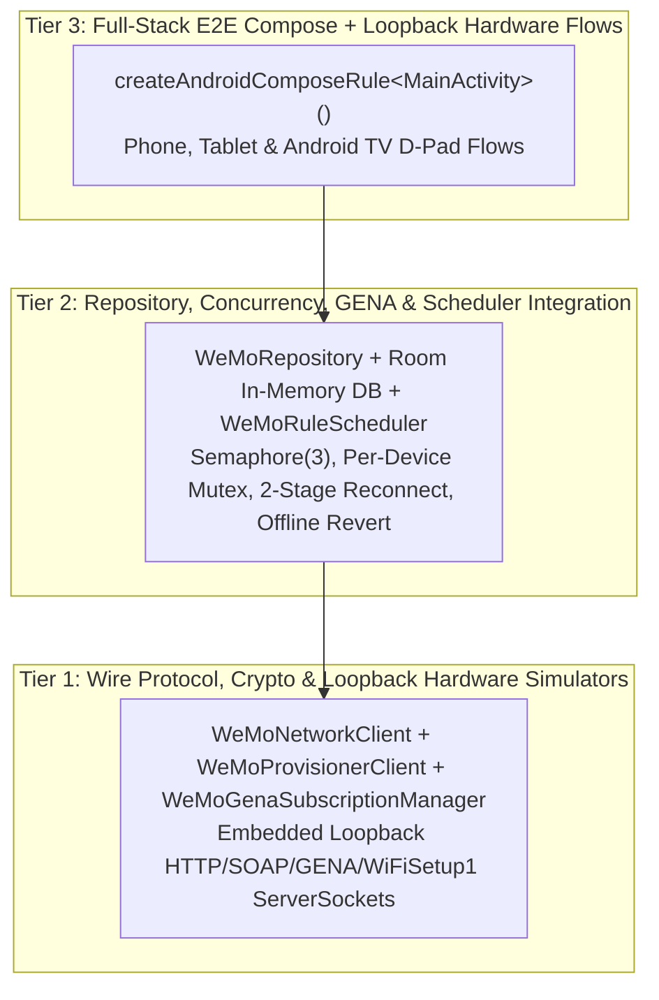

# Android End-to-End (E2E) Testing & Implementation Validation Skill

Use this skill when designing, writing, refactoring, or executing unit, protocol, and end-to-end (E2E) UI tests for Android and Android TV applications (including `MichaelRHead/WeMi-light-control`).

---

## 1. Testing Philosophy: Hermetic, Fast, Full-Stack Validation

For a local-LAN hardware controller app, mocking `WeMoRepository` or `WeMoNetworkClient` with synthetic stubs hides the bugs that matter most in production (socket timeouts, UPnP port shifts, XML quirks, concurrency deadlocks, and optimistic UI rollback).

Instead, follow a **3-Tier Hermetic Testing Pyramid** that runs deterministically on the JVM via JUnit 4 + Robolectric + Jetpack Compose UI Test (`./gradlew testDebugUnitTest`) in seconds without requiring physical switches or an external emulator:



---

## 2. Modular Test Suite Organization

Never let a single test file grow into a 1,200+ line monolith. Organize tests by architectural responsibility (targeting **150–350 lines per test file**) with a shared loopback hardware fixture:

1. **Shared Loopback Hardware Fixture (`FakeWeMoUpnpServer.kt`)**:
   - Encapsulates a lightweight `ServerSocket(0)` bound to `127.0.0.1` that simulates a real Belkin WeMo switch, dimmer, motion sensor, or `10.22.22.1` setup AP.
   - Supports configurable `/setup.xml` / `/Lightsetup.xml`, `GetBinaryState`, `SetBinaryState` (including `<BinaryState>Error</BinaryState>` quirk mode), `GetMetaInfo`, `GetSignalStrength`, `ConfigureNightMode`, `ChangeFriendlyName`, `SUBSCRIBE /upnp/event/basicevent1` (including simulated HTTP 412 expiry), and `WiFiSetup1` (`GetApList`, `GetNetworkList`, `ConnectHomeNetwork`, `GetNetworkStatus`, `CloseSetup`).
   - Supports simulated **port shifting** (closing port $A$ and opening port $B$ with the same `<serialNumber>`) and **DHCP IP swap hazards** (serving a different `<serialNumber>` on the old IP:port).
2. **Tier 1 — Stateless Parsers, SKU Classification & Crypto (`WeMoSkuAndCryptoTest.kt`)**:
   - Validates `classifyHardwareSku` across all 4 hardware families (`F7C030`, `WLS040`/`WLS0403`, `F7C059`/`WDS060`, `F7C063`/`WSP080`).
   - Validates `parseSetupXmlDescriptor` (`<binaryState>0</binaryState>` vs `<binaryState>1</binaryState>`, `<brightness>`, `<rtos>`).
   - Validates `classifyDeviceCategory` (`CHRISTMAS_TREE`, `FAN`, `LIGHT`, `MOTION_SENSOR`, `SWITCH_PLUG`) and `inferRoomFromName`.
   - Validates `pywemo` OpenSSL AES-128-CBC round-trip `encryptWifiPassword` / `decryptWifiPassword` across Methods 1 (OpenWrt), 2 (RTOS), and 3 (`binaryOption`).
3. **Tier 2 — Loopback SOAP Control, Self-Healing & Provisioning (`WeMoProtocolAndHealingTest.kt` & `WeMoProvisioningAndGenaTest.kt`)**:
   - **Startup State Detection**: Parallel `detectStartupDeviceStates` across `ON`, `OFF (Accessible Standby)`, and `Disconnected` switches.
   - **9-Port Probing & Port-Hop Healing**: Verifies `probeWemoPort` recovers when a switch hops from `49153` to `49154` and aborts when `<serialNumber>` mismatches.
   - **Real LAN Mode Offline Revert**: Verifies that toggling an unreachable switch in Real LAN Mode (`isDemoShowroomMode = false`) reverts `isOn` to its prior value and sets `isReachable = false, latencyMs = 0`.
   - **UPnP GENA Push & Echo Suppression**: Verifies `SUBSCRIBE`, HTTP 412 recovery, `<e:propertyset>` `NOTIFY` push updates (`<100ms`), and `1200ms` echo suppression after local `SetBinaryState`.
   - **Zero-Cloud `WiFiSetup1` Provisioning**: Full loopback flow from `probeSetupDevice` → `GetApList`/`GetNetworkList` → `ConnectHomeNetwork` double-send → `GetNetworkStatus` multi-poll → `CloseSetup` + `SetSetupDoneStatus` → automatic Room device insertion.
4. **Tier 3 — End-to-End Compose UI & User Journey Tests (`WeMoEndToEndUiTest.kt`)**:
   - Uses `createAndroidComposeRule<MainActivity>()` to validate complete human user journeys:
     - **Journey A (Multi-Home & Room Master Control)**: Switch between remembered Wi-Fi Homes, verify room grouping, trigger room-wide master power toggle and room brightness slider, and verify SOAP log telemetry.
     - **Journey B (3-State VisualSemantics & Interactive Toggling)**: Verify `ON` (active teal + power ring), `OFF Accessible Standby` (slate + warm amber standby LED + power ring), and `Disconnected` (dashed red outline + `Retry` button) badges and semantic category badges (`Tree Lights`, `Fan`, `Light`, `Motion`, `Switch`), then toggle `ON ↔ OFF` and verify immediate state transition.
     - **Journey C (Fresh-Device Setup AP Provisioning Wizard)**: Open `ProvisionWeMoApDialog`, scan APs, type a custom name (`"Porch Christmas Tree"`), verify live semantic category preview updates to `"Icon Category: Tree Lights"`, submit provisioning, and verify the new switch appears in `devices_list`.
     - **Journey D (Rules, Auto-Off Countdowns & 10-Foot Android TV Mode)**: Navigate to Rules & More tabs, toggle Demo Showroom vs. Real LAN Mode, launch Android TV 10-foot D-Pad mode (`header_tv_mode_button`), trigger TV scenes (`tv_scene_movie`), and return to phone mode.

---

## 3. Compose Semantic `testTag` Conventions

Every interactive or status-bearing Compose element must expose a deterministic `Modifier.testTag(...)` so E2E tests never rely on fragile layout hierarchy indexing:
- Device Row container: `"device_row_${device.id}"`
- Power Ring button: `"power_button_${device.id}"`
- Reconnect / Retry button: `"reconnect_button_${device.id}"`
- Status Badges (use `useUnmergedTree = true` when inside clickable rows):
  - `"connection_status_badge_${device.id}"`
  - `"power_state_badge_${device.id}"`
  - `"category_badge_${device.id}"`
- Room Group header & toggle: `"room_header_$roomName"`, `"room_power_toggle_$roomName"`
- Empty-Home Onboarding Card (`EmptyDevicesState`): `"empty_devices_state_card"`, `"empty_state_scan_ssdp_button"`, `"empty_state_provision_ap_button"`, `"empty_state_add_manual_button"`, `"empty_state_restore_classic_button"`
- Navigation & Modals: `"nav_tab_devices"`, `"nav_tab_rules"`, `"nav_tab_more"`, `"add_device_button"`, `"open_provision_ap_wizard_button"`, `"provision_ap_status_box"`, `"provision_status_box"`, `"confirm_provision_ap_button"`

---

## 4. Mandatory Pre-Push Verification Gate

Before pushing any code or test changes to GitHub:
```bash
# 1. Execute all unit, loopback protocol, and Robolectric Compose E2E tests
./gradlew testDebugUnitTest

# 2. Assemble the debug APK to verify resource linking, manifest merging, and KSP Room codegen
./gradlew assembleDebug
```
Both commands must exit with code `0` and zero test failures.
