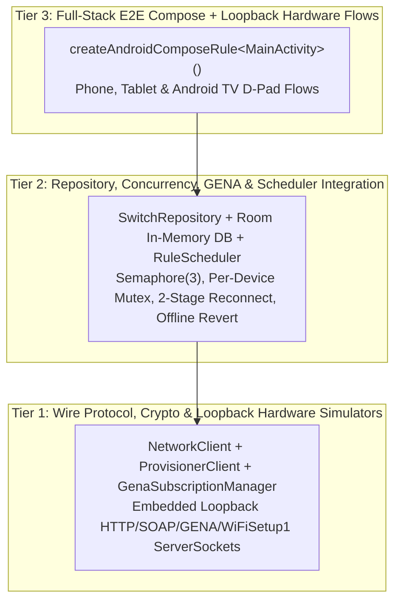

# Android End-to-End (E2E) Testing & Implementation Validation Skill

Use this skill when designing, writing, refactoring, or executing unit, protocol, and end-to-end (E2E) UI tests for Android and Android TV applications (including `MichaelRHead/WeMi-light-control`).

---

## 1. Testing Philosophy: Hermetic, Fast, Full-Stack Validation

For a local-LAN hardware controller app, mocking `SwitchRepository` or `NetworkClient` with synthetic stubs hides the bugs that matter most in production (socket timeouts, UPnP port shifts, XML quirks, concurrency deadlocks, and optimistic UI rollback).

Instead, follow a **3-Tier Hermetic Testing Pyramid** that runs deterministically on the JVM via JUnit 4 + Robolectric + Jetpack Compose UI Test (`./gradlew testDebugUnitTest`) in seconds without requiring physical switches or an external emulator:



---

## 2. Modular Test Suite Organization (`app/src/test/java/org/suppressingfire/wemi/`)

Never let a single test file grow into a 1,200+ line monolith. Organize tests by architectural responsibility (targeting **150–350 lines per test file**) with a shared loopback hardware fixture:

1. **Shared Loopback Hardware Fixture (`FakeUpnpServer.kt`)**:
   - Encapsulates a lightweight `ServerSocket(0)` bound to `127.0.0.1` that simulates a real Belkin WeMo switch, dimmer, motion sensor, or `10.22.22.1` setup AP.
   - Supports configurable `/setup.xml` / `/Lightsetup.xml`, `GetBinaryState`, `SetBinaryState` (including `<BinaryState>Error</BinaryState>` quirk mode), `GetMetaInfo`, `GetSignalStrength`, `ConfigureNightMode`, `ChangeFriendlyName`, `SUBSCRIBE /upnp/event/basicevent1` (including simulated HTTP 412 expiry), and `WiFiSetup1` (`GetApList`, `GetNetworkList`, `ConnectHomeNetwork`, `GetNetworkStatus`, `CloseSetup`).
   - Supports simulated **port shifting** (closing port $A$ and opening port $B$ with the same `<serialNumber>`) and **DHCP IP swap hazards** (serving a different `<serialNumber>` on the old IP:port).
2. **Tier 1 — Stateless Parsers, SKU Classification & Crypto (`SkuAndCryptoTest.kt`)**:
   - Validates `classifyHardwareSku` across all 4 hardware families (`F7C030`, `WLS040`/`WLS0403`, `F7C059`/`WDS060`, `F7C063`/`WSP080`).
   - Validates `parseSetupXmlDescriptor` (`<binaryState>0</binaryState>` vs `<binaryState>1</binaryState>`, `<brightness>`, `<rtos>`).
   - Validates `classifyDeviceCategory` (`CHRISTMAS_TREE`, `FAN`, `LIGHT`, `MOTION_SENSOR`, `SWITCH_PLUG`) and `inferRoomFromName`.
   - Validates first-party OpenSSL `EVP_BytesToKey` AES-128-CBC round-trip `encryptWifiPassword` / `decryptWifiPassword` across Methods 1 (OpenWrt), 2 (RTOS), and 3 (`binaryOption`).
3. **Tier 2 — Loopback SOAP Control, Self-Healing, Provisioning & License Governance (`SoapAndSelfHealingTest.kt`, `GenaProvisioningAndRulesTest.kt` & `LicenseAndBrandGovernanceTest.kt`)**:
   - **Startup State Detection**: Parallel `detectStartupDeviceStates` across `ON`, `OFF (Accessible Standby)`, and `Disconnected` switches.
   - **9-Port Probing & Port-Hop Healing**: Verifies `probeWemoPort` recovers when a switch hops from `49153` to `49154` and aborts when `<serialNumber>` mismatches.
   - **Real LAN Mode Offline Revert & Night Mode Port-Healing**: Verifies that toggling an unreachable switch or dimmer Night Mode (`toggleDimmerNightMode`) in Real LAN Mode (`isDemoShowroomMode = false`) reverts optimistic state and sets `isReachable = false, latencyMs = 0`, while reachable dimmers self-heal across shifted ports and background polls (`pollActiveHomeStates`) respect `2000ms` echo suppression.
   - **UPnP GENA Push, Multi-Byte UTF-8 Byte-Framing & Echo Suppression**: Verifies `SUBSCRIBE`, HTTP 412 recovery, byte-exact `Content-Length` framing on multi-byte UTF-8 `<e:propertyset>` `NOTIFY` & `ChangeFriendlyName` payloads (`<100ms`, never stalling on character-count mismatch), and `1200ms` echo suppression after local `SetBinaryState`.
   - **Zero-Cloud `WiFiSetup1` Provisioning**: Full loopback flow from `probeSetupDevice` → `GetApList`/`GetNetworkList` → `ConnectHomeNetwork` double-send → `GetNetworkStatus` multi-poll → `CloseSetup` + `SetSetupDoneStatus` → automatic Room device insertion.
   - **MIT License, Dependency Footprint & Brand Hygiene (`LicenseAndBrandGovernanceTest.kt`)**: Verifies root `LICENSE` parity with `MoreScreen.kt`, minimal `Apache-2.0` dependency footprint (zero external HTTP/font bloat), `org.suppressingfire.wemi` package/filename hygiene, and Play Store trademark boundaries.
4. **Tier 3 — End-to-End Compose UI & User Journey Tests (`ExampleRobolectricTest.kt`, `EndToEndUiTest.kt`, `HardwareCujEndToEndTest.kt` & `TvAndHeaderLayoutE2ETest.kt`)**:
   - Uses `createAndroidComposeRule<MainActivity>()` to validate complete human user journeys (`35/35` total tests across 9 suites):
     - **Journey A (Multi-Home & Room Master Control)**: Switch between remembered Wi-Fi Homes, verify room grouping, trigger room-wide master power toggle and room brightness slider, and verify SOAP log telemetry.
     - **Journey B (3-State VisualSemantics & Interactive Toggling)**: Verify `ON` (active teal + power ring), `OFF Accessible Standby` (slate + warm amber standby LED + power ring), and `Disconnected` (dashed red outline + `Retry` button) badges and semantic category badges (`Tree Lights`, `Fan`, `Light`, `Motion`, `Switch`), then toggle `ON ↔ OFF` and verify immediate state transition.
     - **Journey C (Zero-Cloud `10.22.22.1` Setup AP Hardware Scan, AES Method 2 Provisioning & Screenshot Telemetry Export — `HardwareCujEndToEndTest`)**: Open `ProvisionApDialog` pointed at a live loopback `FakeUpnpServer` (`registerAsCandidatePort = true`), scan 2.4 GHz APs over HTTP/SOAP, provision a 2nd-Gen `WLS0403` RTOS switch (`ChangeFriendlyName` + double `ConnectHomeNetwork` + `GetNetworkStatus` polls + `CloseSetup` + `SetSetupDoneStatus`), export `wemi-telemetry-latest.txt` via `copy_provision_debug_button`, and verify the provisioned switch appears in the Compose `Devices` list.
     - **Journey D (Full-Stack Reset → SSDP UDP Discovery → Adopt Switch & Dimmer → Toggle & Scale Brightness — `HardwareCujEndToEndTest`)**: Reset all LAN homes/switches/rooms, discover a switch and dimmer over loopback UDP `M-SEARCH`, adopt both, toggle the switch, and scale dimmer brightness via preset chips (`75%`, `21%`), continuous `Slider` drag, `Night Mode (20%)`, and Room Master dimmer slider.
     - **Journey E (Disconnected 9-Port Self-Healing Reconnect Ring, GENA Push UI Update & Live SOAP Log Export — `HardwareCujEndToEndTest`)**: Seed a switch on a stale port (`49159`), tap its Disconnected ring (`reconnect_button_${id}`) to heal onto `FakeUpnpServer.port`, push an unsolicited `NOTIFY` via `server.pushGenaNotify(callbackPort = server.lastGenaCallbackPort.get(), ...)` and verify the Compose UI row transitions automatically from `ON` to `OFF`, then export telemetry from the `More` tab (`export_telemetry_file_button`).
     - **Journey F (Single-Row `TopHeader` Geometry & Native Android TV 3-Column Room-Grouped D-Pad `DIM -/+` Loopback SOAP Control — `TvAndHeaderLayoutE2ETest`)**: Verify single-row horizontal alignment (`brand_wordmark_text`, `refresh_devices_button`, `edit_devices_button`, `add_device_button`) on mobile/tablet, and under `@Config(sdk = [36], qualifiers = "television")` discover 3 loopback `FakeUpnpServer` devices via `tv_scan_button`, verify `"Unassigned"` sorts below named rooms, toggle switches with hardware `Key.DirectionCenter`, enter `"DIM -/+"` via `Key.MediaPlayPause`, step brightness `+10%` via `Key.DirectionRight`, exit via `Key.DirectionCenter`, and toggle Room Master (`tv_room_header_<Room>`) over live loopback SOAP.

---

## 3. Compose Semantic `testTag` Conventions

Every interactive or status-bearing Compose element must expose a deterministic `Modifier.testTag(...)` so E2E tests never rely on fragile layout hierarchy indexing:
- Top Header single-row controls: `"brand_wordmark_text"`, `"refresh_devices_button"`, `"edit_devices_button"`, `"add_device_button"`
- Device Row container & name: `"device_row_${device.id}"`, `"device_name_${device.id}"`
- Power Ring button: `"power_button_${device.id}"`
- Reconnect / Retry button: `"reconnect_button_${device.id}"`
- Inline Diagnostics & Edit Mode: `"ping_device_${device.id}"`, `"edit_device_${device.id}"`, `"delete_device_${device.id}"`
- Status Badges (use `useUnmergedTree = true` when inside clickable rows):
  - `"connection_status_badge_${device.id}"`
  - `"power_state_badge_${device.id}"`
  - `"category_badge_${device.id}"`
- Room Group header & toggle: `"room_header_$roomName"`, `"room_power_toggle_$roomName"`
- Android TV 10-foot Dashboard (`wemi TV`): `"tv_dashboard_screen"`, `"tv_device_grid"`, `"tv_room_header_$roomName"`, `"tv_room_dim_minus_$roomName"`, `"tv_room_dim_plus_$roomName"`, `"tv_device_card_${device.id}"`, `"tv_card_dim_mode_${device.id}"`, `"tv_dimmer_mode_toggle"`, `"tv_remote_dpad_ok"`, `"tv_scene_movie"`, `"tv_scene_holiday"`, `"tv_scene_bedtime"`, `"tv_scan_button"`
- Empty-Home Onboarding Card (`EmptyDevicesState`): `"empty_devices_state_card"`, `"empty_state_scan_ssdp_button"`, `"empty_state_provision_ap_button"`, `"empty_state_add_manual_button"`, `"empty_state_restore_classic_button"`
- Navigation & Modals: `"nav_tab_devices"`, `"nav_tab_rules"`, `"nav_tab_more"`, `"save_device_button"`, `"open_provision_ap_wizard_button"`, `"provision_ap_status_box"`, `"provision_status_box"`, `"confirm_provision_ap_button"`, `"add_rule_button"`, `"save_rule_button"`

---

## 4. Avoiding E2E Flakiness, Modal Scrim Traps & Socket Starvation

1. **Wall-Clock Loopback Pumping vs. `composeTestRule.waitUntil` (`awaitLoopbackIo` Pattern)**:
   - Under Robolectric, `composeTestRule.waitUntil(timeoutMillis)` spins the virtual `TestMainClock` in a tight CPU loop without sleeping real wall-clock time, starving background `Dispatchers.IO` and loopback `ServerSocket` threads (`FakeUpnpServer`).
   - Always use `awaitLoopbackIo` (which interleaves `composeTestRule.waitForIdle()` with `Thread.sleep(20)`) when waiting for background `Dispatchers.IO` / Room / loopback HTTP updates to propagate back to `Dispatchers.Main` and Compose UI.
2. **Synchronous Modal Dismissal Before Background Network Probes**:
   - Whenever an E2E test clicks **Save** in a modal dialog (`save_device_button`, `save_rule_button`) and then interacts with the underlying screen (`edit_devices_button`, `devices_list`), the ViewModel **must** dismiss the modal synchronously on the main thread (`_showAddDeviceDialog.value = false`, `_editingDevice.value = null`) *before* launching `viewModelScope.launch` / `Dispatchers.IO` probes (`repository.saveDevice`).
   - If modal dismissal happens inside the coroutine after `repository.saveDevice`, any probe against a non-loopback demo IP (`192.168.1.x`) will keep the modal scrim open on screen and swallow subsequent test clicks.
3. **Loopback `SocketFactory` & Per-Application Room DB Isolation**:
   - Ensure `NetworkMonitor.createWifiBoundSocketFactory` overrides `0`-arg `createSocket()` with a wrapper that skips `wifiNet.bindSocket(this)` when `inetAddr.isLoopbackAddress` (`127.0.0.1`) or under Robolectric.
   - Ensure `SwitchDatabase.getDatabase` tracks `lastAppContext` and uses `Room.inMemoryDatabaseBuilder(...).allowMainThreadQueries()` under Robolectric so consecutive `@Test` methods in a suite never share stale SQLite connections or dirty tables.
4. **Flag Suspiciously Slow Individual UI Tests (`> 3s` Red Flag)**:
   - Inspect per-test durations in `app/build/test-results/testDebugUnitTest/TEST-*.xml`. Every loopback UI test (after initial Robolectric classloading on the first test) should complete in **`0.5s – 1.5s`**.
   - Any test taking `> 3s` indicates a background coroutine is hitting a real TCP connect timeout on a non-loopback IP while holding a lock or blocking a UI transition.
5. **Single-SDK (`sdk = [36]`) Robolectric Classloader Convention**:
   - Always use `@Config(sdk = [36])` (or `@Config(sdk = [36], qualifiers = "television")` when testing Android TV qualifier overrides) across all Robolectric test classes and methods. Mixing multiple SDK levels (e.g., `sdk = [34]` alongside `sdk = [36]`) in the same test JVM forces Robolectric to load a second `android-all` JAR into memory, causing dual-SDK `ZipFileSystemProvider` collisions and heap exhaustion.

---

## 5. Mandatory Pre-Push Verification Gate (`--rerun-tasks`)

Never rely on a cached `UP-TO-DATE` Gradle test run after refactoring or syncing remote commits. Before pushing any code or test changes to GitHub:
```bash
# 1. Force-execute all unit, loopback protocol, and Robolectric Compose E2E tests
./gradlew testDebugUnitTest --rerun-tasks

# 2. Assemble the debug APK to verify resource linking, manifest merging, and KSP Room codegen
./gradlew assembleDebug
```
Both commands must exit with code `0`, zero test failures, and verified `TEST-*.xml` execution timestamps.
