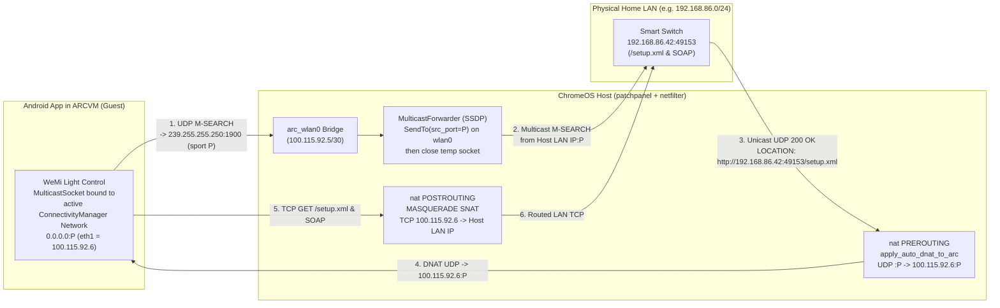

# WeMi Light Control — ChromeOS VM (ARCVM) Local-LAN Discovery Design (`CHROMEOS_ARCVM_DISCOVERY_DESIGN.md`)

**Status**: Proposed Design — **Not Yet Implemented** (Tracked as **Track 7** in [`UPCOMING_FEATURES.md`](UPCOMING_FEATURES.md))  
**Target Baseline**: `v33.0` (`org.suppressingfire.wemi`, `compileSdk = 36`, `targetSdk = 36`, `minSdk = 24`)  
**New Permissions Required**: **Zero** (uses existing 4 install-time LAN permissions: `INTERNET`, `ACCESS_NETWORK_STATE`, `ACCESS_WIFI_STATE`, `CHANGE_WIFI_MULTICAST_STATE`)  
**New Third-Party Dependencies**: **Zero** (pure JDK `java.net.*` + Android SDK `ConnectivityManager` / `WifiManager` / optional `NsdManager`)  
**Related Specs**: [`DISCOVERY_AND_ROOM_GROUPING.md`](DISCOVERY_AND_ROOM_GROUPING.md) *(read-only reference for non-owners)*, [`LICENSE_GOVERNANCE.md`](LICENSE_GOVERNANCE.md) *(read-only reference for non-owners)*, [`ARCHITECTURE.md`](ARCHITECTURE.md), [`UPCOMING_FEATURES.md`](UPCOMING_FEATURES.md)

---

## 1. Executive Summary

Yes — **WeMi Light Control can support local-LAN smart switch discovery and control inside ChromeOS Android VMs (ARCVM)** without adding permissions, native libraries, or third-party dependencies.

Modern Chromebooks run Android inside a crosvm virtual machine (**ARCVM**) networked through ChromiumOS's **`patchpanel`** daemon rather than bridging Android directly onto the physical Wi-Fi/Ethernet LAN. Crucially, ChromiumOS `patchpanel` **explicitly implements SSDP (`239.255.255.250:1900`) multicast forwarding** between ARCVM and the host's physical LAN interface, plus **automatic inbound UDP DNAT** for unicast `M-SEARCH` replies and **outbound TCP `MASQUERADE` SNAT** for `/setup.xml` and UPnP SOAP control calls.

Today, however, five specific assumptions in WeMi Light Control break or degrade on ARCVM because Android inside the VM only sees RFC 6598 (`100.115.92.x/30`) guest addresses and virtio-net `eth*` interfaces rather than the Chromebook host's physical LAN IPv4 (e.g., `192.168.86.x`):

1. **Wrong SSDP interface & missing `Network.bindSocket`** — raw `NetworkInterface` sorting can pick `arc0` (`100.115.92.2`) instead of the active shill-backed `TRANSPORT_WIFI`/`TRANSPORT_ETHERNET` interface (`100.115.92.6+`), and `SsdpDiscoveryEngine` never binds its UDP socket to Android's active `Network`.
2. **Broken Stage C `/24` unicast fallback** — `scanSubnetUnicast()` sweeps `100.115.92.1..254` (ChromeOS internal VM space) instead of the physical LAN `/24` subnet.
3. **Polluted `100.115.92.0/24` Home profiles** — `HomeProfileSanitizer` and `SwitchViewModel` auto-create and auto-switch to a phantom `"LAN 100.115.92.0/24"` Home.
4. **Unreachable GENA push callbacks** — `GenaSubscriptionManager` sends `CALLBACK: <http://100.115.92.x:8989/gena/...>` to physical wall switches, which cannot route back to `100.115.92.x` and can tie up embedded lwIP sockets on 2nd-Gen RTOS switches (`WLS040`, `WLS0403`, `WDS060`).
5. **No manual physical-subnet escape hatch** — on enterprise/mesh Wi-Fi networks that drop SSDP multicast completely, a fresh ARCVM install cannot infer the physical `/24` from its guest IP alone.

This document records the verified ChromiumOS `patchpanel` architecture, the exact codebase gaps, a 3-phase implementation plan that preserves every existing discovery/governance/modularity invariant, platform limitations, and a concrete test plan for future implementation.

---

## 2. Verified ChromeOS ARCVM Networking Architecture (`patchpanel`)

Findings below were verified directly against ChromiumOS `platform2/patchpanel` (`address_manager.cc`, `arc_service.cc`, `multicast_proxy.cc`, `multicast_forwarder.cc`, `datapath.cc`, `iptables/iptables.start.jinja2`).

### 2.1 Guest IPv4 Addressing (`100.115.92.0/24` `/30` Slicing)

`patchpanel::AddressManager` partitions RFC 6598 CGNAT space `100.115.92.0/24` into `/30` point-to-point subnets (host gateway = base + 1, guest = base + 2):

| Subnet | Guest IP | Purpose in ChromiumOS (`patchpanel`) | Multicast / Auto-DNAT to Physical LAN? |
| :--- | :--- | :--- | :--- |
| `100.115.92.0/30` | `100.115.92.2` | `arc0` (`kArc0`, bridged to `arcbr0`) — ARC management & VPN routing | **NO** (`ArcService` creates no `MulticastForwarder`, no `BroadcastForwarder`, and no `AddInboundIPv4DNAT`) |
| `100.115.92.4/30` .. `100.115.92.20/30` | `100.115.92.6`, `.10`, `.14`, `.18`, `.22` | Up to 5 shill-backed physical devices (`kArcNet`, bridged to `arc_wlan0`, `arc_eth0`, etc.) | **YES** (outbound SNAT, SSDP/mDNS `MulticastForwarder`, and inbound `apply_auto_dnat_to_arc`) |
| `100.115.92.24/30` .. `100.115.92.255` | `.26+` | Termina VM, host namespaces, Crostini LXD containers | Not exposed to ARCVM |

Key interface naming detail (`arc_service.cc`):
- Inside ARCVM, guest virtio-net NICs use `kArcVmIfnamePrefix = "eth"` (`eth0`, `eth1`, `eth2`, … via `ArcService::GuestIfManager`), **even when backed by host Wi-Fi** (`wlan0`).
- Android's network agent registers each shill-backed device in `ConnectivityManager` with the real host transport type (`TRANSPORT_WIFI` or `TRANSPORT_ETHERNET`), while `NetworkInterface.getNetworkInterfaces()` sees `eth*` names and `100.115.92.x` addresses.
- **Android inside ARCVM never sees the Chromebook's physical LAN IPv4** (e.g., `192.168.86.25`) in `NetworkInterface` or `LinkProperties.linkAddresses`.

### 2.2 SSDP Multicast Forwarding, `MulticastLock`, and Auto-DNAT Packet Flow

1. **Host Firewall (`iptables.start.jinja2`)**: ChromeOS `INPUT` explicitly allows `224.0.0.251:5353` (mDNS) and `239.255.255.250:1900` (SSDP).
2. **SSDP Forwarder (`multicast_proxy.cc` & `multicast_forwarder.cc`)**: `MulticastProxy` creates both an mDNS forwarder and an SSDP forwarder (`239.255.255.250:1900` IPv4 / `ff02::c:1900` IPv6) for each physical shill interface (`arc_wlan0` ↔ `wlan0`, `arc_eth0` ↔ `eth0`).
3. **Direction & `WifiManager.MulticastLock` (`arc_service.cc`)**:
   - `ArcService::AddDevice` starts Wi-Fi forwarding with at least `Direction::kOutboundOnly` (`kTwoWays` on Ethernet).
   - Acquiring Android's `WifiManager.MulticastLock` signals `NotifyAndroidWifiMulticastLockChange`, enabling `Direction::kInboundOnly` as well (upgrading Wi-Fi to `kTwoWays` so unsolicited SSDP `NOTIFY` advertisements also enter ARCVM).
4. **Outbound `M-SEARCH` Source-Port Preservation (`MulticastForwarder::SendTo`)**:
   - When an Android app sends `M-SEARCH` to `239.255.255.250:1900` from ephemeral UDP source port `P` on the shill-backed virtio NIC (`eth1` / `100.115.92.6`), `patchpanel` opens a temporary UDP socket bound to `(<lan_ifname>, P)` on the Chromebook host, transmits the `M-SEARCH` from `<chromebook_lan_ip>:P`, and immediately closes the temporary host socket.
5. **Inbound Unicast `200 OK` Reply via Auto-DNAT (`datapath.cc`)**:
   - Physical Belkin switches on the LAN send unicast UDP `HTTP/1.1 200 OK` replies (containing `LOCATION: http://192.168.86.42:49153/setup.xml`) back to `<chromebook_lan_ip>:P`.
   - Because `patchpanel` closed its temporary host socket, `nat PREROUTING` → `apply_auto_dnat_to_arc` skips `-m socket --nowildcard -j ACCEPT` and hits `-i <lan_if> -p udp -j DNAT --to-destination 100.115.92.6`, delivering the unicast UDP reply straight to ARCVM's bound UDP port `P`.
6. **Outbound TCP/HTTP/SOAP Control (`datapath.cc`)**:
   - Subsequent `GET http://192.168.86.42:49153/setup.xml` and `POST /upnp/control/basicevent1` traverse `POSTROUTING -m mark --mark 0x1/0x1 -j MASQUERADE` SNAT natively and transparently.

---

## 3. Audit of Current WeMi Light Control Gaps

| # | Gap | Current Code Location | Failure Mode on ChromeOS ARCVM |
| :--- | :--- | :--- | :--- |
| **1** | **Unbound SSDP UDP Socket & Raw Interface Pick** | [`LanRuntimeUtils.kt`](app/src/main/java/org/suppressingfire/wemi/network/LanRuntimeUtils.kt#L77-L106), [`NetworkClient.kt`](app/src/main/java/org/suppressingfire/wemi/network/NetworkClient.kt#L97-L98), [`SsdpDiscoveryEngine.kt`](app/src/main/java/org/suppressingfire/wemi/network/SsdpDiscoveryEngine.kt#L140-L158) | `resolveLocalIpv4Address()` bypasses `ConnectivityManager`. With no `wlan0` in ARCVM, sorting `eth*` can return `arc0`/`eth0` (`100.115.92.2`), which has **no** `MulticastForwarder` and **no** auto-DNAT. Even when `100.115.92.6` is chosen, `DatagramSocket(null)` is bound to a specific IP without `activeNetwork.bindSocket(socket)` or `MulticastSocket.networkInterface`, causing outbound multicast to exit the wrong interface or drop DNAT'd replies. |
| **2** | **Broken Stage C `/24` Unicast Fallback** | [`SsdpDiscoveryEngine.kt`](app/src/main/java/org/suppressingfire/wemi/network/SsdpDiscoveryEngine.kt#L51-L63), [`SsdpDiscoveryEngine.kt`](app/src/main/java/org/suppressingfire/wemi/network/SsdpDiscoveryEngine.kt#L292-L312), [`DeviceDescriptorFetcher.kt`](app/src/main/java/org/suppressingfire/wemi/network/DeviceDescriptorFetcher.kt#L84-L89) | `scanSubnetUnicast()` skips `10.0.2`, `10.22.22`, and `127.`, but **not** RFC 6598 (`100.64.0.0/10`, including `100.115.92`). When Stage A gets 0 Belkin hits, Stage C wastes time sweeping `100.115.92.1..254` instead of using the physical `/24` from saved homes, remembered switch IPs, non-Belkin `upnp:rootdevice` SSDP `LOCATION` headers (e.g., router IGD `192.168.86.1`), or private `LinkProperties.dnsServers`. |
| **3** | **Phantom `100.115.92.0/24` Home Profiles & Auto-Switch Thrash** | [`HomeProfileSanitizer.kt`](app/src/main/java/org/suppressingfire/wemi/data/HomeProfileSanitizer.kt#L254-L353), [`SwitchViewModel.kt`](app/src/main/java/org/suppressingfire/wemi/ui/SwitchViewModel.kt#L198-L215), [`WifiHomeBar.kt`](app/src/main/java/org/suppressingfire/wemi/ui/components/WifiHomeBar.kt#L264-L273) | Startup and `NetworkMonitor` callbacks create `"LAN 100.115.92.0/24"` and switch back to it on link updates, clobbering user-configured homes. `AddWifiHomeNetworkDialog` pre-fills `100.115.92` as the subnet prefix. |
| **4** | **Unreachable GENA Push Callbacks** | [`GenaSubscriptionManager.kt`](app/src/main/java/org/suppressingfire/wemi/network/GenaSubscriptionManager.kt#L318-L401), [`GenaAndHealthPollingCoordinator.kt`](app/src/main/java/org/suppressingfire/wemi/data/GenaAndHealthPollingCoordinator.kt#L83-L96) | `subscribeOrRenew()` advertises `CALLBACK: <http://100.115.92.6:8989/gena/...>` to physical switches. Switches cannot connect back to `100.115.92.6`, risking hung TCP `SYN` retries and lwIP socket exhaustion on 2nd-Gen RTOS switches (`WLS040`, `WLS0403`, `WDS060`). |
| **5** | **No Manual Physical-Subnet Escape Hatch on Multicast-Blocked LANs** | [`SsdpScannerModal.kt`](app/src/main/java/org/suppressingfire/wemi/ui/components/SsdpScannerModal.kt#L68-L180), [`WifiHomeBar.kt`](app/src/main/java/org/suppressingfire/wemi/ui/components/WifiHomeBar.kt#L264-L320) | If a Chromebook is on a strict mesh/enterprise AP that drops all multicast **and** uses public DNS (e.g., `8.8.8.8`), a fresh install has zero automatic hints for the physical `/24` subnet unless the user enters a subnet prefix (e.g., `192.168.1`) or adds a single switch IP first. |

**What Already Works Today (No Changes Needed)**:
- [`AndroidManifest.xml`](app/src/main/AndroidManifest.xml#L12-L20) already marks `android.hardware.touchscreen`, `android.hardware.wifi`, and `android.software.leanback` as `android:required="false"`, so the single APK installs cleanly on Chromebooks.
- [`NetworkMonitor.createWifiBoundSocketFactory()`](app/src/main/java/org/suppressingfire/wemi/network/NetworkMonitor.kt#L209-L252) already binds outbound TCP sockets (`LanHttpClient` → `/setup.xml`, `GetBinaryState`, `SetBinaryState`, `GetMetaInfo`) to the preferred `TRANSPORT_WIFI`/`TRANSPORT_ETHERNET` `Network`.
- Outbound TCP/SOAP control and 9-port self-healing (`probeWemoPort`) already traverse ChromeOS `MASQUERADE` SNAT cleanly once a switch's physical LAN IP is known.

---

## 4. Phased Implementation Design

### Architectural & Governance Guardrails (Read Before Implementing)

1. **Preserve All 6 Discovery Invariants** from [`DISCOVERY_AND_ROOM_GROUPING.md`](DISCOVERY_AND_ROOM_GROUPING.md) — never touch `DISCOVERY_AND_ROOM_GROUPING.md`, `LICENSE_GOVERNANCE.md`, `UX_DESIGN.md`, `UX_DESIGN_AND_EXPERIENCE.md`, `DEBUGGING_AND_SUPPORT.md`, or their exclusively owned skills when implementing as a non-owner.
2. **Preserve `< 500`-Line File Modularity**: Note that [`NetworkClient.kt`](app/src/main/java/org/suppressingfire/wemi/network/NetworkClient.kt) (`482L`), [`SwitchRepository.kt`](app/src/main/java/org/suppressingfire/wemi/data/SwitchRepository.kt) (`493L`), and [`SwitchViewModel.kt`](app/src/main/java/org/suppressingfire/wemi/ui/SwitchViewModel.kt) (`490L`) are already close to `500` lines. Place new pure subnet/ARCVM classification and candidate-subnet resolution logic in [`LanRuntimeUtils.kt`](app/src/main/java/org/suppressingfire/wemi/network/LanRuntimeUtils.kt) (`108L`) or a dedicated new helper `LanSubnetHintResolver.kt` *(new, under `org.suppressingfire.wemi.network`)* so every `.kt` file stays well below `500` lines.
3. **Preserve Zero-New-Permissions & Brand Boundaries** ([`LicenseAndBrandGovernanceTest.kt`](app/src/test/java/org/suppressingfire/wemi/LicenseAndBrandGovernanceTest.kt)):
   - Do **not** add any `<uses-permission>` entries to `AndroidManifest.xml`.
   - Do **not** add third-party libraries.
   - Any new user-visible strings in `ui/**/*.kt` or `res/values/strings.xml` (e.g., ChromeOS subnet hint or helper copy) must remain brand-neutral (`"smart switches"`, `"local network"`) with **zero** `"WeMo"`/`"Wemo"` literals.
4. **Preserve RTOS `Semaphore(3)` Protection**: Stage A/B/C descriptor enrichment and SOAP polling must continue respecting `Semaphore(3)` so 2nd-Gen RTOS switches (`WLS040`, `WLS0403`, `WDS060`) never experience lwIP socket starvation.

---

### Phase 1: ARCVM Detection, Active `Network` Selection & `MulticastSocket` Binding

**Goal**: Make Stage A SSDP multicast (`M-SEARCH` → `MulticastForwarder` → `apply_auto_dnat_to_arc`) work reliably on Chromebooks out of the box, without breaking physical Android phones, tablets, or Android TV.

#### 1.1 ChromeOS / ARCVM & RFC 6598 Classification (`LanRuntimeUtils.kt`)

Add pure, unit-testable classifiers to [`LanRuntimeUtils.kt`](app/src/main/java/org/suppressingfire/wemi/network/LanRuntimeUtils.kt):

- `isCarrierGradeNatIpv4(ipOrPrefix: String): Boolean`
  - Parses the first two IPv4 octets and returns `true` for **`100.64.0.0/10`** (`octet1 == 100 && octet2 in 64..127`), which covers ChromeOS ARCVM `100.115.92.x` as well as carrier/Tailscale/container CGNAT overlays.
- `isArcVmManagementIpv4(ip: String): Boolean`
  - Returns `true` for `100.115.92.1` and `100.115.92.2` (the `arc0` management/VPN `/30` subnet that has **no** `MulticastForwarder` or inbound auto-DNAT).
- `isPrivateRfc1918Ipv4(ipOrPrefix: String): Boolean`
  - Returns `true` for `10.0.0.0/8` (excluding `10.0.2.*` emulator and `10.22.22.*` setup AP), `172.16.0.0/12`, and `192.168.0.0/16`.
- `isArcVmRuntime(context: Context? = null, localIpv4: String? = null): Boolean`
  - Checks `context?.packageManager?.hasSystemFeature("org.chromium.arc") == true` or `"org.chromium.arc.device_management"` or `Build.DEVICE`/`Build.PRODUCT`/`Build.BRAND` indicators (`cheets`, `bertha`, `chromium`) **or** `localIpv4?.startsWith("100.115.92.") == true`.
  - Pure helper overload accepting `(hasArcFeature: Boolean, localIpv4: String?)` so JVM unit tests can exercise both ChromeOS and physical Android paths deterministically.

#### 1.2 `ConnectivityManager`-First Network & Interface Resolution (`NetworkMonitor.kt` & `NetworkClient.kt`)

1. **Extend `LanNetworkSnapshot` (`NetworkMonitor.kt`)**:
   - Add `val dnsServersIpv4: List<String> = emptyList()` (populated from `LinkProperties.dnsServers` filtered to non-loopback `Inet4Address` values) and `val isArcVmNatSubnet: Boolean = false` (`LanRuntimeUtils.isCarrierGradeNatIpv4(localIpv4)`).
2. **Harden `NetworkMonitor.findPreferredWifiOrLanNetwork(cm)` (`NetworkMonitor.kt:173-202`)**:
   - Reject `TRANSPORT_VPN` networks and reject any network whose IPv4 address is `100.115.92.2` (`isArcVmManagementIpv4`) when another `TRANSPORT_WIFI` or `TRANSPORT_ETHERNET` network exists.
   - Prefer `cm.activeNetwork` first if it carries `TRANSPORT_WIFI` or `TRANSPORT_ETHERNET` and is not VPN/`arc0`, while retaining the existing highest-priority `10.22.22.x` Setup AP override for physical phones connected to an unconfigured switch AP alongside cellular data.
   - Expose a companion helper `resolveActiveLanBinding(context: Context?): ActiveLanBinding?` returning `(network: Network?, interfaceName: String, localIpv4: String, dnsServersIpv4: List<String>)`.
3. **Update `NetworkClient.resolveLocalIpv4Address()` (`NetworkClient.kt:97-98`)**:
   - Query `NetworkMonitor.resolveActiveLanBinding(appContext)` first (skipping `ConnectivityManager` under `isRunningInRobolectric()` or falling back cleanly when `appContext == null`), and only fall back to `LanRuntimeUtils.resolvePreferredLanInterfaceIpv4()` when `ConnectivityManager` returns nothing.
   - In `LanRuntimeUtils.resolvePreferredLanInterfaceIpv4()`, deprioritize `arc0`, `tun*`, `tap*`, and `100.115.92.2` below active `wlan*` and non-`arc0` `eth*` interfaces so even the raw fallback avoids `arc0`.

#### 1.3 Network-Bound `MulticastSocket` in `SsdpDiscoveryEngine.kt`

Replace the plain `DatagramSocket(null)` setup in [`SsdpDiscoveryEngine.performSsdpDiscoveryScan()`](app/src/main/java/org/suppressingfire/wemi/network/SsdpDiscoveryEngine.kt#L140-L171):

1. **Resolve active `Network` and `NetworkInterface`**:
   - Look up `activeBinding = NetworkMonitor.resolveActiveLanBinding(appContext)` (when `!fastMode`).
   - Resolve `targetNetworkInterface = NetworkInterface.getByName(activeBinding.interfaceName)` (or fallback by matching `localIp`).
2. **Use `MulticastSocket(null)` bound to wildcard `0.0.0.0:0` + `activeNetwork.bindSocket(socket)`**:
   - Create `MulticastSocket(null)` with `reuseAddress = true` and `timeToLive = 4` (RFC/UPnP standard SSDP TTL).
   - Call `socket.bind(InetSocketAddress(0))` (wildcard ephemeral port `0.0.0.0:P`) so inbound DNAT'd unicast UDP replies on ARCVM are never dropped by a mismatched local interface address.
   - If `!fastMode && activeNetwork != null`, call `runCatching { activeNetwork.bindSocket(socket) }`.
   - If `!fastMode && targetNetworkInterface != null`, set `runCatching { socket.networkInterface = targetNetworkInterface }` (API 24+ compatible — `minSdk = 24`) so outbound multicast packets explicitly leave `eth1` (`100.115.92.6` → `arc_wlan0` → `MulticastForwarder`) rather than `arc0` (`100.115.92.2`).
3. **ARCVM `MulticastLock` Settle Window & Receive Deadline**:
   - On ARCVM (`isArcVmRuntime`), `WifiManager.MulticastLock.acquire()` notifies ChromeOS `patchpanel` over Mojo IPC asynchronously (`NotifyAndroidWifiMulticastLockChange`). Add a brief non-blocking `delay(100L)` after acquiring `multicastLock` when `isArcVm && !fastMode` before transmitting the first `M-SEARCH` burst.
   - Extend the Stage A receive deadline modestly on ARCVM (`2000L` ms with `retransmit` at `750L` ms, `soTimeout = 700` ms) to accommodate crosvm virtio-net + `patchpanel` forwarding jitter, while keeping `fastMode` (`220L` ms) and physical Android (`1250L` ms) unchanged.

---

### Phase 2: Physical-Subnet-Aware Stage C Unicast Fallback & Manual Subnet Override

**Goal**: Ensure Stage C unicast discovery works on ARCVM even when SSDP multicast replies from Belkin switches are dropped by a mesh router, IGMP snooping, or AP isolation.

#### 2.1 Guard `scanSubnetUnicast()` Against CGNAT / VM Subnets (`SsdpDiscoveryEngine.kt`)

In [`SsdpDiscoveryEngine.scanSubnetUnicast()`](app/src/main/java/org/suppressingfire/wemi/network/SsdpDiscoveryEngine.kt#L51-L63):
- Reject any `cleanPrefix` where `LanRuntimeUtils.isCarrierGradeNatIpv4(cleanPrefix)` is `true` (blocks `100.64.0.0/10`, preventing futile 254-host sweeps of `100.115.92.1..254`).
- Keep existing guards against `10.0.2`, `10.22.22`, and `127.`.

#### 2.2 Harvest Non-Belkin SSDP `LOCATION` Subnets During Stage A (`SsdpDiscoveryEngine.kt`)

Notice a free, zero-permission trick already enabled by [`SsdpDiscoveryEngine.kt:122-126`](app/src/main/java/org/suppressingfire/wemi/network/SsdpDiscoveryEngine.kt#L122-L126): WeMi **already** broadcasts `ST: upnp:rootdevice` alongside `urn:Belkin:service:basicevent:1`.
- Today, any non-Belkin UPnP responder (home router IGD at `192.168.86.1`, Chromecast, Sonos, smart TV, printer) replies with a valid `LOCATION: http://192.168.86.1:5000/rootDesc.xml` header — which `DeviceDescriptorFetcher.kt:84-89` correctly filters out as non-Belkin, **discarding the physical LAN `/24` clue**.
- In Stage A, record every `LOCATION` URL host IPv4 parsed from `seenLocations` into a `observedSsdpPeerIps: Set<String>` (extracting the host via `URI(loc).host` or regex, filtering through `LanRuntimeUtils.isPrivateRfc1918Ipv4(host)`).
- Even if Belkin switches failed to respond to UDP multicast while the router or a TV did, WeMi immediately learns the Chromebook's real physical LAN `/24` (e.g., `192.168.86`)!

#### 2.3 Deterministic 5-Tier Candidate Physical Subnet Resolver (`LanSubnetHintResolver.kt`)

Create a small, pure helper `LanSubnetHintResolver.resolveCandidateSubnets(...)` that returns an ordered, deduplicated list of up to `2` RFC 1918 `/24` prefixes (never returning `100.64.0.0/10`, `10.22.22`, `10.0.2`, or `127.*`):

| Priority | Source | Example | Reliability on ARCVM |
| :--- | :--- | :--- | :--- |
| **Tier 1** | Explicit user-provided manual subnet override (from `SsdpScannerModal` or `AddWifiHomeNetworkDialog`) | `192.168.86` | 100% deterministic |
| **Tier 2** | Active `HomeNetworkEntity.subnetPrefix` (if RFC 1918 and not `100.64.0.0/10` / placeholder) | `192.168.86` | 100% after first setup |
| **Tier 3** | Remembered `DeviceEntity.ipAddress` `/24` prefixes in the active Home (sorted by frequency) | `192.168.86` | 100% once >=1 switch is saved |
| **Tier 4** | Physical LAN IPv4s harvested from Stage A non-Belkin `upnp:rootdevice` SSDP `LOCATION` headers (plus optional `NsdManager` `_http._tcp` / `_googlecast._tcp` mDNS browse when `patchpanel` forwards mDNS on `224.0.0.251:5353`) | `192.168.86` (from router IGD) | Very high on home routers |
| **Tier 5** | Private RFC 1918 `LinkProperties.dnsServers` (when ChromeOS passes the router's LAN DNS IP like `192.168.86.1` rather than a `100.115.92.x` proxy or `8.8.8.8`) | `192.168.86` | Medium (router-dependent) |
| **Fallback (Non-ARCVM Only)** | Local interface IPv4 prefix (`localIp.substringBeforeLast('.')`) when `isPrivateRfc1918Ipv4(localIp)` | `192.168.1` | Standard Android behavior (unchanged) |

- Wire `candidateSubnets: List<String>` from `DiscoveryCoordinator.reconnectAndRediscoverHome()` and `DiscoveryCoordinator.executeSsdpScan()` into `NetworkClient.performSsdpDiscoveryScan(...)` → `SsdpDiscoveryEngine.performSsdpDiscoveryScan(...)`.
- In Stage C, sweep the top candidate `/24` prefix (and up to a second distinct candidate only if the first yields 0 switches), keeping total sweep duration bounded (`Semaphore(24)`, `180ms` TCP connect timeout).
- Record `scannedSubnets: List<String> = emptyList()` and `isArcVmEnvironment: Boolean = false` on [`SsdpScanReport`](app/src/main/java/org/suppressingfire/wemi/network/NetworkModels.kt#L30-L38) so `SsdpScannerModal` and the SOAP Packet Log show clear diagnostics (e.g., `"ChromeOS VM detected (100.115.92.6) • Scanned 192.168.86.0/24"`).

#### 2.4 Manual `/24` Subnet Input Escape Hatch (`SsdpScannerModal.kt` & `WifiHomeBar.kt`)

When `scanReport.isArcVmEnvironment` is `true` (or `localIp` is RFC 6598) and `discoveredDevices.isEmpty()`:
- Display a compact, brand-neutral hint row inside [`SsdpScannerModal.kt`](app/src/main/java/org/suppressingfire/wemi/ui/components/SsdpScannerModal.kt) explaining that ChromeOS runs Android in a virtual network (`100.115.92.x`) and offering an inline **"Scan Home Subnet (e.g. 192.168.1)"** text input + **"Scan Subnet"** button (`testTag("ssdp_manual_subnet_input")` / `testTag("ssdp_scan_manual_subnet_button")`).
- Submitting a valid `/24` prefix (e.g., `192.168.86`) immediately runs `executeSsdpScan(manualSubnetOverride = "192.168.86")` and updates the active Home's `subnetPrefix` once switches are found.
- In [`AddWifiHomeNetworkDialog`](app/src/main/java/org/suppressingfire/wemi/ui/components/WifiHomeBar.kt#L264-L273), if `LanRuntimeUtils.isCarrierGradeNatIpv4(detectedLocalIp)` is `true`, do **not** pre-fill `100.115.92`; leave `subnetPrefix` blank with placeholder `"192.168.1"` so the user enters their real home router subnet.

*(Note: Coordinate any visual layout adjustments in `SsdpScannerModal.kt` / `WifiHomeBar.kt` with [`UX_DESIGN.md`](UX_DESIGN.md) invariants: `>= 48.dp` touch targets, single-line non-wrapping compact controls, and brand-neutral copy.)*

---

### Phase 3: Home Profile Hygiene & GENA Safety on ARCVM

**Goal**: Stop ARCVM's `100.115.92.x` guest IP from polluting Room `wemo_home_networks` profiles or sending unroutable GENA `CALLBACK` URLs to hardware switches.

#### 3.1 Prevent Phantom `100.115.92.0/24` Homes (`HomeProfileSanitizer.kt` & `SwitchViewModel.kt`)

1. **`HomeProfileSanitizer.resolveOrCreateHomeForSubnet()` (`HomeProfileSanitizer.kt:329-353`)**:
   - Return `null` immediately when `LanRuntimeUtils.isCarrierGradeNatIpv4(subnetPrefix)` is `true` (just like `subnetPrefix == "10.22.22"` today).
   - This prevents `SwitchViewModel.kt:198-215` `NetworkCallback` events from creating a bogus `"Home (100.115.92.x)"` profile or forcibly switching away from the user's real Home on every ChromeOS Wi-Fi wake/roam event.
2. **`HomeProfileSanitizer.sanitizeAndResolveInitialLanHome(localIp)` (`HomeProfileSanitizer.kt:254-323`)**:
   - When `LanRuntimeUtils.isCarrierGradeNatIpv4(localIp)` is `true`:
     - If any existing `HomeNetworkEntity` exists in Room (especially one with a real RFC 1918 `subnetPrefix`), select it rather than trying to match `100.115.92`.
     - If Room has **no** homes yet (first launch on a Chromebook), create a clean default Home with `networkKey = "wifi_lan_chromeos_default"`, `homeName = "My Home"`, `ssidLabel = "Local LAN"`, `subnetPrefix = ""` (unset pending first discovered switch or manual subnet), and `gatewayIp = ""`.
     - Repair any previously persisted polluted `100.115.92` home if its devices actually live on an RFC 1918 subnet (inferring the real `/24` from its saved `DeviceEntity.ipAddress` entries).
3. **Automatic Home `subnetPrefix` Backfill (`HomeProfileSanitizer.kt`)**:
   - Add `syncHomeSubnetFromDiscoveredDevices(networkKey: String, discovered: List<SsdpDiscoveredDevice>)` (mirroring `syncFirstRouterSsid`).
   - When the active Home's `subnetPrefix` is blank or CGNAT (`100.64.0.0/10`) and a switch is discovered or manually added on an RFC 1918 IP (e.g., `192.168.86.42`), update the Home's `subnetPrefix = "192.168.86"`, `gatewayIp = "192.168.86.1"`, and generic `"LAN ..."` `ssidLabel` (if no real router SSID was learned from `GetMetaInfo`) automatically.

#### 3.2 GENA Callback Safety & Polling Behavior (`GenaSubscriptionManager.kt` & `SwitchViewModel.kt`)

1. **Skip Unroutable GENA `SUBSCRIBE` Calls (`GenaSubscriptionManager.kt:318-401`)**:
   - In `subscribeOrRenew()`, resolve `localIp` **before** starting the callback server or issuing `SUBSCRIBE`.
   - If `device.ipAddress != "127.0.0.1"` and `LanRuntimeUtils.isCarrierGradeNatIpv4(localIp)` is `true`, return `null` immediately (do not start the `8989` listener or send `CALLBACK: <http://100.115.92.x:8989/gena/...>`).
   - **Why this matters**: Physical switches on `192.168.86.x` cannot route TCP connections to `100.115.92.x`. Sending an unroutable `CALLBACK` causes the switch's embedded UPnP stack to repeatedly attempt outbound TCP `SYN`s to an unreachable address, which on 2nd-Gen RTOS switches (`WLS040`, `WLS0403`, `WDS060`) consumes scarce lwIP sockets and can temporarily wedge SOAP responsiveness.
   - Note: Loopback E2E tests (`device.ipAddress == "127.0.0.1"`) are explicitly exempted so all existing hermetic GENA tests keep passing unchanged.
2. **Polling Cadence on ARCVM (`SwitchViewModel.kt:238-254`)**:
   - Without GENA push callbacks, physical wall-paddle state changes sync via `repository.pollActiveHomeStates(key)`.
   - The existing `30s` `GetBinaryState` poll works out of the box (bounded by `Semaphore(3)`). Optionally tighten the foreground poll interval to `10–15s` **only** when `isArcVmRuntime` is true and GENA is skipped, balancing snappy wall-paddle updates against RTOS politeness.
   - Log a single informative SOAP log entry on session start (or in `TelemetryFileExporter` diagnostics) noting `"GENA push skipped in ChromeOS VM (NAT guest IP 100.115.92.x); using SOAP state polling"` so troubleshooting traces remain transparent.

---

## 5. Known Platform Boundaries & Non-Goals

| Scenario | Behavior on ChromeOS ARCVM | Design Stance / Mitigation |
| :--- | :--- | :--- |
| **`10.22.22.1` Setup AP Auto-Detection** | Connecting the Chromebook host to a factory-reset switch's soft-AP (`WeMo.Light.xxx`) still presents a `100.115.92.x` IP to ARCVM, so `NetworkMonitor`'s `prefix == "10.22.22"` auto-banner will **not** trigger automatically. | **Manual Setup Still Works**: Tapping **More → Provision New Setup AP** sends outbound TCP directly to `10.22.22.1:49152` over ChromeOS SNAT, which remains routable if the host Wi-Fi is associated with the switch AP. Document as a known Chromebook caveat when shipping. |
| **Active ChromeOS / Android VPN** | VPNs inside ARC route through `arc0`/TUN, bypassing shill's `MulticastForwarder` and physical LAN routes. | Expected OS behavior; advise temporarily pausing VPN during switch discovery/control. |
| **Strict Enterprise / Mesh AP Isolation + Public DNS** | Blocks all UDP multicast (including non-Belkin `upnp:rootdevice` and mDNS) and hides the router's RFC 1918 DNS IP. | Handled cleanly by the Phase 2.4 manual `/24` subnet scan input in `SsdpScannerModal` or adding a single switch by IP (`+` button). |
| **Future `targetSdk = 37` (Android 17)** | Current `targetSdk = 36` allows local LAN sockets with `INTERNET` alone. Android 17 introduces a runtime `ACCESS_LOCAL_NETWORK` permission for local-LAN traffic. | Out of scope for Track 7 (`targetSdk = 36`), but note before any future `targetSdk = 37` bump so ChromeOS and Android 17 LAN permissions are handled together. |
| **ChromeOS Linux (Crostini) / Lacros** | Not an Android runtime. | Out of scope; this design targets ChromeOS's Android runtime (ARCVM). |

---

## 6. Verification & Test Plan (For Future Implementation)

### 6.1 Automated Hermetic JVM / Robolectric Tests (Zero Hardware Required)

Add a dedicated test suite (e.g., `ChromeOsArcVmDiscoveryTest.kt`, `< 500` lines) plus targeted additions to existing suites:

1. **RFC 6598 & ARCVM Classifiers (`LanRuntimeUtils`)**:
   - Verify `isCarrierGradeNatIpv4` returns `true` for `100.64.0.1`, `100.115.92.2`, `100.115.92.6`, `100.127.255.254` and `false` for `100.63.255.254`, `100.128.0.1`, `192.168.1.50`, `10.0.0.5`, `172.16.0.1`.
   - Verify `isArcVmManagementIpv4` matches `100.115.92.1` / `100.115.92.2` and not `100.115.92.6`.
   - Verify `isPrivateRfc1918Ipv4` accepts `192.168.*`, `172.16..31.*`, `10.*` and rejects `10.0.2.*`, `10.22.22.*`, `100.115.92.*`, `8.8.8.8`.
2. **Stage C Subnet Guard & 5-Tier Candidate Resolution (`LanSubnetHintResolver` + `SsdpDiscoveryEngine`)**:
   - Verify `scanSubnetUnicast("100.115.92")` immediately returns `emptyList()` without opening sockets.
   - Verify strict priority order: manual override > active Home RFC 1918 prefix > remembered device subnets (by frequency) > harvested non-Belkin SSDP `LOCATION` host IP > private RFC 1918 DNS server > local RFC 1918 IP.
   - Verify non-Belkin `upnp:rootdevice` SSDP response (`LOCATION: http://192.168.86.1:5000/rootDesc.xml`) is excluded from `discoveredDevices` yet populates the Stage C candidate subnet `192.168.86`.
3. **Home Profile Hygiene (`HomeProfileSanitizer`)**:
   - Verify `resolveOrCreateHomeForSubnet("100.115.92")` returns `null` and does not insert a phantom Home or overwrite the active Home.
   - Verify `sanitizeAndResolveInitialLanHome("100.115.92.6")` preserves an existing RFC 1918 Home, or creates a clean `"My Home"` with blank `subnetPrefix` on a fresh Chromebook install, and repairs a legacy `100.115.92` Home when saved devices live on `192.168.86.x`.
   - Verify `syncHomeSubnetFromDiscoveredDevices` backfills `subnetPrefix = "192.168.86"` and `gatewayIp = "192.168.86.1"` when the first switch is discovered or added.
4. **GENA Safety (`GenaSubscriptionManager`)**:
   - Verify `subscribeOrRenew()` returns `null` without sending HTTP `SUBSCRIBE` or binding port `8989` when `localIpProvider()` returns `100.115.92.6` and `device.ipAddress` is `192.168.86.42`.
   - Verify `subscribeOrRenew()` still succeeds for `127.0.0.1` loopback test devices and normal RFC 1918 local IPs (`192.168.86.25`).
5. **Compose UI E2E (`SsdpScannerModal` & `AddWifiHomeNetworkDialog`)**:
   - Verify `AddWifiHomeNetworkDialog` does not pre-fill `100.115.92` when `detectedLocalIp = "100.115.92.6"`.
   - Verify `SsdpScannerModal` renders the manual `/24` subnet scan fallback when `isArcVmEnvironment = true` and `discoveredDevices` is empty, and invokes the scan callback cleanly.
6. **Mandatory Pre-Push Gate**:
   - `sh gradlew testDebugUnitTest --rerun-tasks lintDebug assembleDebug` (including `LicenseAndBrandGovernanceTest` passing with 0 new permissions, 0 trademark leaks, and all `.kt` files `< 500` lines).

### 6.2 Physical Chromebook Manual Validation Checklist

Once implemented, verify on a real Chromebook running ARCVM on the same Wi-Fi/Ethernet LAN as at least one physical smart switch:
1. Check `adb shell ip addr` inside ARCVM to confirm `eth0` (`100.115.92.2`) vs. active `eth1` (`100.115.92.6`).
2. Launch WeMi Light Control on a clean install (`Real LAN Mode`) and tap **Scan Network**:
   - Confirm Stage A SSDP receives live UDP `200 OK` replies (`isLiveUdpResponse = true`) without manually typing an IP.
   - Confirm the created Home profile backfills the physical router subnet (e.g., `192.168.x.0/24`) and never creates `"LAN 100.115.92.0/24"`.
3. Toggle a switch ON/OFF and adjust a dimmer slider; confirm `< 250ms` SOAP control works cleanly.
4. Inspect **More → UPnP / SOAP Packet Log** (and exported `wemi-telemetry-latest.txt`):
   - Confirm no `SUBSCRIBE` with `CALLBACK: <http://100.115.92.*>` is transmitted.
   - Flip a physical wall paddle and confirm state converges via SOAP polling.
5. Temporarily disable multicast (or test on a guest/isolated SSID) and confirm the manual `/24` subnet input in `SsdpScannerModal` discovers switches via Stage C unicast probing.

---

## 7. Implementation File Map

| Phase | Target Files | Current Lines | Expected Scope |
| :--- | :--- | :---: | :--- |
| **Phase 1** | [`LanRuntimeUtils.kt`](app/src/main/java/org/suppressingfire/wemi/network/LanRuntimeUtils.kt) | `108L` | Add RFC 6598, `arc0`, RFC 1918, and ARCVM classifiers; deprioritize `arc0`/`100.115.92.2` in interface enumeration |
| **Phase 1** | [`NetworkMonitor.kt`](app/src/main/java/org/suppressingfire/wemi/network/NetworkMonitor.kt) | `255L` | Capture `dnsServersIpv4` + `isArcVmNatSubnet`; exclude VPN/`arc0` in `findPreferredWifiOrLanNetwork`; add `resolveActiveLanBinding()` |
| **Phase 1** | [`NetworkClient.kt`](app/src/main/java/org/suppressingfire/wemi/network/NetworkClient.kt) | `482L` | Delegate `resolveLocalIpv4Address()` to `NetworkMonitor.resolveActiveLanBinding()` first (minimal delta to stay `< 500L`) |
| **Phase 1 & 2** | [`SsdpDiscoveryEngine.kt`](app/src/main/java/org/suppressingfire/wemi/network/SsdpDiscoveryEngine.kt) | `442L` | Switch to `MulticastSocket(null)` + `activeNetwork.bindSocket()` + `networkInterface`; ARCVM settle/deadline; block CGNAT in `scanSubnetUnicast()`; harvest non-Belkin `LOCATION` IPs |
| **Phase 2** | `LanSubnetHintResolver.kt` *(new)* | `~90L` | Pure 5-tier physical `/24` subnet candidate resolver |
| **Phase 2** | [`NetworkModels.kt`](app/src/main/java/org/suppressingfire/wemi/network/NetworkModels.kt) | `95L` | Add `isArcVmEnvironment` and `scannedSubnets` metadata fields (with defaults) to `SsdpScanReport` |
| **Phase 2** | [`DiscoveryCoordinator.kt`](app/src/main/java/org/suppressingfire/wemi/data/DiscoveryCoordinator.kt) | `449L` | Pass active Home & remembered device subnet hints (and optional manual override) into `performSsdpDiscoveryScan`; call `syncHomeSubnetFromDiscoveredDevices` |
| **Phase 2** | [`SsdpScannerModal.kt`](app/src/main/java/org/suppressingfire/wemi/ui/components/SsdpScannerModal.kt), [`WifiHomeBar.kt`](app/src/main/java/org/suppressingfire/wemi/ui/components/WifiHomeBar.kt) | `431L` / `346L` | Add ARCVM manual `/24` subnet scan fallback row; avoid pre-filling `100.115.92` in `AddWifiHomeNetworkDialog` |
| **Phase 3** | [`HomeProfileSanitizer.kt`](app/src/main/java/org/suppressingfire/wemi/data/HomeProfileSanitizer.kt) | `430L` | Ignore RFC 6598 in `resolveOrCreateHomeForSubnet` & `sanitizeAndResolveInitialLanHome`; add `syncHomeSubnetFromDiscoveredDevices` |
| **Phase 3** | [`GenaSubscriptionManager.kt`](app/src/main/java/org/suppressingfire/wemi/network/GenaSubscriptionManager.kt) | `433L` | Skip `SUBSCRIBE` when `localIp` is RFC 6598 and target device is non-loopback |
| **Tests** | `ChromeOsArcVmDiscoveryTest.kt` *(new)* | `~300L` | Hermetic unit + Robolectric coverage for Phases 1–3 |
