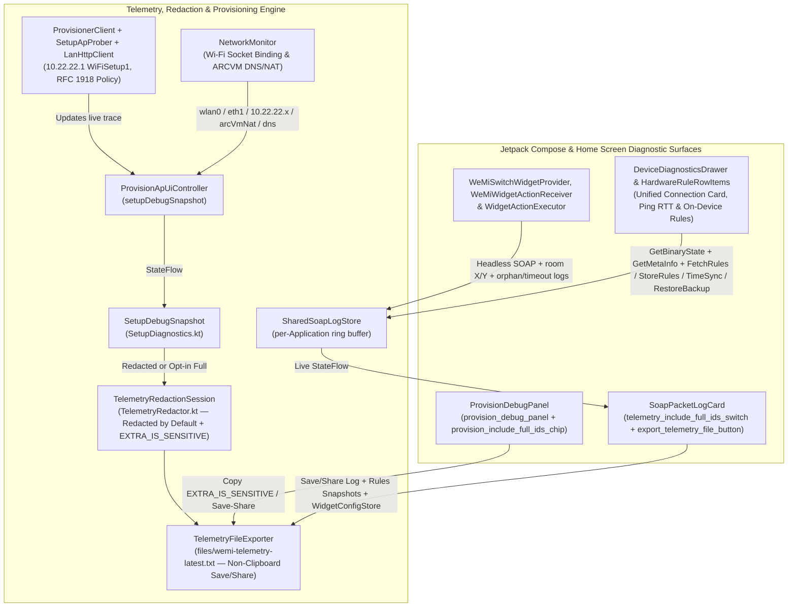

# WeMi Light Control — On-Device Telemetry, `10.22.22.1` Provisioning Diagnostics & Support Architecture (`DEBUGGING_AND_SUPPORT.md`)

**Repository**: `MichaelRHead/WeMi-light-control` (`org.suppressingfire.wemi` / `com.aistudio.wemiswitch.kxpqzr`, `v38.0`)  
**Document & Skill Owner**: **Antigravity Debugging & Support Agent — EXCLUSIVE OWNER**  
**Companion Agent Skill**: [`.agents/skills/wemi-device-telemetry-debug/SKILL.md`](.agents/skills/wemi-device-telemetry-debug/SKILL.md)  
**Companion User Guide**: [`docs/user-guide/telemetry-and-troubleshooting.md`](docs/user-guide/telemetry-and-troubleshooting.md)

> [!CAUTION]
> **EXCLUSIVE AGENT OWNERSHIP NOTICE (READ-ONLY FOR OTHER AGENTS)**
> - **Owner**: **Antigravity Debugging & Support Agent** is the **sole author and maintainer** of [`DEBUGGING_AND_SUPPORT.md`](DEBUGGING_AND_SUPPORT.md), [`.agents/skills/wemi-device-telemetry-debug/SKILL.md`](.agents/skills/wemi-device-telemetry-debug/SKILL.md), and [`docs/user-guide/telemetry-and-troubleshooting.md`](docs/user-guide/telemetry-and-troubleshooting.md).
> - **Policy for All Other Agents (including the Google AI Studio Agent, the Antigravity Security & Privacy Agent, CLI agents, and external coding assistants)**: **DO NOT MODIFY, OVERWRITE, RENAME, OR DELETE THESE THREE FILES.** All other agents **must** read, preserve, and respect the diagnostic architecture, `Modifier.testTag(...)` contracts, and non-destructive provisioning invariants defined here when editing UI, widget, or network code, but must treat these three debugging & support files as **strictly read-only**.

Related documentation:
- [`AGENTS.md`](AGENTS.md) & [`ARCHITECTURE.md`](ARCHITECTURE.md) — Concise Agent Guide & On-Demand Source/Test Catalog
- [`UX_DESIGN.md`](UX_DESIGN.md) & [`UX_DESIGN_AND_EXPERIENCE.md`](UX_DESIGN_AND_EXPERIENCE.md) — Android & Android TV UX Design Guidelines *(Owned Exclusively by the Google AI Studio Agent)*
- [`DISCOVERY_AND_ROOM_GROUPING.md`](DISCOVERY_AND_ROOM_GROUPING.md) — Device Discovery & Room Grouping Architecture *(Owned Exclusively by the Antigravity Device Discovery & Room Grouping Agent)*
- [`SECURITY_AND_PRIVACY.md`](SECURITY_AND_PRIVACY.md) — Security Threat Model, Privacy Lifecycle Invariants & Stage 4 Hardening *(Owned Exclusively by the Antigravity Security & Privacy Agent)*
- [`LICENSE_GOVERNANCE.md`](LICENSE_GOVERNANCE.md) — Open-Source MIT License Parity, Permissive Dependency Policy & Brand/Trademark Governance *(Owned Exclusively by the Antigravity License & Brand Governance Agent)*
- [`RELEASE_PROCESS.md`](RELEASE_PROCESS.md) & [`RELEASE_SIGN_OFF.md`](RELEASE_SIGN_OFF.md) — 7-Agent / 8-Stage Autonomous Release Review Process, Sign-Off Ledger & Closed Testing Promotion
- [`IMPLEMENTED.md`](IMPLEMENTED.md) — Reverse-Chronological Change Log (`v1.0` → `v38.0`)
- [`UPCOMING_FEATURES.md`](UPCOMING_FEATURES.md) — Upcoming Features & Next-Iteration Roadmap
- [`USER_GUIDE.md`](USER_GUIDE.md) — Modular User Guide Index & Feature Guides ([`docs/user-guide/`](docs/user-guide/))

---

## 1. Debugging & Support Philosophy

Because switches from Belkin's discontinued smart switch platform (`F7C030`, `WLS040`/`WLS0403`, `F7C059`/`WDS060`, `F7C063`/`WSP080`) communicate over the user's private local Wi-Fi (`192.168.x.x/24`) or an unconfigured switch's isolated `10.22.22.1/24` Setup AP, remote agents cannot directly ping the user's switches from the cloud.

To make hardware, Chromebook (ChromeOS ARCVM), widget, and production release debugging fast, deterministic, and privacy-preserving, **WeMi Light Control** combines on-device LAN telemetry with embedded Play Console crash deobfuscation:
1. **Channel A — High-Contrast On-Screen Screenshot Panels**:
   - Designed so a single phone, Chromebook, or Android TV screenshot captures the complete hardware, network, encryption, and SOAP state while keeping Wi-Fi setup passwords masked (with ephemeral memory storage, `ON_PAUSE` auto-remasking, and reveal-scoped `FLAG_SECURE`).
2. **Channel B — Privacy-First 5-Section Telemetry File Exporter (`wemi-telemetry-latest.txt`) with Default Redaction, `BuildConfig` Version Stamping & Cloud-Backup Exclusion**:
   - Writes a structured 5-section text report stamped with `App Version: v<VERSION_NAME> (versionCode=<VERSION_CODE>, <APPLICATION_ID>)` and `Identifiers: REDACTED (default privacy-safe)` (or `FULL (opt-in diagnostics)` when the user explicitly toggles **Full Diagnostics in Exported Logs** / **Full IDs in Export** ON) to `/data/data/com.aistudio.wemiswitch.kxpqzr/files/wemi-telemetry-latest.txt`. By default, [`TelemetryRedactor.kt`](app/src/main/java/org/suppressingfire/wemi/network/TelemetryRedactor.kt) masks Wi-Fi SSIDs (`SSID#N`), MAC addresses (`****XXXX`), serial numbers (`***XXXX`), UDN suffixes, and DNS server IPs across all 5 sections (including GENA endpoints and stale-context SOAP logs).
   - **`Save/Share`** (`saveAndShareTelemetryReport`) saves `wemi-telemetry-latest.txt` and opens Android's `Intent.ACTION_SEND` share sheet **without** silently writing to the system clipboard; explicit **`Copy`** (`copyTelemetryReportToClipboard`) marks the clip with `ClipDescription.EXTRA_IS_SENSITIVE = true` (Android 13+).
   - [`backup_rules.xml`](app/src/main/res/xml/backup_rules.xml) and [`data_extraction_rules.xml`](app/src/main/res/xml/data_extraction_rules.xml) exclude Room `database` (`.`), `sharedpref` (`.`), `wemi-telemetry-latest.txt`, and `hardware_rules_backups` from Android cloud Auto-Backup (while direct cable `<device-transfer>` preserves DB/prefs and continues excluding telemetry & rule backups), and **Reset Homes, Discovered Switches & Rooms** erases `wemi-telemetry-latest.txt`, `SharedSoapLogStore`, `ProvisioningCoordinator` setup caches, and widget bindings.
   - Captures every `SetBinaryState` / `GetBinaryState` / `GetMetaInfo` / `GET rulesservice.xml` / `rules1#FetchRules` / `GET /rules.db` / `timesync1#GetDeviceTime` / `timesync1#TimeSync` / `rules1#StoreRules` / `rules1#RestoreBackup` / `HouseholdSync#MERGE` / `HouseholdSync#REPLACE` (metadata counts only, zero PIN or bundle payload) / `GENA` / `SSDP` packet across phone, Chromebook (`arcVmNat=true`, `dns=...`, `subnet=unset`, and deduplicated `GENA#SUBSCRIBE (Skipped)` entries), TopHeader `"All Off"`, Room Master, Android TV D-Pad toggle & focusable dimmer slider actions, **and headless Home Screen Light/Room Widget toggles** (streamed via `SharedSoapLogStore` with `Updated X/Y switch(es)` room outcomes alongside configured widget resolution diagnostics in Section 5).
3. **Release App Bundle Crash/ANR Deobfuscation (`proguard.map` & Pure Kotlin/DEX)**:
   - Release builds ([`app/build.gradle.kts`](app/build.gradle.kts) & [`app/proguard-rules.pro`](app/proguard-rules.pro)) embed R8 mapping metadata with `-keepattributes SourceFile,LineNumberTable` (preserving Room v7 `MIGRATION_5_6` + `MIGRATION_6_7` entities/DAOs, domain enums, and `androidx.activity.EdgeToEdge*`, while stripping production `android.util.Log` calls) and exclude un-symbolicated transitive `.so` shims (`libandroidx.graphics.path.so`) so Google Play Console stack traces remain human-readable with exact line numbers correlated to `versionCode`.

---

## 2. Architecture of the Telemetry & Provisioning Diagnostics Subsystem

### Primary Source Files & Responsibilities

| File | Key Types & Functions | Diagnostic Role |
| :--- | :--- | :--- |
| [`SetupDiagnostics.kt`](app/src/main/java/org/suppressingfire/wemi/network/SetupDiagnostics.kt), [`TelemetryRedactor.kt`](app/src/main/java/org/suppressingfire/wemi/network/TelemetryRedactor.kt), [`backup_rules.xml`](app/src/main/res/xml/backup_rules.xml) & [`data_extraction_rules.xml`](app/src/main/res/xml/data_extraction_rules.xml) | `SetupDebugSnapshot`, `SharedSoapLogStore`, `TelemetryFileExporter`, `TelemetryRedactionSession` | Immutable snapshot of `10.22.22.1` setup & LAN telemetry (`[NET]` with optional `arcVmNat=true` & `dns=...`, `[PROBE]`, `[XML]`, `[FLAGS]`, `[ID]`, `[SCAN]`, `[TARGET AP]` via `targetSsid`, `[STEP 1..6]`); per-`Application` bounded `SharedSoapLogStore` (`50`-entry ring buffer); default privacy redaction (`TelemetryRedactionSession` masking SSIDs, MACs, serials, UDNs, DNS IPs, GENA endpoints, and stale-context SOAP/GetApList/ConnectHome/widget tokens unless opt-in Full Diagnostics is enabled); `BuildConfig`-version-stamped `toClipboardText` (`IDs=REDACTED|FULL`), `resolveExportSetupSnapshot`, ReDoS-bounded (`4096` chars) `sanitizeXmlSnippet` (redacting `<password>` as `[REDACTED encLen=...]` and `<ruleDbBody>` as `[REDACTED base64Len=...]`), 5-section `buildFullTelemetryReport`, `saveTelemetryReportToFile`, `deleteTelemetryFile`, `copyTelemetryReportToClipboard` (`EXTRA_IS_SENSITIVE = true`), `saveAndShareTelemetryReport` (no silent clipboard write), and cloud Auto-Backup exclusion of `database`, `sharedpref`, `wemi-telemetry-latest.txt`, and `hardware_rules_backups`. |
| [`ProvisionerClient.kt`](app/src/main/java/org/suppressingfire/wemi/network/ProvisionerClient.kt), [`SetupApProber.kt`](app/src/main/java/org/suppressingfire/wemi/network/SetupApProber.kt), [`ProvisioningCoordinator.kt`](app/src/main/java/org/suppressingfire/wemi/data/ProvisioningCoordinator.kt), [`NetworkModels.kt`](app/src/main/java/org/suppressingfire/wemi/network/NetworkModels.kt), [`NetworkClient.kt`](app/src/main/java/org/suppressingfire/wemi/network/NetworkClient.kt) & [`LanHttpClient.kt`](app/src/main/java/org/suppressingfire/wemi/network/LanHttpClient.kt) | `probeSetupDevice`, `fetchAvailableApList`, `provisionDeviceToHomeWifi`, `SetupApProber`, `ProvisioningCoordinator.clearCachedSetupState`, `SetupDeviceDescriptor`, `ProvisionResult`, `NetworkClient`, `LanHttpClient` | Byte-exact `10.22.22.1` HTTP/1.1 probing across ports `49151..49159` via zero-dependency `LanHttpClient` (`LanEndpointPolicy` RFC 1918 guard, `connectTimeoutMs = 1500`, `readTimeoutMs = 8500`), placeholder-serial-safe & `DEFAULT_FALLBACK_MAC`-safe metadata resolution, `CancellationException` propagation, single-attempt early break on unreachable Setup AP, `encryptedPasswordPayload = ""` in `ProvisionResult` (never retaining ciphertext in memory), double-send `ConnectHomeNetwork` with `[REDACTED encLen=...]` logging, 18-poll `GetNetworkStatus` loop with distinct `<8`-char vs. `>=8`-char `Status=2` remediation, non-destructive `CloseSetup` gating, post-success & Reset setup cache clearing (`clearCachedSetupState`), and exact offline LAN failure-cause capture in `NetworkClient`. |
| [`HardwareRulesClient.kt`](app/src/main/java/org/suppressingfire/wemi/network/HardwareRulesClient.kt), [`HardwareRulesWriteEngine.kt`](app/src/main/java/org/suppressingfire/wemi/network/HardwareRulesWriteEngine.kt), [`HardwareRulesBackupStore.kt`](app/src/main/java/org/suppressingfire/wemi/network/HardwareRulesBackupStore.kt), [`HardwareRulesProtocol.kt`](app/src/main/java/org/suppressingfire/wemi/network/HardwareRulesProtocol.kt), [`HardwareRulesSafetyValidator.kt`](app/src/main/java/org/suppressingfire/wemi/network/HardwareRulesSafetyValidator.kt) & [`HardwareRulesCoordinator.kt`](app/src/main/java/org/suppressingfire/wemi/data/HardwareRulesCoordinator.kt) | `probeRulesCapability`, `fetchDeviceRulesSnapshot`, `mutateAndStoreRulesDb`, `restoreRulesFromBackup`, `syncDeviceTime` | Logs structured `SharedSoapLogStore` entries for Tier-2 capability checks (`GET rulesservice.xml`, `rules1#FetchRules`), binary DB downloads (`GET /rules.db`), clock checks & sync (`timesync1#TimeSync(<tzOffset>)`), armored live writes (`rules1#StoreRules(v<n>)`, `rules1#StoreRules (Blocked)`, `rules1#StoreRules (Prep Failed)`, `rules1#StoreRules (Mutation Rejected)`), and backup restores (`rules1#RestoreBackup`), saving rotating pre-write raw-ZIP backups strictly in device-local `noBackupFilesDir/hardware_rules_backups`. |
| [`WeMiSwitchWidgetProvider.kt`](app/src/main/java/org/suppressingfire/wemi/widget/WeMiSwitchWidgetProvider.kt), [`WeMiWidgetActionReceiver.kt`](app/src/main/java/org/suppressingfire/wemi/widget/WeMiWidgetActionReceiver.kt), [`WidgetActionExecutor.kt`](app/src/main/java/org/suppressingfire/wemi/widget/WidgetActionExecutor.kt), [`WidgetConfigStore.kt`](app/src/main/java/org/suppressingfire/wemi/widget/WidgetConfigStore.kt), [`GenaAndHealthPollingCoordinator.kt`](app/src/main/java/org/suppressingfire/wemi/data/GenaAndHealthPollingCoordinator.kt) & [`SwitchRepository.kt`](app/src/main/java/org/suppressingfire/wemi/data/SwitchRepository.kt) | `WeMiSwitchWidgetProvider`, `WeMiWidgetActionReceiver` (`exported="false"`), `WidgetActionExecutor`, `WidgetConfigStore.loadAll`, `GenaAndHealthPollingCoordinator`, `SwitchRepository.resetLanHomesSwitchesAndRooms` | Handles widget toggle & pin callbacks through non-exported `WeMiWidgetActionReceiver`, streams headless Home Screen Light & Room Widget UPnP SOAP calls (`Widget#Toggle(DEVICE)` / `Widget#Toggle(ROOM)` with `Updated <succeeded>/<total> switch(es)`), unconfigured/orphaned warnings, `8.5s` `goAsync()` timeouts, and deduplicated `GENA#SUBSCRIBE (Skipped)` ChromeOS ARCVM entries into `SharedSoapLogStore`; full Reset clears Room, rule backups, `SharedSoapLogStore`, `wemi-telemetry-latest.txt`, `ProvisioningCoordinator` caches, and `WidgetConfigStore`/mutexes. |
| [`PasswordCrypto.kt`](app/src/main/java/org/suppressingfire/wemi/network/PasswordCrypto.kt) | `encryptWifiPassword`, `decryptWifiPassword` | Stateless first-party `minSdk 24`-safe OpenSSL `EVP_BytesToKey` MD5 key/IV derivation and AES-128-CBC encryption supporting all 6 permutations (`Method 1/2/3` × `addPasswordLengths = true/false`) with sensitive byte-buffer zeroing in `finally`. |
| [`NetworkMonitor.kt`](app/src/main/java/org/suppressingfire/wemi/network/NetworkMonitor.kt) | `createWifiBoundSocketFactory`, `resolveActiveLanBinding`, `findPreferredWifiOrLanNetwork` | Binds HTTP/SOAP/SSDP/Sync sockets directly to the active physical Wi-Fi or Ethernet `Network` handle (prioritizing `10.22.22.x` Setup APs on phones while skipping VPNs and ChromeOS `arc0`) and exposes `isArcVmNatSubnet` + IPv4 `dnsServersIpv4` hints. |
| [`ProvisionApUiController.kt`](app/src/main/java/org/suppressingfire/wemi/ui/ProvisionApUiController.kt), [`ProvisionDebugPanel.kt`](app/src/main/java/org/suppressingfire/wemi/ui/components/ProvisionDebugPanel.kt), [`ProvisionApDialog.kt`](app/src/main/java/org/suppressingfire/wemi/ui/components/ProvisionApDialog.kt) & [`ProvisionApFormSections.kt`](app/src/main/java/org/suppressingfire/wemi/ui/components/ProvisionApFormSections.kt) | `ProvisionApUiController`, `ProvisionDebugPanel`, `ProvisionApDialog`, `isProvisionStatusWarningOrError`, `ProvisionWifiTargetSection`, `ProvisionCryptoOptionsSection` | Manages live `setupDebugSnapshot`, keeps `provision_password_input` strictly in ephemeral `remember` memory (masked by default, auto-remasked on `ON_PAUSE`, reveal-scoped `FLAG_SECURE`, cleared on dismiss/success), validates Setup AP IP inline (`provision_ap_ip_validation_error`), renders collapsible **`SETUP DIAGNOSTICS`** (`provision_debug_panel`, `toggle_provision_debug_button`, `provision_debug_text`, `copy_provision_debug_button`, `share_provision_debug_button`, `provision_include_full_ids_chip` `Full IDs in Export` defaulting OFF, `keep_provision_dialog_open_chip`, and the 6 AES/length chips). |
| [`MoreScreen.kt`](app/src/main/java/org/suppressingfire/wemi/ui/screens/MoreScreen.kt), [`MoreControlAndLogCards.kt`](app/src/main/java/org/suppressingfire/wemi/ui/screens/MoreControlAndLogCards.kt), [`HouseholdSyncCard.kt`](app/src/main/java/org/suppressingfire/wemi/ui/screens/HouseholdSyncCard.kt), [`DeviceDiagnosticsDrawer.kt`](app/src/main/java/org/suppressingfire/wemi/ui/components/DeviceDiagnosticsDrawer.kt) & [`HardwareRuleRowItems.kt`](app/src/main/java/org/suppressingfire/wemi/ui/components/HardwareRuleRowItems.kt) | `MoreScreen`, `SoapPacketLogCard`, `HouseholdSyncCard`, `ExpandedDrawer`, `ExpandedDrawerHardwareRulesSection`, `HardwareRuleSummaryRow` | Exposes **`Full Diagnostics in Exported Logs`** (`telemetry_include_full_ids_switch`, default OFF) above **`Save/Share Log`** (`export_telemetry_file_button`, non-clipboard) and **`Clear`** (`clear_soap_logs_button`); hosts **Household Config Sync** (`HouseholdSync#MERGE`/`REPLACE` summary logs only, zero PIN/payload); and renders the unified **Connection & Hardware Details** drawer card (`ping_device_<id>`, full-width `device_diagnostics_metadata_<id>`, `configure_ip_device_<id>`, `hardware_rules_drawer_section_<id>`, `inspect_device_rules_<id>`, `drawer_add_hardware_rule_<id>`, `drawer_sync_clock_<id>`, `drawer_open_rules_tab_<id>`). |

---

## 3. Non-Negotiable Debugging & Provisioning Invariants

All agents modifying networking, repository, widget, or UI code must preserve these five debugging invariants:

1. **Never Call `CloseSetup` When `GetNetworkStatus` Is `0` or `2` (`kept_open_for_retry`)**:
   - In [`ProvisionerClient.kt`](app/src/main/java/org/suppressingfire/wemi/network/ProvisionerClient.kt), `overallSuccess` requires `httpSuccess && (netStatus == 1 || netStatus == 3)`.
   - Whenever `netStatus == 0` (still connecting / handshake timeout) or `netStatus == 2` (password/auth rejected — distinguishing `<8`-char password length failures from `>=8`-char password typos or AES `Method`/`lengths` mismatches), `CloseSetup` **must be skipped** (`[STEP 6 HOLD]`) so the switch's `10.22.22.1` setup AP stays open and the user can immediately retry another encryption method or password without factory-resetting the switch. Upon a verified `overallSuccess` (and during Reset), [`ProvisioningCoordinator.kt`](app/src/main/java/org/suppressingfire/wemi/data/ProvisioningCoordinator.kt) must clear its cached setup descriptor and AP list so consecutive factory-reset switches at `10.22.22.1` always probe fresh MAC/serial keys.
2. **Never Auto-Dismiss `ProvisionApDialog` on Failure or When `keepDialogOpenOnSuccess` Is Enabled**:
   - In [`ProvisionApUiController.kt`](app/src/main/java/org/suppressingfire/wemi/ui/ProvisionApUiController.kt), when provisioning fails (`!res.success`) or when the user toggles `keep_provision_dialog_open_chip` ON, `ProvisionApDialog` must remain open on screen and `ProvisionDebugPanel` must auto-expand on failures/traces (even if the user previously tapped `Hide`) so the user can tap **`Copy`** / **`Save/Share`** or screenshot `provision_debug_panel` with the Wi-Fi password masked by default.
3. **Privacy-by-Default Redaction, Zero Password/PIN/Blob Leakage, Cloud-Backup Exclusion & Complete Reset Erasure**:
   - `SetupDebugSnapshot`, `SoapLogEntry`, and `TelemetryFileExporter` (via `TelemetryRedactor` + ReDoS-bounded `sanitizeXmlSnippet`) must never record plaintext/ciphertext Wi-Fi passwords, Household Sync pairing PINs/ciphertexts, raw base64 `<ruleDbBody>` blobs, or exact `LOCATIONINFO` latitude/longitude coordinates (`solarLoc=set/unset` only).
   - Default exports (`includeSensitiveIdentifiers = false`) must redact Wi-Fi SSIDs, MACs, serials, UDNs, DNS IPs, GENA endpoints, and stale-context SOAP/GetApList/widget tokens; **`Save/Share`** must never silently write to the clipboard; explicit **`Copy`** must set `EXTRA_IS_SENSITIVE = true`; Wi-Fi setup passwords must remain ephemeral (`remember`-only, `ON_PAUSE` re-masked, reveal-scoped `FLAG_SECURE`); [`backup_rules.xml`](app/src/main/res/xml/backup_rules.xml) and [`data_extraction_rules.xml`](app/src/main/res/xml/data_extraction_rules.xml) must exclude `database`, `sharedpref`, `wemi-telemetry-latest.txt`, and `hardware_rules_backups` from cloud Auto-Backup (and exclude telemetry + rule backups from `<device-transfer>`); and Reset must erase `wemi-telemetry-latest.txt`, SOAP logs, setup caches, rule backups, and widget bindings.
4. **Preserve Diagnostic `Modifier.testTag(...)` Identifiers & Headless Widget / Step 2 Rules / Sync Log Bridging**:
   - Keep `provision_debug_panel`, `toggle_provision_debug_button`, `provision_debug_text`, `copy_provision_debug_button`, `share_provision_debug_button`, `provision_include_full_ids_chip`, `provision_ap_ip_validation_error`, `toggle_provision_password_visibility`, `keep_provision_dialog_open_chip`, `provision_len_auto_chip`, `provision_len_true_chip`, `provision_len_false_chip`, `telemetry_include_full_ids_switch`, `export_telemetry_file_button`, `clear_soap_logs_button`, `device_diagnostics_metadata_<id>`, `configure_ip_device_<id>`, `ping_device_<id>`, `trigger_motion_<id>`, `hardware_rules_drawer_section_<id>`, `inspect_device_rules_<id>`, `drawer_add_hardware_rule_<id>`, `drawer_sync_clock_<id>`, and `drawer_open_rules_tab_<id>` intact, and preserve `SharedSoapLogStore` bridging across all `31` automated test suites (including [`TelemetryDiagnosticsTest.kt`](app/src/test/java/org/suppressingfire/wemi/TelemetryDiagnosticsTest.kt), [`SecurityAndPrivacyHardeningTest.kt`](app/src/test/java/org/suppressingfire/wemi/SecurityAndPrivacyHardeningTest.kt), [`HouseholdSyncTest.kt`](app/src/test/java/org/suppressingfire/wemi/HouseholdSyncTest.kt), [`HouseholdSyncE2ETest.kt`](app/src/test/java/org/suppressingfire/wemi/HouseholdSyncE2ETest.kt), [`GenaProvisioningAndRulesTest.kt`](app/src/test/java/org/suppressingfire/wemi/GenaProvisioningAndRulesTest.kt), [`HardwareRulesTest.kt`](app/src/test/java/org/suppressingfire/wemi/HardwareRulesTest.kt), [`HardwareRulesMutationTest.kt`](app/src/test/java/org/suppressingfire/wemi/HardwareRulesMutationTest.kt), [`HardwareRulesE2ETest.kt`](app/src/test/java/org/suppressingfire/wemi/HardwareRulesE2ETest.kt), [`ProvisioningAndGenaCujE2ETest.kt`](app/src/test/java/org/suppressingfire/wemi/ProvisioningAndGenaCujE2ETest.kt), [`ChromeOsArcVmDiscoveryTest.kt`](app/src/test/java/org/suppressingfire/wemi/ChromeOsArcVmDiscoveryTest.kt), [`ChromeOsArcVmE2ETest.kt`](app/src/test/java/org/suppressingfire/wemi/ChromeOsArcVmE2ETest.kt), and [`HomeScreenWidgetUiE2ETest.kt`](app/src/test/java/org/suppressingfire/wemi/HomeScreenWidgetUiE2ETest.kt)).
5. **Preserve `LanHttpClient` & `GenaSubscriptionManager` Byte-Exact UTF-8 `Content-Length` Framing, Delayed-`FIN` Recovery & `8500ms` Site-Survey Read Timeout**:
   - Embedded `uhttpd` / RTOS HTTP servers on `10.22.22.1` often keep TCP sockets open (`Connection: keep-alive`) or delay TCP `FIN` after sending `/setup.xml` and take `3–6 seconds` to complete an 11-channel 2.4 GHz `GetApList` scan. Always use [`LanHttpClient`](app/src/main/java/org/suppressingfire/wemi/network/LanHttpClient.kt) (`tcpNoDelay = true`, `connectTimeoutMs = 1500`, `readTimeoutMs = 8500`, buffered delayed-`FIN` recovery in `readUntilEof`) rather than raw `Socket.getInputStream().readText()` EOF reads, and preserve byte-exact UTF-8 `Content-Length` framing in [`GenaSubscriptionManager.kt`](app/src/main/java/org/suppressingfire/wemi/network/GenaSubscriptionManager.kt).

---

## 4. End-to-End Diagnostic Playbook & Stage 3 Release Sign-Off

When a user provides a screenshot of `SETUP DIAGNOSTICS` or shares `wemi-telemetry-latest.txt`, follow the step-by-step decoder and remediation matrix in [`.agents/skills/wemi-device-telemetry-debug/SKILL.md`](.agents/skills/wemi-device-telemetry-debug/SKILL.md):

1. **Inspect `[NET]`**: Verify `setupSubnet=true` and `wifiBound=true` on `10.22.22.x/24` (note `resolveExportSetupSnapshot` keeps `[NET]` flags consistent with the captured provisioning session rather than blending them with a later home-LAN state). On Chromebooks (ChromeOS ARCVM), `[NET]` shows `arcVmNat=true` on `100.115.92.x` (`eth1`/`eth2`, never `arc0`/`100.115.92.2`) plus `dns=<redacted:N>` (or raw IPv4s in opt-in Full Diagnostics mode), and `10.22.22.1` auto-detection does not fire automatically — open **`More` → `Provision New Switch AP (10.22.22.1)`** manually.
2. **Inspect `[PROBE]`**: Verify which port (`49151..49159`) and XML path (`/setup.xml` or `/Lightsetup.xml`) responded with `HTTP_200`. If `[PROBE]` reports `TCP_TIMEOUT` or `NO_ROUTE`, `[SCAN]` fast-skips with `Skipped (Setup AP unreachable)`.
3. **Inspect `[XML]`, `[FLAGS]` & `[ID]`**: Verify `mac` (redacted `****XXXX` by default, or 12 hex chars in Full Diagnostics) and `sn` (`***XXXX` by default) are non-empty and non-placeholder (`src=GetMetaInfo`, `GetMetaInfo+setup.xml`, `setup.xml`, or `basicevent1#GetMacAddr`) and check `rtos`, `iot`, `binaryOption`, `new_algo` → `autoMethod` / `autoLen`.
4. **Inspect `[SCAN]` & `[TARGET AP]`**: Verify the target 2.4 GHz SSID (`"SSID#1"` by default, or raw name in Full Diagnostics), channel (`1..11`), `Auth` (`WPA2PSK`), and `Encrypt` (`AES`).
5. **Inspect `[STEP 1..6]`**: Check `PairingStatus`, `GetNetworkStatus` poll progression (`0`, `1`, `2`, `3`), and `CloseSetup` status (`success` vs `kept_open_for_retry`).
6. **Inspect Sections 2–5 (`[HOME]`, `[DEV #id]`, `  rules:`, Step 2 SOAP actions, `HouseholdSync#*`, `[ERR]`, `GENA#SUBSCRIBE (Skipped)`, `[WIDGET #id]`)**:
   - Confirm `[HOME]` shows a physical RFC 1918 subnet (or `subnet=unset gw=none` on a fresh Chromebook before first discovery — never `100.115.92.0/24`); cross-reference `home=<networkKey>` and `udn=` across Sections 2, 3, and 5.
   - Check Section 3 `rulesCap=`/`lp=1`/`rulesFw=` and `  rules: dbV=... rules=... integrity=... driftSec=... needsSync=... backups=... solarLoc=set/unset`, plus Section 4 Step 2 actions (`timesync1#TimeSync(<tz>)`, `rules1#StoreRules(v<n>)`, `rules1#StoreRules (Blocked)` / `(Prep Failed)` / `(Mutation Rejected)`, `rules1#RestoreBackup`) and `HouseholdSync#MERGE`/`REPLACE` import counts.
   - Check `GENA#SUBSCRIBE (Skipped)` on ChromeOS VM (expected `15s` SOAP polling fallback); check offline SOAP failure causes (`:49153=ConnectException`, `:49153=SocketTimeoutException`, `:49153=HTTP_500`, `9-port probe: no match`); and inspect `Widget#Toggle(DEVICE)` / `Widget#Toggle(ROOM)` (`Updated X/Y switch(es)`, `ERR` when `0/Y`) / `ORPHANED` / `8500ms broadcast budget` entries for Home Screen widget failures.
7. **Stage 3 Release Sign-Off & Quota-Safe Stop Policy**: During active `IN_REVIEW` rounds in [`RELEASE_SIGN_OFF.md`](RELEASE_SIGN_OFF.md), complete Stage 3 (`telemetry_and_debugging`) telemetry review + [`wemi-doc-audit-and-review`](.agents/skills/wemi-doc-audit-and-review/SKILL.md) per [`RELEASE_PROCESS.md`](RELEASE_PROCESS.md), verify `sh gradlew testDebugUnitTest --rerun-tasks lintDebug assembleDebug` (`100644` non-executable script modes), sign off via `bash scripts/advance_release_turn.sh sign_off telemetry_and_debugging ...` (handing off to `security_and_privacy`), and **stop cleanly without re-arming `scripts/await_release_turn.sh`** once `SIGNED_OFF` or whenever `RELEASE_STATUS` is `APPROVED_FOR_PLAY_STORE` / `PROMOTED_TO_CLOSED_TESTING` / `CURRENT_TURN: NONE`.

