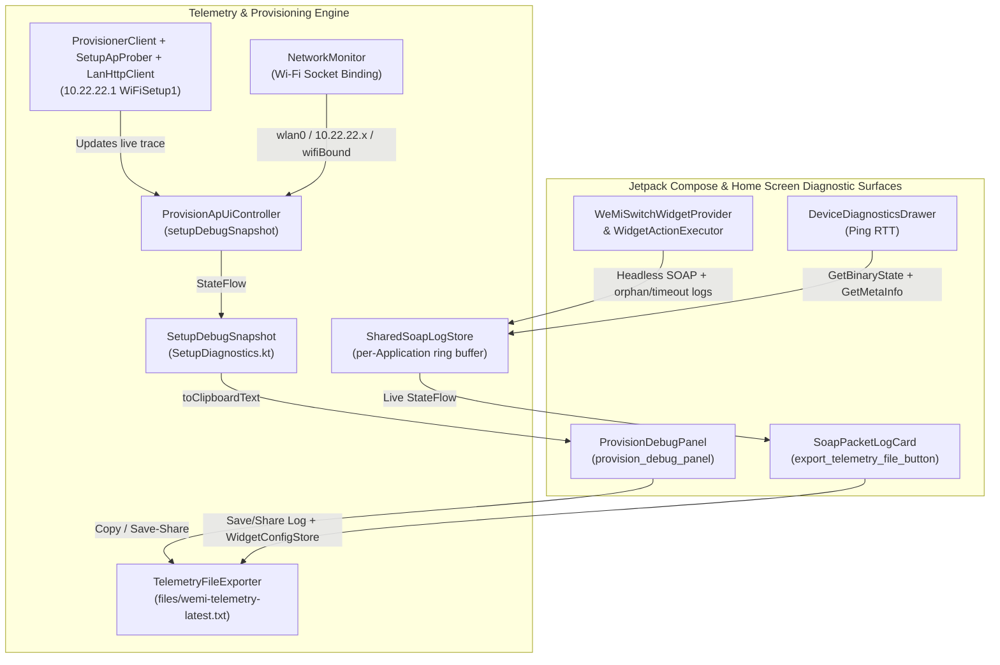

# WeMi Light Control — On-Device Telemetry, `10.22.22.1` Provisioning Diagnostics & Support Architecture (`DEBUGGING_AND_SUPPORT.md`)

**Repository**: `MichaelRHead/WeMi-light-control` (`org.suppressingfire.wemi` / `com.aistudio.wemiswitch.kxpqzr`, `v31.0`)  
**Document & Skill Owner**: **Antigravity Debugging & Support Agent — EXCLUSIVE OWNER**  
**Companion Agent Skill**: [`.agents/skills/wemi-device-telemetry-debug/SKILL.md`](.agents/skills/wemi-device-telemetry-debug/SKILL.md)  
**Companion User Guide**: [`docs/user-guide/telemetry-and-troubleshooting.md`](docs/user-guide/telemetry-and-troubleshooting.md)

> [!CAUTION]
> **EXCLUSIVE AGENT OWNERSHIP NOTICE (READ-ONLY FOR OTHER AGENTS)**
> - **Owner**: **Antigravity Debugging & Support Agent** is the **sole author and maintainer** of [`DEBUGGING_AND_SUPPORT.md`](DEBUGGING_AND_SUPPORT.md), [`.agents/skills/wemi-device-telemetry-debug/SKILL.md`](.agents/skills/wemi-device-telemetry-debug/SKILL.md), and [`docs/user-guide/telemetry-and-troubleshooting.md`](docs/user-guide/telemetry-and-troubleshooting.md).
> - **Policy for All Other Agents (including the Google AI Studio Agent, CLI agents, and external coding assistants)**: **DO NOT MODIFY, OVERWRITE, RENAME, OR DELETE THESE THREE FILES.** All other agents **must** read, preserve, and respect the diagnostic architecture, `Modifier.testTag(...)` contracts, and non-destructive provisioning invariants defined here when editing UI, widget, or network code, but must treat these three debugging & support files as **strictly read-only**.

Related documentation:
- [`AGENTS.md`](AGENTS.md) & [`ARCHITECTURE.md`](ARCHITECTURE.md) — Concise Agent Guide & On-Demand Source/Test Catalog
- [`UX_DESIGN.md`](UX_DESIGN.md) & [`UX_DESIGN_AND_EXPERIENCE.md`](UX_DESIGN_AND_EXPERIENCE.md) — Android & Android TV UX Design Guidelines *(Owned Exclusively by the Google AI Studio Agent)*
- [`DISCOVERY_AND_ROOM_GROUPING.md`](DISCOVERY_AND_ROOM_GROUPING.md) — Device Discovery & Room Grouping Architecture *(Owned Exclusively by the Antigravity Device Discovery & Room Grouping Agent)*
- [`LICENSE_GOVERNANCE.md`](LICENSE_GOVERNANCE.md) — Open-Source MIT License Parity, Permissive Dependency Policy & Brand/Trademark Governance *(Owned Exclusively by the Antigravity License & Brand Governance Agent)*
- [`RELEASE_PROCESS.md`](RELEASE_PROCESS.md) & [`RELEASE_SIGN_OFF.md`](RELEASE_SIGN_OFF.md) — 6-Agent / 7-Stage Autonomous Release Review Process, Sign-Off Ledger & Closed Testing Promotion
- [`IMPLEMENTED.md`](IMPLEMENTED.md) — Reverse-Chronological Change Log (`v1.0` → `v31.0`)
- [`UPCOMING_FEATURES.md`](UPCOMING_FEATURES.md) — Upcoming Features & Next-Iteration Roadmap
- [`USER_GUIDE.md`](USER_GUIDE.md) — Modular User Guide Index & Feature Guides ([`docs/user-guide/`](docs/user-guide/))

---

## 1. Debugging & Support Philosophy

Because switches from Belkin's discontinued smart switch platform (`F7C030`, `WLS040`/`WLS0403`, `F7C059`/`WDS060`, `F7C063`/`WSP080`) communicate over the user's private local Wi-Fi (`192.168.x.x/24`) or an unconfigured switch's isolated `10.22.22.1/24` Setup AP, remote agents cannot directly ping the user's switches from the cloud.

To make hardware, widget, and production release debugging fast, deterministic, and privacy-preserving, **WeMi Light Control** combines on-device LAN telemetry with embedded Play Console crash deobfuscation:
1. **Channel A — High-Contrast On-Screen Screenshot Panels**:
   - Designed so a single phone or Android TV screenshot captures the complete hardware, network, encryption, and SOAP state.
2. **Channel B — One-Tap Recorded 5-Section Telemetry File Exporter (`wemi-telemetry-latest.txt`) with `BuildConfig` Version Stamping & Cloud-Backup Exclusion**:
   - Writes a structured 5-section text report stamped with `App Version: v<VERSION_NAME> (versionCode=<VERSION_CODE>, <APPLICATION_ID>)` to `/data/data/com.aistudio.wemiswitch.kxpqzr/files/wemi-telemetry-latest.txt` (explicitly excluded from Android cloud Auto-Backup and device transfer via [`backup_rules.xml`](app/src/main/res/xml/backup_rules.xml) and [`data_extraction_rules.xml`](app/src/main/res/xml/data_extraction_rules.xml)), copies it to the system clipboard, and launches Android's `Intent.ACTION_SEND` share sheet.
   - Captures every `SetBinaryState` / `GetBinaryState` / `GetMetaInfo` / `GENA` / `SSDP` packet across phone, TopHeader `"All Off"`, Room Master, Android TV D-Pad toggle & focusable dimmer slider actions, **and headless Home Screen Light/Room Widget toggles** (streamed via `SharedSoapLogStore` alongside configured widget resolution diagnostics in Section 5).
3. **Release App Bundle Crash/ANR Deobfuscation (`proguard.map` & Pure Kotlin/DEX)**:
   - Release builds ([`app/build.gradle.kts`](app/build.gradle.kts) & [`app/proguard-rules.pro`](app/proguard-rules.pro)) embed R8 mapping metadata with `-keepattributes SourceFile,LineNumberTable` (preserving Room v5 entities/DAOs, domain enums, and `androidx.activity.EdgeToEdge*`) and exclude un-symbolicated transitive `.so` shims (`libandroidx.graphics.path.so`) so Google Play Console stack traces remain human-readable with exact line numbers correlated to `versionCode`.

---

## 2. Architecture of the Telemetry & Provisioning Diagnostics Subsystem

### Primary Source Files & Responsibilities

| File | Key Types & Functions | Diagnostic Role |
| :--- | :--- | :--- |
| [`SetupDiagnostics.kt`](app/src/main/java/org/suppressingfire/wemi/network/SetupDiagnostics.kt), [`backup_rules.xml`](app/src/main/res/xml/backup_rules.xml) & [`data_extraction_rules.xml`](app/src/main/res/xml/data_extraction_rules.xml) | `SetupDebugSnapshot`, `SharedSoapLogStore`, `TelemetryFileExporter` | Immutable snapshot of `10.22.22.1` setup telemetry (`[NET]`, `[PROBE]`, `[XML]`, `[FLAGS]`, `[ID]`, `[SCAN]`, `[TARGET AP]` via `targetSsid`, `[STEP 1..6]`); process-scoped per-`Application` bounded `SharedSoapLogStore` (`50`-entry ring buffer bridging `SwitchRepository` and headless `WeMiSwitchWidgetProvider`/`WidgetActionExecutor` without Robolectric cross-test leakage); `BuildConfig`-version-stamped `toClipboardText`, session-consistent `resolveExportSetupSnapshot`, hardened `sanitizeXmlSnippet` (redacting standard, namespaced, attributed, HTML-entity-escaped, and truncated unclosed `<password>` tags), 5-section `buildFullTelemetryReport` (Section 3 includes normalized room, `home=<networkKey>`, dimmer `dim=`/`night=1`, and `udn=`; Section 4 includes password-redacted single-line `xml:` summaries; Section 5 inventories configured Home Screen Widgets and live/orphaned resolution), `latestTelemetryFile`, `saveTelemetryReportToFile`, `copyAndShareTelemetryReport`, and strict local-only cloud-backup exclusion for `wemi-telemetry-latest.txt`. |
| [`ProvisionerClient.kt`](app/src/main/java/org/suppressingfire/wemi/network/ProvisionerClient.kt), [`SetupApProber.kt`](app/src/main/java/org/suppressingfire/wemi/network/SetupApProber.kt), [`ProvisioningCoordinator.kt`](app/src/main/java/org/suppressingfire/wemi/data/ProvisioningCoordinator.kt), [`NetworkModels.kt`](app/src/main/java/org/suppressingfire/wemi/network/NetworkModels.kt), [`NetworkClient.kt`](app/src/main/java/org/suppressingfire/wemi/network/NetworkClient.kt) & [`LanHttpClient.kt`](app/src/main/java/org/suppressingfire/wemi/network/LanHttpClient.kt) | `probeSetupDevice`, `fetchAvailableApList`, `provisionDeviceToHomeWifi`, `SetupApProber`, `ProvisioningCoordinator`, `SetupDeviceDescriptor`, `ProvisionResult`, `NetworkClient`, `LanHttpClient` | Byte-exact `Content-Length` / chunked / delayed-`FIN`-framed `10.22.22.1` HTTP/1.1 probing across ports `49151..49159` via zero-dependency `LanHttpClient` (`tcpNoDelay = true`, `connectTimeoutMs = 1500`, `readTimeoutMs = 8500`), placeholder-serial-safe (`!LanRuntimeUtils.isPlaceholderSerial`) & `DEFAULT_FALLBACK_MAC`-safe `GetMetaInfo` + `/setup.xml` + `GetMacAddr`/`GetSerialNo` fallback, full `CancellationException` propagation (including `fetchSetupMetaInfo`), single-attempt early break on unreachable Setup AP (`descriptor == null`), descriptor-driven `recommendedAddLengths` selection, double-send `ConnectHomeNetwork` (with `[REDACTED encLen=...]` password redaction & XML-escaped Demo SSIDs in `SoapLogEntry.xmlSnippet`), 18-poll `GetNetworkStatus` loop with distinct `<8`-char vs. `>=8`-char `Status=2` remediation, non-destructive `CloseSetup` gating, post-success setup cache clearing, and exact offline LAN failure-cause capture (`:port=HTTP_500`, `:port=ConnectException`, `:port=SocketTimeoutException`, `9-port probe: no match`) in `NetworkClient` `SoapLogEntry.statusText`. |
| [`WeMiSwitchWidgetProvider.kt`](app/src/main/java/org/suppressingfire/wemi/widget/WeMiSwitchWidgetProvider.kt), [`WidgetActionExecutor.kt`](app/src/main/java/org/suppressingfire/wemi/widget/WidgetActionExecutor.kt), [`WidgetConfigStore.kt`](app/src/main/java/org/suppressingfire/wemi/widget/WidgetConfigStore.kt) & [`SwitchRepository.kt`](app/src/main/java/org/suppressingfire/wemi/data/SwitchRepository.kt) | `WeMiSwitchWidgetProvider`, `WidgetActionExecutor`, `WidgetConfigStore.loadAll`, `SwitchRepository` | Streams headless Home Screen Light & Room Widget UPnP SOAP calls, per-widget tap outcomes (`Widget#Toggle`), unconfigured/orphaned target warnings, and `8.5s` `goAsync()` broadcast timeouts into `SharedSoapLogStore` so widget failures are immediately inspectable in `More` → `UPnP / SOAP Packet Log` and Section 4/5 of `wemi-telemetry-latest.txt`. |
| [`PasswordCrypto.kt`](app/src/main/java/org/suppressingfire/wemi/network/PasswordCrypto.kt) | `encryptWifiPassword`, `decryptWifiPassword` | Stateless first-party `minSdk 24`-safe (`kotlin.io.encoding.Base64`) OpenSSL `EVP_BytesToKey` MD5 key/IV derivation and AES-128-CBC encryption supporting all 6 permutations (`Method 1/2/3` × `addPasswordLengths = true/false`). |
| [`NetworkMonitor.kt`](app/src/main/java/org/suppressingfire/wemi/network/NetworkMonitor.kt) | `createWifiBoundSocketFactory`, `hasBoundWifiNetwork` | Binds HTTP/SOAP sockets directly to the active (even unvalidated/no-internet) `10.22.22.x` Wi-Fi `Network` handle so Android cellular data never hijacks setup traffic. |
| [`ProvisionApUiController.kt`](app/src/main/java/org/suppressingfire/wemi/ui/ProvisionApUiController.kt), [`ProvisionDebugPanel.kt`](app/src/main/java/org/suppressingfire/wemi/ui/components/ProvisionDebugPanel.kt), [`ProvisionApDialog.kt`](app/src/main/java/org/suppressingfire/wemi/ui/components/ProvisionApDialog.kt) & [`ProvisionApFormSections.kt`](app/src/main/java/org/suppressingfire/wemi/ui/components/ProvisionApFormSections.kt) | `ProvisionApUiController`, `ProvisionDebugPanel`, `ProvisionApDialog`, `ProvisionCryptoOptionsSection` | Manages live `setupDebugSnapshot` state via atomic `StateFlow.update` (including `targetSsid` retention for `More` → `Save/Share Log`), `compareAndSet` re-entrancy guards & superseded `scanJob` cancellation on provision start, unreachable-AP fast-skip (`Skipped (Setup AP unreachable)` on `TCP_TIMEOUT`/`NO_ROUTE`), `try/finally`-guarded scan/provision spinners, & dialog hold lifecycle; renders the `SETUP DEBUG DETAILS (SCREENSHOT)` terminal card (`provision_debug_panel`, `provision_debug_text`), auto-resetting **`Copy`** (`copy_provision_debug_button`) and **`Save/Share`** (`share_provision_debug_button`), **`Keep Dialog Open on Success`** (`keep_provision_dialog_open_chip`), and the 6-permutation AES/length override chips (`provision_len_auto_chip`, `provision_len_true_chip`, `provision_len_false_chip`). |
| [`MoreScreen.kt`](app/src/main/java/org/suppressingfire/wemi/ui/screens/MoreScreen.kt), [`MoreControlAndLogCards.kt`](app/src/main/java/org/suppressingfire/wemi/ui/screens/MoreControlAndLogCards.kt) & [`DeviceDiagnosticsDrawer.kt`](app/src/main/java/org/suppressingfire/wemi/ui/components/DeviceDiagnosticsDrawer.kt) | `MoreScreen`, `SoapPacketLogCard`, `ExpandedDrawer` | Renders the live `UPnP / SOAP Packet Log` card (`SoapPacketLogCard`) with auto-resetting one-tap full 5-section **`Save/Share Log`** (`export_telemetry_file_button`, preserving session-consistent `setupDebugSnapshot` + `[TARGET AP]`, live `lanNetworkState`, `homeNetworks`, `allDevices` with `home=`/dimmer/UDN fields, sanitized `soapLogs` including headless widget traffic, and configured `WidgetConfigStore.loadAll(context)` status) and **`Clear`** (`clear_soap_logs_button`), plus the per-device inline RTT diagnostics drawer (`ping_device_<id>`). |

---

## 3. Non-Negotiable Debugging & Provisioning Invariants

All agents modifying networking, repository, widget, or UI code must preserve these five debugging invariants:

1. **Never Call `CloseSetup` When `GetNetworkStatus` Is `0` or `2` (`kept_open_for_retry`)**:
   - In [`ProvisionerClient.kt`](app/src/main/java/org/suppressingfire/wemi/network/ProvisionerClient.kt), `overallSuccess` requires `httpSuccess && (netStatus == 1 || netStatus == 3)`.
   - Whenever `netStatus == 0` (still connecting / handshake timeout) or `netStatus == 2` (password/auth rejected — distinguishing `<8`-char password length failures from `>=8`-char password typos or AES `Method`/`lengths` mismatches), `CloseSetup` **must be skipped** (`[STEP 6 HOLD]`) so the switch's `10.22.22.1` setup AP stays open and the user can immediately retry another encryption method or password without factory-resetting the switch. Upon a verified `overallSuccess`, [`ProvisioningCoordinator.kt`](app/src/main/java/org/suppressingfire/wemi/data/ProvisioningCoordinator.kt) must clear its cached setup descriptor and AP list so consecutive factory-reset switches at `10.22.22.1` always probe fresh MAC/serial keys.
2. **Never Auto-Dismiss `ProvisionApDialog` on Failure or When `keepDialogOpenOnSuccess` Is Enabled**:
   - In [`ProvisionApUiController.kt`](app/src/main/java/org/suppressingfire/wemi/ui/ProvisionApUiController.kt), when provisioning fails (`!res.success`) or when the user toggles `keep_provision_dialog_open_chip` ON, `ProvisionApDialog` must remain open on screen so the user can screenshot `provision_debug_panel` or tap **`Save/Share`**.
3. **Never Log Plaintext or Ciphertext Wi-Fi Passwords or Sync `wemi-telemetry-latest.txt` to Cloud Auto-Backup**:
   - `SetupDebugSnapshot`, `SoapLogEntry.xmlSnippet`, and `TelemetryFileExporter` (including defense-in-depth `TelemetryFileExporter.sanitizeXmlSnippet` scrubbing of standard, namespaced, attributed, HTML-entity-escaped, and truncated unclosed `<password>` tags in Section 4 exports) must only record `Method`, `addLengths`, `plainLen`, `encLen`, and `suffix` (`[STEP 4 CRYPTO] Method=1 addLengths=true plainLen=12 encLen=68 suffix=0c40` and `<password>[REDACTED encLen=...]</password>`) — never the user's raw or reversible AES-encrypted Wi-Fi password — and [`backup_rules.xml`](app/src/main/res/xml/backup_rules.xml) + [`data_extraction_rules.xml`](app/src/main/res/xml/data_extraction_rules.xml) must keep `wemi-telemetry-latest.txt` excluded from cloud backup and device transfer.
4. **Preserve Diagnostic `Modifier.testTag(...)` Identifiers & Headless Widget Log Bridging**:
   - Keep `provision_debug_panel`, `provision_debug_text`, `copy_provision_debug_button`, `share_provision_debug_button`, `keep_provision_dialog_open_chip`, `provision_len_auto_chip`, `provision_len_true_chip`, `provision_len_false_chip`, `export_telemetry_file_button`, `clear_soap_logs_button`, and `ping_device_<id>` intact, and preserve `SharedSoapLogStore` bridging for headless Home Screen widgets across the `20`-suite `95/95` automated test gate ([`TelemetryDiagnosticsTest.kt`](app/src/test/java/org/suppressingfire/wemi/TelemetryDiagnosticsTest.kt), [`GenaProvisioningAndRulesTest.kt`](app/src/test/java/org/suppressingfire/wemi/GenaProvisioningAndRulesTest.kt), [`ProvisioningAndGenaCujE2ETest.kt`](app/src/test/java/org/suppressingfire/wemi/ProvisioningAndGenaCujE2ETest.kt), [`LifecycleAndConcurrencyTest.kt`](app/src/test/java/org/suppressingfire/wemi/LifecycleAndConcurrencyTest.kt), [`ExampleUnitTest.kt`](app/src/test/java/org/suppressingfire/wemi/ExampleUnitTest.kt), [`SoapAndSelfHealingTest.kt`](app/src/test/java/org/suppressingfire/wemi/SoapAndSelfHealingTest.kt), [`AppFlowsAndManagementE2ETest.kt`](app/src/test/java/org/suppressingfire/wemi/AppFlowsAndManagementE2ETest.kt), and [`HomeScreenWidgetUiE2ETest.kt`](app/src/test/java/org/suppressingfire/wemi/HomeScreenWidgetUiE2ETest.kt)).
5. **Preserve `LanHttpClient` & `GenaSubscriptionManager` Byte-Exact UTF-8 `Content-Length` Framing, Delayed-`FIN` Recovery & `8500ms` Site-Survey Read Timeout**:
   - Embedded `uhttpd` / RTOS HTTP servers on `10.22.22.1` often keep TCP sockets open (`Connection: keep-alive`) or delay TCP `FIN` after sending `/setup.xml` and take `3–6 seconds` to complete an 11-channel 2.4 GHz `GetApList` scan. Always use [`LanHttpClient`](app/src/main/java/org/suppressingfire/wemi/network/LanHttpClient.kt) (`tcpNoDelay = true`, `connectTimeoutMs = 1500`, `readTimeoutMs = 8500`, buffered delayed-`FIN` recovery in `readUntilEof`) rather than raw `Socket.getInputStream().readText()` EOF reads, and preserve byte-exact UTF-8 `Content-Length` framing in [`GenaSubscriptionManager.kt`](app/src/main/java/org/suppressingfire/wemi/network/GenaSubscriptionManager.kt).

---

## 4. End-to-End Diagnostic Playbook & Stage 3 Release Sign-Off

When a user provides a screenshot of `SETUP DEBUG DETAILS (SCREENSHOT)` or shares `wemi-telemetry-latest.txt`, follow the step-by-step decoder and remediation matrix in [`.agents/skills/wemi-device-telemetry-debug/SKILL.md`](.agents/skills/wemi-device-telemetry-debug/SKILL.md):

1. **Inspect `[NET]`**: Verify `setupSubnet=true` and `wifiBound=true` on `10.22.22.x/24` (note `resolveExportSetupSnapshot` keeps `[NET]` flags consistent with the captured provisioning session rather than blending them with a later home-LAN state).
2. **Inspect `[PROBE]`**: Verify which port (`49151..49159`) and XML path (`/setup.xml` or `/Lightsetup.xml`) responded with `HTTP_200`. If `[PROBE]` reports `TCP_TIMEOUT` or `NO_ROUTE`, `[SCAN]` fast-skips with `Skipped (Setup AP unreachable)`.
3. **Inspect `[XML]`, `[FLAGS]` & `[ID]`**: Verify `mac` (12 hex chars) and `sn` are non-empty and non-placeholder (`src=GetMetaInfo`, `GetMetaInfo+setup.xml`, `setup.xml`, or `basicevent1#GetMacAddr`) and check `rtos`, `iot`, `binaryOption`, `new_algo` → `autoMethod` / `autoLen`.
4. **Inspect `[SCAN]` & `[TARGET AP]`**: Verify the target 2.4 GHz SSID, channel (`1..11`), `Auth` (`WPA2PSK`), and `Encrypt` (`AES`).
5. **Inspect `[STEP 1..6]`**: Check `PairingStatus`, `GetNetworkStatus` poll progression (`0`, `1`, `2`, `3`), and `CloseSetup` status (`success` vs `kept_open_for_retry`).
6. **Inspect Section 3/4/5 (`[DEV #id]`, `[ERR]`, `[WIDGET #id]`)**: Cross-reference `home=<networkKey>` across Sections 2, 3, and 5; check offline SOAP failure causes (`:49153=ConnectException`, `:49153=SocketTimeoutException`, `:49153=HTTP_500`, `9-port probe: no match`); and inspect `Widget#Toggle` / `ORPHANED` / `8500ms broadcast budget` entries for Home Screen widget failures.
7. **Stage 3 Release Sign-Off & Quota-Safe Stop Policy**: During active `IN_REVIEW` rounds in [`RELEASE_SIGN_OFF.md`](RELEASE_SIGN_OFF.md), complete Stage 3 (`telemetry_and_debugging`) per [`RELEASE_PROCESS.md`](RELEASE_PROCESS.md), verify `sh gradlew testDebugUnitTest --rerun-tasks lintDebug assembleDebug` (`100644` non-executable script modes), sign off via `bash scripts/advance_release_turn.sh sign_off telemetry_and_debugging ...`, and **stop cleanly without re-arming `scripts/await_release_turn.sh`** once `SIGNED_OFF` or whenever `RELEASE_STATUS` is `APPROVED_FOR_PLAY_STORE` / `PROMOTED_TO_CLOSED_TESTING` / `CURRENT_TURN: NONE`.

