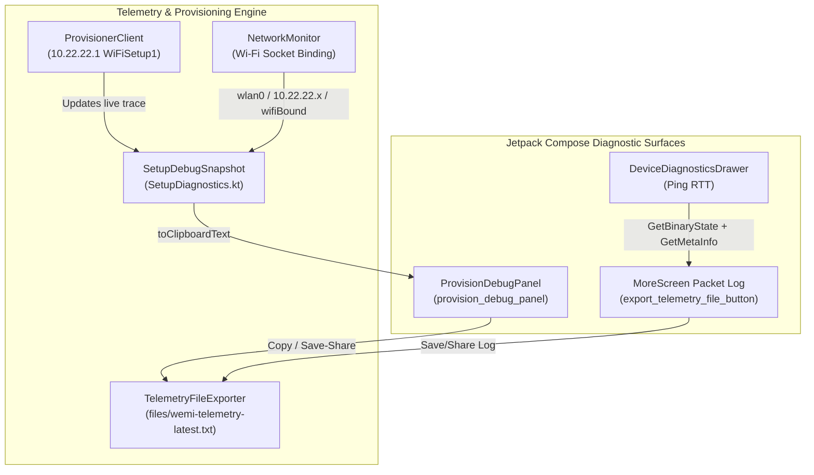

# WeMi Light Control — On-Device Telemetry, `10.22.22.1` Provisioning Diagnostics & Support Architecture (`DEBUGGING_AND_SUPPORT.md`)

**Repository**: `MichaelRHead/WeMi-light-control` (`org.suppressingfire.wemi` / `com.aistudio.wemiswitch.kxpqzr`, `v21.0`)  
**Document & Skill Owner**: **Antigravity Debugging & Support Agent — EXCLUSIVE OWNER**  
**Companion Agent Skill**: [`.agents/skills/wemi-device-telemetry-debug/SKILL.md`](.agents/skills/wemi-device-telemetry-debug/SKILL.md)  
**Companion User Guide**: [`docs/user-guide/telemetry-and-troubleshooting.md`](docs/user-guide/telemetry-and-troubleshooting.md)

> [!CAUTION]
> **EXCLUSIVE AGENT OWNERSHIP NOTICE (READ-ONLY FOR OTHER AGENTS)**
> - **Owner**: **Antigravity Debugging & Support Agent** is the **sole author and maintainer** of [`DEBUGGING_AND_SUPPORT.md`](DEBUGGING_AND_SUPPORT.md), [`.agents/skills/wemi-device-telemetry-debug/SKILL.md`](.agents/skills/wemi-device-telemetry-debug/SKILL.md), and [`docs/user-guide/telemetry-and-troubleshooting.md`](docs/user-guide/telemetry-and-troubleshooting.md).
> - **Policy for All Other Agents (including the Google AI Studio Agent, CLI agents, and external coding assistants)**: **DO NOT MODIFY, OVERWRITE, RENAME, OR DELETE THESE THREE FILES.** All other agents **must** read, preserve, and respect the diagnostic architecture, `Modifier.testTag(...)` contracts, and non-destructive provisioning invariants defined here when editing UI or network code, but must treat these three debugging & support files as **strictly read-only**.

Related documentation:
- [`AGENTS.md`](AGENTS.md) — Architecture & Agent Guide
- [`UX_DESIGN.md`](UX_DESIGN.md) & [`UX_DESIGN_AND_EXPERIENCE.md`](UX_DESIGN_AND_EXPERIENCE.md) — Android & Android TV UX Design Guidelines *(Owned Exclusively by the Google AI Studio Agent)*
- [`DISCOVERY_AND_ROOM_GROUPING.md`](DISCOVERY_AND_ROOM_GROUPING.md) — Device Discovery & Room Grouping Architecture *(Owned Exclusively by the Antigravity Device Discovery & Room Grouping Agent)*
- [`LICENSE_GOVERNANCE.md`](LICENSE_GOVERNANCE.md) — Open-Source MIT License Parity, Permissive Dependency Policy & Brand/Trademark Governance *(Owned Exclusively by the Antigravity License & Brand Governance Agent)*
- [`RELEASE_PROCESS.md`](RELEASE_PROCESS.md) & [`RELEASE_SIGN_OFF.md`](RELEASE_SIGN_OFF.md) — 5-Agent Autonomous Round-Robin Release Review Process & Sign-Off Ledger
- [`IMPLEMENTED.md`](IMPLEMENTED.md) — Reverse-Chronological Change Log (`v1.0` → `v21.0`)
- [`UPCOMING_FEATURES.md`](UPCOMING_FEATURES.md) — Upcoming Features & Next-Iteration Roadmap
- [`USER_GUIDE.md`](USER_GUIDE.md) — Modular User Guide Index & Feature Guides ([`docs/user-guide/`](docs/user-guide/))

---

## 1. Debugging & Support Philosophy

Because switches from Belkin's discontinued smart switch platform (`F7C030`, `WLS040`/`WLS0403`, `F7C059`/`WDS060`, `F7C063`/`WSP080`) communicate over the user's private local Wi-Fi (`192.168.x.x/24`) or an unconfigured switch's isolated `10.22.22.1/24` Setup AP, remote agents cannot directly ping the user's switches from the cloud.

To make hardware debugging fast, deterministic, and privacy-preserving, **WeMi Light Control** embeds a two-channel on-device telemetry system:
1. **Channel A — High-Contrast On-Screen Screenshot Panels**:
   - Designed so a single phone or Android TV screenshot captures the complete hardware, network, encryption, and SOAP state.
2. **Channel B — One-Tap Recorded Telemetry File Exporter (`wemi-telemetry-latest.txt`)**:
   - Writes a structured 4-section text report to `/data/data/com.aistudio.wemiswitch.kxpqzr/files/wemi-telemetry-latest.txt`, copies it to the system clipboard, and launches Android's `Intent.ACTION_SEND` share sheet.

---

## 2. Architecture of the Telemetry & Provisioning Diagnostics Subsystem

### Primary Source Files & Responsibilities

| File | Key Types & Functions | Diagnostic Role |
| :--- | :--- | :--- |
| [`SetupDiagnostics.kt`](app/src/main/java/org/suppressingfire/wemi/network/SetupDiagnostics.kt) | `SetupDebugSnapshot`, `TelemetryFileExporter` | Immutable snapshot of `10.22.22.1` setup telemetry (`[NET]`, `[PROBE]`, `[XML]`, `[FLAGS]`, `[ID]`, `[SCAN]`, `[TARGET AP]`, `[STEP 1..6]`) plus `buildFullTelemetryReport`, `latestTelemetryFile`, `saveTelemetryReportToFile`, and `copyAndShareTelemetryReport`. |
| [`ProvisionerClient.kt`](app/src/main/java/org/suppressingfire/wemi/network/ProvisionerClient.kt) | `probeSetupDevice`, `fetchAvailableApList`, `provisionDeviceToHomeWifi` | OkHttp-framed `10.22.22.1` probing across ports `49151..49159`, `GetMetaInfo` + `GetMacAddr`/`GetSerialNo` fallback, `8500ms` 2.4 GHz site-survey timeout, double-send `ConnectHomeNetwork`, 18-poll `GetNetworkStatus` loop, and non-destructive `CloseSetup` gating. |
| [`PasswordCrypto.kt`](app/src/main/java/org/suppressingfire/wemi/network/PasswordCrypto.kt) | `encryptWifiPassword`, `decryptWifiPassword` | Stateless `pywemo`-exact OpenSSL `EVP_BytesToKey` MD5 key/IV derivation and AES-128-CBC encryption supporting all 6 permutations (`Method 1/2/3` × `addPasswordLengths = true/false`). |
| [`NetworkMonitor.kt`](app/src/main/java/org/suppressingfire/wemi/network/NetworkMonitor.kt) | `createWifiBoundSocketFactory`, `hasBoundWifiNetwork` | Binds HTTP/SOAP sockets directly to the active (even unvalidated/no-internet) `10.22.22.x` Wi-Fi `Network` handle so Android cellular data never hijacks setup traffic. |
| [`ProvisionDebugPanel.kt`](app/src/main/java/org/suppressingfire/wemi/ui/components/ProvisionDebugPanel.kt) & [`ProvisionApDialog.kt`](app/src/main/java/org/suppressingfire/wemi/ui/components/ProvisionApDialog.kt) | `ProvisionDebugPanel`, `ProvisionApDialog` | Renders the `SETUP DEBUG DETAILS (SCREENSHOT)` terminal card (`provision_debug_panel`, `provision_debug_text`), **`Copy`** (`copy_provision_debug_button`), **`Save/Share`** (`share_provision_debug_button`), and **`Keep Dialog Open on Success`** (`keep_provision_dialog_open_chip`). |
| [`MoreScreen.kt`](app/src/main/java/org/suppressingfire/wemi/ui/screens/MoreScreen.kt) & [`DeviceDiagnosticsDrawer.kt`](app/src/main/java/org/suppressingfire/wemi/ui/components/DeviceDiagnosticsDrawer.kt) | `MoreScreen`, `ExpandedDrawer` | Renders the live `UPnP / SOAP Packet Log` card with one-tap **`Save/Share Log`** (`export_telemetry_file_button`) and **`Clear`**, plus the per-device inline RTT diagnostics drawer (`ping_device_<id>`). |

---

## 3. Non-Negotiable Debugging & Provisioning Invariants

All agents modifying networking, repository, or UI code must preserve these five debugging invariants:

1. **Never Call `CloseSetup` When `GetNetworkStatus` Is `0` or `2` (`kept_open_for_retry`)**:
   - In [`ProvisionerClient.kt`](app/src/main/java/org/suppressingfire/wemi/network/ProvisionerClient.kt), `overallSuccess` requires `httpSuccess && (netStatus == 1 || netStatus == 3)`.
   - Whenever `netStatus == 0` (still connecting / handshake timeout) or `netStatus == 2` (password/auth rejected), `CloseSetup` **must be skipped** (`[STEP 6 HOLD]`) so the switch's `10.22.22.1` setup AP stays open and the user can immediately retry another encryption method or password without factory-resetting the switch.
2. **Never Auto-Dismiss `ProvisionApDialog` on Failure or When `keepDialogOpenOnSuccess` Is Enabled**:
   - When provisioning fails (`!result.success`), or when the user toggles `keep_provision_dialog_open_chip` ON, `ProvisionApDialog` must remain open on screen so the user can screenshot `provision_debug_panel` or tap **`Save/Share`**.
3. **Never Log Plaintext Wi-Fi Passwords in Screenshots or Telemetry Files**:
   - `SetupDebugSnapshot` and `TelemetryFileExporter` must only record `Method`, `addLengths`, `plainLen`, `encLen`, and `suffix` (`[STEP 4 CRYPTO] Method=1 addLengths=true plainLen=12 encLen=68 suffix=0c40`) — never the user's raw Wi-Fi password.
4. **Preserve Diagnostic `Modifier.testTag(...)` Identifiers**:
   - Keep `provision_debug_panel`, `provision_debug_text`, `copy_provision_debug_button`, `share_provision_debug_button`, `keep_provision_dialog_open_chip`, and `export_telemetry_file_button` intact and covered by [`GenaProvisioningAndRulesTest.kt`](app/src/test/java/org/suppressingfire/wemi/GenaProvisioningAndRulesTest.kt), [`EndToEndUiTest.kt`](app/src/test/java/org/suppressingfire/wemi/EndToEndUiTest.kt), and [`HardwareCujEndToEndTest.kt`](app/src/test/java/org/suppressingfire/wemi/HardwareCujEndToEndTest.kt).
5. **Preserve OkHttp Content-Length Framing & `8500ms` Site-Survey Read Timeout on `10.22.22.1`**:
   - Embedded `uhttpd` / RTOS HTTP servers on `10.22.22.1` often keep TCP sockets open (`Connection: keep-alive`) after sending `/setup.xml` and take `3–6 seconds` to complete an 11-channel 2.4 GHz `GetApList` scan. Always use `OkHttpClient` (`readTimeout = 8500ms`) rather than raw `Socket.getInputStream().readText()`.

---

## 4. End-to-End Diagnostic Playbook

When a user provides a screenshot of `SETUP DEBUG DETAILS (SCREENSHOT)` or shares `wemi-telemetry-latest.txt`, follow the step-by-step decoder and remediation matrix in [`.agents/skills/wemi-device-telemetry-debug/SKILL.md`](.agents/skills/wemi-device-telemetry-debug/SKILL.md):

1. **Inspect `[NET]`**: Verify `setupSubnet=true` and `wifiBound=true` on `10.22.22.x/24`.
2. **Inspect `[PROBE]`**: Verify which port (`49151..49159`) and XML path (`/setup.xml` or `/Lightsetup.xml`) responded with `HTTP_200`.
3. **Inspect `[XML]`, `[FLAGS]` & `[ID]`**: Verify `mac` (12 hex chars) and `sn` are non-empty (`src=GetMetaInfo`, `setup.xml`, or `basicevent1#GetMacAddr`) and check `rtos`, `iot`, `binaryOption`, `new_algo` → `autoMethod`.
4. **Inspect `[SCAN]` & `[TARGET AP]`**: Verify the target 2.4 GHz SSID, channel (`1..11`), `Auth` (`WPA2PSK`), and `Encrypt` (`AES`).
5. **Inspect `[STEP 1..6]`**: Check `PairingStatus`, `GetNetworkStatus` poll progression (`0`, `1`, `2`, `3`), and `CloseSetup` status (`success` vs `kept_open_for_retry`).
