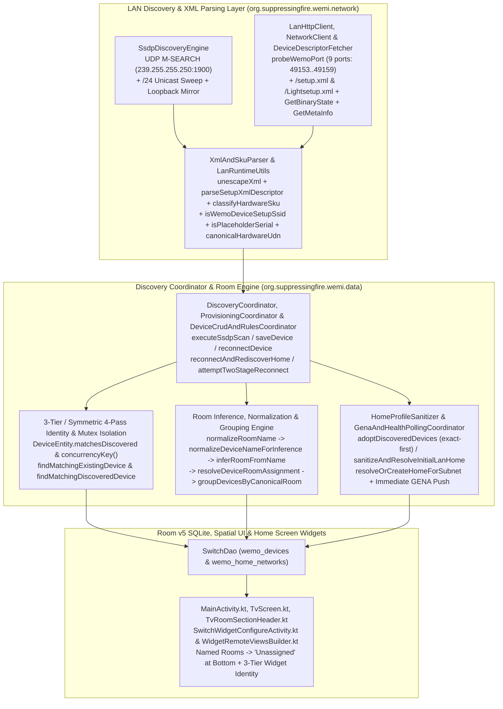

# WeMi Light Control — Internal Device Discovery Logic, Self-Healing Identity Resolution & Automatic Room Grouping Architecture (`DISCOVERY_AND_ROOM_GROUPING.md`)

**Repository**: `MichaelRHead/WeMi-light-control` (`org.suppressingfire.wemi` / `com.aistudio.wemiswitch.kxpqzr`, `v32.0`)  
**Document & Skill Owner**: **Antigravity Device Discovery & Room Grouping Agent — EXCLUSIVE OWNER**  
**Companion Agent Skill**: [`.agents/skills/wemi-discovery-and-room-grouping/SKILL.md`](.agents/skills/wemi-discovery-and-room-grouping/SKILL.md)  
**Companion User Guides**: [`docs/user-guide/room-grouping.md`](docs/user-guide/room-grouping.md) & [`docs/user-guide/switch-discovery.md`](docs/user-guide/switch-discovery.md)

> [!CAUTION]
> **EXCLUSIVE AGENT OWNERSHIP NOTICE (READ-ONLY FOR OTHER AGENTS)**
> - **Owner**: **Antigravity Device Discovery & Room Grouping Agent** is the **sole author and maintainer** of [`DISCOVERY_AND_ROOM_GROUPING.md`](DISCOVERY_AND_ROOM_GROUPING.md) and [`.agents/skills/wemi-discovery-and-room-grouping/SKILL.md`](.agents/skills/wemi-discovery-and-room-grouping/SKILL.md).
> - **Policy for All Other Agents (including the Google AI Studio Agent, the Antigravity Telemetry & Debugging Agent, the Antigravity Code Quality & E2E Testing Agent, the Antigravity License & Brand Governance Agent, CLI agents, and external coding assistants)**: **DO NOT MODIFY, OVERWRITE, RENAME, OR DELETE THESE TWO FILES.** All other agents **must** read, preserve, and respect the device discovery orchestration, 3-tier identity matching (`matchesDiscoveredDevice`), and automatic room grouping/migration (`inferRoomFromName`, `resolveDeviceRoomAssignment`, `groupDevicesByCanonicalRoom`) invariants defined here when editing repository, network, widget, or UI code, but must treat these two files as **strictly read-only**.

Related documentation:
- [`AGENTS.md`](AGENTS.md) & [`ARCHITECTURE.md`](ARCHITECTURE.md) — Concise Agent Guide & On-Demand Source/Test Catalog
- [`UX_DESIGN.md`](UX_DESIGN.md) & [`UX_DESIGN_AND_EXPERIENCE.md`](UX_DESIGN_AND_EXPERIENCE.md) — Android & Android TV UX Design Guidelines *(Owned Exclusively by the Google AI Studio Agent)*
- [`DEBUGGING_AND_SUPPORT.md`](DEBUGGING_AND_SUPPORT.md) — On-Device Telemetry & `10.22.22.1` Provisioning Diagnostics *(Owned Exclusively by the Antigravity Debugging & Support Agent)*
- [`LICENSE_GOVERNANCE.md`](LICENSE_GOVERNANCE.md) — Open-Source Licensing, Third-Party Attribution & Brand/Trademark Governance *(Owned Exclusively by the Antigravity License & Brand Governance Agent)*
- [`RELEASE_PROCESS.md`](RELEASE_PROCESS.md) & [`RELEASE_SIGN_OFF.md`](RELEASE_SIGN_OFF.md) — 6-Agent / 7-Stage Autonomous Release Process & Sign-Off Ledger
- [`IMPLEMENTED.md`](IMPLEMENTED.md) — Reverse-Chronological Change Log (`v1.0` → `v32.0`)
- [`UPCOMING_FEATURES.md`](UPCOMING_FEATURES.md) — Upcoming Features & Next-Iteration Roadmap
- [`USER_GUIDE.md`](USER_GUIDE.md) — Modular User Guide Index & Feature Guides ([`docs/user-guide/`](docs/user-guide/))

---

## 1. Domain Responsibility & Design Philosophy

Belkin WeMo hardware (`F7C030` 1st-Gen Light Switch, `WLS040`/`WLS0403` 2nd-Gen 3-Way Switch, `F7C059`/`WDS060` Smart Dimmer, and `F7C063`/`WSP080` Mini Smart Plug) operates entirely on the local LAN via UPnP / SSDP / SOAP without any room attribute in its `/setup.xml` descriptor. Furthermore, switches dynamically rotate UPnP ports (`49151–49159`) across reboots, receive new IPv4 leases from home DHCP routers, XML-escape special characters in `<friendlyName>` / `<MetaInfo>`, and frequently return their own factory setup hotspot SSID (`Wemo.LS3W.220`, `WeMo.Switch.xxx`, `WeMo.Light.xxx`) in field 4 of `metainfo1#GetMetaInfo`.

The **Antigravity Device Discovery & Room Grouping Agent** is responsible for two tightly coupled core subsystems:
1. **Internal Device Discovery & Self-Healing Identity Resolution**:
   - Discovering switches across UDP multicast (`239.255.255.250:1900` `M-SEARCH`), `/24` unicast port sweeps (`Semaphore(24)`), and loopback hardware simulators (`127.0.0.1`), while reconciling discovered endpoints against Room v5 SQLite entities and Android Home Screen Widgets via a deterministic **3-Tier / Symmetric 4-Pass Hardware Identity Matcher** without exceeding `Semaphore(3)` concurrency against 2nd-Gen RTOS firmware.
2. **Automatic Room Grouping & Non-Destructive Legacy Room Migration**:
   - Inferring the most accurate household room from each switch's XML-unescaped `<friendlyName>` (`normalizeDeviceNameForInference` + `inferRoomFromName`), placing unrecognized names into canonical **`"Unassigned"`** (sorted at the bottom of the room list) rather than polluting **`"Living Room"`**, merging case-variant room labels via `groupDevicesByCanonicalRoom` across Mobile, Tablet, Android TV, and Home Screen Widget pickers, and automatically migrating existing switches stuck in legacy `"Living Room"` or `"Unassigned"` assignments while preserving intentional custom rooms chosen by the user.

---

## 2. End-to-End Discovery & Room Grouping Architecture

### Primary Source Files & Domain Responsibilities

| File | Key Functions & Types | Role in Discovery & Room Grouping |
| :--- | :--- | :--- |
| [`DeviceEntities.kt`](app/src/main/java/org/suppressingfire/wemi/data/DeviceEntities.kt) | `UNASSIGNED_ROOM`, `normalizeRoomName`, `groupDevicesByCanonicalRoom`, `DeviceEntity.matchesDiscovered`, `DeviceEntity.concurrencyKey`, `SsdpDiscoveredDevice.matchesEndpointOrSerial`, `normalizeDeviceNameForInference`, `inferRoomFromName`, `resolveDeviceRoomAssignment`, `classifyDeviceCategory` | Single source of truth for canonical `"Unassigned"` normalization and case-insensitive room grouping (named rooms ordered by `sortOrder`, `"Unassigned"` last), 3-tier hardware identity matching & `SsdpDiscoveredDevice` Tier-2 `<UDN>` deduplication, `expectedHardwareIdentity`-backed per-device `Mutex` keys, CamelCase/acronym/delimiter normalization, declarative specificity-ordered `ROOM_INFERENCE_RULES` (`"Ensuite"` before `"Bedroom"`, word-prefixed `\bstair` with low-priority `"upstairs"`/`"downstairs"` floor fallback, word-bounded `\bshed\b`/`\bpier\b`/`\bbed\b`/`\bhall\b`/`\bden\b`/`\bwc\b`), and trimmed non-destructive room migrations. |
| [`DiscoveryCoordinator.kt`](app/src/main/java/org/suppressingfire/wemi/data/DiscoveryCoordinator.kt), [`HomeProfileSanitizer.kt`](app/src/main/java/org/suppressingfire/wemi/data/HomeProfileSanitizer.kt), [`ProvisioningCoordinator.kt`](app/src/main/java/org/suppressingfire/wemi/data/ProvisioningCoordinator.kt) & [`DeviceCrudAndRulesCoordinator.kt`](app/src/main/java/org/suppressingfire/wemi/data/DeviceCrudAndRulesCoordinator.kt) | `matchesDiscoveredDevice`, `findMatchingExistingDevice`, `findMatchingDiscoveredDevice`, `executeSsdpScan`, `adoptDiscoveredDevices`, `mergeDiscoveredMetadata`, `syncFirstRouterSsid`, `attemptTwoStageReconnect`, `detectStartupDeviceStates`, `reconnectAndRediscoverHome`, `sanitizeAndResolveInitialLanHome`, `saveDevice`, `moveDeviceOrder`, `toggleRoomPower`, `updateRoomBrightness` | Orchestrates startup `GetBinaryState` probes, 2-stage self-healing reconnects, symmetric 4-pass hardware identity resolution with cross-device claim protection (preventing offline blank-serial switches from hijacking online peers), exact-identity/endpoint-first batch adoption ordering, 3-tier post-provisioning deduplication, `adoptMutex`-serialized adoption preserving known router SSIDs across soft-AP responses, stale-free home router SSID sync, manual-IP 9-port hardware enrichment + `<serialNumber>`/`<UDN>` deduplication, trimmed `normalizeRoomName` home- & room-scoped `moveDeviceOrder(..., withinRoomOnly)`, concurrent `Semaphore(3)` room batch fan-out, and per-home startup soft-AP SSID + legacy `"Living Room"` room sanitization. |
| [`SsdpDiscoveryEngine.kt`](app/src/main/java/org/suppressingfire/wemi/network/SsdpDiscoveryEngine.kt) | `performSsdpDiscoveryScan`, `scanSubnetUnicast`, `shouldRunUnicastSubnetFallback`, `registerLoopbackSsdpPort` | Sends dual UDP `M-SEARCH` bursts (`urn:Belkin:service:basicevent:1` & `upnp:rootdevice`) with `MulticastLock`, `ensureActive()` cancellation checks, and `550ms` retransmit within a `1.25s` window (`90ms`/`220ms` in `fastMode`), fetches Stage A & Stage B descriptors concurrently with order-preserving `Semaphore(3)` RTOS protection, mirrors probes in deterministic registration order to loopback test servers, verifies known endpoints via `expectedHardwareIdentity` + `/Lightsetup.xml` fallback, and runs Stage C `/24` unicast sweeps (`Semaphore(24)`, skipping `localIp`, already-discovered `skipIps`, and `10.22.22.x`) whenever UDP multicast receives zero live responses (bounded by `onlySweepWhenKnownMissing = true` on reconnects). |
| [`LanRuntimeUtils.kt`](app/src/main/java/org/suppressingfire/wemi/network/LanRuntimeUtils.kt) & [`NetworkModels.kt`](app/src/main/java/org/suppressingfire/wemi/network/NetworkModels.kt) | `PLACEHOLDER_SERIALS`, `isPlaceholderSerial`, `canonicalHardwareUdn`, `expectedHardwareIdentity`, `isRunningInRobolectric`, `resolvePreferredLanInterfaceIpv4`, `SsdpScanReport`, `SwitchMetaInfo` | Distinguishes synthetic placeholder serials (`""`, `"UNKNOWN"`, `221517K01018AB` / `LAN` / `NEW`) and placeholder-derived UDNs from real hardware identities, normalizes UPnP `<UDN>` / `USN` identifiers (`substringBefore("::")`), resolves the strongest available hardware identity (`expectedHardwareIdentity`: real serial → canonical UDN → `""`), selects `wlan*`-preferred IPv4 interfaces, and defines shared discovery/SOAP wire models. |
| [`LanHttpClient.kt`](app/src/main/java/org/suppressingfire/wemi/network/LanHttpClient.kt), [`NetworkClient.kt`](app/src/main/java/org/suppressingfire/wemi/network/NetworkClient.kt), [`DeviceDescriptorFetcher.kt`](app/src/main/java/org/suppressingfire/wemi/network/DeviceDescriptorFetcher.kt), [`GenaSubscriptionManager.kt`](app/src/main/java/org/suppressingfire/wemi/network/GenaSubscriptionManager.kt) & [`GenaAndHealthPollingCoordinator.kt`](app/src/main/java/org/suppressingfire/wemi/data/GenaAndHealthPollingCoordinator.kt) | `probeWemoPort`, `executeWithPortHealing`, `fetchLiveDeviceDescriptor`, `probeAndFetchDeviceDescriptor`, `deviceKeyFor`, `handleGenaNotification` | Zero-dependency `SocketFactory` HTTP/1.1 client, 9-port UPnP endpoint prober verifying `<serialNumber>` and canonical `<UDN>` across ports `49153, 49152, 49154, 49151, 49155..49159` (continuing past mismatched loopback ports on `127.0.0.1` while fast-aborting DHCP IP swaps on real LAN hosts and blocking unverified port fallback whenever `expectedHardwareIdentity` is non-empty), `/setup.xml` + `/Lightsetup.xml` live descriptor enrichment, and 3-tier UPnP GENA `NOTIFY` identity routing (`!isPlaceholderSerial(serialNumber)` → `"dev_${id}"` → `sourceIp`). |
| [`XmlAndSkuParser.kt`](app/src/main/java/org/suppressingfire/wemi/network/XmlAndSkuParser.kt) | `escapeXml`, `unescapeXml`, `parseSetupXmlDescriptor`, `classifyHardwareSku`, `parseMetaInfoSoapResponse`, `isWemoDeviceSetupSsid` | Unescapes XML entities (`&amp;`, `&apos;`, `&#39;`, `&quot;`, `&lt;`, `&gt;`) when extracting `<friendlyName>`, `<modelName>`, `<modelDescription>`, and `GetMetaInfo` router SSIDs, extracts `<serialNumber>`, canonical `<UDN>`, `<binaryState>`, and `<brightness>` from `/setup.xml`, classifies Belkin SKUs, and filters out Belkin soft-AP SSIDs (`WeMo.*` / `Wemo.LS3W.*`). |
| [`MainActivity.kt`](app/src/main/java/org/suppressingfire/wemi/MainActivity.kt), [`TvScreen.kt`](app/src/main/java/org/suppressingfire/wemi/ui/components/TvScreen.kt), [`TvRoomSectionHeader.kt`](app/src/main/java/org/suppressingfire/wemi/ui/components/TvRoomSectionHeader.kt), [`DeviceActionsUiController.kt`](app/src/main/java/org/suppressingfire/wemi/ui/DeviceActionsUiController.kt), [`WidgetConfigStore.kt`](app/src/main/java/org/suppressingfire/wemi/widget/WidgetConfigStore.kt), [`WidgetRemoteViewsBuilder.kt`](app/src/main/java/org/suppressingfire/wemi/widget/WidgetRemoteViewsBuilder.kt), [`WidgetActionExecutor.kt`](app/src/main/java/org/suppressingfire/wemi/widget/WidgetActionExecutor.kt), [`WeMiSwitchWidgetProvider.kt`](app/src/main/java/org/suppressingfire/wemi/widget/WeMiSwitchWidgetProvider.kt) & [`SwitchWidgetConfigureActivity.kt`](app/src/main/java/org/suppressingfire/wemi/widget/SwitchWidgetConfigureActivity.kt) | `groupDevicesByCanonicalRoom`, `selectSearchTargetAndScan`, `TvFocusTarget.RoomHeader`, `WidgetTargetConfig` (`serialNumber` + `udn`), `resolveTargetDevice`, `resolveRoomDevices`, `refreshGenaIfRealLan`, `moveDevice` | Groups active home devices via `groupDevicesByCanonicalRoom` on Phone/Tablet (`RoomGroupCard`), Android TV's 3-column grid (`TvRoomSectionHeader` with deterministic Up/Down D-Pad traversal and `Left`/`Right` `-10%`/`+10%` room dimming), and Home Screen Widget pickers (`SwitchWidgetConfigureActivity`), supersedes active SSDP scans cleanly when switching Search Targets (`selectSearchTargetAndScan`), enforces 3-tier hardware identity (`serialNumber` → canonical `udn` → `deviceId` → `displayName`, with anti-hijack mismatch rejection and learned serial/UDN healing) + strict multi-home Room isolation in Home Screen widgets, registers immediate `<100ms` Real-LAN GENA push subscriptions, and sorts `"Unassigned"` after all named rooms. |

---

## 3. Internal Logic of Device Discovery & 3-Tier Identity Resolution

### 3.1 Multi-Path Discovery Pipeline (`SsdpDiscoveryEngine.kt`)
When `executeSsdpScan` or `reconnectAndRediscoverHome` runs (with `DeviceActionsUiController.selectSearchTargetAndScan` cancelling any superseded active `ssdpScanJob` cleanly):
1. **Stage A — UDP Multicast `M-SEARCH` (`239.255.255.250:1900`)**:
   - Acquires `WifiManager.MulticastLock("wemi_ssdp_multicast_lock")`, binds an ephemeral UDP socket on the active Wi-Fi IPv4 interface (`LanRuntimeUtils.resolvePreferredLanInterfaceIpv4`), and transmits two `M-SEARCH` bursts separated by a `550ms` retransmit interval within a `1.25s` receive window (`90ms`/`220ms` in `fastMode` under Robolectric/loopback) with `ensureActive()` cancellation checks.
   - Simultaneously mirrors `M-SEARCH` datagrams to any registered loopback `FakeUpnpServer` UDP ports (`127.0.0.1`) in registration order for deterministic E2E testing, fetches descriptors concurrently via order-preserving `Semaphore(3)` coroutines, unescapes XML entities in `<friendlyName>`/`<MetaInfo>`, and deduplicates responses via `SsdpDiscoveredDevice.matchesEndpointOrSerial` (real serial → canonical UDN → exact `ipAddress:port`).
2. **Stage B — Known-Device Unicast Verification (Placeholder-Serial Safe & Concurrent)**:
   - Probes all unseen remembered switches for the active home in parallel (order-preserving `Semaphore(3)` concurrency) across the 9 Belkin UPnP ports (`49153, 49152, 49154, 49151, 49155..49159`) and `/setup.xml` + `/Lightsetup.xml`, passing `LanRuntimeUtils.expectedHardwareIdentity(known.serialNumber, known.udn)` to `probeWemoPort` and guarding `unseenKnown` with `!LanRuntimeUtils.isPlaceholderSerial` + `canonicalHardwareUdn` so switches on APs that drop UDP multicast are discovered immediately without cross-suppressing unprobed manual-IP entries.
3. **Stage C — Multicast-Zero `/24` Subnet Unicast Sweep (`shouldRunUnicastSubnetFallback` + `scanSubnetUnicast`)**:
   - Triggered whenever UDP multicast receives **zero live responses** (`liveDiscovered.none { it.isLiveUdpResponse }`) in Real LAN Mode (`allowUnicastSubnetFallback = true`, skipped in `fastMode`, Demo Showroom mode, single-switch `attemptTwoStageReconnect`, and on `10.22.22.x` Setup AP subnets):
     - **Explicit LAN Scans (`onlySweepWhenKnownMissing = false`) or Empty Homes**: Always sweeps remaining `/24` hosts even if Stage B already verified remembered switches, passing `skipIps = setOf(localIp) + liveDiscovered.map { it.ipAddress }` so newly installed or DHCP-relocated switches are still discovered on multicast-blocked routers.
     - **Home Reconnects (`onlySweepWhenKnownMissing = true`)**: Sweeps only if at least one remembered switch failed to match via Stage B (`known.matchesDiscovered(discovered, requireSamePortWhenBlankSerial = false)`), avoiding unnecessary sweep latency when all remembered switches are online.
   - Probes remaining hosts with `Semaphore(24)`, `ensureActive()`, and `180ms` TCP connect timeout via Wi-Fi-bound `wifiSocketFactory.createSocket()` across primary Belkin ports (`49153`, `49152`, `49154`, `49151`) and `/setup.xml` + `/Lightsetup.xml`.
4. **Stage D — Live State, Metadata Enrichment, Router SSID Sync & Immediate GENA Push**:
   - For each discovered endpoint, `DeviceDescriptorFetcher` queries `basicevent1#GetBinaryState`, `metainfo1#GetMetaInfo` (unescaping XML entities and filtering out soft-AP SSIDs via `isWemoDeviceSetupSsid`), and `basicevent1#GetSignalStrength`; `DiscoveryCoordinator` delegates metadata merging to `HomeProfileSanitizer.mergeDiscoveredMetadata` inside `mutexFor(device).withLock` (respecting the `1500ms` `lastSetStateTimestampMs` echo window, shielding soft-AP SSIDs, and enriching `<serialNumber>`/`<UDN>`), syncs valid discovered router SSIDs back to generic home labels via `HomeProfileSanitizer.syncFirstRouterSsid` before re-reading the fresh `HomeNetworkEntity`, and `DeviceActionsUiController` registers immediate `<100ms` UPnP GENA `NOTIFY` subscriptions for adopted switches.

### 3.2 Deterministic 3-Tier / Symmetric 4-Pass Hardware Identity Matcher (`matchesDiscovered`, `findMatchingExistingDevice`, `findMatchingDiscoveredDevice`, `saveDevice`, `ProvisioningCoordinator`, `WidgetRemoteViewsBuilder` & GENA `NOTIFY`)
To prevent duplicate database rows when a switch changes IP/port (whether via SSDP scan, `10.22.22.1` provisioning, or manual-IP `saveDevice`, with new insertions receiving monotonic `(maxSortOrder ?: -1) + 1` indices) and to prevent cross-matching when DHCP swaps IPs between two switches or when multiple factory-named switches share `"WeMo Light Switch"`, all reconciliation paths enforce a strict 3-tier / symmetric 4-pass priority order:

1. **Tier 1 (Pass 1) — Real Hardware `<serialNumber>` Identity (Authoritative, Cross-Home)**:
   - If **both** `!LanRuntimeUtils.isPlaceholderSerial(existing.serialNumber)` and `!LanRuntimeUtils.isPlaceholderSerial(discovered.serialNumber)` are true, they match **if and only if** `existing.serialNumber.equals(discovered.serialNumber, ignoreCase = true)`.
   - Two switches with different real hardware serial numbers will **never** match each other across SSDP scans, `10.22.22.1` provisioning, Home Screen widget lookups, or `NetworkClient.probeWemoPort` / `executeWithPortHealing` (which refuse mismatched hardware identities and block unverified port fallback whenever `expectedHardwareIdentity` is non-empty), while synthetic placeholder serials (`""`, `"UNKNOWN"`, `221517K01018AB`, `221517K01018LAN`, `221517K01018NEW`) cleanly fall through to Tiers 2 and 3 so manual entries upgrade to their real hardware serial upon discovery.
2. **Tier 2 (Pass 2) — Canonical UPnP `<UDN>` / `USN` Identity (`LanRuntimeUtils.canonicalHardwareUdn`)**:
   - Strips any `::urn:...` SSDP `USN` service suffix (`substringBefore("::")`) and rejects UDNs synthesized from placeholder serials; when **both** sides carry non-empty canonical UDNs, `DeviceEntity.matchesDiscovered`, `SsdpDiscoveredDevice.matchesEndpointOrSerial`, `ProvisioningCoordinator`, `DeviceCrudAndRulesCoordinator.saveDevice`, and `WidgetRemoteViewsBuilder.resolveTargetDevice` match **if and only if** the canonical UDNs are equal (never falling through to Tier-3 endpoint, `deviceId`, or friendly-name matching on UDN mismatch).
3. **Tier 3 (Pass 3a Exact Endpoint → Pass 3b `<friendlyName>` Fallback with Cross-Device Claim Protection + `"dev_${id}"` GENA Isolation)**:
   - Used **only** when at least one device has a blank/placeholder `serialNumber` and at least one lacks a canonical `udn`. Both `findMatchingExistingDevice` (`discovered → existing`) and `findMatchingDiscoveredDevice` (`existing → discovered`) check exact `(ipAddress, port)` (Pass 3a) **before** falling back to case-insensitive `<friendlyName>` (Pass 3b), while `isDiscoveredClaimedByOtherDevice` prevents an offline blank-serial switch from hijacking a discovered switch whose real serial, canonical UDN, or exact endpoint belongs to another switch in the same home. Batch adoption (`adoptDiscoveredDevices`) likewise processes exact-serial, canonical-UDN, and exact-endpoint matches before name-only candidates. Similarly, `GenaSubscriptionManager.deviceKeyFor` and `GenaAndHealthPollingCoordinator.handleGenaNotification` resolve incoming GENA `NOTIFY` events in 3-tier order (`!isPlaceholderSerial(serialNumber)` → `"dev_${id}"` → blank-key `sourceIp`) inside `mutexFor(matched).withLock`.

---

## 4. Automatic Room Grouping & Legacy Migration Engine

### 4.1 Token Normalization (`normalizeDeviceNameForInference`)
Users and Belkin setup utilities name switches using spaces (`"Shprese Bed Lamp"`), CamelCase (`"StairwayLight"`, `"MasterBathVanity"`), acronym-prefixed CamelCase (`"WCLight"`, `"TVDenLamp"`), underscores (`"Mike_Bed_Light"`), hyphens (`"Front-Porch-Light"`), or XML entities (`"Mike&apos;s Bed &amp; Bath Lamp"`). After `XmlAndSkuParser.unescapeXml`, `normalizeDeviceNameForInference` in [`DeviceEntities.kt`](app/src/main/java/org/suppressingfire/wemi/data/DeviceEntities.kt):
1. Splits acronym-to-CamelCase (`([A-Z]+)([A-Z][a-z])` → `"$1 $2"`) and lower-to-upper CamelCase (`([a-z])([A-Z])` → `"$1 $2"`) boundaries.
2. Replaces `_`, `-`, `/`, and `.` delimiters with spaces.
3. Lowercases and collapses whitespace so word-boundary regexes (`\bbed\b`, `\bhall\b`, `\bstair`, `\bshed\b`, `\bpier\b`, `\bden\b`, `\bwc\b`, etc.) match reliably across all naming styles.

### 4.2 Specificity-Ordered Room Inference Table (`inferRoomFromName`)
`inferRoomFromName(deviceName)` evaluates declarative `ROOM_INFERENCE_RULES` in **specificity order** so compound names (such as `"Master Bath Vanity"`, `"Upstairs Bedroom"`, or `"Finished Basement"`) match their specific functional room before broad demographic or floor modifiers:

| Priority | Target Room | Matched Keywords & Word-Bounded Tokens | Real-World Examples |
| :---: | :--- | :--- | :--- |
| **1** | **`Kitchen`** | `"kitchen"`, `"pantry"`, `"island"`, `"breakfast"`, `"nook"`, `"undercabinet"`, `"under cabinet"`, `"countertop"` | `"Kitchen Island Switch"`, `"Kitchen Under-Cabinet Dimmer"`, `"Pantry Light"` |
| **2** | **`Dining Room`** | `"dining"`, `"buffet"`, `"hutch"`, `"china cabinet"` | `"Dining Room Chandelier"`, `"Buffet Lamps"` |
| **3** | **`Ensuite`** | `"ensuite"`, `"en suite"`, `"bath"` (`"bath"`, `"bathroom"`), `"powder"`, `"vanity"`, `"restroom"`, `"lavatory"`, `"shower"`, `\bwc\b` | `"Master Bath Vanity"`, `"Guest Bathroom Light"`, `"Kids Bath Fan"`, `"WCLight"` |
| **4** | **`Hallway & Landing`** | `"hallway"`, `\bhall\b`, `"landing"`, `\bstair` (`"stair"`, `"stairs"`, `"stairway"`, `"staircase"`, `"stairwell"`), `"foyer"`, `"entry"`, `"vestibule"`, `"mudroom"`, `"mud room"`, `"corridor"`, `"breezeway"` | `"Stairway Light"`, `"Upstairs Hall Sconce"`, `"Front Entry Light"`, `"Mudroom Switch"` |
| **5** | **`Bedroom`** | `"bedroom"`, `"bedside"`, `"nightstand"`, `"night stand"`, `"headboard"`, `"dresser"`, `"wardrobe"`, `\bbed\b`, `"crib"`, `"cradle"`, `"loft"`, `"master"`, `"primary"`, `"nursery"`, `"guest"`, `"bunk"`, `"dorm"`, `"girls"`, `\bgirl\b`, `"boys"`, `\bboy\b`, `"kids"`, `\bkid\b`, `"children"` | `"Shprese Bed Lamp"`, `"Upstairs Bedroom"`, `"Girls Light"`, `"Kids Nightstand Lamp"` |
| **6** | **`Outdoor`** | `"patio"`, `"porch"`, `"veranda"`, `"lanai"`, `"outdoor"`, `"outside"`, `"exterior"`, `"garden"`, `"dock"`, `\bpier\b`, `"yard"`, `"deck"`, `"flood"`, `"walkway"`, `"sidewalk"`, `"pathway"`, `"balcony"`, `"terrace"`, `"gazebo"`, `"pergola"`, `"trellis"`, `"pool"`, `"fountain"`, `"landscape"` | `"Front Porch Light"`, `"Patio String Lights"`, `"Boat Pier Light"` |
| **7** | **`Garage`** | `"garage"`, `"workshop"`, `"workbench"`, `"driveway"`, `"carport"`, `"toolshed"`, `"woodshed"`, `\bshed\b`, `"barn"` | `"Garage Overhead Light"`, `"Tool Shed Light"`, `"Driveway Sensor"` |
| **8** | **`Basement`** | `"basement"`, `"cellar"`, `"laundry"`, `"utility"`, `"boiler"`, `"furnace"`, `"sump"`, `"crawlspace"`, `"rec room"`, `"game room"`, `"media room"`, `"theater"`, `"theatre"` | `"Finished Basement"`, `"Laundry Room Fan"`, `"Utility Sink"` |
| **9** | **`Office`** | `"office"`, `"study"`, `"desk"`, `"workstation"`, `"studio"`, `"library"` | `"Upstairs Office"`, `"Office Desk Lamp"`, `"Study Bookcase Light"` |
| **10** | **`Living Room`** | `"living"`, `"family"`, `\bden\b`, `"lounge"`, `"great room"`, `"parlor"`, `"parlour"`, `"sitting"`, `"sunroom"`, `"sun room"`, `"solarium"`, `"mantel"`, `"hearth"`, `"fireplace"`, `"couch"`, `"sofa"` | `"Downstairs Living Room"`, `"Family Den Switch"`, `"TVDenLamp"` |
| **11** | **`Hallway & Landing`** *(Floor Fallback)* | `"upstairs"`, `"downstairs"` (only when no specific room in Priorities 1–10 matched) | `"Upstairs Light"`, `"Downstairs Switch"` |
| **12** | **`Unassigned`** *(Fallback)* | Any switch name that does not match priorities 1–11 | `"Espresso Machine"`, `"Polished Brass Lamp"`, `"Pierre's Accent Lamp"`, `"Marshall Amp Plug"` |

### 4.3 Canonical Room Normalization, Grouping & Non-Destructive Migration (`normalizeRoomName`, `groupDevicesByCanonicalRoom`, `resolveDeviceRoomAssignment`)
1. **Canonical Normalization (`normalizeRoomName`)**: Trims whitespace and maps blank or case-variant `"unassigned"` values to `UNASSIGNED_ROOM` (`"Unassigned"`).
2. **Case-Insensitive Room Grouping (`groupDevicesByCanonicalRoom`)**: Shared across [`MainActivity.kt`](app/src/main/java/org/suppressingfire/wemi/MainActivity.kt), [`TvScreen.kt`](app/src/main/java/org/suppressingfire/wemi/ui/components/TvScreen.kt), and [`SwitchWidgetConfigureActivity.kt`](app/src/main/java/org/suppressingfire/wemi/widget/SwitchWidgetConfigureActivity.kt); merges case-variants like `"Kitchen"` and `"kitchen"` into a single display header (preferring capitalized labels), orders named rooms by user `sortOrder`, and places `"Unassigned"` last.
3. **Non-Destructive Room Resolution & Automatic Migration (`resolveDeviceRoomAssignment`)**:
   - **Demo Showroom Protection (`isDemoMode == true`)**: Preserves curated Demo Showroom room assignments (trimmed/normalized).
   - **Automatic Migration of Legacy `"Living Room"` & `"Unassigned"` Fallbacks (`!isDemoMode`)**: Trims `existingRoomName` first; if blank, `"Unassigned"`, or `"Living Room"` **and** `inferRoomFromName(deviceName)` resolves to a room other than `"Living Room"`, migrates the device to `inferredRoom`.
   - **Custom User Room Preservation**: Intentional custom rooms (e.g., `"Porch & Entryway"` or `"Upstairs Suite"`) are trimmed and preserved across future scans and restarts.

---

## 5. Non-Negotiable Discovery & Room Grouping Invariants

All agents modifying data, network, widget, or UI code must preserve these six invariants:

1. **Never Default Unrecognized Switch Names to `"Living Room"` & Always Group via `normalizeRoomName` / `groupDevicesByCanonicalRoom`**:
   - `inferRoomFromName` must always return `UNASSIGNED_ROOM` (`"Unassigned"`) as its fallback, `normalizeRoomName` must map blank and case-variant `"unassigned"` strings to `UNASSIGNED_ROOM`, and [`MainActivity.kt`](app/src/main/java/org/suppressingfire/wemi/MainActivity.kt), [`TvScreen.kt`](app/src/main/java/org/suppressingfire/wemi/ui/components/TvScreen.kt), [`SwitchWidgetConfigureActivity.kt`](app/src/main/java/org/suppressingfire/wemi/widget/SwitchWidgetConfigureActivity.kt), [`DeviceActionsUiController.kt`](app/src/main/java/org/suppressingfire/wemi/ui/DeviceActionsUiController.kt), [`WidgetRemoteViewsBuilder.kt`](app/src/main/java/org/suppressingfire/wemi/widget/WidgetRemoteViewsBuilder.kt), and [`DeviceCrudAndRulesCoordinator.kt`](app/src/main/java/org/suppressingfire/wemi/data/DeviceCrudAndRulesCoordinator.kt) must normalize rooms consistently and sort `"Unassigned"` after all named rooms.
2. **Evaluate Specific Functional Rooms (`"Ensuite"`) Before Broad & Floor Modifiers (`"Bedroom"`, `"upstairs"`/`"downstairs"`)**:
   - Keep `"Ensuite"` above `"Bedroom"` and keep `"upstairs"`/`"downstairs"` as a low-priority `"Hallway & Landing"` fallback so `"Master Bath"`, `"Upstairs Bedroom"`, `"Upstairs Office"`, and `"Downstairs Living Room"` resolve to their exact functional room.
3. **Enforce Word Boundaries on Short Ambiguous Tokens (`\bbed\b`, `\bhall\b`, `\bstair`, `\bpier\b`, `\bshed\b`, `\bden\b`, `\bgirl\b`, `\bboy\b`, `\bkid\b`, `\bwc\b`)**:
   - Never use raw substring checks for `"den"` (`"Garden"`), `"hall"` (`"Marshall"`), `"bed"` (`"Embedded"`), `"shed"` (`"Finished Basement"` / `"Polished"`), `"pier"` (`"Pierre"`), or `"stair"` (`"Upstairs Bedroom"`).
4. **Enforce 3-Tier / Symmetric 4-Pass Hardware Identity Across Discovery, Provisioning, Manual Save, GENA & Home Screen Widgets**:
   - Never allow mismatched real `<serialNumber>` or canonical `<UDN>` records to fall through to Tier-3 IP/`deviceId`/name matching, never allow an offline blank-serial switch to hijack a peer's discovered hardware, never allow unverified port fallback in `executeWithPortHealing` when `expectedHardwareIdentity` is non-empty, never treat synthetic placeholder serials (`221517K01018AB` / `LAN` / `NEW`) or placeholder-derived UDNs as real hardware identities, always unescape XML entities in `/setup.xml` and `GetMetaInfo`, and never overwrite a user's custom `roomName` during SSDP scans.
5. **Filter Out Belkin Soft-AP SSIDs (`isWemoDeviceSetupSsid`) & Preserve Known Router SSIDs**:
   - Never allow `WeMo.Switch.xxx`, `Wemo.LS3W.xxx`, `WeMo.Light.xxx`, or `WeMo.Mini.xxx` from `GetMetaInfo` to rename a `HomeNetworkEntity`, overwrite `device.wifiSsid`, or downgrade an already-known router SSID during re-adoption, and always sanitize multi-home device SSIDs against each device's own home/subnet.
6. **Stage 2 Release Sign-Off Gate, `100644` Scripts & Quota-Safe Zero-Idle-Polling Stop Policy**:
   - During active 6-agent / 7-stage release cycles (`RELEASE_SIGN_OFF.md` `CURRENT_TURN: discovery_and_grouping`), verify all discovery & room grouping invariants and full `sh gradlew testDebugUnitTest --rerun-tasks lintDebug assembleDebug` gates (preserving `100644` non-executable script modes) before advancing to `telemetry_and_debugging` via `bash scripts/advance_release_turn.sh`. **Never** re-arm `scripts/await_release_turn.sh` after recording `SIGNED_OFF` or between releases when `RELEASE_STATUS` is `APPROVED_FOR_PLAY_STORE` or `PROMOTED_TO_CLOSED_TESTING` (`CURRENT_TURN: NONE`).
