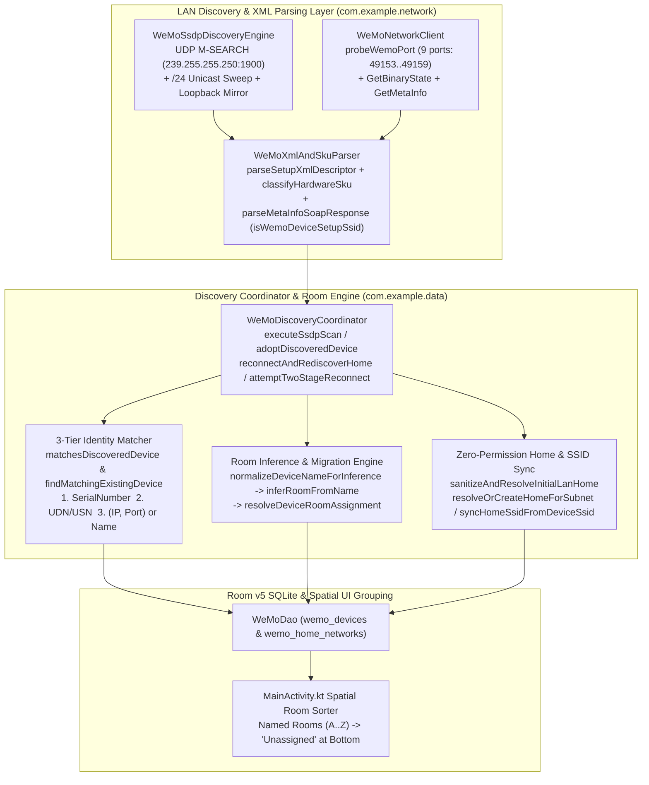

# WeMi Light Control — Internal Device Discovery Logic, Self-Healing Identity Resolution & Automatic Room Grouping Architecture (`DISCOVERY_AND_ROOM_GROUPING.md`)

**Repository**: `MichaelRHead/WeMi-light-control` (`com.example` / `com.aistudio.wemiswitch.kxpqzr`, `v20.0`)  
**Document & Skill Owner**: **Antigravity Device Discovery & Room Grouping Agent — EXCLUSIVE OWNER**  
**Companion Agent Skill**: [`.agents/skills/wemi-discovery-and-room-grouping/SKILL.md`](.agents/skills/wemi-discovery-and-room-grouping/SKILL.md)  
**Companion User Guides**: [`docs/user-guide/room-grouping.md`](docs/user-guide/room-grouping.md) & [`docs/user-guide/switch-discovery.md`](docs/user-guide/switch-discovery.md)

> [!CAUTION]
> **EXCLUSIVE AGENT OWNERSHIP NOTICE (READ-ONLY FOR OTHER AGENTS)**
> - **Owner**: **Antigravity Device Discovery & Room Grouping Agent** is the **sole author and maintainer** of [`DISCOVERY_AND_ROOM_GROUPING.md`](DISCOVERY_AND_ROOM_GROUPING.md) and [`.agents/skills/wemi-discovery-and-room-grouping/SKILL.md`](.agents/skills/wemi-discovery-and-room-grouping/SKILL.md).
> - **Policy for All Other Agents (including the Google AI Studio Agent, the Antigravity Debugging & Support Agent, CLI agents, and external coding assistants)**: **DO NOT MODIFY, OVERWRITE, RENAME, OR DELETE THESE TWO FILES.** All other agents **must** read, preserve, and respect the device discovery orchestration, 3-tier identity matching (`matchesDiscoveredDevice`), and automatic room grouping/migration (`inferRoomFromName` & `resolveDeviceRoomAssignment`) invariants defined here when editing repository, network, or UI code, but must treat these two files as **strictly read-only**.

Related documentation:
- [`AGENTS.md`](AGENTS.md) — Architecture & Agent Guide
- [`UX_DESIGN.md`](UX_DESIGN.md) & [`UX_DESIGN_AND_EXPERIENCE.md`](UX_DESIGN_AND_EXPERIENCE.md) — Android & Android TV UX Design Guidelines *(Owned Exclusively by the Google AI Studio Agent)*
- [`DEBUGGING_AND_SUPPORT.md`](DEBUGGING_AND_SUPPORT.md) — On-Device Telemetry & `10.22.22.1` Provisioning Diagnostics *(Owned Exclusively by the Antigravity Debugging & Support Agent)*
- [`IMPLEMENTED.md`](IMPLEMENTED.md) — Reverse-Chronological Change Log (`v1.0` → `v20.0`)
- [`UPCOMING_FEATURES.md`](UPCOMING_FEATURES.md) — Upcoming Features & Next-Iteration Roadmap
- [`USER_GUIDE.md`](USER_GUIDE.md) — Modular User Guide Index & Feature Guides ([`docs/user-guide/`](docs/user-guide/))
- [`CODE_QUALITY_AND_MODULARIZATION_PLAN.md`](CODE_QUALITY_AND_MODULARIZATION_PLAN.md) — Code Modularization & E2E Validation Plan

---

## 1. Domain Responsibility & Design Philosophy

Belkin WeMo hardware (`F7C030` 1st-Gen Light Switch, `WLS040`/`WLS0403` 2nd-Gen 3-Way Switch, `F7C059`/`WDS060` Smart Dimmer, and `F7C063`/`WSP080` Mini Smart Plug) operates entirely on the local LAN via UPnP / SSDP / SOAP without any room attribute in its `/setup.xml` descriptor. Furthermore, switches dynamically rotate UPnP ports (`49151–49159`) across reboots, receive new IPv4 leases from home DHCP routers, and frequently return their own factory setup hotspot SSID (`Wemo.LS3W.220`, `WeMo.Switch.xxx`, `WeMo.Light.xxx`) in field 4 of `metainfo1#GetMetaInfo`.

The **Antigravity Device Discovery & Room Grouping Agent** is responsible for two tightly coupled core subsystems:
1. **Internal Device Discovery & Self-Healing Identity Resolution**:
   - Discovering switches across UDP multicast (`239.255.255.250:1900` `M-SEARCH`), `/24` unicast port sweeps (`Semaphore(24)`), and loopback hardware simulators (`127.0.0.1`), while reconciling discovered endpoints against Room v5 SQLite entities via a deterministic **3-Tier Hardware Identity Matcher** without exceeding `Semaphore(3)` concurrency against 2nd-Gen RTOS firmware.
2. **Automatic Room Grouping & Non-Destructive Legacy Room Migration**:
   - Inferring the most accurate household room from each switch's `<friendlyName>` (`normalizeDeviceNameForInference` + `inferRoomFromName`), placing unrecognized names into **`"Unassigned"`** (sorted at the bottom of the room list) rather than polluting **`"Living Room"`**, and automatically migrating existing switches stuck in legacy `"Living Room"` or `"Unassigned"` assignments while preserving intentional custom rooms chosen by the user.

---

## 2. End-to-End Discovery & Room Grouping Architecture

### Primary Source Files & Domain Responsibilities

| File | Key Functions & Types | Role in Discovery & Room Grouping |
| :--- | :--- | :--- |
| [`WeMoEntities.kt`](app/src/main/java/com/example/data/WeMoEntities.kt) | `normalizeDeviceNameForInference`, `inferRoomFromName`, `resolveDeviceRoomAssignment`, `classifyDeviceCategory` | Normalizes CamelCase/underscores/hyphens, applies specificity-ordered room inference (`"Ensuite"` before `"Bedroom"`, word-bounded `"bed"`/`"hall"`/`"den"`, `"Unassigned"` fallback), and resolves non-destructive room migrations. |
| [`WeMoDiscoveryCoordinator.kt`](app/src/main/java/com/example/data/WeMoDiscoveryCoordinator.kt) | `matchesDiscoveredDevice`, `findMatchingExistingDevice`, `executeSsdpScan`, `adoptDiscoveredDevice`, `attemptTwoStageReconnect`, `detectStartupDeviceStates`, `reconnectAndRediscoverHome`, `sanitizeAndResolveInitialLanHome` | Orchestrates startup `GetBinaryState` probes, 2-stage self-healing reconnects, SSDP/unicast discovery scans, `adoptMutex`-serialized device adoption, 3-tier identity matching, and soft-AP SSID / legacy room sanitization. |
| [`WeMoSsdpDiscoveryEngine.kt`](app/src/main/java/com/example/network/WeMoSsdpDiscoveryEngine.kt) | `performSsdpDiscoveryScan`, `scanSubnetUnicast`, `registerLoopbackSsdpPort` | Sends dual UDP `M-SEARCH` bursts (`urn:Belkin:service:basicevent:1` & `upnp:rootdevice`) with `MulticastLock` + 1s retransmit, mirrors probes to loopback test servers, and sweeps `/24` subnets with `Semaphore(24)`. |
| [`WeMoXmlAndSkuParser.kt`](app/src/main/java/com/example/network/WeMoXmlAndSkuParser.kt) | `parseSetupXmlDescriptor`, `classifyHardwareSku`, `parseMetaInfoSoapResponse`, `isWemoDeviceSetupSsid` | Extracts `<friendlyName>`, `<modelName>`, `<serialNumber>`, `<UDN>`, `<binaryState>`, and `<brightness>` from `/setup.xml`, classifies Belkin SKUs, and filters out Belkin soft-AP SSIDs (`WeMo.*` / `Wemo.LS3W.*`). |
| [`MainActivity.kt`](app/src/main/java/com/example/MainActivity.kt) | `availableRooms`, `groupedDevicesByRoom` | Groups active home devices by `roomName` and sorts `"Unassigned"` after all named rooms so unassigned switches never displace primary household rooms. |

---

## 3. Internal Logic of Device Discovery & 3-Tier Identity Resolution

### 3.1 Multi-Path Discovery Pipeline (`WeMoSsdpDiscoveryEngine.kt`)
When `executeSsdpScan` or `reconnectAndRediscoverHome` runs:
1. **Stage A — UDP Multicast `M-SEARCH` (`239.255.255.250:1900`)**:
   - Acquires `WifiManager.MulticastLock("wemi_ssdp_multicast_lock")`, binds an ephemeral UDP socket on the active Wi-Fi IPv4 interface, and transmits two `M-SEARCH` bursts separated by a `550ms` retransmit interval (`90ms` in `fastMode` under Robolectric/loopback) to defeat Wi-Fi multicast packet loss.
   - Simultaneously mirrors `M-SEARCH` datagrams to any registered loopback `FakeWeMoUpnpServer` UDP ports (`127.0.0.1`) for deterministic E2E testing.
2. **Stage B — Known-Device Unicast Verification**:
   - Probes all remembered switches for the active home across the 9 Belkin UPnP ports (`49153, 49152, 49154, 49151, 49155..49159`) so switches on APs that drop UDP multicast are still discovered immediately.
3. **Stage C — `/24` Subnet Unicast Sweep (`scanSubnetUnicast`)**:
   - If UDP multicast returns zero devices on a real LAN, sweeps all 254 hosts on the active `/24` subnet (`Semaphore(24)`, `180ms` TCP connect timeout via Wi-Fi-bound `wifiSocketFactory.createSocket()`) across primary Belkin ports (`49153`, `49152`, `49154`, `49151`).
4. **Stage D — Live State & Metadata Enrichment**:
   - For each discovered `/setup.xml` endpoint, queries `basicevent1#GetBinaryState`, `metainfo1#GetMetaInfo` (filtering out soft-AP SSIDs via `isWemoDeviceSetupSsid`), and `WiFiSetup1#GetSignalStrength`.

### 3.2 Deterministic 3-Tier Hardware Identity Matcher (`matchesDiscoveredDevice`)
To prevent duplicate database rows when a switch changes IP/port and to prevent cross-matching when DHCP swaps IPs between two switches (or when multiple loopback servers run on `127.0.0.1`), `WeMoDiscoveryCoordinator.matchesDiscoveredDevice` enforces a strict 3-tier priority order:

1. **Tier 1 — Hardware `<serialNumber>` Identity (Authoritative)**:
   - If **both** `existing.serialNumber` and `discovered.serialNumber` are non-blank, they match **if and only if** `existing.serialNumber.equals(discovered.serialNumber, ignoreCase = true)`.
   - Two switches with different non-blank serial numbers will **never** match each other even if they share the same IP address or friendly name.
2. **Tier 2 — UPnP `<UDN>` / `USN` Identity**:
   - If serial numbers are not both present and both `existing.udn` and `discovered.usn` are non-blank, matches if `discovered.usn.contains(existing.udn, ignoreCase = true)`.
3. **Tier 3 — Endpoint (`ipAddress`, `port`) or `<friendlyName>` Fallback**:
   - Used **only** when at least one device has a blank `serialNumber` (for example, a manually entered IP address before its first hardware probe completes).

---

## 4. Automatic Room Grouping & Legacy Migration Engine

### 4.1 Token Normalization (`normalizeDeviceNameForInference`)
Users and Belkin setup utilities name switches using spaces (`"Shprese Bed Lamp"`), CamelCase (`"StairwayLight"`, `"MasterBathVanity"`), underscores (`"Mike_Bed_Light"`), or hyphens (`"Front-Porch-Light"`). Before matching keywords, `normalizeDeviceNameForInference` in [`WeMoEntities.kt`](app/src/main/java/com/example/data/WeMoEntities.kt):
1. Splits lower-to-upper CamelCase boundaries (`([a-z])([A-Z])` → `"$1 $2"`).
2. Replaces `_`, `-`, `/`, and `.` delimiters with spaces.
3. Lowercases and collapses whitespace so word-boundary regexes (`\bbed\b`, `\bhall\b`, `\bden\b`, etc.) match reliably across all naming styles.

### 4.2 Specificity-Ordered Room Inference Table (`inferRoomFromName`)
`inferRoomFromName(deviceName)` evaluates room categories in **specificity order** so compound names (such as `"Master Bath Vanity"`, `"Guest Bathroom Light"`, or `"Kids Bath Fan"`) match their specific functional room (`"Ensuite"`) before broad demographic/suite modifiers (`"master"`, `"guest"`, `"kids"` in `"Bedroom"`):

| Priority | Target Room | Matched Keywords & Word-Bounded Tokens | Real-World Examples |
| :---: | :--- | :--- | :--- |
| **1** | **`Kitchen`** | `"kitchen"`, `"pantry"`, `"island"`, `"breakfast"`, `"nook"`, `"undercabinet"`, `"under cabinet"`, `"countertop"` | `"Kitchen Island Switch"`, `"Kitchen Under-Cabinet Dimmer"`, `"Pantry Light"` |
| **2** | **`Dining Room`** | `"dining"`, `"buffet"`, `"hutch"`, `"china cabinet"` | `"Dining Room Chandelier"`, `"Buffet Lamps"` |
| **3** | **`Ensuite`** | `"ensuite"`, `"en suite"`, `"bath"` (`"bath"`, `"bathroom"`), `"powder"`, `"vanity"`, `"restroom"`, `"lavatory"`, `"shower"`, `\bwc\b` | `"Master Bath Vanity"`, `"Guest Bathroom Light"`, `"Kids Bath Fan"`, `"Powder Room"` |
| **4** | **`Hallway & Landing`** | `"hallway"`, `\bhall\b`, `"landing"`, `"stair"` (`"stair"`, `"stairs"`, `"stairway"`, `"staircase"`, `"upstairs"`, `"downstairs"`), `"foyer"`, `"entry"`, `"vestibule"`, `"mudroom"`, `"mud room"`, `"corridor"`, `"breezeway"` | `"Stairway Light"`, `"Upstairs Hall Sconce"`, `"Front Entry Light"`, `"Mudroom Switch"` |
| **5** | **`Bedroom`** | `"bedroom"`, `"bedside"`, `"nightstand"`, `"night stand"`, `"headboard"`, `"dresser"`, `"wardrobe"`, `\bbed\b`, `"crib"`, `"cradle"`, `"loft"`, `"master"`, `"primary"`, `"nursery"`, `"guest"`, `"bunk"`, `"dorm"`, `"girls"`, `\bgirl\b`, `"boys"`, `\bboy\b`, `"kids"`, `\bkid\b`, `"children"` | `"Shprese Bed Lamp"`, `"Mike Bed Light"`, `"Girls Light"`, `"Kids Nightstand Lamp"`, `"Master Bedroom"` |
| **6** | **`Outdoor`** | `"patio"`, `"porch"`, `"veranda"`, `"lanai"`, `"outdoor"`, `"outside"`, `"exterior"`, `"garden"`, `"dock"`, `"pier"`, `"yard"`, `"deck"`, `"flood"`, `"walkway"`, `"sidewalk"`, `"pathway"`, `"balcony"`, `"terrace"`, `"gazebo"`, `"pergola"`, `"trellis"`, `"pool"`, `"fountain"`, `"landscape"` | `"Front Porch Light"`, `"Patio String Lights"`, `"Backyard Flood"` |
| **7** | **`Garage`** | `"garage"`, `"workshop"`, `"workbench"`, `"driveway"`, `"carport"`, `"shed"`, `"barn"` | `"Garage Overhead Light"`, `"Workshop Exhaust Fan"`, `"Driveway Sensor"` |
| **8** | **`Basement`** | `"basement"`, `"cellar"`, `"laundry"`, `"utility"`, `"boiler"`, `"furnace"`, `"sump"`, `"crawlspace"`, `"rec room"`, `"game room"`, `"media room"`, `"theater"`, `"theatre"` | `"Laundry Room Fan"`, `"Basement Stairs"`, `"Utility Sink"` |
| **9** | **`Office`** | `"office"`, `"study"`, `"desk"`, `"workstation"`, `"studio"`, `"library"` | `"Office Desk Lamp"`, `"Study Bookcase Light"` |
| **10** | **`Living Room`** | `"living"`, `"family"`, `\bden\b`, `"lounge"`, `"great room"`, `"parlor"`, `"parlour"`, `"sitting"`, `"sunroom"`, `"sun room"`, `"solarium"`, `"mantel"`, `"hearth"`, `"fireplace"`, `"couch"`, `"sofa"` | `"Living Room Floor Lamp"`, `"Family Den Switch"`, `"Fireplace Mantel"` |
| **11** | **`Unassigned`** *(Fallback)* | Any switch name that does not match priorities 1–10 | `"Espresso Machine"`, `"Wooden Accent Lamp"`, `"Marshall Amp Plug"` |

### 4.3 Non-Destructive Room Resolution & Automatic Migration (`resolveDeviceRoomAssignment`)
Whenever an existing switch is inspected during app startup (`sanitizeAndResolveInitialLanHome`), SSDP scanning (`executeSsdpScan`), device adoption (`adoptDiscoveredDevice`), or home reconnection (`reconnectAndRediscoverHome`), `resolveDeviceRoomAssignment` applies three rules:
1. **Demo Showroom Protection (`isDemoMode == true`)**: Preserves curated Demo Showroom room assignments.
2. **Automatic Migration of Legacy `"Living Room"` & `"Unassigned"` Fallbacks (`!isDemoMode`)**:
   - If `existingRoomName` is blank, `"Unassigned"`, or `"Living Room"` **and** `inferRoomFromName(deviceName)` resolves to a room other than `"Living Room"` (or `"Unassigned"` when migrating out of `"Living Room"`), the device is automatically migrated to `inferredRoom`.
3. **Custom User Room Preservation**:
   - If the user manually assigned a custom room in `AddOrEditWeMoDeviceDialog` (e.g., `"Porch & Entryway"` or `"Upstairs Suite"`), `existingRoomName` is neither `"Unassigned"` nor `"Living Room"`, so it is **always preserved** across future scans and restarts.

---

## 5. Non-Negotiable Discovery & Room Grouping Invariants

All agents modifying data, network, or UI code must preserve these five invariants:

1. **Never Default Unrecognized Switch Names to `"Living Room"`**:
   - `inferRoomFromName` must always return `"Unassigned"` as its `else` fallback, and [`MainActivity.kt`](app/src/main/java/com/example/MainActivity.kt) must sort `"Unassigned"` after all named rooms.
2. **Evaluate Specific Functional Rooms (`"Ensuite"`) Before Broad Modifiers (`"Bedroom"`)**:
   - Keep `"Ensuite"` above `"Bedroom"` in `inferRoomFromName` so `"Master Bath"`, `"Guest Bathroom"`, `"Primary Bath"`, and `"Kids Bath"` never get misclassified into `"Bedroom"`.
3. **Enforce Word Boundaries on Short Ambiguous Tokens (`\bbed\b`, `\bhall\b`, `\bden\b`, `\bgirl\b`, `\bboy\b`, `\bkid\b`, `\bwc\b`)**:
   - Never use raw substring checks for `"den"` (which false-matches `"Garden"` or `"Credenza"`), `"hall"` (which false-matches `"Marshall"` or `"Shallow"`), or `"bed"` (which false-matches `"Embedded"`).
4. **Always Use `matchesDiscoveredDevice` & `resolveDeviceRoomAssignment` in `WeMoDiscoveryCoordinator.kt`**:
   - Never write ad-hoc IP-only matching that ignores non-blank `<serialNumber>` mismatches, and never overwrite a user's custom `roomName` during SSDP scans.
5. **Filter Out Belkin Soft-AP SSIDs (`isWemoDeviceSetupSsid`) Before Updating Home or Device SSIDs**:
   - Never allow `WeMo.Switch.xxx`, `Wemo.LS3W.xxx`, `WeMo.Light.xxx`, or `WeMo.Mini.xxx` from `GetMetaInfo` to rename a `WeMoHomeNetworkEntity` or overwrite `device.wifiSsid`.
