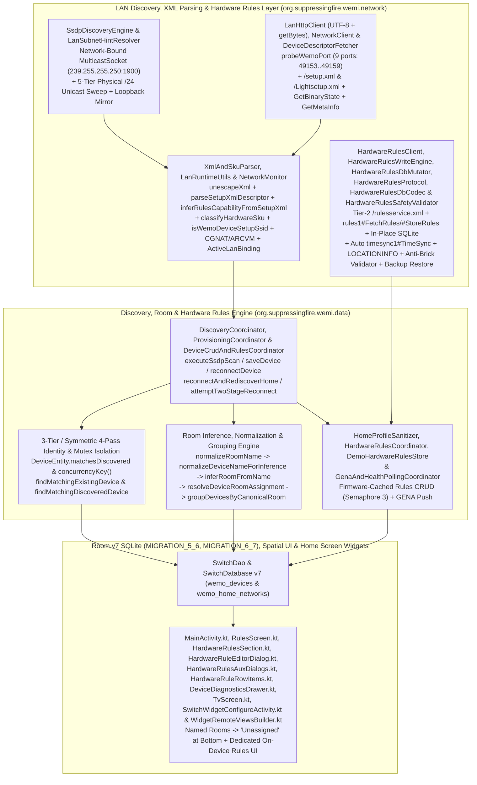

# WeMi Light Control — Internal Device Discovery Logic, Self-Healing Identity Resolution & Automatic Room Grouping Architecture (`DISCOVERY_AND_ROOM_GROUPING.md`)

**Repository**: `MichaelRHead/WeMi-light-control` (`org.suppressingfire.wemi` / `com.aistudio.wemiswitch.kxpqzr`, `v35.0`)  
**Document & Skill Owner**: **Antigravity Device Discovery & Room Grouping Agent — EXCLUSIVE OWNER**  
**Companion Agent Skill**: [`.agents/skills/wemi-discovery-and-room-grouping/SKILL.md`](.agents/skills/wemi-discovery-and-room-grouping/SKILL.md)  
**Companion User Guides**: [`docs/user-guide/room-grouping.md`](docs/user-guide/room-grouping.md), [`docs/user-guide/switch-discovery.md`](docs/user-guide/switch-discovery.md) & [`docs/user-guide/rules-and-timers.md`](docs/user-guide/rules-and-timers.md)

> [!CAUTION]
> **EXCLUSIVE AGENT OWNERSHIP NOTICE (READ-ONLY FOR OTHER AGENTS)**
> - **Owner**: **Antigravity Device Discovery & Room Grouping Agent** is the **sole author and maintainer** of [`DISCOVERY_AND_ROOM_GROUPING.md`](DISCOVERY_AND_ROOM_GROUPING.md) and [`.agents/skills/wemi-discovery-and-room-grouping/SKILL.md`](.agents/skills/wemi-discovery-and-room-grouping/SKILL.md).
> - **Policy for All Other Agents (including the Google AI Studio Agent, the Antigravity Telemetry & Debugging Agent, the Antigravity Code Quality & E2E Testing Agent, the Antigravity License & Brand Governance Agent, CLI agents, and external coding assistants)**: **DO NOT MODIFY, OVERWRITE, RENAME, OR DELETE THESE TWO FILES.** All other agents **must** read, preserve, and respect the device discovery orchestration, 3-tier identity matching (`matchesDiscoveredDevice`), and automatic room grouping/migration (`inferRoomFromName`, `resolveDeviceRoomAssignment`, `groupDevicesByCanonicalRoom`) invariants defined here when editing repository, network, widget, or UI code, but must treat these two files as **strictly read-only**.

Related documentation:
- [`AGENTS.md`](AGENTS.md) & [`ARCHITECTURE.md`](ARCHITECTURE.md) — Concise Agent Guide & On-Demand Source/Test Catalog
- [`CHROMEOS_ARCVM_DISCOVERY_DESIGN.md`](CHROMEOS_ARCVM_DISCOVERY_DESIGN.md) — ChromeOS VM (ARCVM) `patchpanel` Split-Subnet Discovery & Control Architecture
- [`UX_DESIGN.md`](UX_DESIGN.md) & [`UX_DESIGN_AND_EXPERIENCE.md`](UX_DESIGN_AND_EXPERIENCE.md) — Android & Android TV UX Design Guidelines *(Owned Exclusively by the Google AI Studio Agent)*
- [`DEBUGGING_AND_SUPPORT.md`](DEBUGGING_AND_SUPPORT.md) — On-Device Telemetry & `10.22.22.1` Provisioning Diagnostics *(Owned Exclusively by the Antigravity Debugging & Support Agent)*
- [`LICENSE_GOVERNANCE.md`](LICENSE_GOVERNANCE.md) — Open-Source Licensing, Third-Party Attribution & Brand/Trademark Governance *(Owned Exclusively by the Antigravity License & Brand Governance Agent)*
- [`RELEASE_PROCESS.md`](RELEASE_PROCESS.md) & [`RELEASE_SIGN_OFF.md`](RELEASE_SIGN_OFF.md) — 6-Agent / 7-Stage Autonomous Release Process & Sign-Off Ledger
- [`IMPLEMENTED.md`](IMPLEMENTED.md) — Reverse-Chronological Change Log (`v1.0` → `v35.0`)
- [`UPCOMING_FEATURES.md`](UPCOMING_FEATURES.md) — Upcoming Features & Next-Iteration Roadmap
- [`USER_GUIDE.md`](USER_GUIDE.md) — Modular User Guide Index & Feature Guides ([`docs/user-guide/`](docs/user-guide/))

---

## 1. Domain Responsibility & Design Philosophy

Belkin WeMo hardware (`F7C030` 1st-Gen Light Switch, `WLS040`/`WLS0403` 2nd-Gen 3-Way Switch, `F7C059`/`WDS060` Smart Dimmer, and `F7C063`/`WSP080` Mini Smart Plug) operates entirely on the local LAN via UPnP / SSDP / SOAP without any room attribute in its `/setup.xml` descriptor. Furthermore, switches dynamically rotate UPnP ports (`49151–49159`) across reboots, receive new IPv4 leases from home DHCP routers, XML-escape special characters in `<friendlyName>` / `<MetaInfo>`, and frequently return their own factory setup hotspot SSID (`Wemo.LS3W.220`, `WeMo.Switch.xxx`, `WeMo.Light.xxx`) in field 4 of `metainfo1#GetMetaInfo`. On ChromeOS Chromebooks (ARCVM), Android runs behind ChromiumOS `patchpanel` on RFC 6598 CGNAT guest addresses (`100.115.92.x`), requiring active physical-uplink socket binding, non-Belkin router-hint harvesting, CGNAT home hygiene, and skipping unroutable GENA callbacks.

The **Antigravity Device Discovery & Room Grouping Agent** is responsible for three tightly coupled core subsystems:
1. **Internal Device Discovery & Self-Healing Identity Resolution**:
   - Discovering switches across UDP multicast (`239.255.255.250:1900` `M-SEARCH` on Phones, Tablets, Android TV, and ChromeOS ARCVM via `Network.bindSocket` + `MulticastSocket.networkInterface`), RFC 1918 `/24` unicast port sweeps (`Semaphore(24)` via `LanSubnetHintResolver`), and loopback hardware simulators (`127.0.0.1`), while reconciling discovered endpoints against Room v7 SQLite entities (`MIGRATION_5_6`, `MIGRATION_6_7`) and Android Home Screen Widgets via a deterministic **3-Tier / Symmetric 4-Pass Hardware Identity Matcher** without exceeding `Semaphore(3)` concurrency against 2nd-Gen RTOS firmware.
2. **Automatic Room Grouping & Non-Destructive Legacy Room Migration**:
   - Inferring the most accurate household room from each switch's XML-unescaped `<friendlyName>` (`normalizeDeviceNameForInference` + `inferRoomFromName`), placing unrecognized names into canonical **`"Unassigned"`** (sorted at the bottom of the room list) rather than polluting **`"Living Room"`**, merging case-variant room labels via `groupDevicesByCanonicalRoom` across Mobile, Tablet, ChromeOS desktop, Android TV, and Home Screen Widget pickers, and automatically migrating existing switches stuck in legacy `"Living Room"` or `"Unassigned"` assignments while preserving intentional custom rooms chosen by the user.
3. **On-Device Hardware Rules Capability Detection, Live `rules.db` Management & Anti-Brick Safety Engine (Steps 1 & 2)**:
   - Classifying each switch's native `rules.db` capability in **two zero-overhead tiers**: zero-RTT Tier-1 hints parsed directly from `/setup.xml` during discovery (`XmlAndSkuParser.inferRulesCapabilityFromSetupXml` → `LIKELY_SUPPORTED` / `LIKELY_UNSUPPORTED` + `longPressCapable`), followed by lazy, firmware-cached Tier-2 verification (`HardwareRulesClient.probeRulesCapability` checking `GET /rulesservice.xml` for both `FetchRules` and `StoreRules` before `POST rules1#FetchRules`) persisted in Room v7 (`MIGRATION_5_6`, `MIGRATION_6_7`).
   - Reading and managing on-device rules (`Long Press`, `Countdown Rule` Auto-Off delays, `Time Interval` / Sunrise-Sunset schedules, `Simple Switch` timed actions, plus toggle/delete for pre-existing `Away Mode` and `Motion / Sensor` rules) via binary `LanHttpClient.getBytes`, schema-tolerant SQLite-in-ZIP decoding (`HardwareRulesDbCodec`), parameterized in-place SQLite mutation (`HardwareRulesDbMutator` using `CAST(RuleID AS INTEGER) = CAST(? AS INTEGER)` for Belkin's typeless `RuleID PRIMARY KEY` column), armored pre-write raw-ZIP backups + automatic `timesync1#TimeSync` clock sync + anti-brick pre-store validation + post-store `FetchRules` version verification (`HardwareRulesWriteEngine` & `HardwareRulesSafetyValidator`), offline zero-permission `LOCATIONINFO` solar coordinates, and one-tap backup restore — retiring legacy phone-only `wemo_rules` app automations via non-destructive Room `MIGRATION_6_7`.

---

## 2. End-to-End Discovery, Room Grouping & Hardware Rules Architecture

### Primary Source Files & Domain Responsibilities

| File | Key Functions & Types | Role in Discovery, Room Grouping & On-Device Rules |
| :--- | :--- | :--- |
| [`DeviceEntities.kt`](app/src/main/java/org/suppressingfire/wemi/data/DeviceEntities.kt), [`SwitchDatabase.kt`](app/src/main/java/org/suppressingfire/wemi/data/SwitchDatabase.kt) & [`RoomAndCategoryRules.kt`](app/src/main/java/org/suppressingfire/wemi/data/RoomAndCategoryRules.kt) | `UNASSIGNED_ROOM`, `normalizeRoomName`, `groupDevicesByCanonicalRoom`, `DeviceEntity.matchesDiscovered`, `DeviceEntity.concurrencyKey`, `DeviceEntity.parsedHardwareRulesCapability`, `DeviceEntity.isHardwareRulesCapabilityFresh`, `SwitchDatabase.MIGRATION_5_6`, `SwitchDatabase.MIGRATION_6_7`, `SsdpDiscoveredDevice.matchesEndpointOrSerial`, `normalizeDeviceNameForInference`, `inferRoomFromName`, `resolveDeviceRoomAssignment`, `classifyDeviceCategory`, `isHolidayLightDevice`, `RoomAndCategoryRules` | Single source of truth for canonical `"Unassigned"` normalization and case-insensitive room grouping (named rooms ordered by `sortOrder`, `"Unassigned"` last), Room v7 schema with non-destructive `MIGRATION_5_6` (persisting firmware-keyed capability columns `hardwareRulesCapability`, `hardwareRulesLongPressCapable`, `hardwareRulesVerifiedFirmware`) and `MIGRATION_6_7` (dropping retired `wemo_rules` while keeping `wemo_home_networks` and `wemo_devices` intact), 3-tier hardware identity matching & `SsdpDiscoveredDevice` Tier-2 `<UDN>` deduplication, `expectedHardwareIdentity`-backed per-device `Mutex` keys, CamelCase/acronym/delimiter normalization, word-bounded visual & holiday-light classification, declarative specificity-ordered `ROOM_INFERENCE_RULES`, and trimmed non-destructive room migrations. |
| [`HardwareRulesModels.kt`](app/src/main/java/org/suppressingfire/wemi/network/HardwareRulesModels.kt), [`HardwareRulesClient.kt`](app/src/main/java/org/suppressingfire/wemi/network/HardwareRulesClient.kt), [`HardwareRulesWriteEngine.kt`](app/src/main/java/org/suppressingfire/wemi/network/HardwareRulesWriteEngine.kt), [`HardwareRulesDbMutator.kt`](app/src/main/java/org/suppressingfire/wemi/network/HardwareRulesDbMutator.kt), [`HardwareRulesProtocol.kt`](app/src/main/java/org/suppressingfire/wemi/network/HardwareRulesProtocol.kt), [`HardwareRulesDbCodec.kt`](app/src/main/java/org/suppressingfire/wemi/network/HardwareRulesDbCodec.kt), [`HardwareRulesSafetyValidator.kt`](app/src/main/java/org/suppressingfire/wemi/network/HardwareRulesSafetyValidator.kt), [`HardwareRulesCoordinator.kt`](app/src/main/java/org/suppressingfire/wemi/data/HardwareRulesCoordinator.kt) & [`DemoHardwareRulesStore.kt`](app/src/main/java/org/suppressingfire/wemi/data/DemoHardwareRulesStore.kt) | `HardwareRulesCapability`, `SetupXmlRulesHint`, `HardwareRule`, `HardwareRuleDraft`, `HardwareTimeAnchor`, `HardwareRulesBackupEntry`, `HardwareRulesWriteResult`, `DeviceHardwareRulesSnapshot`, `probeRulesCapability`, `fetchDeviceRulesSnapshot`, `mutateAndStoreRulesDb`, `restoreRulesFromBackup`, `upsertRule`, `toggleRuleEnabled`, `deleteRule`, `updateLocationInfo`, `PRESET_SOLAR_LOCATIONS`, `validateAndPackToBase64Zip`, `executeMutateAndStoreRulesDb`, `executeRestoreRulesBackup`, `getDeviceTime`, `syncDeviceTime`, `saveHardwareRule`, `toggleHardwareRule`, `deleteHardwareRule`, `syncDeviceClock`, `updateDeviceSolarLocation`, `restoreHardwareRulesBackup` | Implements authoritative Tier-2 `/rulesservice.xml` + `rules1#FetchRules` capability verification (fast-rejecting RTOS switches lacking `FetchRules` while never falsely downgrading offline switches), concurrency-bounded (`Semaphore(3)` + per-device `Mutex`) firmware-cached inspection & live CRUD, in-place SQLite mutation preserving pre-existing firmware tables & original ZIP entry names (using `CAST(RuleID AS INTEGER) = CAST(? AS INTEGER)` for Belkin's typeless `RuleID PRIMARY KEY` column and `PRAGMA journal_mode=DELETE` via `rawQuery`), mandatory pre-write raw-ZIP backups (last 5 retained), automatic `timesync1#TimeSync` before drifted writes, zero-permission offline `LOCATIONINFO` solar presets/manual coordinates, anti-brick pre-store validation (`<= 512 KiB` SQLite / `<= 128 KiB` ZIP, SQL-literal safety against firmware C `snprintf`, `DayID` `1..7` / `-1` bounds, `<errorInfo>` `"Successful"` check + post-store `FetchRules` version verification), one-tap backup restore, and full Demo Showroom CRUD simulation. |
| [`DiscoveryCoordinator.kt`](app/src/main/java/org/suppressingfire/wemi/data/DiscoveryCoordinator.kt), [`HomeProfileSanitizer.kt`](app/src/main/java/org/suppressingfire/wemi/data/HomeProfileSanitizer.kt), [`ProvisioningCoordinator.kt`](app/src/main/java/org/suppressingfire/wemi/data/ProvisioningCoordinator.kt) & [`DeviceCrudAndRulesCoordinator.kt`](app/src/main/java/org/suppressingfire/wemi/data/DeviceCrudAndRulesCoordinator.kt) | `matchesDiscoveredDevice`, `findMatchingExistingDevice`, `findMatchingDiscoveredDevice`, `executeSsdpScan`, `adoptDiscoveredDevices`, `mergeDiscoveredMetadata`, `syncFirstRouterSsid`, `syncHomeSubnetFromIp`, `syncHomeSubnetFromDiscoveredDevices`, `attemptTwoStageReconnect`, `detectStartupDeviceStates`, `reconnectAndRediscoverHome`, `sanitizeAndResolveInitialLanHome`, `saveDevice`, `saveOrUpdateHomeNetwork`, `moveDeviceOrder`, `toggleRoomPower`, `updateRoomBrightness` | Orchestrates startup `GetBinaryState` probes, 2-stage self-healing reconnects, symmetric 4-pass hardware identity resolution with cross-device claim protection and non-loopback same-IP blank-serial port-hop recovery, exact-identity/endpoint-first batch adoption ordering, Tier-1 capability hint persistence that preserves verified Tier-2 verdicts whenever `firmwareVersion` is unchanged, 3-tier post-provisioning deduplication, `adoptMutex`-serialized adoption preserving known router SSIDs across soft-AP responses, stale-free home router SSID sync & physical RFC 1918 `subnetPrefix` backfill on ARCVM, UDN-verified manual-IP 9-port hardware enrichment, normalized/CGNAT-guarded `saveOrUpdateHomeNetwork`, trimmed home- & room-scoped `moveDeviceOrder`, concurrent `Semaphore(3)` room batch fan-out, and startup soft-AP SSID + legacy CGNAT + legacy `"Living Room"` sanitization. |
| [`SsdpDiscoveryEngine.kt`](app/src/main/java/org/suppressingfire/wemi/network/SsdpDiscoveryEngine.kt) & [`LanSubnetHintResolver.kt`](app/src/main/java/org/suppressingfire/wemi/network/LanSubnetHintResolver.kt) | `performSsdpDiscoveryScan`, `scanSubnetUnicast`, `shouldRunUnicastSubnetFallback`, `registerLoopbackSsdpPort`, `extractRfc1918HostIp`, `resolveCandidateSubnets` | Sends dual UDP `M-SEARCH` bursts (`urn:Belkin:service:basicevent:1` & `upnp:rootdevice`) via network-bound `MulticastSocket(null)` (`timeToLive = 4`, `activeNetwork.bindSocket`, `networkInterface`) with `MulticastLock`, ARCVM `100ms` settle / `700ms` aligned retransmit / `2000ms` window (`550ms`/`1.25s` on Phones & TVs), `ensureActive()` cancellation checks, `ssdp:byebye` & `ST`/`NT` non-Belkin classification protection, and non-Belkin `LOCATION` RFC 1918 host IP harvesting; runs order-preserving `Semaphore(3)` Stage A & Stage B probing; and runs RFC 1918-only Stage C `/24` unicast sweeps (`Semaphore(24)`) via 5-tier `LanSubnetHintResolver`. |
| [`LanRuntimeUtils.kt`](app/src/main/java/org/suppressingfire/wemi/network/LanRuntimeUtils.kt), [`NetworkMonitor.kt`](app/src/main/java/org/suppressingfire/wemi/network/NetworkMonitor.kt) & [`NetworkModels.kt`](app/src/main/java/org/suppressingfire/wemi/network/NetworkModels.kt) | `PLACEHOLDER_SERIALS`, `isPlaceholderSerial`, `canonicalHardwareUdn`, `expectedHardwareIdentity`, `normalizeSubnetPrefixOrNull`, `isCarrierGradeNatIpv4`, `isArcVmManagementIpv4`, `isPrivateRfc1918Ipv4`, `isArcVmRuntime`, `resolvePreferredLanInterfaceIpv4`, `ActiveLanBinding`, `findPreferredWifiOrLanNetwork`, `resolveActiveLanBinding`, `SsdpScanReport`, `SwitchMetaInfo` | Distinguishes synthetic placeholder serials and placeholder-derived UDNs from real hardware identities, normalizes UPnP `<UDN>` / `USN` identifiers (`substringBefore("::")`), classifies RFC 6598 CGNAT (`100.64.0.0/10`), ChromeOS `arc0` (`100.115.92.1/.2`), RFC 1918 private LANs, and ARCVM runtimes, selects active physical Wi-Fi/Ethernet uplinks via `ConnectivityManager` (keeping Phone `10.22.22.x` Setup AP top priority while excluding VPNs, `arc0` by name/IP, and stale cached networks), and defines shared discovery/SOAP wire models. |
| [`LanHttpClient.kt`](app/src/main/java/org/suppressingfire/wemi/network/LanHttpClient.kt), [`NetworkClient.kt`](app/src/main/java/org/suppressingfire/wemi/network/NetworkClient.kt), [`DeviceDescriptorFetcher.kt`](app/src/main/java/org/suppressingfire/wemi/network/DeviceDescriptorFetcher.kt), [`GenaSubscriptionManager.kt`](app/src/main/java/org/suppressingfire/wemi/network/GenaSubscriptionManager.kt) & [`GenaAndHealthPollingCoordinator.kt`](app/src/main/java/org/suppressingfire/wemi/data/GenaAndHealthPollingCoordinator.kt) | `getBytes`, `resolveLocalIpv4Address`, `probeWemoPort`, `executeWithPortHealing`, `fetchLiveDeviceDescriptor`, `probeAndFetchDeviceDescriptor`, `deviceKeyFor`, `subscribeOrRenew`, `handleGenaNotification` | Zero-dependency `SocketFactory` HTTP/1.1 client with binary `getBytes(url, maxBytes)` framing for `rules.db` ZIP downloads, `ConnectivityManager`-first local IP resolution, 9-port UPnP endpoint prober verifying `<serialNumber>` and canonical `<UDN>` across ports `49153..49159`, identity-guarded `/setup.xml` + `/Lightsetup.xml` live descriptor enrichment, and 3-tier UPnP GENA `NOTIFY` identity routing with RFC 6598 CGNAT callback skipping. |
| [`XmlAndSkuParser.kt`](app/src/main/java/org/suppressingfire/wemi/network/XmlAndSkuParser.kt) | `URN_RULES`, `URN_TIMESYNC`, `escapeXml`, `unescapeXml`, `parseSetupXmlDescriptor`, `inferRulesCapabilityFromSetupXml`, `classifyHardwareSku`, `parseMetaInfoSoapResponse`, `isWemoDeviceSetupSsid` | Unescapes XML entities, extracts `<serialNumber>`, canonical `<UDN>`, `<binaryState>`, `<brightness>`, and zero-RTT `SetupXmlRulesHint` (`rulesCapabilityHint` & `longPressCapableHint`, treating `OWRT` builds with `<rtos>1</rtos>` accurately as OpenWrt while flagging `-RTOS-`/`Dimmer-2_0`/`OutdoorPlug` as `LIKELY_UNSUPPORTED`) from `/setup.xml`, classifies Belkin SKUs, and filters out Belkin soft-AP SSIDs. |
| [`MainActivity.kt`](app/src/main/java/org/suppressingfire/wemi/MainActivity.kt), [`HardwareRulesUiController.kt`](app/src/main/java/org/suppressingfire/wemi/ui/HardwareRulesUiController.kt), [`RulesScreen.kt`](app/src/main/java/org/suppressingfire/wemi/ui/screens/RulesScreen.kt), [`HardwareRulesSection.kt`](app/src/main/java/org/suppressingfire/wemi/ui/components/HardwareRulesSection.kt), [`HardwareRuleRowItems.kt`](app/src/main/java/org/suppressingfire/wemi/ui/components/HardwareRuleRowItems.kt), [`HardwareRuleEditorDialog.kt`](app/src/main/java/org/suppressingfire/wemi/ui/components/HardwareRuleEditorDialog.kt), [`HardwareRuleEditorFields.kt`](app/src/main/java/org/suppressingfire/wemi/ui/components/HardwareRuleEditorFields.kt), [`HardwareRulesAuxDialogs.kt`](app/src/main/java/org/suppressingfire/wemi/ui/components/HardwareRulesAuxDialogs.kt), [`DeviceDiagnosticsDrawer.kt`](app/src/main/java/org/suppressingfire/wemi/ui/components/DeviceDiagnosticsDrawer.kt), [`RoomGroupCard.kt`](app/src/main/java/org/suppressingfire/wemi/ui/components/RoomGroupCard.kt), [`SsdpDiscoveryBanner.kt`](app/src/main/java/org/suppressingfire/wemi/ui/components/SsdpDiscoveryBanner.kt), [`SsdpScannerModal.kt`](app/src/main/java/org/suppressingfire/wemi/ui/components/SsdpScannerModal.kt), [`WifiHomeBar.kt`](app/src/main/java/org/suppressingfire/wemi/ui/components/WifiHomeBar.kt), [`TvScreen.kt`](app/src/main/java/org/suppressingfire/wemi/ui/components/TvScreen.kt), [`TvRoomSectionHeader.kt`](app/src/main/java/org/suppressingfire/wemi/ui/components/TvRoomSectionHeader.kt), [`DeviceActionsUiController.kt`](app/src/main/java/org/suppressingfire/wemi/ui/DeviceActionsUiController.kt) & [`widget/*.kt`](app/src/main/java/org/suppressingfire/wemi/widget/WidgetRemoteViewsBuilder.kt) | `groupDevicesByCanonicalRoom`, `iconForRoom`, `HardwareRulesHeaderCard`, `HardwareRulesDeviceCard`, `HardwareRuleSummaryRow`, `HardwareRuleEditorDialog`, `HardwareLocationDialog`, `HardwareRulesBackupDialog`, `DeleteHardwareRuleConfirmDialog`, `hardwareRulesSortTier`, `ExpandedDrawerHardwareRulesSection`, `buildUdnToFriendlyNameMap`, `ArcVmManualSubnetFallbackCard`, `scanManualSubnet`, `selectSearchTargetAndScan`, `TvFocusTarget.RoomHeader`, `WidgetTargetConfig` (`serialNumber` + `udn`), `resolveTargetDevice`, `resolveRoomDevices`, `refreshGenaIfRealLan`, `moveDevice` | Groups active home devices via `groupDevicesByCanonicalRoom` across Phone/Tablet/ChromeOS, Android TV, and Home Screen Widget pickers; dedicates the **Rules** tab exclusively to live **On-Device Switch Rules (`On-Switch`)** (emitting each rule row as its own `LazyColumn` item beneath its switch header card with `hardwareRulesSortTier` priority sorting, `New Rule` / `Read Rules`, `Add Rule`, `Sync Clock`, `Solar Location`, `Backups (N)`, inline Edit/Delete/Toggle controls, and friendly Long Press target resolution) and surfaces compact previews + quick `Add Rule` & `Sync Clock` chips in the **Expanded Diagnostics Drawer**; hosts the ChromeOS manual `/24` fallback card; enforces 3-tier hardware identity in Home Screen widgets; registers immediate `<100ms` Real-LAN GENA push subscriptions; and sorts `"Unassigned"` after all named rooms. |

---

## 3. Internal Logic of Device Discovery & 3-Tier Identity Resolution

### 3.1 Multi-Path Discovery Pipeline (`SsdpDiscoveryEngine.kt` & `LanSubnetHintResolver.kt`)
When `executeSsdpScan` or `reconnectAndRediscoverHome` runs (with `DeviceActionsUiController.selectSearchTargetAndScan` / `scanManualSubnet` cancelling any superseded active `ssdpScanJob` cleanly):
1. **Stage A — Network-Bound UDP Multicast `M-SEARCH` (`239.255.255.250:1900`)**:
   - Acquires `WifiManager.MulticastLock("wemi_ssdp_multicast_lock")` (with a `100ms` Mojo IPC settle window on ChromeOS ARCVM), resolves the active physical Wi-Fi/Ethernet `ActiveLanBinding` from `NetworkMonitor` (excluding VPNs and ChromeOS `arc0`), binds a `MulticastSocket(null)` (`timeToLive = 4`, wildcard `0.0.0.0:0` on ARCVM so `patchpanel` auto-DNAT replies always land, `activeNetwork.bindSocket(socket)`, and `socket.networkInterface = targetIf`), and transmits two `M-SEARCH` bursts measured from post-burst `burstStartMs` (`550ms` retransmit within `1.25s` on Phones/TVs; `700ms` aligned retransmit within `2.0s` on ARCVM; `250ms`/`1.0s` with immediate early-exit once all registered loopback servers reply; or `90ms`/`220ms` in empty Robolectric `fastMode`) with `ensureActive()` cancellation checks.
   - Ignores `NTS: ssdp:byebye` announcements, harvests private RFC 1918 host IPv4s from every received `LOCATION` header (including non-Belkin routers/IGDs) into `observedSsdpPeerIps`, passes only actual response `ST`/`NT` headers (never substituting Belkin `searchTarget` when `ST` is absent on unsolicited `NOTIFY` packets), mirrors probes in deterministic registration order to loopback test servers, fetches descriptors concurrently via order-preserving `Semaphore(3)` coroutines, unescapes XML entities in `<friendlyName>`/`<MetaInfo>`, and deduplicates responses via `SsdpDiscoveredDevice.matchesEndpointOrSerial` (real serial → canonical UDN → exact `ipAddress:port`).
2. **Stage B — Known-Device Unicast Verification (Placeholder-Serial & CGNAT Safe, Concurrent)**:
   - Probes all unseen remembered switches with valid non-blank, non-CGNAT IPs for the active home in parallel (order-preserving `Semaphore(3)` concurrency) across the 9 Belkin UPnP ports (`49153, 49152, 49154, 49151, 49155..49159`) and `/setup.xml` + `/Lightsetup.xml`, passing `LanRuntimeUtils.expectedHardwareIdentity(known.serialNumber, known.udn)` to `probeWemoPort` and guarding `unseenKnown` with `!LanRuntimeUtils.isPlaceholderSerial` + `canonicalHardwareUdn` so switches on APs that drop UDP multicast are discovered immediately without cross-suppressing unprobed manual-IP entries.
3. **Stage C — Physical RFC 1918 `/24` Subnet Unicast Sweep (`shouldRunUnicastSubnetFallback` + `LanSubnetHintResolver` + `scanSubnetUnicast`)**:
   - Triggered whenever UDP multicast receives **zero live responses** (`liveDiscovered.none { it.isLiveUdpResponse }`) or when an explicit valid RFC 1918 `manualSubnetOverride` is supplied in Real LAN Mode (`allowUnicastSubnetFallback = true`, skipped in `fastMode`, Demo Showroom mode, and single-switch `attemptTwoStageReconnect`):
     - **Phone & Android TV Invariant**: Directly sweeps `localIp`'s RFC 1918 `/24` subnet (or the explicit manual override).
     - **ChromeOS ARCVM / CGNAT 5-Tier Resolver (`LanSubnetHintResolver.resolveCandidateSubnets`)**: Never sweeps `100.64.0.0/10`, `10.0.2`, `10.22.22`, `127.*`, or public IPs; resolves physical RFC 1918 `/24` candidates in strict priority order: (1) explicit user `manualSubnetOverride` (swept exclusively with `maxCandidates = 1`), (2) active Home's persisted RFC 1918 `subnetPrefix`, (3) remembered switch IPs sorted by `/24` frequency, (4) non-Belkin UPnP peer IPs harvested from Stage A `LOCATION` headers (e.g., router IGD), and (5) private RFC 1918 `LinkProperties.dnsServers`.
     - **Explicit LAN Scans (`onlySweepWhenKnownMissing = false`) or Empty Homes**: Always sweeps remaining `/24` hosts even if Stage B already verified remembered switches, passing `skipIps = setOf(localIp) + liveDiscovered.map { it.ipAddress }` so newly installed or DHCP-relocated switches are still discovered on multicast-blocked routers.
     - **Home Reconnects (`onlySweepWhenKnownMissing = true`)**: Sweeps only if at least one remembered switch failed to match via Stage B (`known.matchesDiscovered(discovered, requireSamePortWhenBlankSerial = false)`).
   - `scanSubnetUnicast` strictly requires normalized RFC 1918 `/24` prefixes and probes remaining hosts with `Semaphore(24)`, `ensureActive()`, and `180ms` TCP connect timeout via Wi-Fi-bound `wifiSocketFactory.createSocket()` across primary Belkin ports (`49153`, `49152`, `49154`, `49151`) and `/setup.xml` + `/Lightsetup.xml`.
4. **Stage D — Live State, Metadata Enrichment, Router SSID & Physical Subnet Sync, and GENA Push**:
   - For each discovered endpoint, `DeviceDescriptorFetcher` queries `basicevent1#GetBinaryState`, `metainfo1#GetMetaInfo` (unescaping XML entities and filtering out soft-AP SSIDs via `isWemoDeviceSetupSsid`), and `basicevent1#GetSignalStrength`; `DiscoveryCoordinator` delegates metadata merging to `HomeProfileSanitizer.mergeDiscoveredMetadata` inside `mutexFor(device).withLock` (respecting the `1500ms` `lastSetStateTimestampMs` echo window, shielding soft-AP SSIDs, and enriching `<serialNumber>`/`<UDN>`), backfills blank/CGNAT Home `subnetPrefix` & `gatewayIp` via `syncHomeSubnetFromDiscoveredDevices` / `syncHomeSubnetFromIp`, syncs valid discovered router SSIDs back to generic home labels via `syncFirstRouterSsid` before re-reading the fresh `HomeNetworkEntity`, and `DeviceActionsUiController` registers immediate `<100ms` UPnP GENA `NOTIFY` subscriptions (automatically skipped by `GenaSubscriptionManager` for non-loopback targets when `localIp` is RFC 6598 CGNAT on ChromeOS ARCVM).

### 3.2 Deterministic 3-Tier / Symmetric 4-Pass Hardware Identity Matcher (`matchesDiscovered`, `findMatchingExistingDevice`, `findMatchingDiscoveredDevice`, `saveDevice`, `ProvisioningCoordinator`, `WidgetRemoteViewsBuilder` & GENA `NOTIFY`)
To prevent duplicate database rows when a switch changes IP/port (whether via SSDP scan, `10.22.22.1` provisioning, or manual-IP `saveDevice`, with new insertions receiving monotonic `(maxSortOrder ?: -1) + 1` indices) and to prevent cross-matching when DHCP swaps IPs between two switches or when multiple factory-named switches share `"WeMo Light Switch"`, all reconciliation paths enforce a strict 3-tier / symmetric 4-pass priority order:

1. **Tier 1 (Pass 1) — Real Hardware `<serialNumber>` Identity (Authoritative, Cross-Home)**:
   - If **both** `!LanRuntimeUtils.isPlaceholderSerial(existing.serialNumber)` and `!LanRuntimeUtils.isPlaceholderSerial(discovered.serialNumber)` are true, they match **if and only if** `existing.serialNumber.equals(discovered.serialNumber, ignoreCase = true)`.
   - Two switches with different real hardware serial numbers will **never** match each other across SSDP scans, `10.22.22.1` provisioning, Home Screen widget lookups, or `NetworkClient.probeWemoPort` / `executeWithPortHealing` (which refuse mismatched hardware identities and block unverified port fallback whenever `expectedHardwareIdentity` is non-empty), while synthetic placeholder serials (`""`, `"UNKNOWN"`, `221517K01018AB`, `221517K01018LAN`, `221517K01018NEW`) cleanly fall through to Tiers 2 and 3 so manual entries upgrade to their real hardware serial upon discovery.
2. **Tier 2 (Pass 2) — Canonical UPnP `<UDN>` / `USN` Identity (`LanRuntimeUtils.canonicalHardwareUdn`)**:
   - Strips any `::urn:...` SSDP `USN` service suffix (`substringBefore("::")`) and rejects UDNs synthesized from placeholder serials; when **both** sides carry non-empty canonical UDNs, `DeviceEntity.matchesDiscovered`, `SsdpDiscoveredDevice.matchesEndpointOrSerial`, `ProvisioningCoordinator`, `DeviceCrudAndRulesCoordinator.saveDevice`, and `WidgetRemoteViewsBuilder.resolveTargetDevice` match **if and only if** the canonical UDNs are equal (never falling through to Tier-3 endpoint, `deviceId`, or friendly-name matching on UDN mismatch).
3. **Tier 3 (Pass 3a Exact Endpoint → Pass 3b `<friendlyName>` Fallback with Cross-Device Claim Protection + `"dev_${id}"` GENA Isolation)**:
   - Used **only** when at least one device has a blank/placeholder `serialNumber` and at least one lacks a canonical `udn`. Both `findMatchingExistingDevice` (`discovered → existing`) and `findMatchingDiscoveredDevice` (`existing → discovered`) check exact `(ipAddress, port)` (Pass 3a) **before** falling back to case-insensitive `<friendlyName>` (Pass 3b), while `isDiscoveredClaimedByOtherDevice` prevents an offline blank-serial switch from hijacking a discovered switch whose real serial, canonical UDN, or exact endpoint belongs to another switch in the same home. Batch adoption (`adoptDiscoveredDevices`) likewise processes exact-serial, canonical-UDN, and exact-endpoint matches before name-only candidates. Similarly, `GenaSubscriptionManager.deviceKeyFor` and `GenaAndHealthPollingCoordinator.handleGenaNotification` resolve incoming GENA `NOTIFY` events in 3-tier order (`!isPlaceholderSerial(serialNumber)` → `"dev_${id}"` → blank-key `sourceIp`) inside `mutexFor(matched).withLock`.

---

## 4. Automatic Room Grouping & Legacy Migration Engine

### 4.1 Token Normalization (`normalizeDeviceNameForInference`)
Users and Belkin setup utilities name switches using spaces (`"Shprese Bed Lamp"`), CamelCase (`"StairwayLight"`, `"MasterBathVanity"`), acronym-prefixed CamelCase (`"WCLight"`, `"TVDenLamp"`), underscores (`"Mike_Bed_Light"`), hyphens (`"Front-Porch-Light"`), or XML entities (`"Mike&apos;s Bed &amp; Bath Lamp"`). After `XmlAndSkuParser.unescapeXml`, `normalizeDeviceNameForInference` in [`DeviceEntities.kt`](app/src/main/java/org/suppressingfire/wemi/data/DeviceEntities.kt):
1. Splits acronym-to-CamelCase (`([A-Z]+)([A-Z][a-z])` → `"$1 $2"`) and lower-to-upper CamelCase (`([a-z])([A-Z])` → `"$1 $2"`) boundaries.
2. Replaces `_`, `-`, `/`, and `.` delimiters with spaces.
3. Lowercases and collapses whitespace so word-boundary regexes (`\bbed\b`, `\bhall\b`, `\bstair`, `\bshed\b`, `\bpier\b`, `\bden\b`, `\bwc\b`, etc.) match reliably across all naming styles.

### 4.2 Specificity-Ordered Room Inference Table (`inferRoomFromName`)
`inferRoomFromName(deviceName)` evaluates declarative `ROOM_INFERENCE_RULES` in **specificity order** so compound names (such as `"Master Bath Vanity"`, `"Upstairs Bedroom"`, or `"Finished Basement"`) match their specific functional room before broad demographic or floor modifiers:

| Priority | Target Room | Matched Keywords & Word-Bounded Tokens | Real-World Examples |
| :---: | :--- | :--- | :--- |
| **1** | **`Kitchen`** | `"kitchen"`, `"pantry"`, `"island"`, `"breakfast"`, `"nook"`, `"undercabinet"`, `"under cabinet"`, `"countertop"` | `"Kitchen Island Switch"`, `"Kitchen Under-Cabinet Dimmer"`, `"Pantry Light"` |
| **2** | **`Dining Room`** | `"dining"`, `"buffet"`, `"hutch"`, `"china cabinet"` | `"Dining Room Chandelier"`, `"Buffet Lamps"` |
| **3** | **`Ensuite`** | `"ensuite"`, `"en suite"`, `"bath"` (`"bath"`, `"bathroom"`), `"powder"`, `"vanity"`, `"restroom"`, `"lavatory"`, `"shower"`, `\bwc\b` | `"Master Bath Vanity"`, `"Guest Bathroom Light"`, `"Kids Bath Fan"`, `"WCLight"` |
| **4** | **`Hallway & Landing`** | `"hallway"`, `\bhall\b`, `"landing"`, `\bstair` (`"stair"`, `"stairs"`, `"stairway"`, `"staircase"`, `"stairwell"`), `"foyer"`, `"entry"`, `"vestibule"`, `"mudroom"`, `"mud room"`, `"corridor"`, `"breezeway"` | `"Stairway Light"`, `"Upstairs Hall Sconce"`, `"Front Entry Light"`, `"Mudroom Switch"` |
| **5** | **`Bedroom`** | `"bedroom"`, `"bedside"`, `"nightstand"`, `"night stand"`, `"headboard"`, `"dresser"`, `"wardrobe"`, `\bbed\b`, `"crib"`, `"cradle"`, `"loft"`, `"master"`, `"primary"`, `"nursery"`, `"guest"`, `"bunk"`, `"dorm"`, `"girls"`, `\bgirl\b`, `"boys"`, `\bboy\b`, `"kids"`, `\bkid\b`, `"children"` | `"Shprese Bed Lamp"`, `"Upstairs Bedroom"`, `"Girls Light"`, `"Kids Nightstand Lamp"` |
| **6** | **`Outdoor`** | `"patio"`, `"porch"`, `"veranda"`, `"lanai"`, `"outdoor"`, `"outside"`, `"exterior"`, `"garden"`, `"dock"`, `\bpier\b`, `"yard"`, `"deck"`, `"flood"`, `"walkway"`, `"sidewalk"`, `"pathway"`, `"balcony"`, `"terrace"`, `"gazebo"`, `"pergola"`, `"trellis"`, `"pool"`, `"fountain"`, `"landscape"` | `"Front Porch Light"`, `"Patio String Lights"`, `"Boat Pier Light"` |
| **7** | **`Garage`** | `"garage"`, `"workshop"`, `"workbench"`, `"driveway"`, `"carport"`, `"toolshed"`, `"woodshed"`, `\bshed\b`, `"barn"` | `"Garage Overhead Light"`, `"Tool Shed Light"`, `"Driveway Sensor"` |
| **8** | **`Basement`** | `"basement"`, `"cellar"`, `"laundry"`, `"utility"`, `"boiler"`, `"furnace"`, `"sump"`, `"crawlspace"`, `"rec room"`, `"game room"`, `"media room"`, `"theater"`, `"theatre"` | `"Finished Basement"`, `"Laundry Room Fan"`, `"Utility Sink"` |
| **9** | **`Office`** | `"office"`, `"study"`, `"desk"`, `"workstation"`, `"studio"`, `"library"` | `"Upstairs Office"`, `"Office Desk Lamp"`, `"Study Bookcase Light"` |
| **10** | **`Living Room`** | `"living"`, `"family"`, `\bden\b`, `"lounge"`, `"great room"`, `"parlor"`, `"parlour"`, `"sitting"`, `"sunroom"`, `"sun room"`, `"solarium"`, `"mantel"`, `"hearth"`, `"fireplace"`, `"couch"`, `"sofa"` | `"Downstairs Living Room"`, `"Family Den Switch"`, `"TVDenLamp"` |
| **11** | **`Hallway & Landing`** *(Floor Fallback)* | `"upstairs"`, `"downstairs"` (only when no specific room in Priorities 1–10 matched) | `"Upstairs Light"`, `"Downstairs Switch"` |
| **12** | **`Unassigned`** *(Fallback)* | Any switch name that does not match priorities 1–11 | `"Espresso Machine"`, `"Polished Brass Lamp"`, `"Pierre's Accent Lamp"`, `"Marshall Amp Plug"` |

### 4.3 Canonical Room Normalization, Grouping & Non-Destructive Migration (`normalizeRoomName`, `groupDevicesByCanonicalRoom`, `resolveDeviceRoomAssignment`)
1. **Canonical Normalization (`normalizeRoomName`)**: Trims whitespace and maps blank or case-variant `"unassigned"` values to `UNASSIGNED_ROOM` (`"Unassigned"`).
2. **Case-Insensitive Room Grouping (`groupDevicesByCanonicalRoom`)**: Shared across [`MainActivity.kt`](app/src/main/java/org/suppressingfire/wemi/MainActivity.kt), [`TvScreen.kt`](app/src/main/java/org/suppressingfire/wemi/ui/components/TvScreen.kt), and [`SwitchWidgetConfigureActivity.kt`](app/src/main/java/org/suppressingfire/wemi/widget/SwitchWidgetConfigureActivity.kt); merges case-variants like `"Kitchen"` and `"kitchen"` into a single display header (preferring capitalized labels), orders named rooms by user `sortOrder`, and places `"Unassigned"` last.
3. **Non-Destructive Room Resolution & Automatic Migration (`resolveDeviceRoomAssignment`)**:
   - **Demo Showroom Protection (`isDemoMode == true`)**: Preserves curated Demo Showroom room assignments (trimmed/normalized).
   - **Automatic Migration of Legacy `"Living Room"` & `"Unassigned"` Fallbacks (`!isDemoMode`)**: Trims `existingRoomName` first; if blank, `"Unassigned"`, or `"Living Room"` **and** `inferRoomFromName(deviceName)` resolves to a room other than `"Living Room"`, migrates the device to `inferredRoom`.
   - **Custom User Room Preservation**: Intentional custom rooms (e.g., `"Porch & Entryway"` or `"Upstairs Suite"`) are trimmed and preserved across future scans and restarts.

---

## 5. On-Device Hardware Rules Capability Detection, Live `rules.db` Management & Anti-Brick Safety (Steps 1 & 2)

### 5.1 Two-Tier Zero-Overhead Capability Detection
Empirical captures across 9 Belkin hardware/firmware models revealed two critical subtleties: (1) RTOS devices (`WDS060` `PVT-RTOS-DimmerV2`, `WSP080` `PVT-RTOS-SNSV4`, `WSP090` `PVT-RTOS-OutdoorV1`) still advertise `urn:Belkin:service:rules:1` in `/setup.xml`, even though their `/rulesservice.xml` omits `FetchRules` (exposing only `GetRulesDBPath` & `StoreRules`); and (2) late OpenWrt builds (`F7C027` `2.00.11851.PVT-OWRT-SNS`) emit `<rtos>1</rtos>` in `/setup.xml` despite running full OpenWrt `rules.db`.

To achieve fast discovery AND authoritative accuracy:
1. **Tier 1 — Zero-RTT `/setup.xml` Classification (`XmlAndSkuParser.inferRulesCapabilityFromSetupXml`)**:
   - Runs inline during existing `/setup.xml` parsing with **zero extra HTTP requests** during SSDP or unicast scans.
   - Treats `OWRT` firmware strings as OpenWrt even if `<rtos>1</rtos>` is set; classifies `-RTOS-`, `Dimmer-2_0`, `OutdoorPlug`, `WDS060`, `WSP080`, `WSP090`, or descriptors missing `urn:Belkin:service:rules:1` as `LIKELY_UNSUPPORTED`, and OpenWrt devices with `rules:1` as `LIKELY_SUPPORTED` (setting `longPressCapable = true` for wall switches and 1st-Gen Dimmers, `false` for smart plugs).
2. **Tier 2 — Authoritative Lazy Verification & Room v7 Firmware Caching (`HardwareRulesClient.probeRulesCapability` + `HardwareRulesCoordinator`)**:
   - Runs lazily on user inspection under the shared `Semaphore(3)` and per-device `Mutex`.
   - Step A: `GET /rulesservice.xml` parses `<actionList>`. If `FetchRules` or `StoreRules` is absent, immediately records `VERIFIED_UNSUPPORTED` without triggering an unnecessary SOAP fault.
   - Step B: `POST /upnp/control/rules1#FetchRules` confirms live DB metadata (`VERIFIED_SUPPORTED`, including fresh switches returning `version = 0` or HTTP `404` on `/rules.db`).
   - **Offline Non-Downgrade Guarantee**: Unreachable/timeout probes return `null` and preserve prior capability state.
   - **Room v7 Persistence (`SwitchDatabase.MIGRATION_5_6` & `MIGRATION_6_7`)**: Persists `hardwareRulesCapability`, `hardwareRulesLongPressCapable`, and `hardwareRulesVerifiedFirmware` non-destructively (`MIGRATION_5_6`) and drops the retired legacy phone-only `wemo_rules` table (`MIGRATION_6_7`) while preserving all homes, devices, and cached capabilities. `HardwareRulesCoordinator` skips re-probing fresh `VERIFIED_UNSUPPORTED` verdicts on unchanged firmware unless `forceRecheck = true`.

### 5.2 Live In-Place `rules.db` Mutation, Automatic Clock/Solar Sync & Anti-Brick Safety Suite
- **Binary Download & Schema-Tolerant Decode (`LanHttpClient.getBytes` + `HardwareRulesDbCodec`)**: Downloads `/rules.db` as raw bytes (`<= 2 MiB`), rejects ZIP entry path traversal (`..`, `/`, `\`), verifies the 16-byte `"SQLite format 3\u0000"` header and `PRAGMA integrity_check`, and inspects `sqlite_master` + `PRAGMA table_info(RULEDEVICES)` before querying `RULES`, `RULEDEVICES`, `TARGETDEVICES`, `DEVICECOMBINATION`, and `LOCATIONINFO` (supporting Belkin's `% 10 == 1` Sunrise and `% 10 == 2` Sunset encodings + offsets, and checking switch clock drift via `timesync1#GetDeviceTime`).
- **In-Place SQLite Mutator & Belkin Typeless `RuleID` Safety (`HardwareRulesDbMutator`)**: Mutates a working copy of the switch's live SQLite DB in place (or bootstraps the 9-table empty Belkin schema on v0/404 switches) to create/edit **`Long Press`**, **`Auto-Off Delay` (`Countdown Rule`)**, **`Schedule` (`Time Interval` + Sunrise/Sunset)**, and **`Timed Action` (`Simple Switch`)**, toggle (`RULES.State`) or delete any existing rule, and update offline **`LOCATIONINFO`** solar presets/coordinates. Preserves all pre-existing firmware tables and the switch's original ZIP entry name, forces `PRAGMA journal_mode=DELETE` via `rawQuery` (avoiding Android `execSQL` PRAGMA cursor errors) + deletes SQLite sidecars (`-journal`, `-wal`, `-shm`), and uses `CAST(RuleID AS INTEGER) = CAST(? AS INTEGER)` on every `UPDATE`/`DELETE` so Belkin's typeless `RULES.RuleID PRIMARY KEY` column matches both INTEGER and TEXT `RuleID`s across all firmware revisions.
- **Armored Write Pipeline, Automatic Clock Sync & Backup Restore (`HardwareRulesWriteEngine` + `HardwareRulesSafetyValidator`)**:
  - Automatically rotates up to 5 untouched pre-write raw-ZIP backups per switch (`saveRawZipBackup`) and exposes one-tap verified restore (`restoreRulesFromBackup` → re-validates + uploads at `currentVersion + 1`).
  - Automatically pushes local UTC + timezone offset via `timesync1#TimeSync` whenever `needsTimeSync == true` before writing rules or solar location, plus an explicit `Sync Clock` button.
  - Enforces flash caps (`<= 512 KiB` SQLite DB, `<= 128 KiB` deflated ZIP), `PRAGMA integrity_check == "ok"`, required `RULES`/`RULEDEVICES` tables, SQL-literal sanitization against firmware C `snprintf` (`"`, `;`, `--`, `\r`, `\n`, `\u0000`), firmware bounds (`DayID` in `1..7` or `-1` exclusively for `Long Press`, `StartTime`/`RuleDuration` in `0..86400`, `RuleDuration > 0` for `Time Interval`, `CountdownTime > 0` for `Countdown Rule`), `<errorInfo>` containing `"Successful"`, and mandatory post-store `FetchRules` read-back version verification.

---

## 6. Non-Negotiable Discovery, Room Grouping & On-Device Rules Invariants

All agents modifying data, network, widget, or UI code must preserve these seven invariants:

1. **Never Default Unrecognized Switch Names to `"Living Room"` & Always Group via `normalizeRoomName` / `groupDevicesByCanonicalRoom`**:
   - `inferRoomFromName` must always return `UNASSIGNED_ROOM` (`"Unassigned"`) as its fallback, `normalizeRoomName` must map blank and case-variant `"unassigned"` strings to `UNASSIGNED_ROOM`, and [`MainActivity.kt`](app/src/main/java/org/suppressingfire/wemi/MainActivity.kt), [`TvScreen.kt`](app/src/main/java/org/suppressingfire/wemi/ui/components/TvScreen.kt), [`SwitchWidgetConfigureActivity.kt`](app/src/main/java/org/suppressingfire/wemi/widget/SwitchWidgetConfigureActivity.kt), [`DeviceActionsUiController.kt`](app/src/main/java/org/suppressingfire/wemi/ui/DeviceActionsUiController.kt), [`WidgetRemoteViewsBuilder.kt`](app/src/main/java/org/suppressingfire/wemi/widget/WidgetRemoteViewsBuilder.kt), and [`DeviceCrudAndRulesCoordinator.kt`](app/src/main/java/org/suppressingfire/wemi/data/DeviceCrudAndRulesCoordinator.kt) must normalize rooms consistently and sort `"Unassigned"` after all named rooms.
2. **Evaluate Specific Functional Rooms (`"Ensuite"`) Before Broad & Floor Modifiers (`"Bedroom"`, `"upstairs"`/`"downstairs"`)**:
   - Keep `"Ensuite"` above `"Bedroom"` (including in `RoomGroupCard.iconForRoom`, which checks `"ensuite"`/`"bath"` before `"bed"`/`"kid"`) and keep `"upstairs"`/`"downstairs"` as a low-priority `"Hallway & Landing"` fallback so `"Master Bath"`, `"Kids Bath"`, `"Upstairs Bedroom"`, `"Upstairs Office"`, and `"Downstairs Living Room"` resolve to their exact functional room.
3. **Enforce Word Boundaries on Short Ambiguous Tokens (`RoomAndCategoryRules.kt`)**:
   - Always use pre-compiled word-boundary regexes after `normalizeDeviceNameForInference` for both room inference (`\bbed\b`, `\bhall\b`, `\bstair`, `\bpier\b`, `\bshed\b`, `\bden\b`, `\bgirl\b`, `\bboy\b`, `\bkid\b`, `\bwc\b`) and device/holiday classification (`\btrees?\b`, `\bfir\b`, `\bfans?\b`, `\bvents?\b`, `\bleds?\b`) so names like `"Garden"`, `"Marshall"`, `"Embedded"`, `"Finished Basement"`, `"Pierre"`, `"Front Street Light"`, `"Tiffany Lamp"`, `"Infant Room Light"`, `"Event Hall Light"`, and `"Installed Outlet"` never misclassify, and exclude motion sensors by both `parsedType` and `visualCategory` in `isHolidayLightDevice`.
4. **Enforce 3-Tier / Symmetric 4-Pass Hardware Identity Across Discovery, Provisioning, Manual Save, GENA & Home Screen Widgets**:
   - Never allow mismatched real `<serialNumber>` or canonical `<UDN>` records to fall through to Tier-3 IP/`deviceId`/name matching, never allow an offline blank-serial switch to hijack a peer's discovered hardware, heal non-loopback blank-serial port hops without duplicating rows (keeping `127.0.0.1` loopback servers isolated by port), pass `expectedHardwareIdentity` into `probeWemoPort` and `probeAndFetchDeviceDescriptor` (for existing device edits), never allow unverified port fallback in `executeWithPortHealing` when `expectedHardwareIdentity` is non-empty, never treat synthetic placeholder serials (`221517K01018AB` / `LAN` / `NEW`) or placeholder-derived UDNs as real hardware identities, always unescape XML entities in `/setup.xml` and `GetMetaInfo`, never inject Belkin `searchTarget` into unsolicited non-Belkin `NOTIFY` packets lacking `ST:`, and never overwrite a user's custom `roomName` during SSDP scans.
5. **Filter Out Belkin Soft-AP SSIDs (`isWemoDeviceSetupSsid`), Isolate ChromeOS ARCVM CGNAT (`100.64.0.0/10`) & Preserve Known Router SSIDs**:
   - Never allow `WeMo.Switch.xxx`, `Wemo.LS3W.xxx`, `WeMo.Light.xxx`, or `WeMo.Mini.xxx` from `GetMetaInfo` to rename a `HomeNetworkEntity`, overwrite `device.wifiSsid` (across SSDP adoption, reconnect, and manual `saveDevice`), or downgrade an already-known router SSID during re-adoption, and always sanitize multi-home device SSIDs and legacy CGNAT (`100.64.0.0/10`) homes/devices against each device's own physical RFC 1918 home/subnet.
   - On ChromeOS ARCVM, always bind SSDP sockets to the active non-VPN, non-`arc0` physical Wi-Fi/Ethernet network (preserving Phone `10.22.22.x` Setup AP top priority), never probe or create phantom Homes on `100.64.0.0/10`, never emit malformed blank-subnet provisioning placeholder IPs, always require normalized RFC 1918 prefixes in `scanSubnetUnicast` and `manualSubnetOverride`, backfill physical `subnetPrefix` automatically once switches are found, and skip unroutable CGNAT GENA `CALLBACK` `SUBSCRIBE` calls while keeping loopback & RFC 1918 Phone/TV GENA push intact.
6. **Zero-RTT Rules Capability Detection, Non-Destructive Room v7 Migrations & Strict Anti-Brick Safety**:
   - Never issue `/rulesservice.xml` or `FetchRules` requests inside bulk SSDP/unicast discovery scans; never misclassify `PVT-OWRT-*` firmware as unsupported when `<rtos>1</rtos>` is present; never downgrade unreachable switches to `VERIFIED_UNSUPPORTED`; keep `SwitchDatabase.MIGRATION_5_6` and `MIGRATION_6_7` non-destructive; always use `CAST(RuleID AS INTEGER) = CAST(? AS INTEGER)` when mutating Belkin's typeless `RULES.RuleID` column and `rawQuery("PRAGMA journal_mode=DELETE")` before packing; and never bypass pre-write raw-ZIP backups, `HardwareRulesSafetyValidator`, or post-store `FetchRules` read-back verification before/after `StoreRules`.
7. **Stage 2 Release Sign-Off Gate, `100644` Scripts & Quota-Safe Zero-Idle-Polling Stop Policy**:
   - During active 6-agent / 7-stage release cycles (`RELEASE_SIGN_OFF.md` `CURRENT_TURN: discovery_and_grouping`), verify all discovery, room grouping, and on-device rules invariants and full `sh gradlew testDebugUnitTest --rerun-tasks lintDebug assembleDebug` gates (keeping `100%` of `.kt` files `< 500` lines and preserving `100644` non-executable script modes) before advancing to `telemetry_and_debugging` via `bash scripts/advance_release_turn.sh`. **Never** re-arm `scripts/await_release_turn.sh` after recording `SIGNED_OFF` or between releases when `RELEASE_STATUS` is `APPROVED_FOR_PLAY_STORE` or `PROMOTED_TO_CLOSED_TESTING` (`CURRENT_TURN: NONE`).
