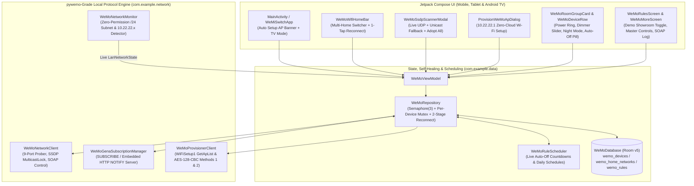

# WeMi Light Control — Implemented Architecture & Completed Phases (`IMPLEMENTED.md`)

**Repository**: `MichaelRHead/WeMi-light-control` (`com.example.wemi` / `com.aistudio.wemiswitch.kxpqzr`)  
**Current Version**: `v10.0` (`versionCode = 10`)  
**Target Platforms**: Android Phones, Tablets, and Android TV (`UI_MODE_TYPE_TELEVISION` 10-foot D-Pad interface)

Related documentation:
- [`docs/IMPLEMENTATION_PLAN.md`](docs/IMPLEMENTATION_PLAN.md) — Next-Iteration Roadmap & Future Engineering Ideas (Phases 8–13)
- [`AGENTS.md`](AGENTS.md) — Architecture & Agent Guide
- [`.agents/skills/wemi-light-control/SKILL.md`](.agents/skills/wemi-light-control/SKILL.md) — Agent Skill Definition
- [`.agents/skills/wemi-light-control/references/wemo-upnp-protocol.md`](.agents/skills/wemi-light-control/references/wemo-upnp-protocol.md) — Complete `pywemo` & Home Assistant Wire Protocol Reference

---

## 1. Summary of Completed Work (Phases 1–7)

All **7 core engineering phases** have been implemented, verified against local loopback UPnP/SOAP/GENA servers, and synced on `main`:

| Phase | Subsystem | Status | Primary Source Files |
| :--- | :--- | :--- | :--- |
| **Phase 1** | **`pywemo`-Grade UPnP / SSDP / SOAP Engine** | **Completed** | [`WeMoNetworkClient.kt`](app/src/main/java/com/example/network/WeMoNetworkClient.kt) |
| **Phase 2** | **Self-Healing Repository, RTOS Concurrency & Optimistic UI** | **Completed** | [`WeMoRepository.kt`](app/src/main/java/com/example/data/WeMoRepository.kt), [`WeMoEntities.kt`](app/src/main/java/com/example/data/WeMoEntities.kt), [`WeMoDatabase.kt`](app/src/main/java/com/example/data/WeMoDatabase.kt) |
| **Phase 3** | **Real-Time Local Push Events (UPnP GENA `SUBSCRIBE` / `NOTIFY`)** | **Completed** | [`WeMoGenaSubscriptionManager.kt`](app/src/main/java/com/example/network/WeMoGenaSubscriptionManager.kt), [`WeMoViewModel.kt`](app/src/main/java/com/example/ui/WeMoViewModel.kt) |
| **Phase 4** | **Zero-Permission Wi-Fi Subnet Monitor, `GetMetaInfo` SSID Sync & Demo Mode** | **Completed** | [`WeMoNetworkMonitor.kt`](app/src/main/java/com/example/network/WeMoNetworkMonitor.kt), [`WeMoRulesAndMoreScreens.kt`](app/src/main/java/com/example/ui/screens/WeMoRulesAndMoreScreens.kt) |
| **Phase 5** | **App-Driven Rule Scheduler, Auto-Off Countdowns & Dimmer Night Mode** | **Completed** | [`WeMoRuleScheduler.kt`](app/src/main/java/com/example/data/WeMoRuleScheduler.kt), [`WeMoDeviceRow.kt`](app/src/main/java/com/example/ui/components/WeMoDeviceRow.kt) |
| **Phase 6** | **Zero-Cloud `10.22.22.1` Wi-Fi Setup Provisioner (`WiFiSetup1`)** | **Completed** | [`WeMoProvisionerClient.kt`](app/src/main/java/com/example/network/WeMoProvisionerClient.kt), [`WeMoDialogs.kt`](app/src/main/java/com/example/ui/components/WeMoDialogs.kt), [`MainActivity.kt`](app/src/main/java/com/example/MainActivity.kt) |
| **Phase 7** | **End-to-End Loopback Protocol & Repository Test Suite** | **Completed** | [`WeMoProtocolTest.kt`](app/src/test/java/com/example/WeMoProtocolTest.kt), [`ExampleRobolectricTest.kt`](app/src/test/java/com/example/ExampleRobolectricTest.kt) |

---

## 2. Confirmed Design Decisions Implemented

| Decision ID | Design Choice | Implementation Details |
| :--- | :--- | :--- |
| **Q1 — Startup & Demo Mode** | **Clean Real-LAN Startup + Explicit "Demo Showroom Mode" Toggle** | On physical Android / Android TV hardware (`!isRunningUnderRobolectric()`), [`WeMoRepository`](app/src/main/java/com/example/data/WeMoRepository.kt) starts with `isDemoShowroomMode = false` and `0` fake devices on the detected local `/24` subnet. Users can toggle **Demo Showroom Mode** at any time in [`WeMoMoreScreen`](app/src/main/java/com/example/ui/screens/WeMoRulesAndMoreScreens.kt) to preview the 13 classic sample devices. |
| **Q2 — Discovery & Adoption** | **Auto-Adopt on Empty Home + Manual "Adopt" / "Adopt All" Buttons** | When an SSDP scan runs on a Wi-Fi Home with `0` saved devices in Real LAN Mode, all discovered Belkin WeMo devices are automatically adopted into Room. In [`WeMoSsdpScannerModal.kt`](app/src/main/java/com/example/ui/components/WeMoSsdpScannerModal.kt), each discovered device also has an **"Adopt" / "Update"** button plus a batch **"Adopt All (N)"** button. |
| **Q3 — Room Assignment & Hardware Rename** | **Keyword Room Inference + "Sync Name to WeMo Hardware" Switch** | [`inferRoomFromName`](app/src/main/java/com/example/data/WeMoEntities.kt) assigns an initial room from `<friendlyName>` keywords (`Kitchen`, `Living Room`, `Bedroom`, `Hallway & Landing`, `Office`, `Porch & Patio`, etc.). [`AddOrEditWeMoDeviceDialog`](app/src/main/java/com/example/ui/components/WeMoDialogs.kt) includes a **"Sync Name to WeMo Hardware"** toggle that calls `urn:Belkin:service:basicevent:1#ChangeFriendlyName`. |
| **Q4 — Optimistic UI & Offline Revert** | **Optimistic UI + 2-Stage Self-Healing Reconnect + Offline Revert** | Tapping a switch or dragging a dimmer updates Room immediately, dispatches the SOAP command under a per-device `Mutex` and LAN `Semaphore(3)`, runs a 2-stage self-healing reconnect (9-port probe + targeted SSDP scan by `serialNumber`) if unreachable, and reverts to the prior state with `OFFLINE` (`isReachable = false`, `latencyMs = 0`) if the device is genuinely offline in Real LAN Mode. |
| **A1 — Real-Time Physical Switch Sync** | **Hybrid UPnP GENA Push (`<100ms`) + 30s Fallback Poll** | [`WeMoGenaSubscriptionManager`](app/src/main/java/com/example/network/WeMoGenaSubscriptionManager.kt) runs an embedded HTTP `NOTIFY` server (`SUBSCRIBE /upnp/event/basicevent1`, `TIMEOUT: Second-300`, 240s renewal, HTTP 412 recovery) so physical wall-switch and 3-way rocker presses update the UI immediately, backed by a 30s `GetBinaryState` poll. |
| **A2 — Wi-Fi Home & SSID Detection** | **Zero-Permission `/24` Subnet Detection + `GetMetaInfo` SSID Sync** | [`WeMoNetworkMonitor`](app/src/main/java/com/example/network/WeMoNetworkMonitor.kt) tracks the active `/24` IPv4 subnet without requiring Android Location permissions, and [`WeMoRepository`](app/src/main/java/com/example/data/WeMoRepository.kt) automatically populates the Wi-Fi Home's `ssidLabel` from the connected switches' `metainfo1#GetMetaInfo` (`AccessPointSSID` field). |
| **A3 — Rules, Schedules & Night Mode** | **App-Driven Scheduler + Live Countdown Badges + Hardware Night Mode** | [`WeMoRuleScheduler`](app/src/main/java/com/example/data/WeMoRuleScheduler.kt) executes daily `SCHEDULE` rules (including Sunset/Sunrise times) and per-device/rule `AUTO_OFF` timers with live `MM:SS` countdown pills in [`WeMoDeviceRow`](app/src/main/java/com/example/ui/components/WeMoDeviceRow.kt), plus a **20% Night Mode** chip for `F7C059`/`WDS060` dimmers calling `ConfigureNightMode`. |
| **A4 — Zero-Cloud Wi-Fi Setup (`10.22.22.1`)** | **Auto-Detected Setup AP Banner + `WiFiSetup1` Provisioning Wizard** | When connected to a `10.22.22.x` WeMo Setup AP, [`MainActivity`](app/src/main/java/com/example/MainActivity.kt) displays a top **WeMo Setup AP Detected (`10.22.22.1`)** banner that opens [`ProvisionWeMoApDialog`](app/src/main/java/com/example/ui/components/WeMoDialogs.kt) to scan 2.4 GHz APs (`GetApList`) and provision credentials using OpenWrt Method 1 & RTOS Method 2 AES-128-CBC encryption. |

---

## 3. Implemented Architecture Diagram

---

## 4. Detailed Subsystem Breakdown

### 4.1 `WeMoNetworkClient.kt` (UPnP / SSDP / SOAP Engine)
- **9-Port Smart Probing (`probeWemoPort`)**:
  - Probes `49153, 49152, 49154, 49151, 49155, 49156, 49157, 49158, 49159` starting with the device's last-known `preferredPort`.
  - Distinguishes **TCP connect timeout** (host unreachable on Wi-Fi → aborts port sweep immediately in `~750ms`), **`ConnectException` / `ECONNREFUSED`** (port closed → tries next port with `0ms` delay), and **HTTP read timeout** (wedged listener on old port → continues probing remaining ports).
  - Verifies `<serialNumber>` or `<UDN>` in `/setup.xml` (and `/Lightsetup.xml` fallback) when `expectedSerialOrUdn` is provided so DHCP IP reassignment never toggles the wrong switch.
- **Multicast SSDP + Unicast `/24` Fallback (`performSsdpDiscoveryScan`, `scanSubnetUnicast`)**:
  - Acquires `WifiManager.MulticastLock`, binds to the active Wi-Fi IPv4 interface, and retransmits `M-SEARCH` (`urn:Belkin:service:basicevent:1` and `upnp:rootdevice`) every `1000ms` across a `3.2s` window.
  - Filters out non-Belkin UPnP devices (`isBelkinWeMoDescriptor`) and automatically falls back to a `Semaphore(24)` unicast `/24` port sweep if multicast is blocked by router AP isolation or IGMP snooping.
- **Hardware SKU Classification & Live Telemetry (`classifyHardwareSku`, `getMetaInfo`, `getSignalStrength`)**:
  - Accurately classifies **1st Gen In-Wall Switch (`F7C030`)**, **2nd Gen 3-Way Switch (`WLS040` / `WLS0403` RTOS)**, **In-Wall Smart Dimmer (`F7C059` OpenWrt / `WDS060` RTOS)**, and **Mini Smart Plug (`F7C063` / `WSP080`)**.
  - Queries `metainfo1#GetMetaInfo` for pipe-delimited `MAC|Serial|SKU|Firmware|AccessPointSSID|Model` and `basicevent1#GetSignalStrength` for live RSSI percentage.
- **SOAP Quirk Handling (`setBinaryState`, `getBinaryState`, `changeFriendlyName`, `configureNightMode`)**:
  - Sends `Connection: close` on every SOAP request.
  - Handles `pywemo`'s `<BinaryState>Error</BinaryState>` response when a switch is already in the requested state as a confirmed success.
  - Supports dimmer `<brightness>` (`1..100`), hardware `<FriendlyName>` updates (`ChangeFriendlyName`), and dimmer Night Mode (`ConfigureNightMode`).

### 4.2 `WeMoGenaSubscriptionManager.kt` (UPnP GENA Push Server)
- Hosts a lightweight daemon `ServerSocket` on the local Wi-Fi IP (`preferredListenPort = 8989` with automatic fallback to an ephemeral port).
- Sends `SUBSCRIBE /upnp/event/basicevent1` with `CALLBACK: <http://localIp:port/gena/deviceKey>` and `TIMEOUT: Second-300`, tracks `SID` headers, renews before expiry, and automatically recovers from `HTTP/1.1 412 Precondition Failed` by clearing the stale `SID` and issuing a fresh `SUBSCRIBE`.
- Parses inbound `NOTIFY` `<e:propertyset>` XML payloads (`<BinaryState>` and `<Brightness>`/`<brightness>`) and pushes `<100ms` state updates into [`WeMoRepository`](app/src/main/java/com/example/data/WeMoRepository.kt).

### 4.3 `WeMoProvisionerClient.kt` (`10.22.22.1` Zero-Cloud Wi-Fi Setup)
- Probes `10.22.22.1` (`49152, 49153, 49154, 49151`), fetches `/setup.xml` and `metainfo1#GetMetaInfo` (`MAC`, `SerialNumber`, `RTOS` flag), and lists visible 2.4 GHz access points via `WiFiSetup1#GetApList`.
- Implements both **Method 1 (OpenWrt `F7C030`/`F7C059`/`F7C063`)** and **Method 2 (RTOS `WLS040`/`WLS0403`/`WDS060`/`WSP080`)** `pywemo` key derivation (`PBKDF2WithHmacSHA1`, 1000 iterations, MD5 16-byte key + 16-byte IV, `AES/CBC/PKCS5Padding`) with 2-hex-digit password length suffixes.
- Dispatches `WiFiSetup1#ConnectHomeNetwork` twice (`120ms` apart per `pywemo`), polls `GetNetworkStatus`, and closes the setup AP via `CloseSetup`.

### 4.4 Automated Verification (`WeMoProtocolTest.kt` & `ExampleRobolectricTest.kt`)
- **8 automated test suites** verify SKU classification, loopback UPnP port shifting, startup `OFF` state detection (`detectStartupDeviceStates`), DHCP serial mismatch protection, `<BinaryState>Error</BinaryState>` handling, `GetMetaInfo` & `ChangeFriendlyName`, Real LAN Mode offline revert, GENA `SUBSCRIBE` / HTTP 412 / `NOTIFY` callbacks, `WeMoRuleScheduler` time parsing & Auto-Off countdowns, `WiFiSetup1` AP parsing & AES-128-CBC encryption, SSDP packet building, and multi-home room group controls.

### 4.5 Startup State Detection & Distinct Three-State Iconography (`ON` vs. `OFF (Accessible)` vs. `Disconnected`)
- **Immediate Startup `GetBinaryState` Probe (`WeMoRepository.detectStartupDeviceStates`)**:
  - On app launch and home network switch, all remembered switches are immediately probed in parallel (bounded by `Semaphore(3)` for RTOS safety) via `basicevent1#GetBinaryState` before the SSDP discovery sweep begins, updating each device's live `isOn`, `brightness`, `isReachable`, `port`, and `latencyMs` in Room as soon as it responds.
  - `WeMoNetworkClient.parseSetupXmlDescriptor` also parses `<binaryState>` and `<brightness>` directly from `/setup.xml` and `fetchLiveDeviceDescriptor` preserves `stateProbe.binaryStateOn ?: base.isOn` so newly discovered `OFF` switches never default to `ON`.
- **Three Unmistakable Visual States (`WeMoHardwareIllustrations.kt`, `WeMoDeviceRow.kt`, `WeMoTvScreen.kt`)**:
  1. **Accessible & ON (`isReachable && isOn`)**:
     - Ocean-Teal / Electric-Cyan hardware bezel, glowing cyan LED bar / luminous bulb globe, emerald corner badge with IEC `"I"` active power glyph, `WeMoPowerStatePill` (`"ON"`), and glowing cyan-green `WeMoPowerRingButton` with vertical `"I"` stem.
  2. **Accessible & OFF (`isReachable && !isOn`)**:
     - Full `1.0f` opacity Deep Slate-Navy metallic switch bezel (or smoke-slate bulb with visible unlit filament), **Warm Amber Standby Locator LED** (`#F59E0B`), dark-slate & amber corner badge with IEC `"O"` (binary `0` = OFF) standby ring, `WeMoPowerStatePill` (`"OFF"` with amber standby ring), and tactile recessed slate `WeMoPowerRingButton` with top amber pilot dot and closed `"O"` standby symbol.
  3. **Disconnected / Offline (`!isReachable`)**:
     - Desaturated housing with dashed red outline (`#DC2626`), red `"X"` offline corner badge, red `Offline` connection badge, and inline `Retry` button.

