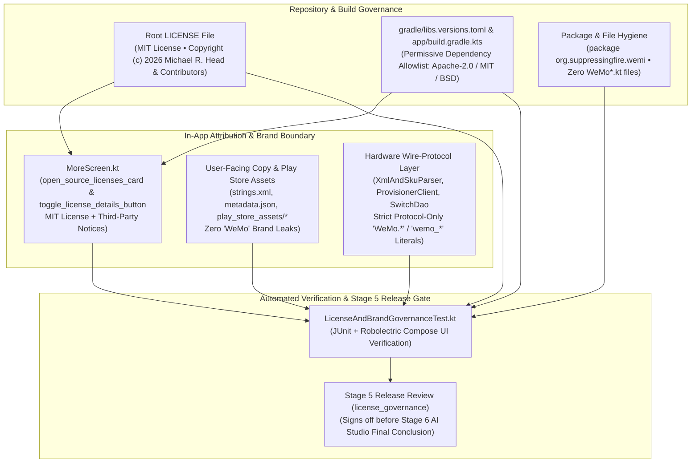

# WeMi Light Control — Open-Source Licensing, Third-Party Attribution & Brand/Trademark Governance (`LICENSE_GOVERNANCE.md`)

**Repository**: `MichaelRHead/WeMi-light-control` (`org.suppressingfire.wemi` / `com.aistudio.wemiswitch.kxpqzr`, `v21.0`)  
**Document & Skill Owner**: **Antigravity License & Brand Governance Agent — EXCLUSIVE OWNER**  
**Companion Agent Skill**: [`.agents/skills/wemi-license-governance/SKILL.md`](.agents/skills/wemi-license-governance/SKILL.md)  
**Primary License File**: [`LICENSE`](LICENSE) (**MIT License** — `Copyright (c) 2026 Michael R. Head and WeMi Light Control Contributors`)  
**In-App License Surface**: [`MoreScreen.kt`](app/src/main/java/org/suppressingfire/wemi/ui/screens/MoreScreen.kt) (`open_source_licenses_card` / `toggle_license_details_button`)  
**Automated Governance Test Suite**: [`LicenseAndBrandGovernanceTest.kt`](app/src/test/java/org/suppressingfire/wemi/LicenseAndBrandGovernanceTest.kt)

> [!CAUTION]
> **EXCLUSIVE AGENT OWNERSHIP NOTICE (READ-ONLY FOR OTHER AGENTS)**
> - **Owner**: **Antigravity License & Brand Governance Agent (`license_governance`)** is the **sole author and maintainer** of [`LICENSE_GOVERNANCE.md`](LICENSE_GOVERNANCE.md) and [`.agents/skills/wemi-license-governance/SKILL.md`](.agents/skills/wemi-license-governance/SKILL.md).
> - **Policy for All Other Agents (including the Google AI Studio Agent, the Antigravity Device Discovery & Room Grouping Agent, the Antigravity Debugging & Support Agent, the Antigravity Code Quality & E2E Testing Agent, CLI agents, and external coding assistants)**: **DO NOT MODIFY, OVERWRITE, RENAME, OR DELETE THESE TWO FILES.** All other agents **must** read, preserve, and respect the MIT license parity, permissive dependency allowlist, third-party open-source attribution notices, `org.suppressingfire.wemi` package namespace, and `"WeMo"` trademark boundary invariants defined here when editing build scripts, dependencies, source code, or UI strings, but must treat [`LICENSE_GOVERNANCE.md`](LICENSE_GOVERNANCE.md) and [`.agents/skills/wemi-license-governance/SKILL.md`](.agents/skills/wemi-license-governance/SKILL.md) as **strictly read-only**.

Related documentation:
- [`LICENSE`](LICENSE) — Repository-Wide MIT License
- [`AGENTS.md`](AGENTS.md) — Architecture & Agent Guide
- [`RELEASE_PROCESS.md`](RELEASE_PROCESS.md) & [`RELEASE_SIGN_OFF.md`](RELEASE_SIGN_OFF.md) — 5-Agent / 6-Stage Autonomous Round-Robin Release Review Process & Live Sign-Off State Machine
- [`UX_DESIGN.md`](UX_DESIGN.md) & [`UX_DESIGN_AND_EXPERIENCE.md`](UX_DESIGN_AND_EXPERIENCE.md) — Android & Android TV UX Design Guidelines *(Owned Exclusively by the Google AI Studio Agent)*
- [`DISCOVERY_AND_ROOM_GROUPING.md`](DISCOVERY_AND_ROOM_GROUPING.md) — Internal Device Discovery Logic, Self-Healing Identity Resolution & Automatic Room Grouping Architecture *(Owned Exclusively by the Antigravity Device Discovery & Room Grouping Agent)*
- [`DEBUGGING_AND_SUPPORT.md`](DEBUGGING_AND_SUPPORT.md) — On-Device Telemetry & `10.22.22.1` Provisioning Diagnostics *(Owned Exclusively by the Antigravity Debugging & Support Agent)*
- [`IMPLEMENTED.md`](IMPLEMENTED.md) — Reverse-Chronological Change Log (`v1.0` → `v21.0`)
- [`UPCOMING_FEATURES.md`](UPCOMING_FEATURES.md) — Upcoming Features & Next-Iteration Roadmap
- [`USER_GUIDE.md`](USER_GUIDE.md) — Modular User Guide Index & Feature Guides ([`docs/user-guide/`](docs/user-guide/))

---

## 1. Domain Responsibility & Governance Philosophy

**WeMi Light Control** is an independent, 100% original Kotlin and Jetpack Compose open-source Android and Android TV application distributed under the **MIT License** (`Copyright (c) 2026 Michael R. Head and WeMi Light Control Contributors`) and published to the Google Play Store (`com.aistudio.wemiswitch.kxpqzr`).

Because the app interoperates over local Wi-Fi with physical switches from **Belkin's discontinued smart switch platform** (`F7C030`, `WLS040`/`WLS0403`, `F7C059`/`WDS060`, `F7C063`/`WSP080`, `F7C028`) and is distributed both as MIT-licensed source code on GitHub and as a signed APK/AAB on Google Play, the **Antigravity License & Brand Governance Agent (`license_governance`)** enforces four pillars of legal, licensing, and brand hygiene:

1. **First-Party Open-Source Licensing & In-App Parity (`LICENSE` ↔ `MoreScreen.kt`)**:
   - The repository root [`LICENSE`](LICENSE) file and the expandable **Open Source License** card (`open_source_licenses_card`) on the **More** tab ([`MoreScreen.kt`](app/src/main/java/org/suppressingfire/wemi/ui/screens/MoreScreen.kt)) must remain in lockstep under the standard OSI MIT License.
2. **Permissive-Only Third-Party Dependency Allowlist (`gradle/libs.versions.toml` & `app/build.gradle.kts`)**:
   - Every runtime, compile-time, and test dependency in the Gradle version catalog must be audited and approved under a permissive license (`Apache-2.0`, `MIT`, `BSD`, or `EPL` for test-only JUnit runners). Copyleft (`GPL`, `AGPL`, `LGPL`), server-side restricted (`SSPL`, `Commons Clause`), or proprietary closed-source telemetry/ad SDKs are strictly prohibited.
3. **Clean-Room Protocol Reference Attribution (`pywemo` & Third-Party Notices)**:
   - While **WeMi Light Control** contains zero copied code from third-party repositories, its local UPnP / SSDP / SOAP / GENA wire-protocol behavior and OpenSSL `EVP_BytesToKey` MD5 AES-128-CBC Wi-Fi setup encryption ([`PasswordCrypto.kt`](app/src/main/java/org/suppressingfire/wemi/network/PasswordCrypto.kt)) were designed for clean-room interoperability informed by the open-source `pywemo` project (`MIT License`). Both in-repo documentation and the in-app **Open Source License** card provide clear third-party attributions.
4. **Trademark, Brand & Package Namespace Hygiene (`"WeMi"` & `org.suppressingfire.wemi` vs. `"WeMo"`)**:
   - **WeMi Light Control** is an independent project and is not affiliated with, endorsed by, or sponsored by Belkin International, Inc.
   - All Kotlin source and test packages reside under `org.suppressingfire.wemi` (never `com.example`), no Kotlin source/test file uses a `WeMo*.kt` filename prefix, and all user-facing UI strings, app titles, and Google Play Store listing assets describe hardware compatibility neutrally as **"Belkin's discontinued smart switch platform"** or **"Smart Switch"**—reserving `"WeMo"` / `"wemo"` strictly for hardware wire-protocol literals (`urn:Belkin:*`, `WeMo.Light.*`, `Wemo.LS3W.*`, `/setup.xml`, `WeMo_WW_*`) and existing Room v5 SQLite table names (`wemo_devices`, `wemo_home_networks`, `wemo_rules`).

---

## 2. Architecture of License & Brand Governance



### Primary Governed Files & Responsibilities

| File | Governance Role |
| :--- | :--- |
| [`LICENSE`](LICENSE) | Canonical OSI **MIT License** text (`Copyright (c) 2026 Michael R. Head and WeMi Light Control Contributors`). |
| [`MoreScreen.kt`](app/src/main/java/org/suppressingfire/wemi/ui/screens/MoreScreen.kt) | Renders the in-app **Open Source License** card (`open_source_licenses_card`) and **`View License` / `Hide`** toggle (`toggle_license_details_button`), displaying the full MIT License and Third-Party Open Source Notices (`Apache-2.0` AndroidX/Compose/Kotlin/Room/OkHttp & `MIT` `pywemo` protocol reference). |
| [`gradle/libs.versions.toml`](gradle/libs.versions.toml) & [`app/build.gradle.kts`](app/build.gradle.kts) | Declares all build plugins, runtime libraries, and test dependencies, plus `namespace = "org.suppressingfire.wemi"` and `dependenciesInfo { includeInApk = false; includeInBundle = true }`. |
| [`strings.xml`](app/src/main/res/values/strings.xml), [`metadata.json`](metadata.json) & [`play_store_assets/`](play_store_assets/) | User-facing app name (`WeMi Switch Control`), header wordmarks, store listing (`STORE_LISTING.md`), release notes (`RELEASE_NOTES.txt`), privacy policy (`PRIVACY_POLICY.md`), and data safety guide (`DATA_SAFETY_GUIDE.md`). |
| [`LicenseAndBrandGovernanceTest.kt`](app/src/test/java/org/suppressingfire/wemi/LicenseAndBrandGovernanceTest.kt) | Automated Robolectric + Compose UI governance test suite verifying MIT license parity, dependency allowlist compliance, `org.suppressingfire.wemi` package/filename hygiene, trademark boundary compliance, and in-app license card rendering. |

---

## 3. Third-Party Dependency License Inventory & Policy Tiers

### 3.1 License Policy Tiers

| Tier | Policy Status | Permitted SPDX Identifiers | Scope & Rules |
| :---: | :---: | :--- | :--- |
| **Tier A** | **Approved (Runtime & Test)** | `MIT`, `Apache-2.0`, `BSD-2-Clause`, `BSD-3-Clause`, `ISC`, `0BSD`, `CC0-1.0` | Permissive licenses fully compatible with MIT source distribution and Google Play APK/AAB distribution without copyleft source-disclosure obligations. |
| **Tier B** | **Approved (Test & Build Tooling Only)** | `EPL-1.0`, `EPL-2.0`, `GPL-2.0-with-classpath-exception` | Permitted strictly for `testImplementation`, `androidTestImplementation`, or JDK/Gradle build tooling (e.g., JUnit 4 `EPL-1.0`, OpenJDK 21 `GPL-2.0-with-classpath-exception`) that is **never** packaged into the production APK/AAB. |
| **Tier C** | **Strictly Prohibited** | `GPL-2.0-only`, `GPL-3.0-*`, `AGPL-3.0-*`, `LGPL-*`, `SSPL-1.0`, `Commons Clause`, `Proprietary Ad/Tracker SDKs` | **Never permitted** in `gradle/libs.versions.toml` or `app/build.gradle.kts`. Any PR or commit adding a Tier C dependency must be rejected during Stage 5 (`license_governance`) review. |

### 3.2 Audited Dependency Inventory (`gradle/libs.versions.toml` & `app/build.gradle.kts`)

All active runtime, compiler, and test dependencies in **WeMi Light Control** have been audited and verified:

| Dependency Group / Artifact | Version (`libs.versions.toml`) | Configuration Scope | SPDX License | Copyright / Maintainer | Governance Status |
| :--- | :---: | :---: | :---: | :--- | :---: |
| **AndroidX Core, Activity & Lifecycle** (`androidx.core:core-ktx`, `androidx.activity:activity-compose`, `androidx.lifecycle:*`) | `1.18.0` / `1.10.1` / `2.8.7` | `implementation` | `Apache-2.0` | The Android Open Source Project (Google) | **Tier A Approved** |
| **Jetpack Compose UI & Material 3** (`androidx.compose:compose-bom`, `ui`, `ui-graphics`, `material3`, `material-icons-*`) | `2024.09.00` | `implementation` / `debugImplementation` | `Apache-2.0` | The Android Open Source Project (Google) | **Tier A Approved** |
| **AndroidX Room Persistence** (`androidx.room:room-runtime`, `room-ktx`, `room-compiler`) | `2.7.0` | `implementation` / `ksp` | `Apache-2.0` | The Android Open Source Project (Google) | **Tier A Approved** |
| **Kotlin Standard Library & Coroutines** (`org.jetbrains.kotlin:*`, `org.jetbrains.kotlinx:kotlinx-coroutines-core`, `kotlinx-coroutines-android`) | `2.2.10` / `1.10.2` | `implementation` | `Apache-2.0` | JetBrains s.r.o. and Kotlin Programming Language Contributors | **Tier A Approved** |
| **Square OkHttp** (`com.squareup.okhttp3:okhttp`) | `4.10.0` | `implementation` | `Apache-2.0` | Square, Inc. | **Tier A Approved** |
| **Google Symbol Processing (KSP)** (`com.google.devtools.ksp`) | `2.3.5` | `plugin` / `ksp` | `Apache-2.0` | Google LLC | **Tier A Approved** |
| **Secrets Gradle Plugin** (`com.google.android.libraries.mapsplatform.secrets-gradle-plugin`) | `2.0.1` | `plugin` | `Apache-2.0` | Google LLC | **Tier A Approved** |
| **Robolectric** (`org.robolectric:robolectric`) | `4.16.1` | `testImplementation` | `MIT` | Robolectric Contributors | **Tier A/B Approved** |
| **AndroidX Test & Espresso** (`androidx.test:core`, `runner`, `ext:junit`, `espresso-core`, `ui-test-junit4`) | `1.6.1` / `1.3.0` / `3.7.0` | `testImplementation` / `androidTestImplementation` | `Apache-2.0` | The Android Open Source Project (Google) | **Tier A/B Approved** |
| **Kotlinx Coroutines Test** (`org.jetbrains.kotlinx:kotlinx-coroutines-test`) | `1.10.2` | `testImplementation` | `Apache-2.0` | JetBrains s.r.o. | **Tier A/B Approved** |
| **JUnit 4** (`junit:junit`) | `4.13.2` | `testImplementation` | `EPL-1.0` | JUnit Team | **Tier B Approved (Test-Only)** |

### 3.3 Clean-Room Protocol & Architectural Attribution (`pywemo`)

- **Protocol Reference**: `pywemo` (`https://github.com/pywemo/pywemo`) — **MIT License** (`Copyright (c) pywemo contributors`).
- **Nature of Use**: **WeMi Light Control** is a 100% original Kotlin and Jetpack Compose codebase (`org.suppressingfire.wemi`). Wire-protocol documentation (`.agents/skills/wemi-light-control/references/wemo-upnp-protocol.md`), UPnP/SSDP/SOAP/GENA endpoint paths (`/setup.xml`, `/upnp/control/basicevent1`, `/upnp/control/WiFiSetup1`, `/upnp/control/metainfo1`), and OpenSSL `EVP_BytesToKey` AES-128-CBC key derivation parameters (`Methods 1, 2 & 3` in [`PasswordCrypto.kt`](app/src/main/java/org/suppressingfire/wemi/network/PasswordCrypto.kt)) were implemented in clean-room Kotlin for local LAN interoperability and credit the `pywemo` community under the MIT License.

---

## 4. Non-Negotiable License & Brand Governance Invariants

All agents modifying code, build scripts, resources, or documentation must preserve these five invariants:

1. **Invariant 1 — Root [`LICENSE`](LICENSE) & In-App [`MoreScreen.kt`](app/src/main/java/org/suppressingfire/wemi/ui/screens/MoreScreen.kt) Parity**:
   - Root [`LICENSE`](LICENSE) must contain the complete OSI MIT License with `Copyright (c) 2026 Michael R. Head and WeMi Light Control Contributors`.
   - [`MoreScreen.kt`](app/src/main/java/org/suppressingfire/wemi/ui/screens/MoreScreen.kt) must render `open_source_licenses_card` and `toggle_license_details_button`, and expanding it must show both the MIT License text (`mit_license_text_surface`) and the Third-Party Open Source Notices (`third_party_notices_surface`).
2. **Invariant 2 — Permissive Dependency Allowlist Enforcement**:
   - No dependency may be added to [`gradle/libs.versions.toml`](gradle/libs.versions.toml) or [`app/build.gradle.kts`](app/build.gradle.kts) unless its license is verified as **Tier A** (`MIT`, `Apache-2.0`, `BSD-*`, `ISC`) or **Tier B** (test-only) and registered in [`LICENSE_GOVERNANCE.md`](LICENSE_GOVERNANCE.md) and [`LicenseAndBrandGovernanceTest.kt`](app/src/test/java/org/suppressingfire/wemi/LicenseAndBrandGovernanceTest.kt).
   - `dependenciesInfo { includeInApk = false; includeInBundle = true }` in [`app/build.gradle.kts`](app/build.gradle.kts) must keep `includeInApk = false` so standalone/F-Droid/GitHub debug & release APKs remain free of proprietary Google Play dependency metadata blobs while AAB bundles remain Play Console compliant.
3. **Invariant 3 — `org.suppressingfire.wemi` Package Namespace & Zero `WeMo*.kt` File Prefix**:
   - `namespace = "org.suppressingfire.wemi"` in [`app/build.gradle.kts`](app/build.gradle.kts) must be preserved (`applicationId = "com.aistudio.wemiswitch.kxpqzr"` is retained for AI Studio & Play Store package continuity).
   - Every `.kt` file under `app/src/main/java/`, `app/src/test/java/`, and `app/src/androidTest/java/` must reside in `org/suppressingfire/wemi` (zero files under `com/example`) and must not use a `WeMo*.kt` filename prefix.
4. **Invariant 4 — Strict `"WeMo"` Trademark Boundary in User-Facing Copy & Play Store Assets**:
   - User-facing UI text in [`app/src/main/res/values/strings.xml`](app/src/main/res/values/strings.xml), [`metadata.json`](metadata.json), [`play_store_assets/STORE_LISTING.md`](play_store_assets/STORE_LISTING.md), [`play_store_assets/RELEASE_NOTES.txt`](play_store_assets/RELEASE_NOTES.txt), [`play_store_assets/PRIVACY_POLICY.md`](play_store_assets/PRIVACY_POLICY.md), [`play_store_assets/DATA_SAFETY_GUIDE.md`](play_store_assets/DATA_SAFETY_GUIDE.md), and Jetpack Compose `Text(...)` / dialog titles in `app/src/main/java/org/suppressingfire/wemi/ui/` must **never** use `"WeMo"` as a brand name or user-visible label.
   - Refer to compatible hardware neutrally as **"Belkin's discontinued smart switch platform"** or **"Smart Switch"**.
   - `"WeMo"` / `"wemo"` is permitted in code **only** for:
     - Physical hardware wire-protocol matching (`WeMo.Light.*`, `WeMo.Switch.*`, `WeMo.Mini.*`, `WeMo.Dimmer.*`, `Wemo.LS3W.*`, `WeMo_WW_*` firmware versions, `/setup.xml` `"WeMo"` tag detection, and `"WeMo Switch"` factory default `<friendlyName>` detection).
     - Room v5 SQLite table/database names (`wemo_devices`, `wemo_home_networks`, `wemo_rules`, `wemo_control_database.db`) and stable Compose `testTag` / theme color identifiers (`wemo_setup_ap_banner`, `more_provision_wemo_ap_button`, `WemoGreenPrimary`).
5. **Invariant 5 — Stage 5 Release Sign-Off Gate (`license_governance`)**:
   - Every release candidate must pass Stage 5 (`license_governance` — the 5th review step in [`RELEASE_PROCESS.md`](RELEASE_PROCESS.md), immediately following `code_quality_and_testing` and immediately preceding Stage 6 where `ai_studio_ux_cuj` makes the final release decision) by running:
     ```bash
     ./gradlew testDebugUnitTest --tests org.suppressingfire.wemi.LicenseAndBrandGovernanceTest
     ```
     and recording `SIGN_OFF_LICENSE_GOVERNANCE: SIGNED_OFF` via `bash scripts/advance_release_turn.sh sign_off license_governance "<summary>"`.
