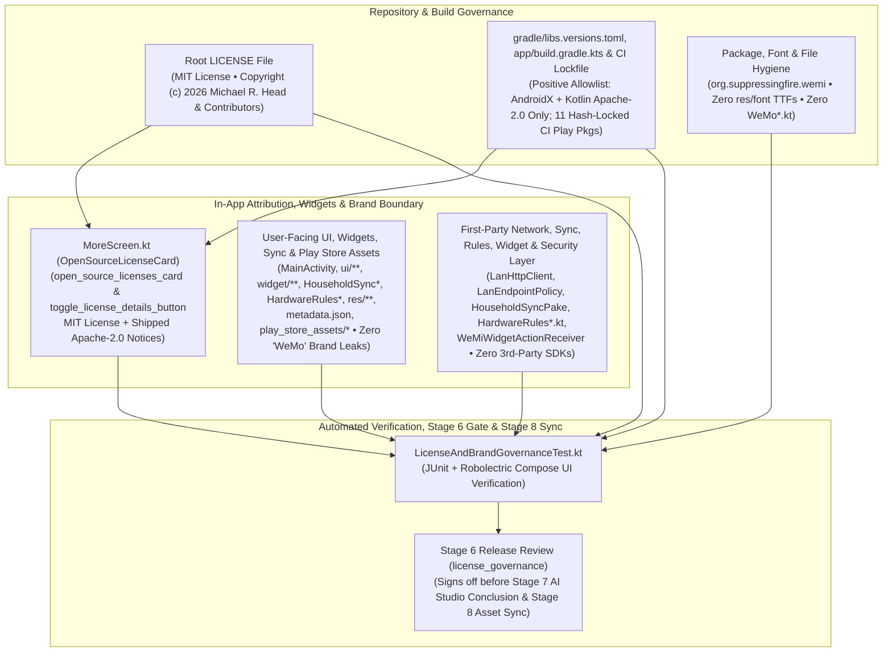

# WeMi Light Control — Open-Source Licensing, Third-Party Attribution & Brand/Trademark Governance (`LICENSE_GOVERNANCE.md`)

**Repository**: `MichaelRHead/WeMi-light-control` (`org.suppressingfire.wemi` / `com.aistudio.wemiswitch.kxpqzr`, `v38.0` / `versionCode = 38`)  
**Document & Skill Owner**: **Antigravity License & Brand Governance Agent — EXCLUSIVE OWNER**  
**Companion Agent Skill**: [`.agents/skills/wemi-license-governance/SKILL.md`](.agents/skills/wemi-license-governance/SKILL.md)  
**Primary License File**: [`LICENSE`](LICENSE) (**MIT License** — `Copyright (c) 2026 Michael R. Head and WeMi Light Control Contributors`)  
**In-App License Surface**: [`MoreScreen.kt`](app/src/main/java/org/suppressingfire/wemi/ui/screens/MoreScreen.kt) (`open_source_licenses_card` / `toggle_license_details_button`)  
**Automated Governance Test Suite**: [`LicenseAndBrandGovernanceTest.kt`](app/src/test/java/org/suppressingfire/wemi/LicenseAndBrandGovernanceTest.kt)

> [!CAUTION]
> **EXCLUSIVE AGENT OWNERSHIP NOTICE (READ-ONLY FOR OTHER AGENTS)**
> - **Owner**: **Antigravity License & Brand Governance Agent (`license_governance`)** is the **sole author and maintainer** of [`LICENSE_GOVERNANCE.md`](LICENSE_GOVERNANCE.md), [`.agents/skills/wemi-license-governance/SKILL.md`](.agents/skills/wemi-license-governance/SKILL.md), and [`LicenseAndBrandGovernanceTest.kt`](app/src/test/java/org/suppressingfire/wemi/LicenseAndBrandGovernanceTest.kt).
> - **Policy for All Other Agents (including the Google AI Studio Agent, the Antigravity Device Discovery & Room Grouping Agent, the Antigravity Debugging & Support Agent, the Antigravity Security & Privacy Agent, the Antigravity Code Quality & E2E Testing Agent, the Antigravity App Promoter Agent, CLI agents, and external coding assistants)**: **DO NOT MODIFY, OVERWRITE, RENAME, OR DELETE THESE THREE FILES.** All other agents **must** read, preserve, and respect the MIT license parity, permissive dependency allowlist, third-party open-source attribution notices, `org.suppressingfire.wemi` package namespace, Data Safety permission & cloud-backup parity, and `"WeMo"` trademark boundary invariants defined here when editing build scripts, dependencies, source code, widgets, or UI strings, but must treat these governance files as **strictly read-only**.

Related documentation:
- [`LICENSE`](LICENSE) — Repository-Wide MIT License
- [`AGENTS.md`](AGENTS.md) & [`ARCHITECTURE.md`](ARCHITECTURE.md) — Concise Agent Guide & On-Demand Architecture/Test Catalog
- [`RELEASE_PROCESS.md`](RELEASE_PROCESS.md) & [`RELEASE_SIGN_OFF.md`](RELEASE_SIGN_OFF.md) — 7-Agent / 8-Stage Autonomous Round-Robin Release Review, Sign-Off & Play Store Promotion State Machine
- [`.agents/skills/agent-commit-attribution/SKILL.md`](.agents/skills/agent-commit-attribution/SKILL.md) — Mandatory Agent Commit Description Attribution Convention
- [`UX_DESIGN.md`](UX_DESIGN.md) & [`UX_DESIGN_AND_EXPERIENCE.md`](UX_DESIGN_AND_EXPERIENCE.md) — Android & Android TV UX Design Guidelines *(Owned Exclusively by the Google AI Studio Agent)*
- [`DISCOVERY_AND_ROOM_GROUPING.md`](DISCOVERY_AND_ROOM_GROUPING.md) — Internal Device Discovery Logic, Self-Healing Identity Resolution & Automatic Room Grouping Architecture *(Owned Exclusively by the Antigravity Device Discovery & Room Grouping Agent)*
- [`DEBUGGING_AND_SUPPORT.md`](DEBUGGING_AND_SUPPORT.md) — On-Device Telemetry & `10.22.22.1` Provisioning Diagnostics *(Owned Exclusively by the Antigravity Debugging & Support Agent)*
- [`SECURITY_AND_PRIVACY.md`](SECURITY_AND_PRIVACY.md) — Security Threat Model, Privacy Lifecycle Invariants & Stage 4 Hardening Baseline *(Owned Exclusively by the Antigravity Security & Privacy Agent)*
- [`IMPLEMENTED.md`](IMPLEMENTED.md) — Reverse-Chronological Change Log (`v1.0` → `v38.0`)
- [`UPCOMING_FEATURES.md`](UPCOMING_FEATURES.md) — Upcoming Features & Next-Iteration Roadmap
- [`USER_GUIDE.md`](USER_GUIDE.md) — Modular User Guide Index & Feature Guides ([`docs/user-guide/`](docs/user-guide/))

---

## 1. Domain Responsibility & Governance Philosophy

**WeMi Light Control** is an independent, 100% original Kotlin and Jetpack Compose open-source Android, Chromebook (ChromeOS), Home Screen Widget, and Android TV application distributed under the **MIT License** (`Copyright (c) 2026 Michael R. Head and WeMi Light Control Contributors`) and published to the Google Play Store (`com.aistudio.wemiswitch.kxpqzr`).

Because the app interoperates over local Wi-Fi with physical switches from **Belkin's discontinued smart switch platform** (`F7C030`, `WLS040`/`WLS0403`, `F7C059`/`WDS060`, `F7C063`/`WSP080`, `F7C028`) and is distributed both as MIT-licensed source code on GitHub and as a signed APK/AAB on Google Play, the **Antigravity License & Brand Governance Agent (`license_governance`)** enforces four pillars of legal, licensing, and brand hygiene:

1. **First-Party Open-Source Licensing & In-App Parity (`LICENSE` ↔ `MoreScreen.kt`)**:
   - The repository root [`LICENSE`](LICENSE) file and the expandable **Open Source License** card (`open_source_licenses_card`) on the **More** tab ([`MoreScreen.kt`](app/src/main/java/org/suppressingfire/wemi/ui/screens/MoreScreen.kt)) must remain in lockstep under the standard OSI MIT License.
2. **Minimal, Permissive-Only Third-Party Dependency Footprint (`gradle/libs.versions.toml`, `app/build.gradle.kts` & CI-only `scripts/requirements-play.txt`)**:
   - Runtime software dependencies are minimized strictly to first-party platform libraries (**AndroidX / Jetpack Compose / Room** and **Kotlin / Kotlinx Coroutines** under `Apache-2.0`), paired with Android's built-in system `FontFamily.SansSerif` ([`Type.kt`](app/src/main/java/org/suppressingfire/wemi/ui/theme/Type.kt)) so zero custom `.ttf` font files are bundled in `app/src/main/res/font/`.
   - All local UPnP / SSDP / SOAP / GENA HTTP/1.1 framing & SSRF policy ([`LanHttpClient.kt`](app/src/main/java/org/suppressingfire/wemi/network/LanHttpClient.kt), [`LanEndpointPolicy.kt`](app/src/main/java/org/suppressingfire/wemi/network/LanEndpointPolicy.kt)), OpenSSL `EVP_BytesToKey` AES-128-CBC Wi-Fi setup encryption ([`PasswordCrypto.kt`](app/src/main/java/org/suppressingfire/wemi/network/PasswordCrypto.kt)), zero-cloud Household Configuration Sync (pure-Kotlin RFC 8259 [`StrictJsonCodec.kt`](app/src/main/java/org/suppressingfire/wemi/network/StrictJsonCodec.kt), [`HouseholdSyncCodec.kt`](app/src/main/java/org/suppressingfire/wemi/network/HouseholdSyncCodec.kt), RFC 9382 SPAKE2 [`HouseholdSyncPake.kt`](app/src/main/java/org/suppressingfire/wemi/network/HouseholdSyncPake.kt), `AES-256-GCM` [`HouseholdSyncCrypto.kt`](app/src/main/java/org/suppressingfire/wemi/network/HouseholdSyncCrypto.kt), [`HouseholdSyncHttpFraming.kt`](app/src/main/java/org/suppressingfire/wemi/network/HouseholdSyncHttpFraming.kt), [`HouseholdSyncLanServer.kt`](app/src/main/java/org/suppressingfire/wemi/network/HouseholdSyncLanServer.kt), [`HouseholdSyncLanClient.kt`](app/src/main/java/org/suppressingfire/wemi/network/HouseholdSyncLanClient.kt), and [`HouseholdSyncCoordinator.kt`](app/src/main/java/org/suppressingfire/wemi/data/HouseholdSyncCoordinator.kt)), on-device switch `rules.db` SQLite-in-ZIP inspection, schema guard, armored in-place mutation, clock sync, solar location, and backup restore ([`HardwareRulesDbCodec.kt`](app/src/main/java/org/suppressingfire/wemi/network/HardwareRulesDbCodec.kt), [`HardwareRulesSchemaGuard.kt`](app/src/main/java/org/suppressingfire/wemi/network/HardwareRulesSchemaGuard.kt), [`HardwareRulesDbMutator.kt`](app/src/main/java/org/suppressingfire/wemi/network/HardwareRulesDbMutator.kt), [`HardwareRulesClient.kt`](app/src/main/java/org/suppressingfire/wemi/network/HardwareRulesClient.kt), [`HardwareRulesWriteEngine.kt`](app/src/main/java/org/suppressingfire/wemi/network/HardwareRulesWriteEngine.kt), [`HardwareRulesBackupStore.kt`](app/src/main/java/org/suppressingfire/wemi/network/HardwareRulesBackupStore.kt), [`HardwareRulesModels.kt`](app/src/main/java/org/suppressingfire/wemi/network/HardwareRulesModels.kt), [`HardwareRulesProtocol.kt`](app/src/main/java/org/suppressingfire/wemi/network/HardwareRulesProtocol.kt), [`HardwareRulesSafetyValidator.kt`](app/src/main/java/org/suppressingfire/wemi/network/HardwareRulesSafetyValidator.kt), [`HardwareRulesCoordinator.kt`](app/src/main/java/org/suppressingfire/wemi/data/HardwareRulesCoordinator.kt), [`DemoHardwareRulesStore.kt`](app/src/main/java/org/suppressingfire/wemi/data/DemoHardwareRulesStore.kt)), telemetry redaction ([`TelemetryRedactor.kt`](app/src/main/java/org/suppressingfire/wemi/network/TelemetryRedactor.kt)), and Android Home Screen widgets ([`widget/`](app/src/main/java/org/suppressingfire/wemi/widget), including non-exported [`WeMiWidgetActionReceiver.kt`](app/src/main/java/org/suppressingfire/wemi/widget/WeMiWidgetActionReceiver.kt)) are implemented directly in first-party Kotlin over JDK `SocketFactory` / `java.math.BigInteger` / `java.util.zip` / `javax.crypto` / Android `SQLiteDatabase` / `AppWidgetProvider` + `RemoteViews` without third-party HTTP, JSON, crypto, ZIP, image, widget, or cloud SDKs (`OkHttp`, `Retrofit`, `Moshi`, `Coil`, `Firebase`, and `Play Services` are excluded).
   - Copyleft (`GPL`, `AGPL`, `LGPL`, `MPL`), server-side restricted (`SSPL`, `Commons Clause`), or proprietary closed-source telemetry/ad SDKs are strictly prohibited in Gradle builds and APKs/AABs, enforced by a positive dependency-group, plugin-ID, production-import, and CI-lockfile allowlist in [`LicenseAndBrandGovernanceTest.kt`](app/src/test/java/org/suppressingfire/wemi/LicenseAndBrandGovernanceTest.kt). The GitHub Actions-only Play Console script lockfile [`scripts/requirements-play.txt`](scripts/requirements-play.txt) (`11` SHA-256 hash-pinned Python packages, never packaged into the APK/AAB) carries a documented Tier B CI-only exception for `certifi` (`MPL-2.0` Mozilla CA bundle).
3. **Accurate In-App Open-Source Attribution (`MoreScreen.kt`)**:
   - **WeMi Light Control** includes zero code from external smart-home projects (such as `pywemo`), zero custom bundled font files, and only lists third-party open-source components actually shipped in the APK/AAB (**AndroidX / Jetpack Compose / Room** `Apache-2.0` and **Kotlin & Kotlinx Coroutines** `Apache-2.0`) alongside the explicit Belkin non-affiliation trademark notice.
4. **Trademark, Brand, Data Safety & Package Namespace Hygiene (`"WeMi"` & `org.suppressingfire.wemi` vs. `"WeMo"`)**:
   - **WeMi Light Control** is an independent project and is not affiliated with, endorsed by, or sponsored by Belkin International, Inc.
   - All Kotlin source and test packages reside under `org.suppressingfire.wemi` (never `com.example`), no Kotlin source/test file uses a `WeMo*.kt` filename prefix, `AndroidManifest.xml` declares only the 4 local-LAN permissions disclosed in `DATA_SAFETY_GUIDE.md` & `PRIVACY_POLICY.md` (zero Android Location permissions even for optional offline Solar Location) plus non-exported `.widget.WeMiWidgetActionReceiver` (`android:exported="false"`), cloud Auto-Backup structurally excludes all 4 sensitive domains (`database` `.`, `sharedpref` `.`, `file` `wemi-telemetry-latest.txt`, and `file` `hardware_rules_backups`) while `<device-transfer>` excludes diagnostic exports & rule backups, and all user-facing UI strings, Home Screen widget layouts/pickers, Household Sync modals/messages, app titles, and Google Play Store listing assets describe hardware compatibility neutrally as **"Belkin's discontinued smart switch platform"** or **"Smart Switch"**—reserving `"WeMo"` / `"wemo"` strictly for hardware wire-protocol literals (`urn:Belkin:*`, `WeMo.Light.*`, `Wemo.LS3W.*`, `/setup.xml`, `WeMo_WW_*`) and existing Room v7 SQLite table names (`MIGRATION_5_6` + `MIGRATION_6_7` dropping retired `wemo_rules`; legacy table names `wemo_devices` and `wemo_home_networks` unchanged).

---

## 2. Architecture of License & Brand Governance



### Primary Governed Files & Responsibilities

| File | Governance Role |
| :--- | :--- |
| [`LICENSE`](LICENSE) | Canonical OSI **MIT License** text (`Copyright (c) 2026 Michael R. Head and WeMi Light Control Contributors`). |
| [`MoreScreen.kt`](app/src/main/java/org/suppressingfire/wemi/ui/screens/MoreScreen.kt), [`MoreControlAndLogCards.kt`](app/src/main/java/org/suppressingfire/wemi/ui/screens/MoreControlAndLogCards.kt) & [`HouseholdSyncCard.kt`](app/src/main/java/org/suppressingfire/wemi/ui/screens/HouseholdSyncCard.kt) | `MoreScreen.kt` (`OpenSourceLicenseCard`) renders `open_source_licenses_card` and `toggle_license_details_button` (`mit_license_text_surface` + `third_party_notices_surface` including the Belkin non-affiliation notice), while `MoreControlAndLogCards.kt` and `HouseholdSyncCard.kt` render operational controls, redacted-by-default telemetry, and zero-cloud Household Config Sync with neutral `WeMi Switch Control` branding. |
| [`LanHttpClient.kt`](app/src/main/java/org/suppressingfire/wemi/network/LanHttpClient.kt), [`LanEndpointPolicy.kt`](app/src/main/java/org/suppressingfire/wemi/network/LanEndpointPolicy.kt), [`StrictJsonCodec.kt`](app/src/main/java/org/suppressingfire/wemi/network/StrictJsonCodec.kt), [`HouseholdSyncCodec.kt`](app/src/main/java/org/suppressingfire/wemi/network/HouseholdSyncCodec.kt), [`HouseholdSyncCrypto.kt`](app/src/main/java/org/suppressingfire/wemi/network/HouseholdSyncCrypto.kt), [`HouseholdSyncPake.kt`](app/src/main/java/org/suppressingfire/wemi/network/HouseholdSyncPake.kt), [`HouseholdSyncHttpFraming.kt`](app/src/main/java/org/suppressingfire/wemi/network/HouseholdSyncHttpFraming.kt), [`HouseholdSyncLanServer.kt`](app/src/main/java/org/suppressingfire/wemi/network/HouseholdSyncLanServer.kt), [`HouseholdSyncLanClient.kt`](app/src/main/java/org/suppressingfire/wemi/network/HouseholdSyncLanClient.kt), [`HouseholdSyncCoordinator.kt`](app/src/main/java/org/suppressingfire/wemi/data/HouseholdSyncCoordinator.kt), [`TelemetryRedactor.kt`](app/src/main/java/org/suppressingfire/wemi/network/TelemetryRedactor.kt), [`HardwareRulesSchemaGuard.kt`](app/src/main/java/org/suppressingfire/wemi/network/HardwareRulesSchemaGuard.kt), [`HardwareRulesDbCodec.kt`](app/src/main/java/org/suppressingfire/wemi/network/HardwareRulesDbCodec.kt), [`HardwareRulesDbMutator.kt`](app/src/main/java/org/suppressingfire/wemi/network/HardwareRulesDbMutator.kt), [`HardwareRulesWriteEngine.kt`](app/src/main/java/org/suppressingfire/wemi/network/HardwareRulesWriteEngine.kt), [`HardwareRulesBackupStore.kt`](app/src/main/java/org/suppressingfire/wemi/network/HardwareRulesBackupStore.kt), [`widget/`](app/src/main/java/org/suppressingfire/wemi/widget) & [`Type.kt`](app/src/main/java/org/suppressingfire/wemi/ui/theme/Type.kt) | Zero-dependency first-party local-LAN HTTP/1.1, UPnP GENA, ChromeOS ARCVM subnet-hint, Household Sync (pure-Kotlin JSON + RFC 9382 SPAKE2 + `AES-256-GCM` over JDK `SocketFactory`/`BigInteger`/`javax.crypto`), Step 1/Step 2 on-device rules engine (`HardwareRules*.kt` over Android `SQLiteDatabase` + JDK `java.util.zip`), Home Screen widgets (`AppWidgetProvider`, non-exported `WeMiWidgetActionReceiver`, `RemoteViews`, zero extra permissions), and system `FontFamily.SansSerif` typography (eliminating `OkHttp`/`Retrofit`/third-party JSON/crypto/ZIP/widget libraries/custom bundled `.ttf` fonts). |
| [`gradle/libs.versions.toml`](gradle/libs.versions.toml), [`app/build.gradle.kts`](app/build.gradle.kts), [`app/proguard-rules.pro`](app/proguard-rules.pro) & [`scripts/requirements-play.txt`](scripts/requirements-play.txt) | Declares the minimal set of build plugins (`android-application`, `kotlin-compose`, `google-devtools-ksp`), runtime libraries (AndroidX + Kotlin Coroutines), test dependencies, `namespace = "org.suppressingfire.wemi"`, release R8 shrinking/deobfuscation & log stripping, `packaging.jniLibs.excludes += "**/libandroidx.graphics.path.so"` (100% pure Kotlin/DEX packaging), `dependenciesInfo { includeInApk = false; includeInBundle = true }`, and the 11 SHA-256 hash-locked CI-only Play promotion Python dependencies. |
| [`MainActivity.kt`](app/src/main/java/org/suppressingfire/wemi/MainActivity.kt), [`ui/`](app/src/main/java/org/suppressingfire/wemi/ui), [`widget/`](app/src/main/java/org/suppressingfire/wemi/widget), [`AndroidManifest.xml`](app/src/main/AndroidManifest.xml), [`strings.xml`](app/src/main/res/values/strings.xml), [`res/layout/`](app/src/main/res/layout/), [`res/xml/`](app/src/main/res/xml/), [`metadata.json`](metadata.json), [`play_store_assets/`](play_store_assets/), [`scripts/GeneratePlayStoreAssets.java`](scripts/GeneratePlayStoreAssets.java) & [`scripts/sync_play_assets.py`](scripts/sync_play_assets.py) | Modular UI screens/dialogs/controllers (including Android TV focus & context-aware top-bar actions in `TvFocusModel.kt`, `TvHeadersAndScenes.kt`, `TvScreen.kt`, `TvCardsAndScenes.kt`, `TvRoomSectionHeader.kt`, `TvDimmerControls.kt`, `ReleaseHistoryCatalog.kt`, Household Sync in `HouseholdSyncUiController.kt`, `HouseholdSyncUiState.kt`, `HouseholdSyncCard.kt`, `HouseholdSyncDialogs.kt`, `HouseholdSyncReceiveDialogs.kt`, `TvHouseholdSyncDialog.kt`, and Step 2 rules UI), Home Screen widget picker/provider/layouts, non-exported `WeMiWidgetActionReceiver`, app name (`WeMi Switch Control`), exact 4 install-time LAN permissions (zero Location permissions), strict 4-domain cloud Auto-Backup exclusions (`backup_rules.xml`, `data_extraction_rules.xml`), store listing (`STORE_LISTING.md` `<= 30 / 80 / 4000` chars), release notes (`RELEASE_NOTES.txt <= 500` chars), privacy/data-safety docs (`19` inventoried Play Store PNG assets in `DATA_SAFETY_GUIDE.md`), Play Store asset generator (`24` generated graphics), and Stage 8 `sync_play_assets.py` trademark/listing guard (`16` API-synced PNGs across `7` Play Console slots). |
| [`LicenseAndBrandGovernanceTest.kt`](app/src/test/java/org/suppressingfire/wemi/LicenseAndBrandGovernanceTest.kt) | Automated Robolectric + Compose UI governance test suite (within `161` tests across `31` suites and `140` `.kt` files) verifying word-for-word `LICENSE` ↔ `MoreScreen.kt` MIT parity, positive dependency-group / plugin-ID / production-import / CI `requirements-play.txt` SHA-256 lockfile allowlists, `libandroidx.graphics.path.so` exclusion, zero `.so`/`.ttf`/`.otf`/`.jar`/`.aar` under `app/src/main`, `org.suppressingfire.wemi` package/filename hygiene, exact 4-permission `AndroidManifest.xml` & non-exported `.widget.WeMiWidgetActionReceiver` parity, structural XML `<exclude>` verification of all 4 cloud Auto-Backup domains (`database`, `sharedpref`, `wemi-telemetry-latest.txt`, `hardware_rules_backups`) plus `<device-transfer>` file exclusions, case-insensitive `\bwemo\b` brand-boundary checks, recursive `app/src/main/res` XML walk, single-line and multi-line `"""..."""` string literal checks across `MainActivity.kt`, `ui/**`, `widget/**`, `HouseholdSyncCoordinator.kt`, `HouseholdSyncCodec.kt`, `HouseholdSyncLanClient.kt`, `DemoHardwareRulesStore.kt`, `HardwareRulesCoordinator.kt`, and `HardwareRulesModels.kt`, active User Guide stale-label checks, Google Play listing limits, and in-app license card + Belkin non-affiliation notice rendering. |

---

## 3. Third-Party Dependency License Inventory & Policy Tiers

### 3.1 License Policy Tiers

| Tier | Policy Status | Permitted SPDX Identifiers | Scope & Rules |
| :---: | :---: | :--- | :--- |
| **Tier A** | **Approved (Runtime & Test)** | `MIT`, `Apache-2.0`, `BSD-2-Clause`, `BSD-3-Clause`, `ISC`, `0BSD` | Permissive software licenses compatible with MIT source distribution and Google Play APK/AAB distribution. **Runtime policy**: keep runtime dependencies strictly to AndroidX & Kotlin (`Apache-2.0`) plus platform `FontFamily.SansSerif`; prefer first-party JDK/Android APIs over external libraries or bundled fonts. |
| **Tier B** | **Approved (Test, Build & CI Tooling Only)** | `EPL-1.0`, `EPL-2.0`, `GPL-2.0-with-classpath-exception`, CI-only `MPL-2.0` (`certifi` CA bundle) | Permitted strictly for `testImplementation`, `androidTestImplementation`, JDK/Gradle build tooling (e.g., JUnit 4 `EPL-1.0`, OpenJDK 21 `GPL-2.0-with-classpath-exception`), or GitHub Actions-only Play Store promotion tooling (`scripts/requirements-play.txt`, including `certifi` `MPL-2.0` Mozilla CA roots) that is **never** packaged into the production APK/AAB. |
| **Tier C** | **Strictly Prohibited (APK / AAB / Gradle)** | `GPL-2.0-only`, `GPL-3.0-*`, `AGPL-3.0-*`, `LGPL-*`, `MPL-*` (in Gradle/APK/AAB), `SSPL-1.0`, `Commons Clause`, `Proprietary Ad/Tracker SDKs`, unapproved 3rd-party SDKs/fonts | **Never permitted** in `gradle/libs.versions.toml`, `app/build.gradle.kts`, or `app/src/main/res/font/`. Any PR or commit adding a Tier C or unapproved third-party dependency/asset must be rejected during Stage 6 (`license_governance`) review. |

### 3.2 Complete Dependency Inventory (`gradle/libs.versions.toml`, `app/build.gradle.kts` & CI-only `scripts/requirements-play.txt`)

All active runtime, compiler, test, and CI-only dependencies in **WeMi Light Control** have been streamlined and audited (zero custom font files are bundled in `app/src/main/res/font/`, Household Sync runs purely on JDK `BigInteger` + `javax.crypto` + `SocketFactory`, and Home Screen widgets use Android platform `AppWidgetProvider` + `RemoteViews` with zero extra libraries):

| Dependency Group / Artifact | Version | Configuration Scope | SPDX License | Copyright / Maintainer | Governance Status |
| :--- | :---: | :---: | :---: | :--- | :---: |
| **AndroidX Core, Activity & Lifecycle** (`androidx.core:core-ktx`, `androidx.activity:activity-compose`, `androidx.lifecycle:*`) | `1.18.0` / `1.10.1` / `2.9.2` | `implementation` | `Apache-2.0` | The Android Open Source Project (Google) | **Tier A Approved** |
| **Jetpack Compose UI & Material 3** (`androidx.compose:compose-bom`, `ui`, `ui-graphics`, `material3`, `material-icons-*`) | `2024.09.00` | `implementation` / `debugImplementation` | `Apache-2.0` | The Android Open Source Project (Google) | **Tier A Approved** |
| **AndroidX Room Persistence** (`androidx.room:room-runtime`, `room-ktx`, `room-compiler`) | `2.8.5` | `implementation` / `ksp` | `Apache-2.0` | The Android Open Source Project (Google) | **Tier A Approved** |
| **Kotlin Standard Library & Coroutines** (`org.jetbrains.kotlin:*`, `org.jetbrains.kotlinx:kotlinx-coroutines-core`, `kotlinx-coroutines-android`) | `2.2.10` / `1.11.0` | `implementation` | `Apache-2.0` | JetBrains s.r.o. and Kotlin Programming Language Contributors | **Tier A Approved** |
| **Android Gradle Plugin (AGP)** (`com.android.application`) | `9.1.1` | `plugin` | `Apache-2.0` | Google LLC | **Tier A Approved (Build-Tooling)** |
| **Google Symbol Processing (KSP)** (`com.google.devtools.ksp`) | `2.3.5` | `plugin` / `ksp` | `Apache-2.0` | Google LLC | **Tier A Approved** |
| **Gradle Foojay Toolchain Resolver** (`org.gradle.toolchains.foojay-resolver-convention` in `settings.gradle.kts`) | `1.0.0` | `settings plugin` | `Apache-2.0` | Gradle / Foojay Contributors | **Tier A Approved (Build-Tooling)** |
| **Robolectric** (`org.robolectric:robolectric`) | `4.18.1` | `testImplementation` | `MIT` | Robolectric Contributors | **Tier A/B Approved** |
| **AndroidX Test & Espresso** (`androidx.test:core`, `runner`, `ext:junit`, `espresso-core`, `ui-test-junit4`) | `1.7.0` / `1.7.0` / `1.3.0` / `3.7.0` | `testImplementation` / `androidTestImplementation` | `Apache-2.0` | The Android Open Source Project (Google) | **Tier A/B Approved** |
| **Kotlinx Coroutines Test** (`org.jetbrains.kotlinx:kotlinx-coroutines-test`) | `1.11.0` | `testImplementation` | `Apache-2.0` | JetBrains s.r.o. | **Tier A/B Approved** |
| **JUnit 4** (`junit:junit`) | `4.13.2` | `testImplementation` | `EPL-1.0` | JUnit Team | **Tier B Approved (Test-Only)** |
| **Play Store CI Python Dependencies** (`scripts/requirements-play.txt`: `google-auth`, `requests`, `urllib3`, `cryptography`, `cffi`, `pycparser`, `charset-normalizer`, `idna`, `pyasn1`, `pyasn1_modules`, `certifi`) | SHA-256 hash-locked (`11` pkgs) | GitHub Actions Stage 8 CI-Only (`play-store-promote.yml`) | `Apache-2.0` / `MIT` / `BSD-3-Clause` / `BSD-2-Clause` (`certifi`: `MPL-2.0` CA bundle) | Google / PSF / PyCA / Mozilla | **Tier B Approved (CI-Only; Never in APK/AAB)** |

---

## 4. Non-Negotiable License & Brand Governance Invariants

All agents modifying code, build scripts, resources, widgets, or documentation must preserve these five invariants:

1. **Invariant 1 — Root [`LICENSE`](LICENSE) & In-App [`MoreScreen.kt`](app/src/main/java/org/suppressingfire/wemi/ui/screens/MoreScreen.kt) Parity**:
   - Root [`LICENSE`](LICENSE) must contain the complete OSI MIT License with `Copyright (c) 2026 Michael R. Head and WeMi Light Control Contributors`.
   - [`MoreScreen.kt`](app/src/main/java/org/suppressingfire/wemi/ui/screens/MoreScreen.kt) must render `open_source_licenses_card` and `toggle_license_details_button`, and expanding it must show both the MIT License text (`mit_license_text_surface`) and accurate Third-Party Open Source Notices (`third_party_notices_surface`) listing only shipped components (`Apache-2.0` AndroidX & Kotlin libraries) plus the Belkin non-affiliation trademark notice.
2. **Invariant 2 — Minimal Third-Party Dependency, Pure Kotlin/DEX Binary, CI Lockfile & Zero Custom Font Footprint**:
   - Runtime dependencies are restricted strictly to AndroidX, Jetpack Compose, Room, and Kotlin/Coroutines (`Apache-2.0`), managed exclusively via [`gradle/libs.versions.toml`](gradle/libs.versions.toml) (no inline Maven coordinates in `app/build.gradle.kts`, no test-only libraries in `implementation`, and production `import` statements restricted to `android.*`, `androidx.*`, `java.*`, `javax.*`, `kotlin.*`, `kotlinx.*`, and `org.suppressingfire.wemi.*`), with typography provided by Android's built-in `FontFamily.SansSerif` (`app/src/main/res/font/` must not bundle custom `.ttf`/`.otf` files). Do **not** introduce third-party networking/JSON/crypto/image/widget/cloud libraries (`OkHttp`, `Retrofit`, `Moshi`, `Coil`, `Firebase`, `Play Services`) or any unapproved third-party dependency without explicit user approval and registration in [`LICENSE_GOVERNANCE.md`](LICENSE_GOVERNANCE.md) and [`LicenseAndBrandGovernanceTest.kt`](app/src/test/java/org/suppressingfire/wemi/LicenseAndBrandGovernanceTest.kt).
   - CI-only Python tooling in [`scripts/requirements-play.txt`](scripts/requirements-play.txt) must remain restricted to the 11 allowlisted packages, pinned with `==` and `--hash=sha256:`, free of `GPL`/`AGPL`/`LGPL`, and strictly isolated to GitHub Actions (never packaged into Android builds).
   - `dependenciesInfo { includeInApk = false; includeInBundle = true }` in [`app/build.gradle.kts`](app/build.gradle.kts) must keep `includeInApk = false` so standalone/F-Droid/GitHub debug & release APKs remain free of proprietary Google Play dependency metadata blobs while AAB bundles remain Play Console compliant, and `packaging { jniLibs { excludes += "**/libandroidx.graphics.path.so" } }` (paired with [`app/proguard-rules.pro`](app/proguard-rules.pro)) must keep APKs and Play Store AABs 100% pure Kotlin/DEX without un-symbolicated third-party `.so` native shims.
3. **Invariant 3 — `org.suppressingfire.wemi` Package Namespace & Zero `WeMo*.kt` File Prefix**:
   - `namespace = "org.suppressingfire.wemi"` in [`app/build.gradle.kts`](app/build.gradle.kts) must be preserved (`applicationId = "com.aistudio.wemiswitch.kxpqzr"` is retained for AI Studio & Play Store package continuity).
   - Every `.kt` file under `app/src/main/java/`, `app/src/test/java/`, and `app/src/androidTest/java/` must reside in `org/suppressingfire/wemi` (zero files under `com/example`) and must not use a `WeMo*.kt` filename prefix.
4. **Invariant 4 — Strict `"WeMo"` Trademark Boundary & Local-Only Data Safety Parity in Manifest, Resources, Widgets, Household Sync, Play Store Assets & Screenshot Generator**:
   - [`app/src/main/AndroidManifest.xml`](app/src/main/AndroidManifest.xml) must declare **only** the 4 install-time LAN permissions disclosed in `DATA_SAFETY_GUIDE.md` & `PRIVACY_POLICY.md` (`INTERNET`, `ACCESS_NETWORK_STATE`, `ACCESS_WIFI_STATE`, `CHANGE_WIFI_MULTICAST_STATE`; zero Android Location permissions) plus non-exported `.widget.WeMiWidgetActionReceiver` (`android:exported="false"`), and [`backup_rules.xml`](app/src/main/res/xml/backup_rules.xml) (`<full-backup-content>`) + [`data_extraction_rules.xml`](app/src/main/res/xml/data_extraction_rules.xml) (`<cloud-backup>`) must structurally exclude all 4 sensitive domains (`database` `.`, `sharedpref` `.`, `file` `wemi-telemetry-latest.txt`, and `file` `hardware_rules_backups`) from cloud Auto-Backup while `<device-transfer>` excludes `wemi-telemetry-latest.txt` and `hardware_rules_backups`.
   - User-facing UI text, Home Screen widget code/layouts, Household Sync codecs/coordinators/clients/dialogs, rules models/coordinators/demo stores, and store/manifest metadata in [`AndroidManifest.xml`](app/src/main/AndroidManifest.xml), all XML files under `app/src/main/res/`, [`metadata.json`](metadata.json), [`play_store_assets/STORE_LISTING.md`](play_store_assets/STORE_LISTING.md) (`title <= 30`, `shortDescription <= 80`, `fullDescription <= 4000` chars), [`play_store_assets/RELEASE_NOTES.txt`](play_store_assets/RELEASE_NOTES.txt) (`<= 500` chars), [`play_store_assets/PRIVACY_POLICY.md`](play_store_assets/PRIVACY_POLICY.md), [`play_store_assets/DATA_SAFETY_GUIDE.md`](play_store_assets/DATA_SAFETY_GUIDE.md), [`scripts/GeneratePlayStoreAssets.java`](scripts/GeneratePlayStoreAssets.java), `MainActivity.kt`, `ui/**/*.kt`, `widget/**/*.kt`, `HouseholdSyncCoordinator.kt`, `HouseholdSyncCodec.kt`, `HouseholdSyncLanClient.kt`, `DemoHardwareRulesStore.kt`, `HardwareRulesCoordinator.kt`, and `HardwareRulesModels.kt` must **never** use `"WeMo"` as a brand name or user-visible label (and all XML files recursively under `app/src/main/res/` must contain zero case-insensitive `wemo` references).
   - Refer to compatible hardware neutrally as **"Belkin's discontinued smart switch platform"** or **"Smart Switch"**.
   - `"WeMo"` / `"wemo"` is permitted in code **only** for:
     - Physical hardware wire-protocol matching (`WeMo.Light.*`, `WeMo.Switch.*`, `WeMo.Mini.*`, `WeMo.Dimmer.*`, `Wemo.LS3W.*`, `WeMo_WW_*` firmware versions, `/setup.xml` `"WeMo"` tag detection, and `"WeMo Switch"` factory default `<friendlyName>` detection).
     - Room v7 SQLite table names (`MIGRATION_5_6` + `MIGRATION_6_7` dropping retired `wemo_rules`; legacy table names `wemo_devices` and `wemo_home_networks` inside `wemi_switch_database` unchanged) and stable Compose `testTag` / theme color identifiers (`wemo_setup_ap_banner`, `more_provision_wemo_ap_button`, `WemoGreenPrimary`).
5. **Invariant 5 — Stage 6 Release Sign-Off Gate (`license_governance`)**:
   - Every release candidate must pass Stage 6 (`license_governance` — the 5th specialist review step in the **7-Agent / 8-Stage** [`RELEASE_PROCESS.md`](RELEASE_PROCESS.md), immediately following `code_quality_and_testing` and immediately preceding Stage 7 where `ai_studio_ux_cuj` makes the final release decision and Stage 8 `app_promoter` promotes & syncs Play Store assets) by running:
     ```bash
     sh gradlew testDebugUnitTest --tests org.suppressingfire.wemi.LicenseAndBrandGovernanceTest --rerun-tasks
     PYTHONDONTWRITEBYTECODE=1 python3 -W default scripts/sync_play_assets.py validate-local
     ```
     and recording `SIGN_OFF_LICENSE_GOVERNANCE: SIGNED_OFF` via `bash scripts/advance_release_turn.sh sign_off license_governance "<summary>"`, then ending the turn cleanly without re-arming `scripts/await_release_turn.sh` (per the quota-safe zero-idle-polling policy in [`RELEASE_PROCESS.md`](RELEASE_PROCESS.md)).
