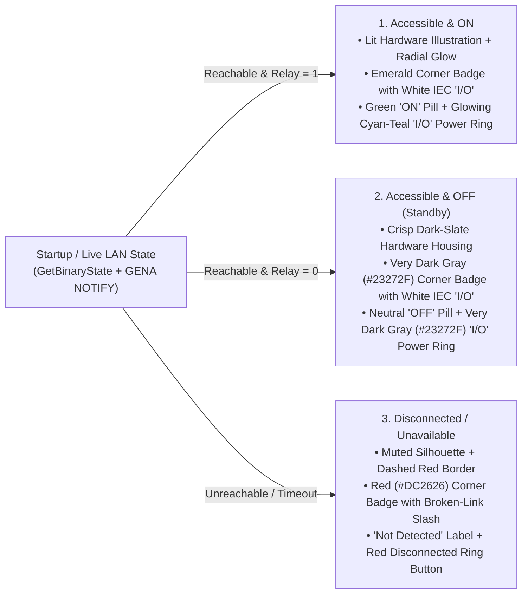

# WeMi Light Control — Android & Android TV UX Design, Behavioral Model & Critical User Journeys (`UX_DESIGN_AND_EXPERIENCE.md`)

**Repository**: `MichaelRHead/WeMi-light-control` (`org.suppressingfire.wemi` / `com.aistudio.wemiswitch.kxpqzr`, `v38.0`)  
**Document & Skill Owner**: **Google AI Studio Agent (`AI Studio Build`) — EXCLUSIVE OWNER**  
**Companion Agent Skill**: [`.agents/skills/wemi-ux-design-and-experience/SKILL.md`](.agents/skills/wemi-ux-design-and-experience/SKILL.md)

> [!CAUTION]
> **EXCLUSIVE OWNERSHIP & READ-ONLY GOVERNANCE RULE FOR OTHER AGENTS**:
> - **This document (`UX_DESIGN_AND_EXPERIENCE.md`), [`UX_DESIGN.md`](UX_DESIGN.md), and their companion skill (`.agents/skills/wemi-ux-design-and-experience/SKILL.md`) are owned exclusively by the Google AI Studio Agent.**
> - **ONLY the Google AI Studio Agent is permitted to author, edit, or modify these files.**
> - **All other agents** (CLI coding agents, background sync agents, test runners, and external assistants) **MUST read, understand, and strictly adhere to** the UX principles, layout invariants, behavioral models, and Critical User Journeys (CUJs) defined here when writing code or tests, **but MUST NOT modify, overwrite, or reformat these files.**

Related documentation:
- [`UX_DESIGN.md`](UX_DESIGN.md) — Android UX Design Guidelines: Navigation Patterns, Accessibility Standards & User Interaction Flows *(Owned Exclusively by the Google AI Studio Agent)*
- [`DEBUGGING_AND_SUPPORT.md`](DEBUGGING_AND_SUPPORT.md) — On-Device Telemetry, `10.22.22.1` Provisioning Diagnostics & Support Architecture *(Owned Exclusively by the Antigravity Debugging & Support Agent — read-only for the Google AI Studio Agent)*
- [`DISCOVERY_AND_ROOM_GROUPING.md`](DISCOVERY_AND_ROOM_GROUPING.md) — Internal Device Discovery Logic, Self-Healing Identity Resolution & Automatic Room Grouping Architecture *(Owned Exclusively by the Antigravity Device Discovery & Room Grouping Agent — read-only for the Google AI Studio Agent)*
- [`SECURITY_AND_PRIVACY.md`](SECURITY_AND_PRIVACY.md) — Security Threat Model, Privacy Lifecycle Invariants & Stage 4 Hardening Backlog *(Owned Exclusively by the Antigravity Security & Privacy Agent — read-only for the Google AI Studio Agent)*
- [`LICENSE_GOVERNANCE.md`](LICENSE_GOVERNANCE.md) — Open-Source MIT License Parity, Permissive Dependency Policy & Brand/Trademark Governance *(Owned Exclusively by the Antigravity License & Brand Governance Agent — read-only for the Google AI Studio Agent)*
- [`AGENTS.md`](AGENTS.md) — Architecture & Agent Guide
- [`IMPLEMENTED.md`](IMPLEMENTED.md) — Reverse-Chronological Change Log (`v1.0` → `v38.0`)
- [`UPCOMING_FEATURES.md`](UPCOMING_FEATURES.md) — Upcoming Features & Next-Iteration Roadmap
- [`USER_GUIDE.md`](USER_GUIDE.md) — Modular User Guide Index & Feature Guides ([`docs/user-guide/`](docs/user-guide/))

---

## 1. UX Vision: Tactile Physicality Meets Zero-Latency Local Trust

Most smart-home apps fail their users in two ways:
1. **Cloud Indirection & Ambiguous State**: They treat a wall switch 15 feet away as an abstract cloud record, hiding whether a switch is actually reachable on the local Wi-Fi versus powered OFF, and leaving users staring at spinners when a router reassigns a DHCP address.
2. **Sterile, Cramped Card Layouts**: They crowd device names, room labels, signal icons, and toggle controls onto a single horizontal row—causing multi-word switch names (*"Hallway & Landing"*, *"Upstairs Master Bedroom Chandelier"*) to truncate to 2 characters or wrap vertically into broken 1-character-per-line columns.

**WeMi Light Control** is engineered around the opposite premise: **a smart-home controller for Belkin's discontinued smart switch platform should feel as immediate, legible, and trustworthy as a physical wall paddle.** Every visual surface, state transition, icon, and layout constraint is designed to model how humans actually perceive and operate lighting in their home.

---

## 2. Modeling User Behavior & Mental Models

### 2.1 Mental Model 1: The Three-State Hardware Truth (`ON` vs. `OFF Accessible Standby` vs. `Disconnected`)
When a user glances at a switch list, their brain asks two distinct questions in order:
1. *"Can my phone talk to this switch right now?"* (Connectivity)
2. *"Is the power relay ON or OFF?"* (Load State)

Conflating **OFF** with **Offline** erodes trust. Therefore, every switch row and custom Canvas hardware illustration in **WeMi Light Control** renders **three unmistakable visual states**:

- **Why ON and OFF Share the Same IEC `"I/O"` Power Symbol (`drawIecPowerSymbol`)**:
  - A physical smart switch has an illuminated power icon on its paddle. Using an unfamiliar symbol (like an amber bullseye) for OFF confuses users into thinking the switch is in a warning state.
  - By rendering the **exact same IEC 60417-5009 power symbol** (`broken circle arc + vertical stem`) in **glowing cyan-teal (`#00838F`) when ON** and **very dark charcoal gray (`#23272F` ring / `#181B20` glyph) when OFF**, the button always reads as a tactile power switch ready to be pressed.
- **Why Unavailable Devices Swap the Power Ring for a Disconnected Ring (`DisconnectedRingButton`)**:
  - When a switch is unreachable (`!device.isReachable`), showing a normal power button invites a dead tap. Replacing it with `DisconnectedRingButton` (dashed red outer ring + broken-link diagonal slash `drawDisconnectedSymbol`) communicates *both* that the switch is offline *and* that tapping the ring will actively run a 2-stage self-healing reconnect probe.

### 2.2 Mental Model 2: Semantic Appliances, Not Generic Outlets (`DeviceCategory`)
Users rarely think in terms of hardware SKUs (`F7C030` vs. `WSP080`). They think in terms of **what is plugged into or wired to the switch**: *"Christmas Tree"*, *"Laundry Fan"*, *"Girls Light"*, *"Stairway Light"*.

`classifyDeviceCategory(name, deviceType)` automatically maps the user's natural naming into five multi-layered Jetpack Compose `Canvas` illustrations (`HardwareIllustrations.kt`):

| Semantic Category | Natural User Naming Triggers | Visual Feedback When `ON` | Visual Feedback When `OFF (Standby)` |
| :--- | :--- | :--- | :--- |
| **`CHRISTMAS_TREE` (`Tree Lights`)** | `tree`, `christmas`, `xmas`, `evergreen`, `spruce`, `fir `, `garland`, `wreath`, `tinsel`, `noel` | 3-tiered evergreen canopy with glowing gold star topper and 9 illuminated multi-color string bulbs | Deep pine silhouette with unlit frosted bulbs, wood trunk, and dark-gray IEC standby corner badge |
| **`FAN` (`Fan`)** | `fan`, `blower`, `vent`, `exhaust`, `ventilat`, `circulator` | Continuous `360°` spinning 4-blade rotor (`rememberInfiniteTransition`) with cyan airflow halo | Stationary brushed-steel blades inside a high-contrast dark-slate cage |
| **`LIGHT` (`Light`)** | `light`, `lamp`, `bulb`, `sconce`, `chandelier`, `lantern`, `pendant`, `flood`, `spot`, `dimmer`, `led`, `candle`, `strip`, `fixture` (or `LIGHTBULB_DIMMER`) | Warm-to-cyan luminous glass globe whose radial aura scales continuously (`1–100%`) with dimmer brightness | Smoke-slate glass dome revealing the unlit internal filament coil and metallic Edison base |
| **`MOTION_SENSOR` (`Motion`)** | `motion`, `sensor` (or `MOTION_SENSOR`) | Glowing emerald PIR lens dome with radiating motion wave arcs | Slate sensor housing with last-motion timestamp |
| **`SWITCH_PLUG` (`Switch`)** | All other switches & appliances (`Coffee Maker`, `Heater`, `Pump`) | Brushed wall paddle / pass-through mini plug with glowing cyan-green status bar | Tactile slate paddle / outlet face with dark-gray IEC standby badge |

### 2.3 Mental Model 3: Spatial Room Mental Model & Zero-Config Room Inference (`inferRoomFromName`)
In a house with 15–20 switches, a flat list forces cognitive scanning on every tap. Humans navigate their home spatially (*"turn off the Upstairs / Hallway lights"*, *"check the Bedroom"*).
- **Natural Household Vocabulary**: `inferRoomFromName` recognizes how families actually name switches:
  - `"bed"`, `"bedside"`, `"nightstand"`, `"bunk"`, `"primary"`, `"girls"`/`"girl"`, `"boys"`/`"boy"`, `"kids"`/`"kid"` → **`Bedroom`**
  - `"stair"` (`"stairway"`, `"stairs"`, `"upstairs"`, `"downstairs"`), `"landing"`, `"foyer"`, `"entry"`, `"mudroom"`, `"corridor"`, word-bounded `"hall"` → **`Hallway & Landing`**
  - `"kitchen"`, `"island"`, `"pantry"`, `"nook"` → **`Kitchen`**
  - `"basement"`, `"laundry"`, `"utility"`, `"cellar"` → **`Basement`**
- **Honest `"Unassigned"` Fallback**: If a switch name has no recognizable room keyword, it is placed in **`"Unassigned"`** (sorted at the bottom after named rooms) rather than silently dumped into `"Living Room"`. And on startup/SSDP scan in Real LAN Mode, switches previously stuck in `"Living Room"` are automatically migrated to their inferred rooms while preserving custom user edits.

### 2.4 Mental Model 4: Frictionless Multi-Home Context & Firmware Quirk Shielding
Users who own smart switches at more than one property (or across distinct routers/VLANs) expect the app to remember their switches per location without nagging for Android GPS/Location permissions (`ACCESS_FINE_LOCATION`):
- **Zero-Permission Subnet Memory**: `NetworkMonitor` inspects the active Wi-Fi interface's `/24` IPv4 prefix (`192.168.86.x`) to select or create the matching `HomeNetworkEntity` (`"My Home"`).
- **Shielding the UI from Firmware Soft-AP Pollution**: Physical Belkin switches (such as 2nd-Gen 3-Way switches `WLS0403` reporting `Wemo.LS3W.220` and 1st-Gen switches reporting `WeMo.Switch.xxx` in field 4 of `metainfo1#GetMetaInfo`) frequently return their own factory-setup hotspot name instead of the home router's SSID. `XmlAndSkuParser.isWemoDeviceSetupSsid()` filters out all `WeMo.*` / `Wemo.*` / `Belkin.*` soft-AP strings, and `SwitchRepository.ensureSeeded()` auto-sanitizes existing database rows on launch so the user's home is never renamed after a switch's internal AP.

### 2.5 Mental Model 5: Sub-Frame Optimistic Feedback with Honest Offline Rollback
When a user taps a power ring:
1. **Immediate Visual Ack (`<16ms`)**: The UI immediately writes the optimistic state to Room, animates the power ring color (`220ms`), and orbits a cyan progress arc (`spinAngle`) while `SetBinaryState` is in flight.
2. **GENA Echo Suppression (`1200ms` Window)**: Because physical switches broadcast a UPnP GENA `NOTIFY` event right after a SOAP toggle, `lastSetStateTimestampMs` suppresses redundant echo notifications for `1200ms` so the row never flickers.
3. **Honest Rollback on Unreachable Hardware**: If the switch does not respond on its last-known port *and* 2-stage self-healing reconnect (`9-port probe` → `SSDP scan by serialNumber`) fails in Real LAN Mode, the row honestly reverts `isOn`/`brightness` to its prior state and transitions to `Offline` (`DisconnectedRingButton`).

---

## 3. Strict Layout, Typography & Visual Hierarchy Invariants

Every screen and component in **WeMi Light Control** must obey these five layout invariants to prevent visual regressions across compact phones, large font scales, foldables, and 10-foot TVs:

### Invariant 1: Dedicated Full-Width Title Line (`AutoResizingDeviceNameText` / `AutoShrinkSwitchName`)
- **Rule**: Never place secondary badges, status pills, or action buttons on the same horizontal line as a dynamic device name, room title, or Wi-Fi Home title if they can compete for width.
- **Implementation**:
  - In `DeviceRow.kt`, `device.name` occupies **Line 1** across the full width of the card (`Modifier.fillMaxWidth().testTag("device_name_${device.id}")`) using `AutoResizingDeviceNameText(initialFontSizeSp = 17.5f, minFontSizeSp = 11f)` (`AutoShrinkSwitchName`). All secondary pills (`connection_status_badge`, `power_state_badge`, IP/Auto-Off, `category_badge`) live in a `FlowRow` on **Line 2** alongside the hardware illustration and 64dp Power/Disconnected ring.
  - Redundant room badges are omitted inside `DeviceRow` and `TvDeviceCard` because room context is already established by `RoomGroupCard` / room filters.

### Invariant 2: Uniform Card Height Across All Room Group Headers
- **Rule**: Every collapsed `RoomGroupHeaderCard` (e.g., `"Hallway & Landing"` vs. `"Living Room"`) must render at the **exact same height** regardless of room name length (`abs(heightA - heightB) <= 2f`).
- **Implementation**:
  - `roomName` sits on **Line 1** of the center column with `AutoResizingDeviceNameText(..., singleLineOnly = true)`.
  - The `"$activeCount/$totalControllable ON"` pill (`maxLines = 1, softWrap = false`) and `"$online/${roomDevices.size} Active • Avg ${avgLatency}ms"` subtitle (`maxLines = 1, softWrap = false, overflow = TextOverflow.Ellipsis`) sit together on **Line 2**.
  - This prevents long room names from squeezing the `"0/1 ON"` pill into a 0dp-wide vertical character column.

### Invariant 3: Compact, Single-Line Top Utility Bars (`WifiHomeBar.kt` & `SsdpDiscoveryBanner.kt`)
- **Rule**: Top chrome on the **Devices** tab must stay compact so rooms and switches remain the visual hero above the fold.
- **Implementation**:
  - `WifiHomeBar` renders the active home name with `AutoResizingDeviceNameText(..., initialFontSizeSp = 15f, singleLineOnly = true)`, single-line status (`maxLines = 1, softWrap = false`), a `32.dp`-high `Reconnect` button, and a horizontally scrollable row of `28.dp`-high chips (`Home (N)`, `Add Home`).
  - `SsdpDiscoveryBanner` (`SsdpDiscoveryBanner.kt`) uses a single compact row (`32.dp` radar icon badge, `maxLines = 1` title/subtitle, and `32.dp` `Scan` button) and automatically hides once switches exist and no scan is active.

### Invariant 4: Top-First Primary Controls in Expandable Drawers (`ExpandedDrawer`)
- **Rule**: When a user taps a dimmable light row to expand its inline drawer, the interactive controls they came for must appear **first**, before technical telemetry.
- **Implementation**:
  - `DeviceDiagnosticsDrawer.kt` renders the **Brightness Level Slider (`1–100%`)** and wrapping `FlowRow` of quick presets (**`21%`**, **`50%`**, **`75%`**, **`100%`**, and **`Night Mode (20%)`**) at the **very top** of `ExpandedDrawer`, followed by a unified Connection & Hardware Details card where `UPnP Endpoint` and `SN / Firmware` (`device_diagnostics_metadata_<id>`) span the full card width above the wrapping action chips (`Add Widget`, `Configure IP`, `Reconnect`) so metadata never wraps into a squeezed vertical strip beside buttons.

### Invariant 5: Non-Blocking Feedback & Synchronous Modal Dismissal
- **Rule**: Transient status banners must never block touches on underlying list items, and modal dialogs must close immediately when the user taps Save/Confirm.
- **Implementation**:
  - `status_feedback_banner` in `MainActivity.kt` is a non-clickable `Box` overlay so taps pass straight through to switch rows and bottom navigation tabs, and `SwitchViewModel.showTransientStatus` cancels any prior `statusBannerJob` timer so sequential status toasts never auto-dismiss prematurely.
  - All ViewModel and UI controller dialog save/confirm actions (`SwitchViewModel.kt`, `DeviceActionsUiController.kt`, `ProvisionApUiController.kt`, `HomeAndRulesUiController.kt`, `HardwareRulesUiController.kt`, and `WeMiModalDialogs.kt`: `saveDevice`, `addWifiHomeNetwork`, `deleteDevice`, `saveHardwareRule`, `confirmDeleteHardwareRule`, `saveSolarLocation`, `restoreBackup`) set their dialog `MutableStateFlow` to `false`/`null` **synchronously on the main thread** before launching background `Dispatchers.IO` network probes, and wrap all loading spinner flags in cancellation-safe `try / finally` blocks.

---

## 4. Critical User Journeys (CUJs)

### CUJ 1: First-Time Real LAN Launch, Confirmed Reset & SSDP Auto-Adoption
1. **Context**: User installs the app on a physical Android phone or opens **`More`** → **`Reset Homes, Discovered Switches & Rooms`** (`more_reset_lan_homes_switches_button`) → **`Reset & Rescan LAN`** (or **`Reset Empty`**).
2. **Experience**:
   - When `0` switches are saved in the active Wi-Fi Home, `EmptyDevicesState` (`empty_devices_state_card`) presents a visual showcase of the 4 hardware categories (`Switch`, `Light`, `Tree Lights`, `Fan`) and 3 real-LAN onboarding actions: **`Scan Local Network (SSDP)`**, **`Setup Factory-Reset Switch AP (10.22.22.1)`**, and **`Add Switch Manually (By IP)`** (Demo Showroom presets stay gated behind `Demo Showroom Mode` on the `More` tab).
   - Tapping **`Scan Local Network (SSDP)`** (`empty_state_scan_ssdp_button`) broadcasts UDP `M-SEARCH` bursts (`239.255.255.250:1900`) + a `/24` unicast sweep, displays live progress inside `SsdpScannerModal`, and **automatically adopts** all discovered switches into `My Home` when starting from an empty home (or lets the user tap **`Adopt`** / **`Adopt All`** when adding to an existing home). On Chromebooks (ChromeOS ARCVM `100.115.92.x`), if a strict router blocks multicast and automatic physical-subnet fallback finds zero switches, `ArcVmManualSubnetFallbackCard` (`arcvm_manual_subnet_card`) provides a clean RFC 1918 `/24` prefix prompt right inside the scanner modal without leaking CGNAT addresses into saved Wi-Fi Homes.

### CUJ 2: Everyday Single-Tap Switch Toggle & `<100ms` Physical Wall-Switch Sync
1. **Context**: User taps a switch's 64dp `PowerRingButton` (`power_button_${id}`) on their phone, or someone physically presses the wall switch paddle in the room.
2. **Experience**:
   - **App Tap**: The power ring immediately animates between very dark charcoal (`#23272F` OFF) and glowing cyan-teal (`#00838F` ON) with a spinning orbital arc while `SetBinaryState` executes inside `Semaphore(3)`. Once confirmed, the status pill updates (`ON` / `OFF`) and the connection badge shows the live SOAP round-trip time (`Active • 18ms`).
   - **Physical Wall Press**: `GenaSubscriptionManager` receives the switch's HTTP `NOTIFY /upnp/event` callback and updates the Room entity in `<100ms`, reflecting the new state on screen without waiting for the 30-second fallback poll.

### CUJ 3: Multi-Modal Dimmer Brightness Scaling (`1–100%` & Hardware `Night Mode 20%`)
1. **Context**: User wants to adjust a Smart Dimmer (`F7C059` or `WDS060`) from standby or while ON.
2. **Experience**:
   - **Collapsed Row**: The status pill always shows both power state and stored brightness (`OFF • 35%` or `ON • 75%`), and the lightbulb illustration scales its cyan-white radial glow to match `brightness`.
   - **Inline Drawer**: Tapping the dimmer row expands `ExpandedDrawer` with the continuous `Slider` (`brightness_slider_${id}`) and one-tap preset chips (`1%`, `21%`, `25%`, `50%`, `75%`, `100%`, and `Night Mode (20%)`) right at the top. Dragging the slider or tapping a preset on an `OFF` dimmer automatically turns it `ON` to that exact level.
   - **Room Master Dimmer**: Tapping the tune icon (`room_dimmer_button_${roomName}`) on a room header reveals a master room slider (`room_dimmer_slider_${roomName}`) that scales all dimmers in that room simultaneously.

### CUJ 4: Spatial Room Filtering, Collapsing & Whole-Room Master Toggle
1. **Context**: User wants to turn off an entire room (e.g., *Kitchen* or *Bedroom*) or focus on one area of the house.
2. **Experience**:
   - **Room Filter Bar (`RoomFilterBar`)**: Users can switch between **Grouped by Room** and **Flat List** (`toggle_group_by_room_chip`) or filter to a single room chip (`All Rooms (9)`, `Bedroom`, `Hallway & Landing`, etc.).
   - **Room Group Header (`RoomGroupHeaderCard`)**: Shows the room icon, single-line room name, `X/Y ON` badge, average latency, collapse chevron, optional room dimmer icon, and a 64dp **Room Master Power Ring** (`room_power_toggle_${roomName}`) that turns every reachable switch in that room ON or OFF in one tap.

### CUJ 5: Zero-Cloud `10.22.22.1` Factory-Reset Switch Provisioning & Screenshot Diagnostics
1. **Context**: User connects their phone's Wi-Fi to a blinking factory-reset smart switch (`WeMo.Light.xxx`, `WeMo.Switch.xxx`, `Wemo.LS3W.xxx`, `WeMo.Mini.xxx`) at `10.22.22.1`.
2. **Experience**:
   - **Auto-Detected Setup Banner**: `NetworkMonitor` detects the `10.22.22.x` subnet and surfaces the prominent **Smart Switch Setup AP Detected (`10.22.22.1`)** banner at the top of the **Devices** tab.
   - **Guided Wizard (`ProvisionApDialog`)**: Probes `10.22.22.1` across ports `49151–49159` via `LanHttpClient` (with inline RFC 1918 Setup AP IP validation), displays the detected hardware SKU/MAC/Serial and recommended AES-128-CBC method, scans nearby 2.4 GHz networks (`Scan APs` with an `8.5s` site-survey timeout), keeps the home Wi-Fi password strictly ephemeral in `remember` memory (masked by default behind a `48.dp` show/hide toggle `toggle_provision_password_visibility`, auto-remasking on `ON_PAUSE` and applying reveal-scoped `FLAG_SECURE` only while plaintext is revealed), and previews the auto-classified icon and inferred room (falling back honestly to `"Unassigned"`) as the user types a switch name.
   - **Non-Destructive Failure Handling & Privacy-First Setup Diagnostics**: If the switch reports `NetworkStatus = 0` or `2` (e.g., password typo, 5 GHz-only SSID, or firmware requiring a different OpenWrt/RTOS AES method / `xxyy` length suffix), the app **never** calls `CloseSetup`—keeping the `10.22.22.1` AP open for immediate retry—and keeps the dialog open while auto-expanding the collapsible **`SETUP DIAGNOSTICS`** terminal panel (`provision_debug_panel`, collapsed by default while idle with a `Details`/`Hide` toggle) with redacted-by-default one-tap **`Copy`** (flagged `EXTRA_IS_SENSITIVE`), **`Save/Share`** (`wemi-telemetry-latest.txt`), and an opt-in **`Full IDs in Export`** chip (`provision_include_full_ids_chip`).

### CUJ 6: Self-Healing Reconnection When a Switch Is Offline or Changes IP/Port
1. **Context**: A switch row shows the red **Disconnected Ring Button** (`reconnect_button_${id}`) and `Offline • Timeout` badge after a power outage or router reboot.
2. **Experience**:
   - Tapping the Disconnected Ring (or tapping **`Reconnect`** on `WifiHomeBar`) runs `attemptTwoStageReconnect`:
     1. **Stage 1**: Probes all 9 UPnP ports (`49153, 49152, 49154, 49151, 49155..49159`) at the switch's known IP, verifying `<serialNumber>` / `<UDN>` so a DHCP IP swap never toggles the wrong switch.
     2. **Stage 2**: Broadcasts a targeted SSDP `M-SEARCH` scan to locate the switch by `<serialNumber>` if the router assigned a new IPv4 address, automatically updating the Room database and restoring the glowing power ring.

### CUJ 7: Native 10-Foot Living Room Android TV Experience (`wemi TV`)
1. **Context**: User opens **WeMi Light Control** on an Android TV / Google TV device (`UI_MODE_TYPE_TELEVISION`).
2. **Experience**:
   - Automatically launches `TvDashboardScreen` (`tv_dashboard_screen` across `TvScreen.kt`, `TvFocusModel.kt`, `TvDimmerControls.kt`, `TvRoomSectionHeader.kt`, `TvHeadersAndScenes.kt`, `TvCardsAndScenes.kt`, and `TvHouseholdSyncDialog.kt`) with a single compact top header bar (`tv_top_header_bar`: `wemi TV`, active switch counter, context-aware focused item status pill `tv_remote_dpad_ok` with ellipsizing focused switch, Room Master bar, or top-bar action name + live OK/dimming hint such as `• OK Toggle`, `• OK Reconnect`, `• OK Toggle Room`, `• OK Toggle Room • ◄/► Dim`, or `• ◄/► N%`, dimmer mode chip `tv_dimmer_mode_toggle` shown only for reachable dimmers, quick scene chips `Movie 20%`, conditional `Holiday ON` — rendered only when the active home includes a holiday/festive switch such as Christmas tree, holiday lights, Diwali/Dewali, Hanukkah, Halloween, or fairy/string lights — `All OFF` via `TvScene`, `Rescan`, and **`Sync`** `tv_sync_button`) that preserves constant single-row height and unclipped right-edge alignment while dimming so over 90% of vertical screen height showcases the **3-Column Room-Grouped Switch Grid (`tv_device_grid`)**.
   - **Room Section Headers (`TvRoomSectionHeader`, `tv_room_header_<RoomName>`)**: Group switches by room across all 3 columns (`span = { GridItemSpan(maxLineSpan) }`, with `"Unassigned"` sorted last), are always selected next when moving Up or Down through them from any column (including the leftmost switch widget), allow one-click concurrent (`Semaphore(3)`) Room Master toggling when pressed with `OK`, and step all room dimmers by `-10%` / `+10%` when `Left` / `Right` is pressed on a focused Room Header (`FOCUSED • OK TOGGLE • L/R DIM`).
   - **Unmistakable 10-Foot Cursor Focus & Empty-Home Rescan Focus**: Initial focus (`FocusRequester`) automatically lands on the first switch card (or on `Rescan` `tv_scan_button` when the active Wi-Fi Home has `0` switches), rendering a `3.5.dp` Electric Cyan border (`#22D3EE`), bright illuminated surface (`#133B66`), `1.022f` scale lift, and a **`FOCUSED • OK`** badge.
   - **Google TV Remote-Friendly Focusable Dimmer Slider, System Back & 3-Column Navigation**: Navigating into a dimmer card focuses its **On/Off Toggle** (`tv_device_card_<id>`), where `Left / Right` moves across adjacent switch cards and `OK` toggles power `ON` / `OFF`. Navigating **Down once more** focuses the **Dimmer Slider** (`tv_card_dim_mode_<id>`, highlighted in glowing Gold `#FBBF24`), where pressing `Left / Right` lowers (`-10%`) or raises (`+10%`) the dimmer brightness (surfacing `tv_dimmer_hud_overlay`), pressing `Up` or **system `Back`** (`BackHandler`) returns focus to the On/Off Toggle (`tv_device_card_<id>`), and pressing `Down` moves to the widget in the same column below.

### CUJ 8: Zero-Launch Home Screen Light & Room Toggle Widgets (`widget/`)
1. **Context**: User wants to flip a favorite light or an entire room ON/OFF directly from the Android home screen without launching WeMi Light Control.
2. **Experience**:
   - **One-Tap In-App Pinning or Launcher Picker**: The user taps the **Pin Room Widget** button (`room_pin_widget_button_<Room>`) on any `RoomGroupCard`, taps **`Add Widget`** (`pin_device_widget_<id>`) in a switch's `ExpandedDrawer`, or drags **WeMi Light & Room Toggle** from the Android widget drawer to launch `SwitchWidgetConfigureActivity` (Rooms / Lights tabs with Wi-Fi Home filters and honest 3-state `ON` / `OFF` / `Offline` tile previews).
   - **Direct Local-LAN Toggle & Live Sync**: Tapping the placed home screen widget runs `WidgetActionExecutor.toggleWidget` headlessly via non-exported `WeMiWidgetActionReceiver` over local-LAN UPnP SOAP (`SetBinaryState`, `Semaphore(3)`-safe room fan-out, 9-port self-healing reconnect) without opening `MainActivity`. The widget immediately updates its Ocean Teal (`ON`), dark charcoal standby (`OFF`), or red dashed (`Offline`) visual state, dimmer brightness (`ON • 75%`), or room counter (`2/3 ON`), and automatically refreshes whenever in-app or physical wall-switch GENA changes occur.

### CUJ 9: Live On-Device Switch Rules (`On-Switch`) Management (`RulesScreen.kt`, `HardwareRulesSection.kt`, `HardwareRuleEditorDialog.kt`, `HardwareRulesAuxDialogs.kt` & `DeviceDiagnosticsDrawer.kt`)
1. **Context**: User owns legacy OpenWrt switches (`F7C030`, `WLS0403`, `F7C059`, `F7C063`) capable of storing schedules, Auto-Off delays, Timed Actions, and Long Press targets directly in switch flash (`rules.db`), alongside newer RTOS switches (`WDS060`, `WSP080`) that do not expose on-device rules storage, and wants to create, edit, toggle, delete, sync clocks, configure solar coordinates, and restore backups without relying on a phone or cloud service.
2. **Experience**:
   - **Unified `On-Switch` Mental Model & Guarded Creation**: The **`Rules`** tab is dedicated exclusively to **`On-Switch`** rules (*"Stored in switch memory • runs even when your phone is off"*). Tapping **`+`** in `TopHeader` (context-aware TalkBack label `"Add On-Device Rule"`) or **`+ New Rule`** (`add_hardware_rule_button`, `>= 48.dp`) opens `HardwareRuleEditorDialog` filtered to reachable compatible switches—or shows a clear status notice when zero reachable compatible switches exist. Empty homes render a `>= 48.dp` **`Go to Devices`** bridge (`rules_empty_go_to_devices_button`) instead of a dead end.
   - **Accessible Editing, Compact-Width Resilience & Safety Tools**: Individual lazy rule rows (`HardwareRuleSummaryRow`) ellipsize long badges (`Modifier.weight(1f, fill = false)`) so `Edit`, `Delete`, and the `Enabled` `Switch` never clip on `320dp` phones; pre-existing firmware rules like `Away Mode` display a **`View only`** badge (edit hidden), while multi-switch **`Shared rule`** entries and non-owner **`Target`** copies render read-only with `Edit` hidden and `Delete`/`Switch` disabled to prevent cross-switch corruption. `HardwareRuleEditorDialog` preserves draft form fields across rotation via `rememberSaveable`, preserves the chosen rule type when switching compatible owners, surfaces a pinned `LiveRegionMode.Polite` validation banner above the actions, displays wrapping `AssistChip` time steppers (`-1h`, `+1h`, `-15m`, `+15m`, `-5m`, `+5m`, `-1m`, `+1m`) and Sunrise/Sunset presets (`-60m` to `+60m` + custom firmware offsets), validates distinct fixed and solar start/end times, and supports removing unknown pre-existing Long Press target UDNs. `HardwareLocationDialog` uses `KeyboardType.Ascii` with signed-decimal filtering so Western/Southern Hemisphere negative coordinates work on every Android IME, and `HardwareRulesBackupDialog` reassures users that current rules are backed up automatically in device-local `noBackupFilesDir` before restoring.
   - **Contextual Quick View & Bridge in `ExpandedDrawer`**: Expanding any controllable switch on the **`Devices`** tab surfaces a compact **On-Device Rules** card (`hardware_rules_drawer_section_<id>`) below Brightness and Connection Telemetry (preserving Invariant 4), displaying capability status, `Inspect Rules` / `Refresh`, clock-sync warnings, up to 4 styled `trigger → action` rule rows (with muted `Paused` badges), and a clickable **`Manage Rules`** chip (`drawer_open_rules_tab_<id>`) plus `"+N more rule(s) in Rules tab"` link that jumps directly to the **`Rules`** tab.

### CUJ 10: Zero-Cloud Household Configuration Sync (`HouseholdSyncCard.kt`, `HouseholdSyncDialogs.kt`, `HouseholdSyncReceiveDialogs.kt` & `TvHouseholdSyncDialog.kt`)
1. **Context**: User has organized their Wi-Fi Homes, custom switch names, canonical room assignments, and switch ordering on their primary Android phone and wants to copy that setup to an Android TV (`wemi TV`), secondary phone, tablet, or Chromebook—or keep a portable backup—without creating a cloud account or exposing Wi-Fi passwords.
2. **Experience**:
   - **Portable JSON Export & Import (`More` → `Household Config Sync`)**: Tapping **`Export JSON`** (`more_export_household_json_button`) or **`Import JSON`** (`more_import_household_json_button`) launches Android's zero-permission Storage Access Framework (`CreateDocument` with truncating `"wt"` writes / `OpenDocument`). Compact button padding (`10.dp` horizontal) with single-line ellipsis keeps all four `>= 48.dp` action buttons readable on `320dp` screens. Imported bundles open `HouseholdImportConfirmDialog` (`household_import_confirm_dialog`, vertically scrollable with wrapping `FlowRow` actions) displaying source, home/switch/room counts, and identity-safe **`Merge`** (preserving local live IPs, ON/OFF states, and verified rules caches via exact-identity-first 3-tier serial → UDN → endpoint/name matching) vs. **`Replace All`**.
   - **PIN-Encrypted Phone-to-TV & Local-LAN Pairing**: On Android TV, navigating to **`Sync`** (`tv_sync_button`) opens `TvHouseholdSyncOverlay` (`tv_household_sync_overlay`, Up/Down D-Pad focus-contained, `BackHandler`-dismissible, `>= 48.dp` D-Pad focusable buttons) showing a temporary `120s`-TTL **6-digit pairing code** (protected by `FLAG_SECURE` while visible and automatically paused on `ON_STOP`), local `IP:port`, and polite live-region status updates (or **More → Receive** `more_receive_lan_sync_button` on handhelds/tablets, with honest ChromeOS ARCVM receive guidance). On the sending phone, **`Send to TV`** (`more_send_lan_sync_button`) opens `HouseholdSyncSendDialog` (`household_sync_send_dialog`), auto-discovers nearby receivers over Wi-Fi-bound UDP `49190` (`SyncPeerRow`, `>= 48.dp` with merged TalkBack selection semantics), validates RFC 1918 IPv4 and TCP port `1..65535` inline, keeps the 6-digit PIN strictly in volatile `remember` memory, runs a pure-Kotlin **RFC 9382 SPAKE2 (Group 14)** handshake with sender-bound `AES-256-GCM` AAD, and pushes the bundle directly over local Wi-Fi for one-click **`Merge & Apply`** or **`Replace All`** on the TV.

