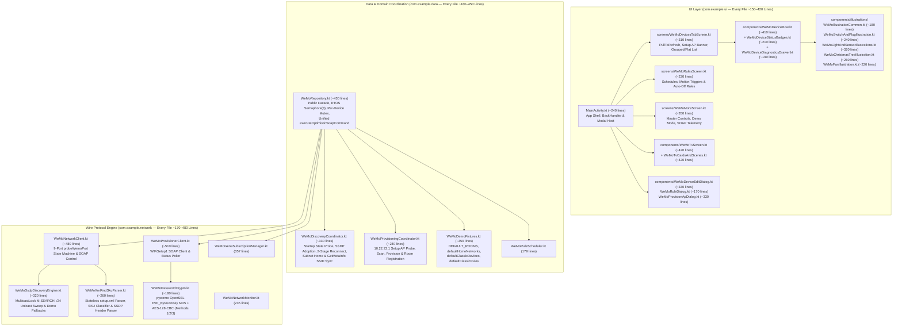

# WeMi Light Control — Code Quality, Human-Readable Modularization & End-to-End Validation Plan

**Target Repository**: `MichaelRHead/WeMi-light-control` (`com.example` / `com.aistudio.wemiswitch.kxpqzr`, `v12.0`)  
**Status**: **Ready for Review** (Awaiting Go-Ahead Order before touching production `.kt` files)

Related documents and skills:
- [`AGENTS.md`](../AGENTS.md) — Architecture & Agent Guide
- [`IMPLEMENTED.md`](../IMPLEMENTED.md) / [`docs/IMPLEMENTED.md`](IMPLEMENTED.md) — Reverse-Chronological Change Log (`v1.0` → `v12.0`)
- [`UPCOMING_FEATURES.md`](../UPCOMING_FEATURES.md) / [`docs/UPCOMING_FEATURES.md`](UPCOMING_FEATURES.md) — Upcoming Features & Next-Iteration Roadmap
- [`USER_GUIDE.md`](../USER_GUIDE.md) / [`docs/USER_GUIDE.md`](USER_GUIDE.md) — Modular User Guide Index & Feature Guides ([`docs/user-guide/`](user-guide/))
- [`.agents/skills/android-code-modularization/SKILL.md`](../.agents/skills/android-code-modularization/SKILL.md) — Android Code Modularization & Human Readability Skill
- [`.agents/skills/android-e2e-testing/SKILL.md`](../.agents/skills/android-e2e-testing/SKILL.md) — Android End-to-End (E2E) Testing & Validation Skill
- [`.agents/skills/multi-agent-git-sync/SKILL.md`](../.agents/skills/multi-agent-git-sync/SKILL.md) — Multi-Agent Git Sync, Anti-Stomp Audit & Conflict-Free Integration Skill
- [`.agents/skills/wemi-changelog-and-docs/SKILL.md`](../.agents/skills/wemi-changelog-and-docs/SKILL.md) — Change Log & Documentation Maintenance Skill
- [`.agents/skills/wemi-light-control/SKILL.md`](../.agents/skills/wemi-light-control/SKILL.md) — WeMi Light Control Domain & UPnP Protocol Skill

---

## 1. Guiding Philosophy: Exceptionally Readable Code for Humans

The goal of this plan is to make the **WeMi Light Control** codebase effortlessly readable for human engineers while expanding end-to-end test confidence:

1. **Concise, Cohesive Files (`150–400` Lines Target)**:
   - A human reader opening any `.kt` file should immediately grasp its single responsibility without scrolling through 1,000+ lines of unrelated concerns.
2. **The Subtlety Rule (Inherent vs. Accidental Complexity)**:
   - Implementation files should **not** grow complex and large unless there is an **underlying subtlety to the module's responsibility** that requires keeping tightly coupled state transitions together.
   - **Genuine Subtlety (Keep Cohesive)**:
     - The 9-port `probeWemoPort` state machine in `WeMoNetworkClient` (distinguishing ARP/SYN `SocketTimeoutException` host-offline aborts vs. `ECONNREFUSED` closed-port skips vs. HTTP read timeouts on wedged ports, plus `<serialNumber>`/`<UDN>` DHCP swap verification).
     - The RTOS-safe concurrency & self-healing command pipeline in `WeMoRepository` (per-device `Mutex`, LAN-wide `Semaphore(3)` to prevent 2nd-Gen `WLS0403` lwIP socket starvation, `1200ms–1500ms` GENA echo suppression, optimistic Room writes, 2-stage self-healing reconnect, and offline rollback).
     - The `pywemo`-exact OpenSSL `EVP_BytesToKey` MD5 key/IV derivation and AES-128-CBC password encryption across Methods 1 (OpenWrt), 2 (RTOS), and 3 (`binaryOption`).
   - **Accidental Complexity (Decompose Immediately)**:
     - Bundling 350 lines of static Demo Showroom seed data inside `WeMoRepository.kt`.
     - Copy-pasting the 75-line optimistic-update + `Semaphore(3)` + 2-stage reconnect + offline-revert block three times across `toggleDevicePower`, `setDevicePowerExplicit`, and `updateDeviceBrightness`.
     - Packing 6 distinct 3-state `Canvas` hardware illustrations (`1,373` lines) or 3 unrelated modal dialogs (`903` lines) into single monolithic files.
3. **Zero-Regression Public API Compatibility**:
   - All decompositions preserve existing package namespaces (`com.example.data`, `com.example.network`, `com.example.ui.components`, `com.example.ui.screens`) and public entry points (`WeMoRepository`, `WeMoNetworkClient`, `WeMoViewModel`, `WeMiSwitchApp`) so AI Studio, Compose Previews, and tests continue to work seamlessly.

---

## 2. Current Codebase Audit (`14,847` Lines Across 24 Kotlin Files)

| File | Current Lines | Assessment | Underlying Subtlety vs. Accidental Bundling |
| :--- | ---: | :--- | :--- |
| [`data/WeMoRepository.kt`](../app/src/main/java/com/example/data/WeMoRepository.kt) | **629** (was 1,898) | **Completed (Phase M1)** | **Subtlety**: Concurrency (`Semaphore(3)` + per-device `Mutex`), unified `executeOptimisticDeviceCommand` with 2-stage self-healing reconnect & offline rollback, GENA push handling, and Room CRUD. |
| [`data/WeMoDiscoveryCoordinator.kt`](../app/src/main/java/com/example/data/WeMoDiscoveryCoordinator.kt) | **385** (new) | **Completed (Phase M1)** | Extracted startup `GetBinaryState` detection (`detectStartupDeviceStates`), 2-stage reconnect (`attemptTwoStageReconnect`), SSDP scan & auto-adoption, and subnet/SSID home sync. |
| [`data/WeMoDemoFixtures.kt`](../app/src/main/java/com/example/data/WeMoDemoFixtures.kt) | **351** (new) | **Completed (Phase M1)** | Extracted static Demo Showroom seed fixtures (`DEFAULT_ROOMS`, `defaultHomeNetworks`, `defaultClassicDevices`, `defaultClassicRules`). |
| [`data/WeMoProvisioningCoordinator.kt`](../app/src/main/java/com/example/data/WeMoProvisioningCoordinator.kt) | **289** (new) | **Completed (Phase M1)** | Extracted `10.22.22.1` Setup AP probing, 2.4 GHz AP scanning, `WiFiSetup1` provisioning, Demo Showroom AP simulation, and post-provisioning Room registration. |
| [`ui/components/WeMoHardwareIllustrations.kt`](../app/src/main/java/com/example/ui/components/WeMoHardwareIllustrations.kt) | **1,373** | **Refactor (Priority 1)** | **Accidental**: Bundles 5 standalone 3-state `Canvas` illustrations (`SmartPlug`, `MotionSensor`, `Lightbulb`, `ChristmasTree`, `Fan`) plus `WeMoPowerRingButton` and `WeMoPlugTabIcon` in one file. |
| [`network/WeMoNetworkClient.kt`](../app/src/main/java/com/example/network/WeMoNetworkClient.kt) | **1,268** | **Refactor (Priority 1)** | **Subtlety**: 9-port `probeWemoPort` & SOAP retry/quirk handling (`<BinaryState>Error</BinaryState>`). **Accidental**: Stateless XML/SSDP regex parsers, SKU classification table, and UDP multicast SSDP + `/24` unicast subnet scanner. |
| [`test/.../WeMoProtocolTest.kt`](../app/src/test/java/com/example/WeMoProtocolTest.kt) | **1,227** | **Refactor (Priority 1)** | **Accidental**: Combines 10 distinct test suites (SKU classification, SOAP port-hop, offline revert, GENA push, RuleScheduler, AES-128-CBC crypto, full loopback provisioning, manual IP probing, startup state detection) and inline mock socket servers in one file. |
| [`ui/components/WeMoTvScreen.kt`](../app/src/main/java/com/example/ui/components/WeMoTvScreen.kt) | **1,010** | **Refactor (Priority 2)** | **Accidental**: Combines the 10-foot Android TV dashboard shell, D-Pad remote simulator bar, TV scene cards, TV room group cards, TV device tiles, and SOAP footer in one file. |
| [`ui/components/WeMoDialogs.kt`](../app/src/main/java/com/example/ui/components/WeMoDialogs.kt) | **905** | **Refactor (Priority 2)** | **Accidental**: Bundles 3 unrelated dialogs (`AddOrEditWeMoDeviceDialog`, `AddWeMoRuleDialog`, and `ProvisionWeMoApDialog` with error-status highlighting and room preset chips) into one file. |
| [`ui/WeMoViewModel.kt`](../app/src/main/java/com/example/ui/WeMoViewModel.kt) | **858** | **Refactor (Priority 2)** | Coordinates 28 separate `MutableStateFlow` properties and background loops. Can be streamlined with cohesive state holders and concise action helpers. |
| [`ui/components/WeMoDeviceRow.kt`](../app/src/main/java/com/example/ui/components/WeMoDeviceRow.kt) | **812** | **Refactor (Priority 2)** | Combines the primary skeuomorphic device row, inline dimmer slider, expandable hardware diagnostics drawer, and reusable status badges (`WeMoConnectionStatusBadge`, `WeMoSignalBarsIndicator`, `WeMoPowerStatePill`). |
| [`MainActivity.kt`](../app/src/main/java/com/example/MainActivity.kt) | **771** | **Refactor (Priority 2)** | Mixes `ComponentActivity` setup, 34 `collectAsStateWithLifecycle()` calls, `BackHandler`, the entire `DEVICES` tab `PullToRefreshBox` + `LazyColumn`, the 4-icon `EmptyDevicesState` onboarding card, and dialog bindings. |
| [`network/WeMoProvisionerClient.kt`](../app/src/main/java/com/example/network/WeMoProvisionerClient.kt) | **722** | **Refactor (Priority 3)** | **Subtlety**: Multi-step `10.22.22.1` `WiFiSetup1` provisioning state machine. Extracting pure OpenSSL AES-128-CBC crypto (`WeMoPasswordCrypto.kt`, ~170 lines) isolates the subtle cipher math from SOAP I/O. |
| [`ui/screens/WeMoRulesAndMoreScreens.kt`](../app/src/main/java/com/example/ui/screens/WeMoRulesAndMoreScreens.kt) | **583** | **Refactor (Priority 3)** | Contains two separate bottom-nav tab screens (`WeMoRulesScreen` [~230 lines] and `WeMoMoreScreen` [~350 lines]). Splitting into `WeMoRulesScreen.kt` and `WeMoMoreScreen.kt` makes each tab self-contained. |
| [`ui/components/WeMoSsdpScannerModal.kt`](../app/src/main/java/com/example/ui/components/WeMoSsdpScannerModal.kt) | **525** | **Keep / Minor Polish** | Cohesive single feature (SSDP discovery banner + live scanner bottom sheet). |
| [`ui/components/WeMoHeaderAndNav.kt`](../app/src/main/java/com/example/ui/components/WeMoHeaderAndNav.kt) | **481** | **Keep** | Clean, cohesive top lime-green skeuomorphic header + bottom navigation bar. |
| [`ui/components/WeMoRoomGroupCard.kt`](../app/src/main/java/com/example/ui/components/WeMoRoomGroupCard.kt) | **447** | **Keep** | Cohesive room filter bar + collapsible room group card with master power & dimmer slider. |
| [`ui/components/WeMoWifiHomeBar.kt`](../app/src/main/java/com/example/ui/components/WeMoWifiHomeBar.kt) | **358** | **Keep** | Cohesive multi-home Wi-Fi bar & `AddWifiHomeNetworkDialog`. |
| [`network/WeMoGenaSubscriptionManager.kt`](../app/src/main/java/com/example/network/WeMoGenaSubscriptionManager.kt) | **357** | **Keep (Justified Subtlety)** | Self-contained UPnP GENA `SUBSCRIBE` client + embedded `ServerSocket` `NOTIFY` push listener & HTTP 412 recovery. |
| [`test/.../ExampleRobolectricTest.kt`](../app/src/test/java/com/example/ExampleRobolectricTest.kt) | **324** | **Expand E2E Suite** | Clean, readable Robolectric + Compose UI E2E test suite (6 tests). |
| [`network/WeMoNetworkMonitor.kt`](../app/src/main/java/com/example/network/WeMoNetworkMonitor.kt) | **235** | **Keep (Justified Subtlety)** | Focused zero-permission `/24` subnet & `10.22.22.x` Setup AP detector + `createWifiBoundSocketFactory`. |
| [`data/WeMoEntities.kt`](../app/src/main/java/com/example/data/WeMoEntities.kt) | **234** | **Keep** | Clean Room v5 entities, enums, `inferRoomFromName`, and `classifyDeviceCategory`. |
| [`data/WeMoRuleScheduler.kt`](../app/src/main/java/com/example/data/WeMoRuleScheduler.kt) | **179** | **Keep** | Focused coroutine engine for `AUTO_OFF` countdowns and daily `SCHEDULE` evaluation. |
| [`data/WeMoDao.kt`](../app/src/main/java/com/example/data/WeMoDao.kt) & [`WeMoDatabase.kt`](../app/src/main/java/com/example/data/WeMoDatabase.kt) | **86 / 38** | **Keep** | Crisp Room v5 DAO and database singleton. |
| [`ui/theme/Color.kt`](../app/src/main/java/com/example/ui/theme/Color.kt), [`Theme.kt`](../app/src/main/java/com/example/ui/theme/Theme.kt), [`Type.kt`](../app/src/main/java/com/example/ui/theme/Type.kt) | **22 / 34 / 62** | **Keep** | Clean theme definitions. |

---

## 3. Target Modular Architecture Blueprint



---

## 4. Detailed File-by-File Modularization Plan

### Step M1: Decompose `WeMoRepository.kt` (`1,899` lines → 4 focused files)

1. **`data/WeMoDemoFixtures.kt` (~350 lines)**:
   - Extract `DEFAULT_ROOMS`, `defaultHomeNetworks()`, `defaultClassicDevices()`, and `defaultClassicRules()`.
   - Keep delegating `@JvmStatic` methods on `WeMoRepository.Companion` (`fun defaultClassicDevices() = WeMoDemoFixtures.defaultClassicDevices()`, etc.) so existing callers in `WeMoViewModel` and tests require zero changes.
2. **Eliminate 3x Duplicated Optimistic SOAP State-Transition Boilerplate in `WeMoRepository.kt`**:
   - Currently, `toggleDevicePower` (lines 467–552), `setDevicePowerExplicit` (lines 582–638), and `updateDeviceBrightness` (lines 665–731) duplicate the exact same 75-line pattern:
     1. Acquire `mutexFor(device).withLock`
     2. Write optimistic `isOn`/`brightness` to Room and stamp `lastSetStateTimestampMs[device.id]`
     3. Execute SOAP call inside `lanSemaphore.withPermit`
     4. If `!result.reachableOnLan && !_isDemoShowroomMode.value`, invoke `attemptTwoStageReconnect` and retry inside `lanSemaphore.withPermit`
     5. Append `result.logEntry` and commit confirmed state (or revert to `priorOn`/`priorBrightness` with `isReachable = false, latencyMs = 0` when offline in Real LAN Mode).
   - **Consolidation**: Replace all three with a single, well-documented private method `executeOptimisticDeviceCommand(...)` (~65 lines). That makes the subtle concurrency + self-healing + rollback contract readable in one single place and cuts ~160 lines of duplicate code.
3. **`data/WeMoDiscoveryCoordinator.kt` (~330 lines)**:
   - Extract discovery, startup probing, and home-network healing logic (`detectStartupDeviceStates`, `attemptTwoStageReconnect`, `reconnectAndRediscoverHome`, `executeSsdpScan`, `adoptDiscoveredDevice`, `adoptDiscoveredDevices`, `resolveOrCreateHomeForSubnet`, `syncHomeSsidFromDeviceSsid`).
4. **`data/WeMoProvisioningCoordinator.kt` (~240 lines)**:
   - Extract `probeSetupApDevice`, `scanSetupApNetworks`, and `provisionSetupApDevice` (including Demo Showroom AP simulation and automatic post-provisioning Room device registration).
5. **Resulting `data/WeMoRepository.kt` (~430 lines)**:
   - Acts as the clean, human-readable repository entry point holding the Room `Flow`s, `lanSemaphore`, `deviceMutexes`, `genaManager`, `executeOptimisticDeviceCommand`, device/rule CRUD, and thin delegations to `WeMoDiscoveryCoordinator` and `WeMoProvisioningCoordinator`.

---

### Step M2: Decompose `WeMoNetworkClient.kt` (`1,269` lines) & `WeMoProvisionerClient.kt` (`722` lines)

1. **`network/WeMoXmlAndSkuParser.kt` (~260 lines)**:
   - Extract stateless protocol builders & parsers:
     - `buildSsdpMSearchPacket`
     - `parseSsdpHeaders`
     - `classifyHardwareSku` (`F7C030`, `WLS040`, `WLS0403`, `F7C059`, `WDS060`, `F7C063`, `WSP080`)
     - `parseSetupXmlDescriptor` (including `<binaryState>`, `<brightness>`, `<rtos>`, `<serialNumber>`, `<UDN>`)
     - `parseBinaryStateSoapResponse` and `parseMetaInfoSoapResponse`
2. **`network/WeMoSsdpDiscoveryEngine.kt` (~320 lines)**:
   - Extract `performSsdpDiscoveryScan` (`MulticastLock`, UDP `239.255.255.250:1900` burst + retransmit, unicast verification of known devices, and Demo Showroom fallback synthesis) and `scanSubnetUnicast` (`Semaphore(24)` `/24` sweep).
3. **Resulting `network/WeMoNetworkClient.kt` (~480 lines)**:
   - Focuses strictly on the subtle 9-port `probeWemoPort` algorithm, `setBinaryState`, `getBinaryState`, `getMetaInfo`, `getSignalStrength`, `changeFriendlyName`, `configureNightMode`, `fetchLiveDeviceDescriptor`, and `probeAndFetchDeviceDescriptor`.
   - Delegates stateless parsing and SSDP scanning to `WeMoXmlAndSkuParser` and `WeMoSsdpDiscoveryEngine` while keeping public methods on `WeMoNetworkClient` intact.
4. **`network/WeMoPasswordCrypto.kt` (~180 lines)**:
   - Extract `encryptWifiPassword`, `decryptWifiPassword`, `deriveKeyAndIvOpenSslMd5`, and the `pywemo` Method 1 / Method 2 / Method 3 `keydata` builders from `WeMoProvisionerClient.kt`.
   - Leaves `WeMoProvisionerClient.kt` (~510 lines) focused purely on `10.22.22.1` HTTP/SOAP setup communication (`probeSetupDevice`, `fetchAvailableApList`, `provisionDeviceToHomeWifi`, `pollNetworkStatus`, `closeSetup`, `setSetupDoneStatus`).

---

### Step M3: Decompose UI Monoliths (`WeMoHardwareIllustrations.kt`, `WeMoDialogs.kt`, `WeMoTvScreen.kt`, `WeMoDeviceRow.kt`, `MainActivity.kt`)

All extracted UI files remain in `package com.example.ui.components` or `package com.example.ui.screens` so every existing import in `MainActivity.kt` and tests compiles without modification:

1. **Split `WeMoHardwareIllustrations.kt` (`1,373` lines → 5 files, ~180–320 lines each)**:
   - `WeMoHardwareIllustrations.kt` (~200 lines): `WeMoDeviceCategoryIllustration` router, `WeMoPowerRingButton`, `WeMoPlugTabIcon`, and shared 3-state corner status indicator helpers.
   - `WeMoSwitchAndPlugIllustration.kt` (~240 lines): `WeMoSmartPlugIllustration`.
   - `WeMoLightAndSensorIllustrations.kt` (~320 lines): `WeMoLightbulbIllustration` and `WeMoMotionSensorIllustration`.
   - `WeMoChristmasTreeIllustration.kt` (~270 lines): `WeMoChristmasTreeIllustration`.
   - `WeMoFanIllustration.kt` (~220 lines): `WeMoFanIllustration`.
2. **Split `WeMoDialogs.kt` (`881` lines → 3 single-purpose dialog files)**:
   - `WeMoDeviceEditDialog.kt` (~330 lines): `AddOrEditWeMoDeviceDialog` (with live semantic icon category preview & hardware rename toggle).
   - `WeMoRuleDialog.kt` (~170 lines): `AddWeMoRuleDialog`.
   - `WeMoProvisionApDialog.kt` (~330 lines): `ProvisionWeMoApDialog` (`10.22.22.1` zero-cloud setup wizard).
3. **Split `WeMoDeviceRow.kt` (`812` lines → 3 cohesive files)**:
   - `WeMoDeviceRow.kt` (~410 lines): Main skeuomorphic brushed-metal row, inline dimmer slider, Night Mode chip, and Auto-Off countdown pill.
   - `WeMoDeviceStatusBadges.kt` (~210 lines): `WeMoConnectionStatusBadge`, `WeMoSignalBarsIndicator`, `WeMoPowerStatePill`.
   - `WeMoDeviceDiagnosticsDrawer.kt` (~190 lines): Expandable hardware telemetry drawer (`Ping RTT`, `Reconnect`, `Edit`, `Delete`, reorder arrows).
4. **Split `WeMoTvScreen.kt` (`1,010` lines → 2 files)**:
   - `WeMoTvScreen.kt` (~420 lines): `WeMoTvDashboardScreen`, 10-foot header, room filter chips, and D-Pad remote simulator bar.
   - `WeMoTvCardsAndScenes.kt` (~450 lines): TV quick-scene cards, TV room master cards, focusable TV device tiles, and live SOAP telemetry footer.
5. **Split `WeMoRulesAndMoreScreens.kt` (`583` lines → 2 files) & Extract `WeMoDevicesTabScreen.kt` from `MainActivity.kt` (`698` lines → ~250 lines)**:
   - `ui/screens/WeMoDevicesTabScreen.kt` (~320 lines): Extracted from `MainActivity.kt` (`PullToRefreshBox`, `10.22.22.1` Setup AP banner, `WeMoWifiHomeBar`, `WeMoSsdpDiscoveryBanner`, `WeMoRoomFilterBar`, grouped/flat `LazyColumn`, and `EmptyDevicesState`).
   - `ui/screens/WeMoRulesScreen.kt` (~230 lines) and `ui/screens/WeMoMoreScreen.kt` (~350 lines).
   - `MainActivity.kt` (~250 lines): Clean `ComponentActivity` + `WeMiSwitchApp` shell handling TV mode detection, `BackHandler`, top/bottom bars, tab switching, status toast banner, and modal dialogs.

---

## 5. Implementation Validation & End-to-End (E2E) Test Coverage Plan

### 5.1 Current Implementation Validation Matrix (`v12.0` — 17 Passing Tests)

| Requirement / Subsystem | Implementation Verified In | Current Automated Test Coverage |
| :--- | :--- | :--- |
| **Hardware SKU Classification (`F7C030`, `WLS040`/`WLS0403`, `F7C059`/`WDS060`, `F7C063`/`WSP080`)** | `WeMoNetworkClient.classifyHardwareSku` | `WeMoProtocolTest`: `verify hardware SKU classification...` |
| **9-Port Smart Probing (`49151..49159`), Port-Hop Healing & DHCP Serial Verification** | `WeMoNetworkClient.probeWemoPort`, `WeMoRepository.attemptTwoStageReconnect` | `WeMoProtocolTest`: `verify loopback UPnP port shift probing...` |
| **SOAP Quirks (`<BinaryState>Error</BinaryState>`, `Connection: close`, `GetMetaInfo`, `GetSignalStrength`, `ChangeFriendlyName`, `ConfigureNightMode`)** | `WeMoNetworkClient` | `WeMoProtocolTest`: `verify loopback UPnP port shift probing...` & `verify multi-device startup state detection...` |
| **Startup Parallel `GetBinaryState` Detection (`ON` vs `OFF Accessible Standby` vs `Disconnected`)** | `WeMoRepository.detectStartupDeviceStates`, `parseSetupXmlDescriptor` | `WeMoProtocolTest`: `verify startup binaryState parsing...` & `verify multi-device startup state detection...` |
| **Semantic Switch-Name Icon Classification (`CHRISTMAS_TREE`, `FAN`, `LIGHT`, `MOTION_SENSOR`, `SWITCH_PLUG`)** | `WeMoEntities.classifyDeviceCategory`, `WeMoHardwareIllustrations` | `ExampleRobolectricTest` (3 tests) + `WeMoProtocolTest` |
| **Real LAN Mode Optimistic UI & Offline Rollback (`isReachable = false, latencyMs = 0`)** | `WeMoRepository.toggleDevicePower` | `WeMoProtocolTest`: `verify Real LAN Mode reverts optimistic toggle...` |
| **UPnP GENA Push Server (`SUBSCRIBE`, `TIMEOUT: Second-300`, HTTP 412 Recovery, `<100ms` `NOTIFY`)** | `WeMoGenaSubscriptionManager`, `WeMoRepository.handleGenaNotification` | `WeMoProtocolTest`: `verify Phase 3 UPnP GENA SUBSCRIBE...` |
| **Rule Scheduler & Live `MM:SS` Auto-Off Countdowns** | `WeMoRuleScheduler` | `WeMoProtocolTest`: `verify Phase 5 WeMoRuleScheduler...` |
| **Zero-Cloud `10.22.22.1` `WiFiSetup1` Provisioning, Error Status Box, Room Chips & `pywemo` AES-128-CBC (Methods 1, 2 & 3)** | `WeMoProvisionerClient`, `WeMoRepository.provisionSetupApDevice`, `ProvisionWeMoApDialog` (`provision_ap_status_box` / `provision_status_box` error styling & Room `FilterChip`s) | `WeMoProtocolTest` (2 crypto & full loopback provisioning tests) + `ExampleRobolectricTest` (Provisioning UI wizard test) |
| **Manual IP Entry Automatic 9-Port Hardware Probing & Empty-Home Onboarding Card** | `WeMoRepository.saveDevice`, `probeAndFetchDeviceDescriptor`, `EmptyDevicesState` (`empty_devices_state_card`) | `WeMoProtocolTest`: `verify manual saveDevice probes fresh switch IP...` + `ExampleRobolectricTest`: `verify EmptyDevicesState onboarding card...` |
| **Multi-Home Switching, Room Grouping, Master Room Toggle & Android TV 10-Foot Mode** | `MainActivity`, `WeMoViewModel`, `WeMoTvScreen` | `ExampleRobolectricTest`: `verify Wi-Fi Home network memory...` |

### 5.2 Step M4: Decompose `WeMoProtocolTest.kt` (`1,227` lines) & Expand E2E Test Suite

To make the test suite just as readable as the production code and close remaining E2E coverage gaps:

1. **Extract `test/.../FakeWeMoUpnpServer.kt` (~240 lines)**:
   - Reusable, configurable loopback Belkin WeMo HTTP/UPnP/SOAP/GENA/`WiFiSetup1` server for tests (eliminating ad-hoc `ServerSocket` boilerplate inside individual test methods).
2. **Split `WeMoProtocolTest.kt` (`1,227` lines) into 3 Focused Protocol & Repository Test Suites (~250–350 lines each)**:
   - `WeMoSkuAndCryptoTest.kt`: Hardware SKU classification, `<binaryState>` setup.xml parsing, semantic `WeMoDeviceCategory` classification, room inference, and `pywemo` AES-128-CBC round-trip encryption/decryption across Methods 1, 2, and 3.
   - `WeMoSoapAndSelfHealingTest.kt`: 9-port `probeWemoPort` port-hop recovery, DHCP `<serialNumber>` mismatch protection, `<BinaryState>Error</BinaryState>` quirk, `GetMetaInfo`, `GetSignalStrength`, `ConfigureNightMode`, `ChangeFriendlyName`, manual IP hardware probing (`saveDevice`), parallel startup state detection (`detectStartupDeviceStates`), and Real LAN Mode offline state revert.
   - `WeMoGenaProvisioningAndRulesTest.kt`: UPnP GENA `SUBSCRIBE`, HTTP 412 recovery, `<e:propertyset>` `NOTIFY` push updates, `WeMoRuleScheduler` schedule parsing + Auto-Off countdowns, and full loopback `10.22.22.1` `WiFiSetup1` provisioning (`GetApList` / `GetNetworkList` fallback, RTOS Method 2 auto-detection, `ConnectHomeNetwork` double-send, `GetNetworkStatus` multi-poll, `CloseSetup`, `SetSetupDoneStatus`, and Room insertion).
3. **Add New End-to-End Compose + Loopback Tests in `ExampleRobolectricTest.kt` / `WeMoEndToEndUiTest.kt`**:
   - **E2E Test 1 — Full Loopback Hardware Control via Compose UI**: Seed a device pointing to `FakeWeMoUpnpServer` on `127.0.0.1`, tap its power ring and drag its dimmer slider in the Compose UI, and assert that `FakeWeMoUpnpServer` received the exact `SetBinaryState` SOAP XML and that the Compose UI displays the updated `ON`/`OFF` badge and live RTT latency.
   - **E2E Test 2 — Inline Device Diagnostics Drawer, Edit Mode Reordering & Hardware Rename**: Expand a device row in Compose, trigger `Ping RTT`, open `AddOrEditWeMoDeviceDialog`, rename the switch with `"Sync Name to WeMo Hardware"` enabled, and verify the updated name and semantic category icon render in the list.
   - **E2E Test 3 — Provisioning Error Banner, Room Chips & Rule Execution**: Test `ProvisionWeMoApDialog` short-password / unreachable error highlighting (`provision_ap_status_box` / `provision_status_box`) and room preset `FilterChip` selection, create/run a rule via `AddWeMoRuleDialog`, and verify `BackHandler` priority.

---

## 6. Execution Sequence & Pre-Push Verification Gate

Once you give the go-ahead order, we will execute this plan in 4 clean, atomic steps:
1. **Phase M1 (Data Layer Modularization)**: Extract `WeMoDemoFixtures.kt`, `WeMoDiscoveryCoordinator.kt`, and `WeMoProvisioningCoordinator.kt`; unify `executeOptimisticDeviceCommand` in `WeMoRepository.kt`.
2. **Phase M2 (Network Layer Modularization)**: Extract `WeMoXmlAndSkuParser.kt`, `WeMoSsdpDiscoveryEngine.kt`, and `WeMoPasswordCrypto.kt` from `WeMoNetworkClient.kt` and `WeMoProvisionerClient.kt`.
3. **Phase M3 (UI Layer Modularization)**: Split `WeMoHardwareIllustrations.kt`, `WeMoDialogs.kt`, `WeMoDeviceRow.kt`, `WeMoTvScreen.kt`, `WeMoRulesAndMoreScreens.kt`, and extract `WeMoDevicesTabScreen.kt` from `MainActivity.kt`.
4. **Phase M4 (Test Suite Modularization & New E2E Tests)**: Extract `FakeWeMoUpnpServer.kt`, split `WeMoProtocolTest.kt` into focused suites, add the 3 new E2E tests, and run the mandatory verification gate:
   ```bash
   ./gradlew testDebugUnitTest assembleDebug
   ```
   before pushing to `origin/main`.

---

## 7. Architecture & Protocol Review Sign-Off (Invariants to Preserve During Execution)

**Review Status**: **Approved for Execution (Phases M1–M4)**

When executing Phases M1–M4, preserve the following four subtle protocol and UI invariants:

1. **Shared RTOS Concurrency & GENA Echo-Suppression State (`Step M1`)**:
   - `WeMoDiscoveryCoordinator` and `WeMoProvisioningCoordinator` must share the **single** `lanSemaphore = Semaphore(3)`, `deviceMutexes`, and `lastSetStateTimestampMs` map owned by `WeMoRepository` (passed into their constructors) rather than instantiating separate semaphores or maps. This guarantees that concurrent startup probes (`detectStartupDeviceStates`), background polls, and manual power toggles never exceed 3 simultaneous TCP sockets against 2nd-Gen RTOS (`WLS040` / `WLS0403`) switches.
   - `executeOptimisticDeviceCommand(...)` must stamp `lastSetStateTimestampMs[device.id]` both before dispatching the SOAP command and upon completion so the `1200ms–1500ms` GENA echo-suppression window prevents UI flicker.
2. **Companion Delegation & Constant Compatibility (`Step M1 & Step M2`)**:
   - Keep delegating companion/instance methods and SKU constants on `WeMoRepository` (`DEFAULT_ROOMS`, `defaultHomeNetworks`, `defaultClassicDevices`, `defaultClassicRules`), `WeMoNetworkClient` (`classifyHardwareSku`, `parseSetupXmlDescriptor`, `buildSsdpMSearchPacket`, `parseSsdpHeaders`, `SKU_*` constants), and `WeMoProvisionerClient` (`encryptWifiPassword`, `decryptWifiPassword`) so existing callers and unit tests compile without signature breakage.
3. **Preserved Package Namespaces & Semantic `testTag`s (`Step M3`)**:
   - Keep extracted UI files in `package com.example.ui.components` or `package com.example.ui.screens` and preserve all `Modifier.testTag(...)` strings (`device_row_${id}`, `power_button_${id}`, `reconnect_button_${id}`, `connection_status_badge_${id}`, `power_state_badge_${id}`, `category_badge_${id}`, `provision_ap_status_box`, `provision_status_box`, `empty_devices_state_card`, etc.).
4. **Change Log Maintenance (`Step M1–M4`)**:
   - Follow [`.agents/skills/wemi-changelog-and-docs/SKILL.md`](../.agents/skills/wemi-changelog-and-docs/SKILL.md) and [`.agents/skills/multi-agent-git-sync/SKILL.md`](../.agents/skills/multi-agent-git-sync/SKILL.md) to prepend completed modularization and E2E testing milestones at the top of [`IMPLEMENTED.md`](../IMPLEMENTED.md) and [`docs/IMPLEMENTED.md`](IMPLEMENTED.md).

