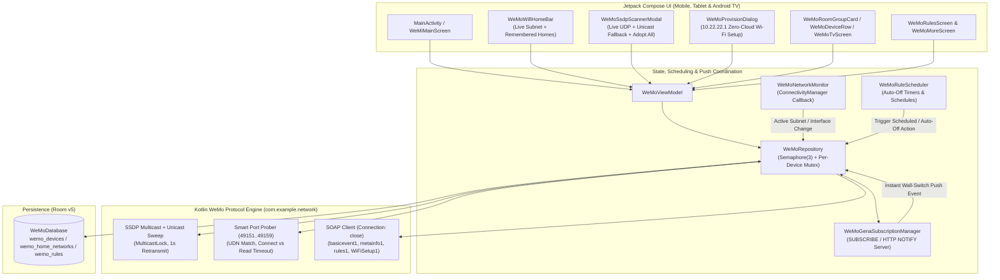

# Full Implementation Plan: Making WeMi Light Control a Real, Production-Ready Belkin WeMo App

**Target Repository**: `MichaelRHead/WeMi-light-control` (`com.example.wemi`)  
**Target Platforms**: Android Phones, Tablets, and Android TV (10-foot D-Pad UI)  
**Target Hardware Fleet**:
- **1st-Gen In-Wall Light Switch** (`F7C030` — OpenWrt, `uuid:Lightswitch-1_0-...`)
- **2nd-Gen In-Wall 3-Way Light Switch** (`WLS040` / `WLS0403` — RTOS, `uuid:Lightswitch-2_0-...` / `3_0`)
- **In-Wall Wi-Fi Smart Dimmer** (`F7C059` Gen 1 OpenWrt & `WDS060` Gen 2 RTOS — `uuid:Dimmer-1_0-...` / `2_0`)
- **WeMo Mini Smart Plug** (`F7C063` Gen 1 & `WSP080` Gen 2 — `uuid:Socket-1_0-...`)

Related documents in this repository:
- [`AGENTS.md`](../AGENTS.md) — Architecture & Agent Guide
- [`.agents/skills/wemi-light-control/SKILL.md`](../.agents/skills/wemi-light-control/SKILL.md) — Agent Skill Definition
- [`.agents/skills/wemi-light-control/references/wemo-upnp-protocol.md`](../.agents/skills/wemi-light-control/references/wemo-upnp-protocol.md) — Complete `pywemo` & Home Assistant Wire Protocol Reference

---

## 1. Executive Summary: What Must Change from Skeleton to Production

The AI Studio prototype (`v6.0` / `d323be0`) provides a rich 2013-era skeuomorphic Jetpack Compose UI, Room v4 schema, multi-home switcher bar, SSDP scanner modal, and Android TV dashboard, but relies on **simulated network fallbacks** so it can be previewed without hardware.

To make **WeMi Light Control** a full-fledged app that works reliably with physical WeMo devices on a real home LAN (post-January 2026 Belkin cloud shutdown), we will implement **7 engineering phases**:

| Phase | Subsystem | Key Deliverables |
| :--- | :--- | :--- |
| **Phase 1** | **`pywemo`-Grade UPnP / SSDP / SOAP Engine** (`WeMoNetworkClient.kt`) | Real `MulticastLock` SSDP with 1s retransmit, unicast `/24` port-sweep fallback, 9-port smart probing (`49151..49159`) with UDN verification & TCP connect/read timeout split, `Connection: close`, `<BinaryState>Error</BinaryState>` handling, Dimmer `<brightness>`, `metainfo1#GetMetaInfo` (SKU & SSID), `GetSignalStrength`, and `ConfigureNightMode`. |
| **Phase 2** | **Real Reachability, Concurrency & Self-Healing Repository** (`WeMoRepository.kt`) | Remove all fake `isReachable = true` overrides; add `Semaphore(3)` LAN concurrency cap + per-device `Mutex` (preventing `WLS0403` RTOS socket starvation); 2-stage auto-reconnect (port re-probe → targeted SSDP by serial/UDN); serial-based deduplication & "Adopt All Discovered". |
| **Phase 3** | **Real-Time Local Push Events (UPnP GENA)** (`WeMoGenaSubscriptionManager.kt`) | Embedded coroutine HTTP `NOTIFY` callback server (`SUBSCRIBE /upnp/event/basicevent1`, `TIMEOUT: Second-300`, `412` recovery) for sub-second UI updates when physical wall switches or 3-way switches are flipped. |
| **Phase 4** | **Live Wi-Fi Subnet Detection & Explicit Demo Mode** (`WeMoNetworkMonitor.kt`, `WeMoRepository.kt`) | `ConnectivityManager.NetworkCallback` live subnet detection, auto-matching/creating `WeMoHomeNetworkEntity` using `metainfo1` `AccessPointSSID`, starting clean on real LANs, and moving the 13 fake seeded devices behind an explicit **"Demo Mode"** toggle. |
| **Phase 5** | **Working Rules, Schedules & Auto-Off Timers** (`WeMoRuleScheduler.kt`) | Real execution of `AUTO_OFF_TIMER`, `TIME_SCHEDULE`, and `SUNSET_SUNRISE` rules via Android `AlarmManager` / `WorkManager` + coroutine timers, plus optional on-device `rules.db` reading (`rules1#FetchRules`). |
| **Phase 6** | **Zero-Cloud Wi-Fi Setup Provisioner (`10.22.22.1`) & Hardware Management** (`WeMoProvisionerClient.kt`) | In-app provisioning wizard for factory-reset WeMo devices (`WeMo.Light.xxx` / `WeMo.Mini.xxx` at `10.22.22.1:49152`) via `WiFiSetup1` (`GetApList`, AES-128-CBC Methods 1/2/3, double-send `ConnectHomeNetwork`), plus hardware rename (`ChangeFriendlyName`) and hardware reset (`ReSetup`). |
| **Phase 7** | **End-to-End Loopback & Robolectric Test Suite** (`WeMoProtocolTest.kt`, `ExampleRobolectricTest.kt`) | Embedded local HTTP/UDP mock WeMo server tests covering all 4 hardware models (`F7C030`, `WLS0403`, `F7C059`/`WDS060`, `F7C063`/`WSP080`), port rotation, GENA `NOTIFY` push, and offline handling. |

---

## 2. System Architecture Diagram



---

## 3. Detailed Phase Specifications

### Phase 1: `pywemo`-Grade UPnP / SSDP / SOAP Engine (`WeMoNetworkClient.kt`)

#### 1.1 Smart Port Probing (`probeWemoPort`)
- **Complete Port List**:
  ```kotlin
  val PROBE_PORTS = listOf(49153, 49152, 49154, 49151, 49155, 49156, 49157, 49158, 49159)
  ```
- **Candidate Ordering**: When probing a device with a known `port`, test `port` first, followed by the remaining `PROBE_PORTS`.
- **UDN / Serial Verification (`expectedSerialOrUdn`)**:
  - Fetch `http://<ip>:<port>/setup.xml` (or `/Lightsetup.xml`).
  - Parse `<serialNumber>` and `<UDN>`. If `expectedSerialOrUdn != null` and neither matches, **reject the port and continue** (prevents toggling the wrong WeMo switch if DHCP swapped IP addresses).
- **Split TCP Connect Timeout vs. `ECONNREFUSED` vs. HTTP Read Timeout**:
  - Open a raw `Socket()` and call `socket.connect(InetSocketAddress(ip, port), 1000)` before (or as part of) the HTTP probe:
    - **`SocketTimeoutException` on `connect()`**: The host IP is unreachable on the Wi-Fi LAN (powered off or wrong subnet). **Break out of the port loop immediately** so an offline device fails fast in ~1s instead of blocking for `9 × timeout`.
    - **`ConnectException` (`ECONNREFUSED`)**: The WeMo's TCP stack is alive and sent `RST` on that port. Immediately try the next port (`0 ms` delay).
    - **`SocketTimeoutException` on HTTP `read()`**: The TCP port accepted the connection (`SYN/ACK`) but the HTTP listener on that old port is wedged (`pywemo` bug). Continue probing the remaining ports.

#### 1.2 Real SSDP Discovery (`performSsdpDiscoveryScan`)
- **`WifiManager.MulticastLock`**:
  - Acquire `wifiManager.createMulticastLock("wemi_ssdp").apply { setReferenceCounted(false); acquire() }` before opening the UDP socket and release it in `finally`.
- **Interface Binding & 1-Second Retransmit (`pywemo/ssdp.py`)**:
  - Bind `DatagramSocket(InetSocketAddress(localInetAddress, 0))` so multicast routes out the active Wi-Fi interface.
  - Set `socket.soTimeout = 1000`. Over a `4500 ms` total window, transmit `M-SEARCH` for both `ST: urn:Belkin:service:basicevent:1` and `ST: upnp:rootdevice` at `t = 0s, 1s, 2s, 3s` whenever a 1-second receive window finishes, overcoming Wi-Fi UDP multicast packet loss.
- **Exact `LOCATION` Fetching & Belkin Manufacturer Validation**:
  - Parse `LOCATION:` and `USN:` headers (`udn = usn.substringBefore("::")`), deduplicating by `(udn, location)`.
  - Fetch the exact `LOCATION` URL (supports both `/setup.xml` and `/Lightsetup.xml` on 1st-gen `F7C030`).
  - Verify `<manufacturer>` contains `Belkin` or `<deviceType>` / `<UDN>` is a Belkin URN (`urn:Belkin:...`). Ignore non-WeMo UPnP responses (routers, smart TVs, Hue bridges, Sonos).
- **Remove All Fake Discovery Injections**:
  - Delete the hardcoded `"Patio String Lights"` (`$subnetPrefix.118:49153`) injection and the synthetic loop that re-emitted `knownLocalDevices` as fake SSDP packets.
- **Unicast `/24` Subnet Sweep Fallback**:
  - Add `performUnicastSubnetSweep(subnetPrefix, onLogLine, onDeviceFound)` using `Semaphore(24)` coroutines to probe `1..254` on ports `49153, 49152` (`350 ms` TCP connect timeout).
  - Run automatically if UDP multicast returns 0 devices (common on routers with AP isolation or IGMP snooping issues) or when the user taps **"Deep Subnet Scan"**.

#### 1.3 Accurate Hardware Classification & Live Telemetry Probing
- Immediately after fetching `setup.xml` for a discovered device, query:
  1. **`getBinaryState(ip, port)`**: Populate real `isOn`, `brightness` (`1..100`), and `latencyMs` instead of hardcoding `isOn = true, brightness = 100`.
  2. **`getMetaInfo(ip, port)`** (`POST /upnp/control/metainfo1`, `urn:Belkin:service:metainfo:1#GetMetaInfo`):
     - Unpack `<MetaInfo>` (`MAC|SerialNumber|DeviceSKU|FirmwareVersion|AccessPointSSID|ModelName`).
     - Extract `deviceSku` (`F7C030`, `WLS040`, `WLS0403`, `F7C059`, `WDS060`, `F7C063`, `WSP080`) and `accessPointSsid` (the real 2.4 GHz Wi-Fi SSID the switch is joined to).
  3. **`getSignalStrength(ip, port)`** (`POST /upnp/control/basicevent1`, `urn:Belkin:service:basicevent:1#GetSignalStrength`):
     - Populate real `signalStrengthPercent` (`0..100%`).
- **Classification Rules (`classifyWeMoHardwareType`)**:
  - `IN_WALL_DIMMER`: `udn` starts with `uuid:Dimmer` (`Dimmer-1_0` / `Dimmer-2_0`), `modelName` contains `Dimmer` or `WDS060`, or `sku` in `{"F7C059", "WDS060"}`.
  - `THREE_WAY_SWITCH`: `udn` starts with `uuid:Lightswitch-2_0` or `uuid:Lightswitch-3_0`, or `sku` / `modelName` / `modelDescription` / `friendlyName` contains `WLS0403`, `WLS040`, or `3-Way`.
  - `IN_WALL_SWITCH`: `udn` starts with `uuid:Lightswitch-1_0`, `deviceType` contains `lightswitch`, or `sku == "F7C030"`.
  - `MINI_PLUG`: `udn` starts with `uuid:Socket` or `uuid:OutdoorPlug`, `deviceType` contains `controllee`, or `sku` in `{"F7C063", "WSP080"}`.

#### 1.4 SOAP Control Refinements (`setBinaryState`, `getBinaryState`, `configureNightMode`, `changeFriendlyName`)
- Always set `Connection: close` and `Content-Type: text/xml; charset="utf-8"`.
- **Handle `<BinaryState>Error</BinaryState>` (`pywemo/ouimeaux_device/switch.py`)**:
  - When a WeMo device is already ON and receives `SetBinaryState(1)` (or already OFF and receives `0`), it returns HTTP 200 with `<BinaryState>Error</BinaryState>`. Treat HTTP 200 with `Error` as confirming the target `isOn` state.
- **Handle Pipe-Delimited `<BinaryState>`**:
  - Parse `rawBinaryState.substringBefore("|").trim()`, where `"1"` or `"8"` is ON and `"0"` is OFF.
- **Avoid Confirm-Read Race**:
  - Do not immediately overwrite a successful `SetBinaryState` with an instant `GetBinaryState` read within `1500 ms`, as dimmer faders and relays may report pre-transition state during the ramp window.
- **Dimmer Night Mode & Hardware Rename**:
  - Implement `configureNightMode(ip, port, enabled, nightBrightness = 20)` via `basicevent1#ConfigureNightMode`.
  - Implement `changeFriendlyName(ip, port, newName)` via `basicevent1#ChangeFriendlyName` so renaming a device in the app also updates the hardware's `<friendlyName>`.

---

### Phase 2: Real Reachability, Concurrency & Self-Healing Repository (`WeMoRepository.kt`)

1. **Remove All Simulated `isReachable = true` Fallbacks**:
   - In `toggleDevicePower`, `updateDeviceBrightness`, `reconnectDevice`, `pingDeviceLatency`, `refreshAllDevicesState`, and `reconnectAndRediscoverHome`, **never** force `isReachable = true` when `result.reachableOnLan == false`.
   - If a device cannot be reached after reconnection attempts, update Room with `isReachable = false, latencyMs = 0, lastCheckedTime = "Offline"` and return a clear status message so the UI displays the red `OFFLINE` badge and inline `Retry` button.
2. **Protect Embedded RTOS Switches with Concurrency Controls**:
   - Add `private val lanRequestSemaphore = Semaphore(3)` (matching Home Assistant's `MAX_CONCURRENCY = 3`) and `private val deviceLocks = ConcurrentHashMap<String, Mutex>()` keyed by `serialNumber`/`id`.
   - Every network operation on a device acquires its per-device `Mutex` and the LAN `Semaphore(3)` so `WLS040`/`WLS0403` 3-way switches and `WDS060` dimmers are never hit with overlapping HTTP requests.
3. **Two-Stage Self-Healing Reconnect (`healAndRetryDevice`)**:
   - When `setBinaryState` or `getBinaryState` fails on `device.ipAddress:device.port`:
     - **Stage 1**: Call `networkClient.probeWemoPort(device.ipAddress, device.port, expectedSerial = device.serialNumber)`. If a new port responds, update `port` in Room and retry the SOAP command.
     - **Stage 2**: If Stage 1 fails (e.g. router DHCP reassigned the device's IP), perform a targeted 2-second SSDP `M-SEARCH` looking for `device.serialNumber`. If found at a new `ip:port`, update both `ipAddress` and `port` in Room and retry the SOAP command.
4. **Serial-Based Deduplication & Batch Adoption (`adoptDiscoveredDevice`, `adoptAllDiscoveredDevices`)**:
   - Look up existing devices in Room by `serialNumber` first (falling back to `ipAddress`).
   - If a device with the same `serialNumber` already exists, update its `ipAddress`, `port`, `firmwareVersion`, `macAddress`, `signalStrengthPercent`, `isOn`, `brightness`, `isReachable = true`, `latencyMs`, and `wifiSsid` while preserving the user's custom `roomName` and `sortOrder`.
   - Add **"Adopt All New Devices"** in `WeMoSsdpScannerModal` so users with many switches can add their entire house in one tap.

---

### Phase 3: Real-Time Local Push Events via UPnP GENA (`WeMoGenaSubscriptionManager.kt`)

When someone physically presses a WeMo wall switch or flips a 3-way traveler switch at the other end of a hallway, the app should reflect the new state immediately without waiting for a manual pull-to-refresh:

1. **Local HTTP `NOTIFY` Server**:
   - Start a lightweight coroutine-backed `ServerSocket` bound to the Android device's Wi-Fi IP (`resolveLocalIpv4Address()`) on port `8989` (scanning `8989..9050` or ephemeral port `0` if busy).
2. **Subscription Lifecycle (`SUBSCRIBE` / `UNSUBSCRIBE`)**:
   - For each reachable device in the active Wi-Fi home, send:
     ```http
     SUBSCRIBE /upnp/event/basicevent1 HTTP/1.1
     HOST: <deviceIp>:<devicePort>
     CALLBACK: <http://<localIp>:<callbackPort>/upnp/event/<serialNumber>>
     NT: upnp:event
     TIMEOUT: Second-300
     Connection: close
     ```
   - Store the returned `SID` header and schedule renewal every `240 seconds` (`SUBSCRIBE` with `SID: <sid>` and `TIMEOUT: Second-300`).
   - If renewal returns `HTTP 412 Precondition Failed` (device rebooted), send `UNSUBSCRIBE`, clear `SID`, and issue a fresh `SUBSCRIBE`.
3. **Handling Incoming `NOTIFY` Requests**:
   - Verify the sender IP matches the subscribed device (`pywemo` defense-in-depth check).
   - Parse `<e:propertyset>` XML for `<BinaryState>` and `<Brightness>` / `<brightness>`.
   - Reply `HTTP/1.1 200 OK` and invoke `repository.onGenaPushEvent(serialNumber, isOn, brightness)` to update Room immediately (`lastCheckedTime = "Live push"`).

---

### Phase 4: Live Wi-Fi Subnet Detection & Explicit Demo Mode (`WeMoNetworkMonitor.kt`)

1. **Automatic Subnet & Home Profile Matching**:
   - Create `WeMoNetworkMonitor` using Android `ConnectivityManager.NetworkCallback` + `NetworkInterface` inspection to expose a reactive `StateFlow<DetectedLanNetwork?>` (`localIp`, `subnetPrefix`, `gatewayIp`, `ssidLabel`).
   - When the app starts on a real Wi-Fi network (e.g. `192.168.86.x`):
     - If a remembered `WeMoHomeNetworkEntity` matches `subnetPrefix` (or `ssidLabel` discovered via `metainfo1#GetMetaInfo` `AccessPointSSID`), automatically select it as `activeHomeKey`.
     - If no remembered home matches the current `/24` subnet, automatically create/update a `"Current Wi-Fi Home (<subnet>.x)"` profile and select it!
2. **Clean Startup vs. Explicit Demo Mode**:
   - Do **not** auto-seed the 13 fake devices (`Living Room Ceiling`, `Lake Cabin`, etc.) into production user databases on first launch.
   - Instead, provide a **"Load / Clear Demo Showroom Devices"** button in the **More** tab (and a flag on `WeMoRepository` so Robolectric tests that test the seeded sample data continue to work seamlessly).

---

### Phase 5: Working Rules, Schedules & Auto-Off Timers (`WeMoRuleScheduler.kt`)

Make the **Rules** tab (`TIME_SCHEDULE`, `SUNSET_SUNRISE`, `AUTO_OFF_TIMER`) genuinely functional:

1. **Auto-Off Countdown Enforcement**:
   - Whenever a device turns ON (either via `toggleDevicePower` in the app or via a physical wall switch press received by `WeMoGenaSubscriptionManager`), check if `device.autoOffMinutes > 0` or if an enabled `AUTO_OFF_TIMER` rule targets that device.
   - Schedule a coroutine / `WorkManager` / `AlarmManager` countdown that turns the device OFF via `setBinaryState(isOn = false)` when the timer elapses.
2. **Daily Time & Sunset/Sunrise Schedules**:
   - Parse `scheduleTimeText` (e.g., `"06:30 AM"`, `"Sunset + 15m"`, `"11:00 PM"`) and `daysCsv` (`"Mon,Tue,Wed,Thu,Fri"`).
   - Schedule exact or windowed triggers so phones and always-on Android TV devices on the LAN execute the rule's target action (`turnOn` + `targetBrightness`) across all matched devices.
3. **Hardware `rules.db` Discovery (Gen-1 OpenWrt)**:
   - Add `fetchDeviceRulesSummary(ip, port)` (`urn:Belkin:service:rules:1#FetchRules`) to inspect on-device rules Version/Path in the hardware diagnostics drawer (gracefully handling HTTP 404 on RTOS `WDS060`).

---

### Phase 6: Zero-Cloud Wi-Fi Provisioning (`10.22.22.1`) & Hardware Management

Because Belkin shut down the official WeMo app/cloud in January 2026, users who factory-reset a WeMo switch or plug need a way to join it to their 2.4 GHz Wi-Fi network:

1. **`WeMoProvisionerClient.kt` (`10.22.22.1:49152` / `49153`)**:
   - Detect when the phone is connected to a `WeMo.*` setup AP (`subnetPrefix == "10.22.22"` or probe `10.22.22.1` ports `49152, 49153`).
   - Implement `getAvailableApList("10.22.22.1", port)` via `WiFiSetup1#GetApList`.
   - Implement `encryptWeMoWifiPassword(password, metaInfo, isRtos, binaryOption)` supporting all 3 `pywemo` AES-128-CBC / MD5 key-derivation methods (`Method 1` OpenWrt, `Method 2` RTOS, `Method 3` binaryOption).
   - Implement `connectHomeNetwork(...)` sending `WiFiSetup1#ConnectHomeNetwork` twice (`100 ms` apart), polling `GetNetworkStatus`, and calling `CloseSetup` + `SetSetupDoneStatus`.
2. **In-App Provisioning UI (`WeMoProvisionDeviceDialog`)**:
   - Accessible from the SSDP Scanner modal and the **More** tab (**"Provision New / Reset WeMo AP (10.22.22.1)"**): scans visible 2.4 GHz SSIDs from the WeMo, prompts for the WPA2 password, pairs the device, and transitions back to the home LAN scan.

---

### Phase 7: Verification & Automated Test Suite

1. **Loopback UPnP / SOAP / GENA Protocol Tests (`WeMoProtocolTest.kt`)**:
   - Spin up a local loopback `ServerSocket` / `DatagramSocket` in JUnit simulating:
     - 1st-Gen `F7C030` (`/Lightsetup.xml`, `uuid:Lightswitch-1_0-...`)
     - 2nd-Gen 3-Way `WLS0403` (`/setup.xml`, `<rtos>1</rtos>`, `uuid:Lightswitch-2_0-...`)
     - Smart Dimmer `WDS060` (`<BinaryState>1</BinaryState><brightness>65</brightness>`)
     - Mini Plug `WSP080` (`uuid:Socket-1_0-...`)
   - Verify port rotation (`49153` → `49151`), UDN mismatch protection, `<BinaryState>Error</BinaryState>` handling, `GetMetaInfo` SKU/SSID parsing, `WiFiSetup1` AES-128-CBC encryption vectors against `pywemo` test outputs, and GENA `NOTIFY` push updates.
2. **Robolectric UI & Repository Integration Tests (`ExampleRobolectricTest.kt`)**:
   - Verify real offline state (`isReachable = false`) when a device is unreachable, live discovery adoption by `serialNumber`, multi-home switching, room batch controls, and Android TV mode.
