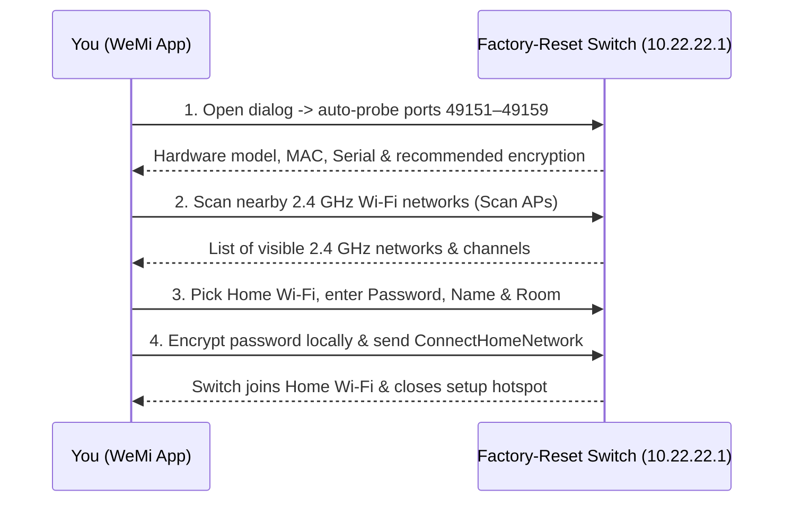

# Fresh Device Setup & Zero-Cloud Wi-Fi Provisioning (`10.22.22.1`)

[← Back to User Guide Index](../../USER_GUIDE.md)

**WeMi Light Control** includes a built-in, 100% local **Wi-Fi Setup Provisioner**. You can connect brand-new or factory-reset switches, 3-way switches, dimmers, and mini plugs from Belkin's discontinued smart switch platform onto your **2.4 GHz** home Wi-Fi without the discontinued Belkin cloud service or an account.

> [!IMPORTANT]
> **2.4 GHz Wi-Fi Required**: Belkin's smart switch hardware only supports **2.4 GHz** Wi-Fi (802.11 b/g/n). Make sure you select a 2.4 GHz or dual-band home Wi-Fi network—5 GHz-only networks will not work.

---

## 1. Put Your Switch into Setup Mode & Join Its Wi-Fi Hotspot

1. Power on your smart switch, dimmer, or mini plug.
2. Confirm its status LED is blinking in **Setup Mode**:
   - **1st-Gen In-Wall Switch (`F7C030`) / Mini Plug (`F7C063` / `WSP080`)**: Blinking **amber and green** (or **white and amber** on newer models).
   - **2nd-Gen 3-Way Switch (`WLS040` / `WLS0403`)**: Blinking setup LED ready for pairing.
   - **In-Wall Smart Dimmer (`F7C059` / `WDS060`)**: Blinking light bar ready for pairing.
   - *Tip*: To factory-reset an older switch into Setup Mode, hold its reset button or bar for 5–10 seconds until the LED blinks amber.
3. Open your phone or tablet's **Wi-Fi Settings** and connect to the switch's open temporary hotspot—for example, `WeMo.Light.xxx`, `WeMo.Switch.xxx`, `Wemo.LS3W.xxx`, `WeMo.Mini.xxx`, or `WeMo.Dimmer.xxx`.
   - If Android asks *"This network has no internet access — Stay connected?"*, choose **Yes / Stay connected**.
   - You do **not** need to turn off mobile cellular data—WeMi automatically routes setup traffic directly over Wi-Fi.

---

## 2. Open the Provisioning Wizard

Once connected to the switch's setup hotspot (`10.22.22.x`):

- **Automatic Setup Banner (Phones & Tablets — Fastest)**:
  Switch back to WeMi and tap the teal banner at the top of the **Devices** tab:
  > **Smart Switch Setup AP Detected (`10.22.22.x`)**
  > *Tap here to provision this factory-reset smart switch (10.22.22.1) onto your 2.4 GHz Home Wi-Fi.*
- **Manual Launch (Anytime, Including Chromebooks)**:
  On Chromebooks, ChromeOS masks the `10.22.22.x` subnet inside its virtual network so the automatic banner will not appear—connect your Chromebook's Wi-Fi to the switch hotspot and open the wizard directly from:
  - **`More` Tab** → **`Provision New Switch AP (10.22.22.1)`**
  - **Top Header `+` Button** → **`Provision New Switch AP (10.22.22.1)`**
  - **Empty Home Card** → **`Setup Factory-Reset Switch AP (10.22.22.1)`**

---

## 3. Step-by-Step Setup Workflow

Inside the **Provision New Switch AP (`10.22.22.1`)** dialog:

1. **Check the Detected Hardware Banner**:
   - As soon as the dialog opens, WeMi automatically probes `10.22.22.1` across ports `49151–49159` and displays **`Detected Hardware: <name> (<model> • Port <port>)`** along with the switch's MAC address, serial number, and recommended encryption mode.
   - If the switch cannot be reached (for example, your phone switched away from the setup hotspot), the status box turns soft red with a clear warning.
2. **Choose Your 2.4 GHz Home Wi-Fi (`Scan APs`)**:
   - Leave **`Setup AP IP`** set to **`10.22.22.1`** (WeMi validates that any custom address is a private local IPv4 address) and tap **`Scan APs`** to ask the switch which 2.4 GHz networks it sees.
   - Tap your home Wi-Fi chip under **`Discovered 2.4 GHz Networks`**. WeMi automatically fills in **`Target 2.4 GHz Wi-Fi SSID`**, **`2.4G Ch`**, **`Auth Mode`** (usually `WPA2PSK`), and **`Encrypt`** (usually `AES`).
   - If your network is hidden or didn't show up, you can type the SSID manually.
3. **Enter Your Home Wi-Fi Password**:
   - Type your 2.4 GHz Wi-Fi password into **`Wi-Fi Password`**. The field is **masked by default** (tap the eye icon to temporarily reveal it while typing—screenshots are blocked while plaintext is shown, and the password automatically re-masks if you switch apps), held strictly in volatile memory, encrypted locally on your device, and cleared when setup finishes or the dialog closes.
4. **Name Your Switch & Pick a Room**:
   - Optionally enter a **`Switch Name (Optional)`** (such as `Porch Christmas Tree` or `Bedroom Ceiling Fan`).
   - Watch the live **Icon Category** preview and **Assigned Room** update automatically as you type (defaulting to **`Unassigned`** when no room keyword is detected), or tap any of the **11 Room Preset Chips** (`Living Room`, `Bedroom`, `Kitchen`, `Dining Room`, `Hallway & Landing`, `Ensuite`, `Outdoor`, `Garage`, `Basement`, `Office`, `Unassigned`). *(Need a custom room name outside those 11 presets? You can type any custom room name afterward via **Edit Device**.)*
5. **Encryption Options (Leave on Auto Unless Troubleshooting)**:
   - Leave **`Hardware AES-128-CBC Key Derivation`** on **`Auto-Detect from /setup.xml`** and **`Password Length Suffix (xxyy hex)`** on **`Auto (M1/M3=Yes, M2=No)`**. WeMi inspects your switch's firmware automatically to pick the right encryption:
     - **`Method 1: Gen 1 OpenWrt (F7C030/059/063)`** — 1st-Gen Switches, Dimmers, and Mini Plugs.
     - **`Method 2: Gen 2 RTOS (WLS040/0403/WDS060)`** — 2nd-Gen 3-Way Switches, Dimmers, and Mini Plugs.
     - **`Method 3: BinaryOption Symmetric`** — Newer symmetric-key firmware builds.
   - If a switch ever rejects a valid password, you can manually test other combinations using the method chips and **`Append +4 Hex Lengths`** / **`No Length Suffix`** without resetting the switch.
6. **Tap `Provision Switch`**:
   - WeMi sends your custom switch name, encrypts your Wi-Fi password, instructs the switch to join your home Wi-Fi, and waits up to 20 seconds for confirmation.
   - **On Success**: WeMi closes the switch's temporary hotspot, adds the switch to your room list, and closes the dialog automatically.
   - **On Failure**: WeMi intentionally **leaves the switch's `10.22.22.1` setup hotspot open** and keeps the dialog on screen so you can fix a typo or try another encryption chip immediately—no factory reset required!
7. **Reconnect to Your Home Wi-Fi**:
   - Once the setup hotspot closes, your device reconnects to your regular home Wi-Fi and WeMi automatically picks up the switch at its new home IP address.

---

## 4. Built-In Setup Diagnostics (`SETUP DIAGNOSTICS`)

Inside the provisioning dialog, a dark **`SETUP DIAGNOSTICS`** card stays compact while you fill in the form (tap **`Details`** / **`Hide`** to expand or collapse it) and **automatically expands** whenever provisioning runs or an error occurs:

- **Privacy-Safe Sharing**: Tap **`Copy`** to copy the diagnostic trace to your clipboard (marked sensitive on Android 13+), or **`Save/Share`** to save `wemi-telemetry-latest.txt` and open Android's share sheet without silently overwriting your clipboard. Wi-Fi passwords are **never** shown or saved, and Wi-Fi SSIDs, MAC addresses, and serial numbers are redacted by default unless you tap **`Full IDs in Export`** ON inside **`Details`**.
- **Keep Dialog Open After Success**: Tap **`Details`** and toggle **`Keep Dialog Open on Success`** ON before tapping **`Provision Switch`** if you want to review or share the full trace even after setup succeeds.
- **What's Inside**: Shows your Wi-Fi interface & binding (`[NET]`), setup port probe results (`[PROBE]`), hardware model & encryption flags (`[XML]`, `[FLAGS]`, `[ID]`), 2.4 GHz scan results (`[SCAN]`, `[TARGET AP]`), and step-by-step setup status (`[STEP 1..6]`).

For a full line-by-line guide to reading diagnostics or sharing a support report, see **[Troubleshooting, Screenshots & Sharing Telemetry Logs](telemetry-and-troubleshooting.md)**.
