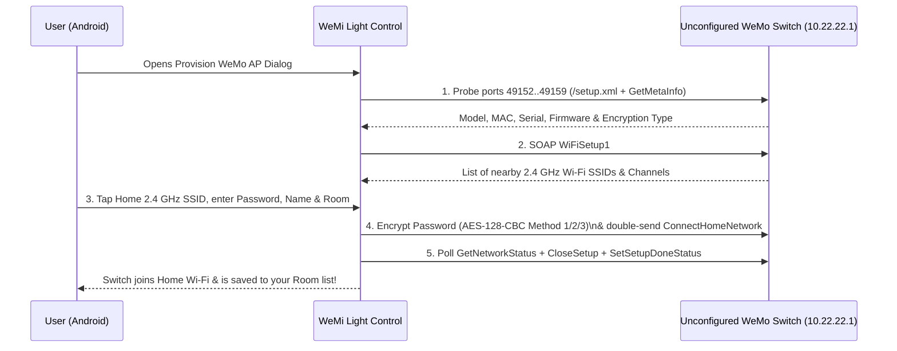

# Fresh Device Setup & Zero-Cloud Wi-Fi Provisioning (`10.22.22.1`)

[← Back to User Guide Index](../../USER_GUIDE.md)

**WeMi Light Control** includes a built-in, zero-cloud **Belkin WeMo Wi-Fi Setup Provisioner** (`WiFiSetup1`). You can configure brand-new or factory-reset Belkin WeMo switches, dimmers, and mini plugs onto your 2.4 GHz home Wi-Fi without needing the discontinued Belkin cloud service or an account.

---

## 1. Preparing Your Belkin WeMo Switch for Setup

1. Power on your Belkin WeMo switch, dimmer, or mini plug.
2. Verify the LED indicator is blinking **Setup Mode**:
   - **1st Gen In-Wall Switch (`F7C030`) / Mini Plug (`F7C063`)**: Blinking **amber and green** (or blinking **white and amber** on newer models).
   - **In-Wall Smart Dimmer (`F7C059` / `WDS060`)**: Blinking light bar ready for pairing.
   - *Tip*: To factory-reset a WeMo switch into Setup Mode, hold down the reset/bar button for 5–10 seconds until the status LED blinks amber.
3. Open your Android device's **Wi-Fi Settings** and connect to the switch's open setup network (for example, `WeMo.Light.xxx`, `WeMo.Switch.xxx`, `WeMo.Mini.xxx`, or `WeMo.Dimmer.xxx`).
   - If Android prompts *"This network has no internet access — Stay connected?"*, tap **Yes / Always Connect**.
   - **WeMi Light Control** automatically binds its setup sockets directly to your Wi-Fi interface even while cellular mobile data remains active.

---

## 2. Opening the Provisioning Wizard

Once connected to the `WeMo.*` setup Wi-Fi network (which uses the `10.22.22.x` subnet):

- **Automatic Setup Banner (Fastest)**:
  A green banner automatically appears at the top of the **Devices** tab:
  > **Belkin WeMo Setup AP Detected (`10.22.22.x`)**
  > *Tap here to provision this factory-reset WeMo switch (`10.22.22.1`) onto your 2.4 GHz Home Wi-Fi.*
  Tap this banner to open the **Provision New WeMo AP (`10.22.22.1`)** dialog.
- **Manual Launch**:
  You can also open the wizard anytime from:
  - **Top Header `+` Button** → **`Provision New WeMo AP (10.22.22.1)`**
  - **`More` Tab** → **`Provision New WeMo AP (10.22.22.1)`**

---

## 3. Step-by-Step Provisioning Workflow

Inside the **Provision New WeMo AP (`10.22.22.1`)** dialog:

1. **Detected Hardware & Connection Status Banner**:
   - The dialog automatically probes `10.22.22.1` across ports `49151–49159` and displays a green detected hardware banner (e.g., `Detected: WeMo Light Switch`, `Port 49152 • MAC EC1A59XXXXXX • SN 2213... • Auto Method 1`).
   - If the switch is unreachable (for example, if your phone is not yet connected to the `WeMo.*` Setup AP) or rejects a short/invalid password, the status box highlights the error in soft red (`#FEF2F2`) with a clear diagnostic message.
2. **Select Your 2.4 GHz Home Wi-Fi (`Scan APs`)**:
   - Tap **`Scan APs`** to query the switch for visible 2.4 GHz Wi-Fi networks (`GetApList` / `GetNetworkList`).
   - Tap your home Wi-Fi network chip from the **`Discovered 2.4 GHz Networks`** list. This automatically fills in the **Home 2.4 GHz SSID**, **Channel**, **Authentication Mode** (`WPA2PSK`), and **Encryption** (`AES`).
3. **Name Your Switch & Choose Its Room**:
   - Enter a **Switch Name** (e.g., `Christmas Tree`, `Bedroom Fan`, `Porch Light`).
   - Watch the **live icon preview** update automatically as you type (`Tree Lights`, `Fan`, `Light`, `Switch`).
   - Type a custom **Room / Group** or tap one of the **Room Preset Chips** (`Living Room`, `Bedroom`, `Kitchen`, `Dining Room`, `Hallway & Landing`, `Ensuite`, `Outdoor`, `Garage`, `Office`) directly below the preview.
4. **Enter Your 2.4 GHz Wi-Fi Password**:
   - Type your home Wi-Fi password in **Home Wi-Fi Password**.
5. **Password Encryption Method & Password Length Suffix (Auto-Detected)**:
   - Leave **Password Encryption Method** set to **`Auto-Detect`** and **Password Length Suffix (`xxyy` hex)** set to **`Auto (Rec.)`**. The app inspects `/setup.xml` (`<rtos>`, `<iot>`, `<binaryOption>`, `<new_algo>`) and `GetMetaInfo` to automatically select:
     - **Method 1 (Gen 1 OpenWrt)**: `F7C030` Light Switch, `F7C059` Dimmer, `F7C063` Mini Plug.
     - **Method 2 (Gen 2 RTOS)**: `WLS040` / `WLS0403` 3-Way Switch, `WDS060` Dimmer, `WSP080` Mini Plug.
     - **Method 3 (Symmetric `<binaryOption>1</binaryOption>`)**: Newer symmetric-key firmware builds.
   - If your switch rejects the password (`NetworkStatus=0` or `2`), you can manually test any of the 6 `pywemo` encryption permutations by combining **`Gen 1 (OpenWrt)`** / **`Gen 2 (RTOS)`** / **`Method 3 (Sym)`** with **`Append xxyy`** or **`No Suffix`**.
6. **Tap `Provision Switch`**:
   - The app sets your custom `<FriendlyName>` on the hardware, encrypts your Wi-Fi password using Belkin's exact OpenSSL AES-128-CBC key derivation, double-sends `ConnectHomeNetwork`, polls `GetNetworkStatus` for up to 20 seconds while the switch joins your 2.4 GHz router, closes the setup AP (`CloseSetup` + `SetSetupDoneStatus`) only when connection succeeds (`NetworkStatus = 1` or `3`), and saves the switch into your Wi-Fi Home.
   - If connection fails (`NetworkStatus = 0` or `2`), the app **does not** call `CloseSetup`, keeping the switch's `10.22.22.1` Setup AP open and keeping the dialog on screen so you can inspect the debug trace and retry immediately.
7. **Reconnect to Your Home Wi-Fi**:
   - Once the setup AP closes, your phone automatically reconnects to your regular Home Wi-Fi and **WeMi Light Control** discovers the switch at its new LAN IP address.

---

## 4. On-Screen Setup Debug Details (`Setup Debug Details (Screenshot)`) & Telemetry Export

At the bottom of the **Provision New WeMo AP (`10.22.22.1`)** dialog, a high-contrast dark terminal card (**`Setup Debug Details (Screenshot)`**) prints real-time hardware and protocol diagnostics directly on screen so you can take a single screenshot, tap **`Copy`** (`copy_provision_debug_button`), or tap **`Save/Share`** (`share_provision_debug_button`) to save `wemi-telemetry-latest.txt` and open Android's share sheet:

- **`[NET]`**: Your phone's active Wi-Fi interface (`wlan0`), IP address (`10.22.22.x`), `setupAp=true/false`, and whether sockets are bound directly to the unvalidated Wi-Fi network (`wifiBound=true/false`).
- **`[PROBE]` & `[PROBE TRACE]`**: The exact port (`49151..49159`) and XML path (`/setup.xml` or `/Lightsetup.xml`) that responded on `10.22.22.1`, plus per-port status codes.
- **`[XML]` & `[FLAGS]`**: Hardware `<modelName>`, `<friendlyName>`, `<firmwareVersion>`, and raw encryption flags (`rtos`, `iot`, `binaryOption`, `new_algo`, `autoMethod`).
- **`[ID]`**: Hardware MAC address, Serial Number, which UPnP service provided them (`GetMetaInfo`, `setup.xml`, or `GetMacAddr/GetSerialNo`), and the raw pipe-delimited `GetMetaInfo` string.
- **`[SCAN]` & `[TARGET AP]`**: The switch's `WiFiSetup1#GetApList` site survey count and the matched 2.4 GHz channel, auth mode (`WPA2PSK`), and cipher (`AES`) for your selected SSID.
- **Live `[STEP 1..5]` Provisioning Trace**: Each step of `ChangeFriendlyName`, AES-128-CBC encryption (`Method 1/2/3`, `lenSuffix`, ciphertext hex length — **never** your plaintext password), `ConnectHomeNetwork` (`PairingStatus`), `GetNetworkStatus` polls (`1..18`), and `CloseSetup` (`kept_open_for_retry` on failure).
- **`Keep Dialog Open on Success` Chip**: Toggle this chip ON before tapping **`Provision Switch`** if you want the dialog to remain open after a successful setup so you can screenshot or export the final trace.

For a complete line-by-line guide to capturing screenshots, exporting `wemi-telemetry-latest.txt`, and interpreting setup status codes, see **[Troubleshooting, Screenshots & Sharing Telemetry Logs](telemetry-and-troubleshooting.md)**.

