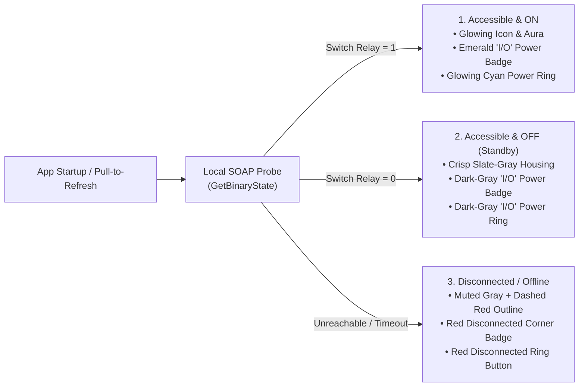

# Main Screen & Device Controls

[← Back to User Guide Index](../../USER_GUIDE.md)

The **Main Screen** (**Devices** tab) is your primary control center in **WeMi Light Control**. It displays your active Wi-Fi Home, network discovery status, room filters, and every Belkin WeMo switch, dimmer, motion sensor, and smart plug configured for your home.

---

## 1. Top Header Bar

At the top of the screen, the brushed lime-green Belkin WeMo header provides quick access to core actions:

| Control | Location | What It Does |
| :--- | :--- | :--- |
| **`wemo` / `wemi` Wordmark** | Top-left | Tap the brand logo to toggle between the classic **`wemo`** wordmark and the **`wemi`** wordmark. |
| **`TV` Button** | Left of icons | Opens the 10-foot **Android TV Dashboard (`wemi TV`)** with D-Pad navigation and quick lighting scenes (see [Master Controls, Diagnostics, Demo Mode & Android TV](more-and-tv-mode.md)). |
| **Refresh / Radar Icon** | Top-right | Opens the live **SSDP Network Discovery Scanner** and starts an immediate local Wi-Fi scan (see [Switch Discovery & Network Scanning](switch-discovery.md)). |
| **`+` (Add) Button** | Top-right | On the **Devices** tab, opens the **Add Device** dialog. On the **Rules** tab, opens the **New Rule** dialog. |
| **`Edit` / `Done` Button** | Far top-right | Toggles **Edit Mode** so you can reorder, rename, reconfigure, or delete switches (see [Editing, Renaming, Reordering & Adding Switches](editing-and-managing-devices.md)). |

---

## 2. Startup State Detection & Three-State Visual Icons

Whenever you launch the app, pull down to refresh, or switch Wi-Fi Homes, **WeMi Light Control** immediately queries each remembered switch on your local network (`GetBinaryState`) and displays one of **three unmistakable visual states**:

| Device State | Hardware Illustration | Corner Badge | Status Pill | Right-Side Action |
| :--- | :--- | :--- | :--- | :--- |
| **1. Accessible & ON** | Lit hardware bezel, glowing LEDs, spinning fan blades, or glowing multi-color tree lights | Emerald circle with white IEC **`I/O`** power symbol | Green **`ON`** pill (or **`ON • 75%`** for dimmers) | Glowing cyan-green **Power Ring (`I/O`)** |
| **2. Accessible & OFF (Standby)** | Full-contrast dark slate housing with unlit slate indicators/filaments/bulbs | Very dark gray (`#23272F`) circle with white IEC **`I/O`** power symbol | Crisp light-gray & dark-gray **`OFF`** pill (or **`OFF • 75%`**) | Very dark gray (`#23272F`) **Power Ring (`I/O`)** — ready to turn ON |
| **3. Disconnected / Offline** | Faded silhouette surrounded by a **dashed red outline** | Red circle with white **broken-link slash** icon | **`Not Detected`** label | Red **Disconnected Ring Button** to trigger self-healing reconnection |

---

## 3. Automatic Switch-Name Icon Classification

Every switch row automatically displays a custom illustration and category badge based on the switch's name (and hardware type):

| Category Badge | Trigger Keywords in Switch Name | Custom Visual Icon Behavior |
| :--- | :--- | :--- |
| **`Tree Lights`** | `tree`, `christmas`, `xmas`, `holiday`, `evergreen`, `spruce`, `fir`, `garland`, `wreath`, `tinsel`, `noel` | **3-Tiered Evergreen Christmas Tree**: Glowing gold star topper and 9 multi-color string lights when **ON**; dark pine canopy with unlit frosted bulbs and a warm amber standby base LED when **OFF**. |
| **`Fan`** | `fan`, `blower`, `vent`, `exhaust`, `ventilat`, `circulator`, `ceiling fan`, `box fan`, `attic fan` | **4-Blade Air Circulator Fan**: Smoothly **animated 360° spinning blades** with cyan airflow glow when **ON**; stationary brushed-steel blades with a warm amber center hub LED when **OFF**. |
| **`Light`** | `light`, `lights`, `lamp`, `bulb`, `chandelier`, `sconce`, `lantern`, `pendant`, `flood`, `spot`, `dimmer`, `led`, `candle`, `strip`, `fixture` (or any **Dimmer** hardware) | **Smart LED Lightbulb**: Luminous cyan-white globe scaled to dimmer brightness when **ON**; smoke-slate glass dome showing the unlit internal filament coil and warm amber neck collar when **OFF**. |
| **`Motion`** | `motion`, `sensor` (or **Motion Sensor** hardware) | **WeMo Motion Sensor Dome**: Glowing green radial wave arcs when motion is sensed. |
| **`Switch`** | All other switch or outlet names (e.g., `Coffee Maker`, `Space Heater`, `Dehumidifier`) | **Belkin In-Wall Switch / Smart Plug**: Tactile wall plate with glowing status bar and power indicator. |

---

## 4. Full-Width Switch Name & Secondary Status Badges

Each switch card displays its **friendly name across the full width of the top line** (reactively reducing the font size if a long switch name needs more room so the full name is always visible), without repeating the room name already shown on the room group header.

On the line below each switch's name, the **Connection Status, Power State & Category Badges** show real-time local Wi-Fi health and classification:
- **Pulsing Status Dot & 4-Bar Signal Meter**:
  - **4 Bars (Emerald — `Active • <= 28ms`)**: Fast local LAN response.
  - **3 Bars (Teal — `Active • 29–65ms`)**: Normal Wi-Fi response.
  - **2 Bars (Amber — `Slow • > 65ms`)**: Congested Wi-Fi or distant 2.4 GHz signal.
  - **0 Bars (Red — `Offline`)**: Switch did not respond on the local network.
- **IP Address / Auto-Off Countdown & Category Pill**:
  - Displays the switch's local IPv4 address (e.g., `192.168.1.104`) or a live countdown (`Auto-Off 14:52`) alongside the semantic category pill (`Tree Lights`, `Fan`, `Light`, `Motion`, `Switch`).

---

## 5. Expandable Device Drawer (Dimming, Night Mode & Telemetry)

Tap the body of any reachable switch or dimmer row to expand its **Inline Control & Telemetry Drawer**:

1. **Connection & Latency Telemetry Banner**:
   - Displays exact round-trip SOAP latency (`Connection: Active (11ms SOAP Round-Trip)`), last checked timestamp, and `<ip>:<port>` endpoint.
   - Tap **`Ping RTT`** to send an immediate `GetBinaryState` probe and measure live round-trip time.
2. **Brightness Slider & Presets (Dimmers Only)**:
   - Drag the **Brightness Level** slider (`1%–100%`) or tap a quick preset chip (**`21%`**, **`50%`**, **`75%`**, **`100%`**).
   - Adjusting brightness on an `OFF` dimmer automatically turns the dimmer `ON` to that level.
3. **Night Mode (`20%`) Chip (Dimmers Only)**:
   - Toggles hardware **Night Mode** on Belkin `F7C059` / `WDS060` Smart Dimmers (`ConfigureNightMode`), capping late-night brightness at a soft `20%`.
4. **Hardware Metadata & Quick Actions**:
   - Displays the UPnP endpoint URL (`http://192.168.1.104:49153`), hardware Serial Number (`SN`), and firmware version.
   - Tap **`Configure IP`** to open the Edit dialog for that switch.

---

## 6. Real-Time Physical Switch Sync & Pull-to-Refresh

- **Instant Wall-Switch Push Updates (`<100ms`)**: When someone physically presses a Belkin WeMo wall paddle, 3-way rocker, or mini plug button, the switch sends a local UPnP GENA `NOTIFY` event directly to the app so the icon and power ring update immediately.
- **Pull-to-Refresh**: Swipe down anywhere on the **Devices** list to re-probe all saved switches and run a background SSDP discovery pass.

---

## 7. Empty Wi-Fi Home Onboarding Card

When a Wi-Fi Home has `0` saved switches (such as on first launch in **Real LAN Mode** before scanning your network), the **Devices** tab displays an onboarding card with a 4-icon category showcase (**Switch**, **Lightbulb**, **Christmas Tree**, and **Fan** in standby) and four quick-start actions:
- **`Scan Local Network (SSDP)`**: Broadcasts a live UPnP SSDP scan (`239.255.255.250:1900`) and automatically adopts discovered Belkin WeMo switches onto the current Wi-Fi Home.
- **`Setup Factory-Reset WeMo AP (10.22.22.1)`**: Opens the zero-cloud `WiFiSetup1` provisioning wizard.
- **`Add Switch Manually`**: Opens the manual IP/Port entry dialog (which automatically probes all 9 WeMo ports at that IP).
- **`Restore Classic Setup`**: Enables **Demo Showroom Mode** with the 13 sample switches across 3 Wi-Fi Homes.
