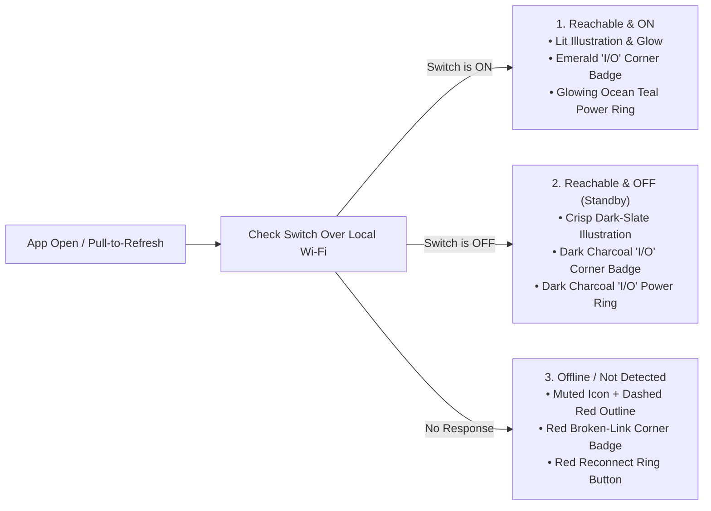

# Main Screen & Device Controls

[← Back to User Guide Index](../../USER_GUIDE.md)

The **Main Screen** (**Devices** tab) is your home lighting dashboard in **WeMi Light Control** (installed as **WeMi Switch Control**). From here you can switch Wi-Fi Homes, filter by room, see whether each switch is ON, OFF, or offline, dim lights, pin Home Screen widgets, and check connection health at a glance.

---

## 1. Top Header Bar & Bottom Navigation

At the top of the screen, the compact single-row **Ocean Teal & Deep Sapphire** header bar gives you one-tap access to everyday actions:

| Control | Location | What It Does |
| :--- | :--- | :--- |
| **`wemi` Wordmark & Version Pill (`v38.0`)** | Top-left | Displays the **`wemi`** logo alongside a subtle version badge (such as **`v38.0`**). Tap the version badge anytime to open the scrollable **Release History** dialog (with an **`Installed`** tag on your current version) to see what's new across releases. |
| **`All Off` Button** | Right cluster | Turns **OFF** every reachable switch and dimmer on your active Wi-Fi Home in a single tap. |
| **Refresh Icon** | Right cluster | Opens the live **SSDP Network Discovery Scan** sheet and scans your local Wi-Fi for switches (see [Switch Discovery & Network Scanning](switch-discovery.md)). |
| **`Edit` / `Done` Button** | Right cluster | Switches to **Edit Mode** (switching to the **Devices** tab first if needed) so you can reorder, rename, edit, or delete switches (see [Editing, Renaming, Reordering & Adding Switches](editing-and-managing-devices.md)). |
| **`+` (Add) Button** | Far top-right | On the **Devices** or **More** tab, opens **Add Smart Switch Device**. On the **Rules** tab, opens **New On-Device Switch Rule**. |

Along the bottom of the screen, the three navigation tabs switch between **Devices** (your lights and rooms), **Rules** (on-device switch rules stored directly inside switch memory), and **More** (whole-home controls, Demo Mode, zero-cloud **Household Config Sync**, packet log, and open-source notices).

> [!TIP]
> **Predictable Back Button**: Pressing your device's **Back** button steps cleanly out of open dialogs, the discovery scanner, Edit Mode, or a single-room filter, and returns from **Rules** or **More** back to **Devices** before exiting the app.

---

## 2. Three Unmistakable Hardware States (`ON`, `OFF`, `Offline`)

Whenever you open the app, pull down to refresh, or switch Wi-Fi Homes, WeMi immediately checks each remembered switch on your local network so you can tell the difference between a switch that is simply turned **OFF** versus a switch that has lost Wi-Fi or power:

| Device State | Hardware Illustration | Corner Badge | Status Label | Right-Side Button |
| :--- | :--- | :--- | :--- | :--- |
| **1. Reachable & ON** | Lit bezel, glowing bulb or multi-color tree lights, or smoothly spinning fan blades | Emerald circle with white **`I/O`** power symbol | Soft-cyan **`ON`** pill (or **`ON • 75%`** for dimmers) | Glowing **Ocean Teal / Electric Cyan Power Ring (`I/O`)** |
| **2. Reachable & OFF (Standby)** | High-contrast dark-slate housing with unlit bulbs, stationary blades, or unlit filament | Dark charcoal (`#23272F`) circle with white **`I/O`** power symbol | Crisp gray **`OFF`** pill (or **`OFF • 75%`**) | Dark charcoal **`I/O` Power Ring** — ready to turn ON |
| **3. Offline / Not Detected** | Faded silhouette with a **dashed red outline** | Red circle with white **broken-link slash** | **`Not Detected`** label + red **`Offline • Timeout`** badge | Red **Disconnected Ring Button** — tap to reconnect |

---

## 3. Automatic Appliance Icons Based on Switch Name

Every switch automatically picks a matching illustration and category badge from its name (and hardware type). Keyword matching is smart about word boundaries, so names like *"Front Street Light"* won't trigger a Christmas Tree icon and *"Tiffany Lamp"* won't trigger a Fan icon:

| Category Badge | Example Keywords in Switch Name | Visual Behavior |
| :--- | :--- | :--- |
| **`Tree Lights`** | `tree`, `christmas` *(except candle/lamp/sconce/lantern)*, `xmas`, `evergreen`, `spruce`, `fir`, `garland`, `wreath`, `tinsel`, `noel` | **3-Tiered Evergreen Christmas Tree**: Glowing gold star topper and 9 multi-color fairy lights when **ON**; deep pine canopy with unlit frosted bulbs on a dark-slate stand when **OFF**. |
| **`Fan`** | `fan`, `blower`, `vent`, `exhaust`, `ventilat`, `circulator` | **4-Blade Air Circulator Fan**: Smoothly **spinning blades** with a cyan airflow glow when **ON**; stationary brushed-steel blades inside a dark-slate grille when **OFF**. |
| **`Light`** | `light`, `lamp`, `bulb`, `candle`, `sconce`, `chandelier`, `lantern`, `pendant`, `flood`, `spot`, `downlight`, `uplight`, `strip`, `neon`, `torch`, `dimmer`, `led`, `fixture` *(or any Dimmer hardware)* | **Smart LED Lightbulb**: Glowing cyan-white dome scaled to your dimmer brightness when **ON**; frosted slate dome showing the unlit internal filament coil and dark charcoal collar when **OFF**. |
| **`Motion`** | `motion`, `sensor` *(or Motion Sensor hardware)* | **Motion Radar Sensor**: Deep sapphire-and-teal dome lens with electric cyan concentric radar rings when reachable. |
| **`Switch`** | Everything else (for example, `Coffee Maker`, `Space Heater`, `Dehumidifier`) | **In-Wall Switch / Smart Plug**: Tactile wall plate with glowing status indicator when **ON** and crisp slate housing when **OFF**. |

---

## 4. Reading Switch Names & Connection Health Badges

Each switch card places the **full switch name across its own top line**, automatically scaling the text slightly if a name is very long so it stays readable without cutting off mid-word.

Below the name, you'll see live status indicators:
- **Live Signal & Response-Time Badge** (pulsing dot + 4-bar wireless meter):
  - **4 Bars — Emerald (`Active • <= 28ms`)**: Fast local Wi-Fi response.
  - **3 Bars — Teal (`Active • 29–65ms`)**: Normal local Wi-Fi response.
  - **2 Bars — Amber (`Slow • > 65ms`)**: Busy Wi-Fi or weaker 2.4 GHz signal.
  - **0 Bars — Red (`Offline • Timeout`)**: Switch did not respond on the local network.
- **Power State & Details**:
  - **Switches & Plugs**: Shows the **`ON`** / **`OFF`** pill, the switch's local IP address, and the category badge (`Tree Lights`, `Fan`, `Light`, `Switch`).
  - **Dimmers**: Shows the **`ON • 75%`** / **`OFF • 75%`** pill, an expand arrow (`v` / `^`), and the category badge.
  - **Motion Sensors**: Shows **`Motion sensed: <time>`** and the **`Motion`** badge.

---

## 5. Expanding a Switch Row (Dimming, Night Mode, Widgets & Diagnostics)

What happens when you tap the body of a row (outside the right-side power ring):
- **Reachable switch, dimmer, or plug**: Expands its **Inline Controls & Telemetry Drawer**.
- **Offline switch**: Runs a self-healing reconnection check right away. *(To edit an offline switch's IP or settings, tap **`Edit`** in the top header first.)*
- **Motion Sensor**: Updates live motion telemetry (**`Refresh Motion`** in Real LAN Mode, or **`Simulate Motion`** in Demo Showroom Mode).

Inside an expanded drawer, controls appear in this order:

1. **Brightness Slider, Quick Presets & Night Mode (Dimmers Only)**:
   - Drag the **Brightness Level** slider (`1%–100%`) or tap a quick preset chip (**`21%`**, **`50%`**, **`75%`**, **`100%`**). Adjusting brightness on an `OFF` dimmer automatically turns it **ON** to that level.
   - Tap **`Night Mode (20%)`** to toggle hardware Night Mode on `F7C059` / `WDS060` Smart Dimmers, capping late-night brightness at a gentle `20%`.
2. **Unified Connection, Hardware Info & Quick Actions Card**:
   - **Connection & Latency Row**: Shows live round-trip speed (`Connection: Active (11ms SOAP Round-Trip)` or offline port status), `Last Checked` timestamp, and a **`Ping RTT`** chip to measure response time immediately.
   - **Hardware Details**: Shows the local UPnP endpoint (`UPnP Endpoint: http://192.168.1.104:49153`), Serial Number (`SN`), and firmware version.
   - **Quick Action Chips**: **`Reconnect`** (when offline) or **`Refresh Motion`** / **`Simulate Motion`** (for motion sensors), **`Add Widget`** to pin a one-tap Home Screen toggle widget (see [Home Screen Light & Room Widgets](home-screen-widgets.md)), and **`Configure IP`** to open the **Edit** dialog for renaming, changing rooms, or updating the IP address.
3. **On-Device Rules (Switches, Dimmers & Plugs)**:
   - Displays whether the switch supports built-in hardware rules (**`On-Device Rules: ...`**, plus **`• Long Press`** on compatible wall switches and 1st-Gen dimmers).
   - Tap **`Inspect Rules`** (changes to **`Refresh`** once read) to verify capability, see the stored database version (`DB v...`) and any **`Switch clock needs sync`** alert, tap **`Add Rule`**, **`Sync Clock`**, or **`Manage Rules`** right from the drawer, and preview up to 4 structured `trigger → action` rule cards inline (showing **`• Paused`** for disabled rules and a clickable **`+N more rule(s) in Rules tab`** link when more rules exist). See [On-Device Switch Rules, Timers & Schedules](rules-and-timers.md) for full management, Solar Location, and Backup Restore.

---

## 6. Real-Time Wall-Switch Sync & Pull-to-Refresh

- **Instant Wall-Switch Push Updates (Phones, Tablets & Android TV)**: When someone presses a physical wall paddle, 3-way rocker, or mini plug button, the switch pushes a local UPnP event straight to WeMi so the screen and Home Screen widgets update in under a second (paired with automatic 30-second health checks).
- **Automatic Polling on Chromebooks (ChromeOS)**: Because ChromeOS's virtual Android network blocks inbound callbacks from physical switches, WeMi automatically refreshes switch states every **15 seconds** while the app is open on Chromebooks.
- **Pull-to-Refresh**: Swipe down anywhere on the **Devices** list to re-check every switch and scan for newly added switches on your Wi-Fi.

---

## 7. Empty Wi-Fi Home Onboarding Card

When a Wi-Fi Home has no saved switches yet (for example, on first launch in **Real LAN Mode**), the **Devices** tab displays a welcome card with three quick ways to get started:
- **`Scan Local Network (SSDP)`**: Scans your Wi-Fi and automatically adds any switches it finds.
- **`Setup Factory-Reset Switch AP (10.22.22.1)`**: Opens the zero-cloud Wi-Fi setup wizard for brand-new or factory-reset switches.
- **`Add Switch Manually`**: Lets you enter a switch's IP address directly (automatically detecting its port, name, and live state).
