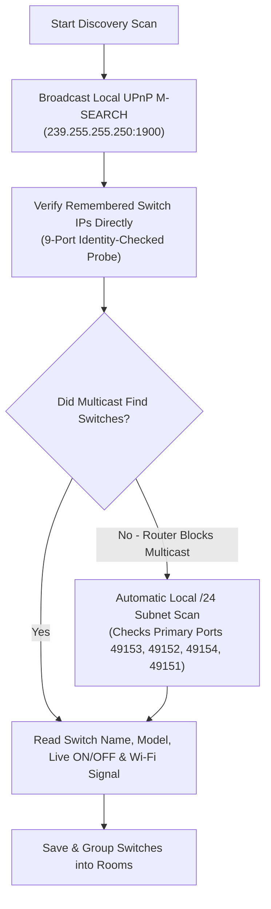

# Switch Discovery & Network Scanning

[← Back to User Guide Index](../../USER_GUIDE.md) • [Discovery & Room Grouping Architecture (`DISCOVERY_AND_ROOM_GROUPING.md`)](../../DISCOVERY_AND_ROOM_GROUPING.md)

**WeMi Light Control** finds switches, dimmers, motion sensors, and mini smart plugs from Belkin's discontinued smart switch platform directly on your home Wi-Fi—using standard local **UPnP / SSDP discovery** backed by an automatic **subnet fallback scan** and **self-healing reconnection** whenever a router changes IP addresses or ports.

> [!NOTE]
> Setting up a brand-new or factory-reset switch that is blinking and broadcasting its own `WeMo.Light.xxx` / `Wemo.LS3W.xxx` Wi-Fi network? Follow **[Fresh Device Setup & Zero-Cloud Wi-Fi Provisioning (`10.22.22.1`)](fresh-device-setup.md)** first so the switch joins your home Wi-Fi.

---

## 1. Ways to Scan for Switches

Make sure your phone, tablet, Chromebook, or Android TV is connected to the same home network as your switches, then start a scan from any of these places:
1. **Top Header Refresh Button**: Tap the circular **Refresh** icon in the top-right header bar to open the live scanner sheet.
2. **Pull-to-Refresh**: Swipe down on the **Devices** list to re-check saved switches and automatically pick up new ones in the background.
3. **Add Device Dialog**: Tap **`+`** in the top header and tap **`Scan Local Wi-Fi (SSDP UPnP)`**.
4. **SSDP Local Network Discovery Banner**: Shown automatically on an empty Wi-Fi Home or while a scan is running (and hides automatically once your switches are populated so your list stays uncluttered).
5. **More Tab**: Open **More** and tap **`Scan LAN (SSDP)`**.

---

## 2. Using the SSDP Network Discovery Scan Sheet

When the **SSDP Network Discovery Scan** bottom sheet opens, it immediately starts scanning your local Wi-Fi:

1. **Search Target (`ST Header`) Filter Chips**:
   - **`Belkin BasicEvent`** *(Recommended default)* — Fast, focused search for compatible smart switches, dimmers, and plugs.
   - **`All Smart Switch Devices`** — Broad search across all Belkin smart-device categories.
   - **`UPnP Root Devices`** — Queries all UPnP devices on your network and filters for compatible smart switches. Helpful if a switch doesn't answer the default target.
   - Tapping a different filter chip immediately starts a fresh scan using that target.
2. **Live Scan Status Box**:
   Shows your device's local IP address (labeled `(ChromeOS VM)` on Chromebooks), scan duration in milliseconds, the multicast search header being broadcast, and any `/24` subnet swept during fallback discovery.
3. **Discovered Devices List**:
   Each found switch displays:
   - Its **auto-classified icon** (`Tree Lights`, `Fan`, `Light`, `Motion`, or `Switch`) and live **`ON`** / **`OFF`** pill.
   - Its hardware name, response time (`ms`), IP address and UPnP port (for example, `192.168.1.104:49153`), model SKU, and serial number.

---

## 3. Adopting Discovered Switches

- **Automatic Adoption on an Empty Home**:
  When you scan a Wi-Fi Home that has **0 saved switches** in Real LAN Mode, WeMi automatically adopts every switch it finds and groups them into rooms based on their names.
- **Adopting One Switch at a Time**:
  Tap **`Adopt`** on any new switch card to add it to your active Wi-Fi Home. Switches that are already saved and reachable show **`Adopted`** with a checkmark—tapping **`Adopted`** refreshes that switch's latest IP, port, and metadata.
- **Adopting Everything at Once (`Adopt All`)**:
  Tap **`Adopt All`** above the discovered list (or tap **`Rescan`** to run another sweep) to add and sync every discovered switch in a single tap.

---

## 4. How Discovery & Self-Healing Work Automatically

- **Works Even on Strict Mesh Routers**: Some mesh routers and guest/IoT networks block multicast discovery packets. If multicast gets zero responses on your home Wi-Fi, WeMi automatically falls back to scanning your local `/24` network directly across the primary smart-switch ports (`49153, 49152, 49154, 49151`) while checking already-saved switch IPs in parallel.
- **Automatic 9-Port Self-Healing**: Smart switch firmware routinely changes its internal port (`49151–49159`) after a power flicker or reboot. Whenever a switch doesn't answer on its saved port, WeMi automatically checks all 9 ports at that IP and verifies the switch's unique hardware ID before sending your command—so it never toggles the wrong switch.
- **Automatic Recovery After Router IP Changes**: If your router gives a switch a new IP address, WeMi runs a targeted rediscovery pass, matches the switch by its unique serial number or UPnP ID, and updates its saved IP and port automatically (both inside the app and for pinned Home Screen widgets).
- **Special Characters in Names**: Switch names and Wi-Fi names with symbols like `&` or apostrophes (`'`) are decoded cleanly during discovery.

---

## 5. Using WeMi on Chromebooks (ChromeOS)

Chromebooks run Android apps inside a virtual network (`100.115.92.x`), separate from your home router's physical LAN (such as `192.168.1.x` or `192.168.86.x`). WeMi handles this automatically with zero extra permissions:

- **Automatic Multicast & Smart Physical-Subnet Detection**: WeMi binds discovery to your Chromebook's active Wi-Fi or Ethernet connection so ChromeOS forwards discovery requests and switch replies across the VM boundary. If your router drops multicast, WeMi avoids scanning ChromeOS's virtual `100.115.92.x` network and instead scans your physical home subnet using hints from your saved Home, remembered switches, router UPnP responses, or local DNS.
- **Guided Manual Home Subnet Scan (Strict / Isolated Routers)**: If you are setting up on a Chromebook for the first time on a router that blocks all multicast and uses public DNS (such as `8.8.8.8`), open the **SSDP Network Discovery Scan** sheet. When zero switches are found inside ChromeOS's virtual network, a **`ChromeOS Virtual Network Detected`** card appears inside the scanner:
  1. Type your home router's IPv4 subnet prefix into **`Home Subnet (e.g. 192.168.1)`** (for example, `192.168.1` or `192.168.86`).
  2. Tap **`Scan Subnet`**.
  3. Once switches are found, your Home profile automatically remembers that physical subnet for future scans.
- **Smooth 15-Second State Sync**: Because physical switches cannot send inbound push notifications back across ChromeOS's virtual NAT, WeMi skips push subscriptions on Chromebooks (keeping 2nd-Gen RTOS switches responsive) and refreshes switch states automatically every **15 seconds** while the app is open.
- **VPN Tip**: If you have a VPN enabled in ChromeOS or Android, pause it while scanning for or controlling local home switches so traffic stays on your local LAN.
