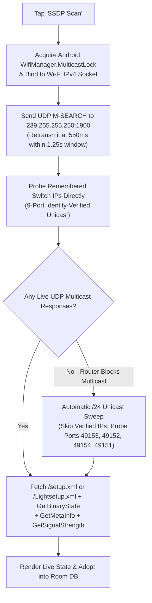

# Switch Discovery & Network Scanning

[← Back to User Guide Index](../../USER_GUIDE.md) • [Discovery & Room Grouping Architecture (`DISCOVERY_AND_ROOM_GROUPING.md`)](../../DISCOVERY_AND_ROOM_GROUPING.md)

**WeMi Light Control** discovers switches, dimmers, and mini plugs from Belkin's discontinued smart switch platform directly over your local Wi-Fi network using standard **UPnP / SSDP multicast discovery** backed by an automatic **unicast `/24` port-sweep fallback** and **self-healing port/IP reconnection**.

> [!NOTE]
> Looking to set up a brand-new or factory-reset switch that is broadcasting its own `WeMo.Light.xxx` Wi-Fi network? See [Fresh Device Setup & Zero-Cloud Wi-Fi Provisioning (`10.22.22.1`)](fresh-device-setup.md).

---

## 1. Ways to Discover Switches

You can trigger a local network discovery scan at any time:
1. **Top Header Radar / Refresh Button**: Tap the **Refresh** icon in the top-right header bar.
2. **Pull-to-Refresh**: Swipe down on the **Devices** list to refresh existing switches and scan for new ones in the background.
3. **Add Device Dialog**: Tap **`+`** in the top header and tap **`Scan Local Wi-Fi (SSDP UPnP)`**.
4. **SSDP Local Network Discovery Banner**: Appears automatically on an empty Wi-Fi Home or while a scan is active (and hides automatically once your switches are populated).

---

## 2. Using the SSDP Network Discovery Scanner Sheet

When you open the **SSDP Network Discovery Scan** bottom sheet:

1. **SSDP Search Target (`ST` Header) Filter Chips**:
   Choose which UPnP search target to broadcast on `239.255.255.250:1900`:
   - **`Belkin BasicEvent`** (`urn:Belkin:service:basicevent:1`) — Recommended default; targets compatible smart switches, dimmers, and plugs directly.
   - **`All Smart Switch Devices`** (`urn:Belkin:device:**`) — Broad Belkin device search.
   - **`UPnP Root Devices`** (`upnp:rootdevice`) — Queries all UPnP root devices on the LAN and filters for Belkin smart switch descriptors (`/setup.xml` / `/Lightsetup.xml`).
2. **Live Scan Telemetry Box**:
   Displays your phone or TV's local Wi-Fi IPv4 address (e.g., `Local Interface: 192.168.1.50`), scan duration in milliseconds, and the exact `M-SEARCH` packet header being broadcast.
3. **Discovered Devices List**:
   Every discovered smart switch is shown with:
   - Its **auto-classified visual icon** (`Christmas Tree`, `Fan`, `Light`, `Motion`, or `Switch`) reflecting its live `ON` / `OFF` state on the network.
   - Its hardware `<friendlyName>`, response time (`ms`), IPv4 address and UPnP port (`192.168.1.104:49153`), and hardware model/serial number.

---

## 3. Adopting Discovered Switches

- **Auto-Adoption on a New / Empty Wi-Fi Home**:
  When you run a scan on a Wi-Fi Home that currently has **0 saved switches** in Real LAN Mode, all discovered smart switches are **automatically adopted** into your list and assigned to rooms based on their names.
- **Adopting Individual Switches**:
  In the SSDP Scanner sheet, tap **`Adopt`** (or **`Update`** if the switch is already saved) on any discovered device card.
- **Batch Adoption (`Adopt All`)**:
  Tap **`Adopt All`** at the top right of the scanner list to add and synchronize every discovered switch in one tap.

---

## 4. How Discovery Works Behind the Scenes

- **Known-Device Direct Probing & Unicast `/24` Fallback for Strict Routers**: Some mesh routers and guest/IoT VLANs drop UDP multicast packets (`239.255.255.250:1900`). Every scan probes previously saved switch IPs directly in parallel (verifying `<serialNumber>` / `<UDN>` and isolating synthetic placeholder serials so multiple manual entries never suppress each other), and switches Search Targets cleanly without dropping scans if you tap a new filter chip mid-scan. Whenever UDP multicast receives zero live responses on a normal LAN subnet (excluding `10.22.22.x` Setup APs), **WeMi Light Control** automatically sweeps the remaining hosts on your active `/24` subnet (skipping your phone's IP and any already-verified switch IPs) across primary UPnP ports (`49153, 49152, 49154, 49151`) for `/setup.xml` and `/Lightsetup.xml`—decoding XML entities like `&` and `'` in switch names and router SSIDs—so newly installed or DHCP-relocated switches are still found even when remembered switches already exist.
- **9-Port Smart Probing & Self-Healing Reconnection**:
  Switch firmware frequently shifts its HTTP SOAP listener across ports `49151–49159` after a power blink or firmware reboot. Whenever a switch stops responding on its old port or IP:
  1. **Stage 1 (9-Port Sweep)**: The app probes all 9 candidate ports (`49153, 49152, 49154, 49151, 49155..49159`) at the last-known IP and verifies the hardware `<serialNumber>` / `<UDN>` in `/setup.xml`.
  2. **Stage 2 (Serial/UDN-Matched SSDP Re-Discovery)**: If the router assigned the switch a new DHCP IP address, the app runs a targeted discovery pass, matches the switch by its unique `<serialNumber>` or `<UDN>` (preventing factory-named switches from ever cross-matching across peers), and updates its IP and port automatically—both in the app and for pinned Home Screen widgets.

---

## 5. Using WeMi Light Control on Chromebooks (ChromeOS)

Chromebooks run Android apps inside a virtual network (`100.115.92.x`), separate from your home router's physical LAN subnet (such as `192.168.1.x` or `192.168.86.x`):

- **Automatic Multicast & Smart Subnet Fallback**: **WeMi Light Control** automatically binds SSDP discovery to your Chromebook's active Wi-Fi or Ethernet network so ChromeOS forwards `M-SEARCH` requests and replies across the VM boundary. If your router drops multicast, the app automatically avoids scanning ChromeOS's virtual `100.115.92.x` subnet and falls back to your saved Home subnet, remembered switch IPs, or local router UPnP/DNS hints.
- **Manual Home Subnet Scan (Multicast-Blocked Routers)**: If you are launching on a Chromebook for the first time on a router that blocks all multicast discovery, open the **SSDP Network Discovery Scan** sheet. When zero switches are found inside a ChromeOS virtual network, the scanner displays a **ChromeOS Virtual Network Detected** box where you can enter your home router's IPv4 prefix (for example, `192.168.1` or `192.168.86`) and tap **Scan Subnet**. Once your switches are found, your Home profile saves that physical subnet automatically for future scans.
- **Live State Sync**: Because physical switches cannot open inbound connections back into ChromeOS's virtual subnet, the app skips GENA push callbacks on Chromebooks and refreshes switch states automatically over local SOAP polling while keeping full toggle, dimmer, and room controls responsive.
- **VPN Note**: If a VPN is active on ChromeOS or inside Android, pause it while discovering or controlling local switches so traffic stays on your home LAN.
