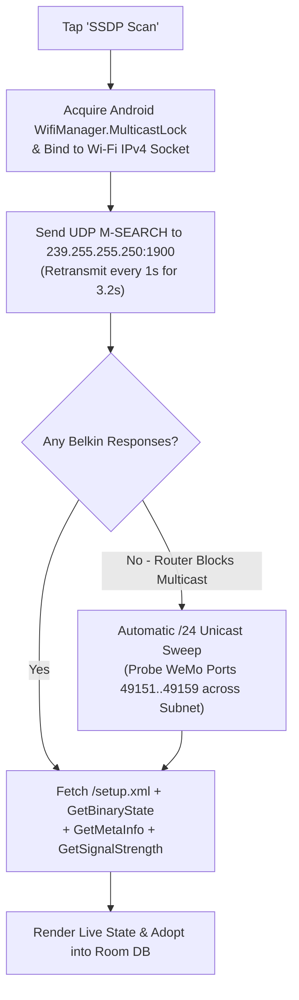

# Switch Discovery & Network Scanning

[← Back to User Guide Index](../../USER_GUIDE.md) • [Discovery & Room Grouping Architecture (`DISCOVERY_AND_ROOM_GROUPING.md`)](../../DISCOVERY_AND_ROOM_GROUPING.md)

**WeMi Light Control** discovers Belkin WeMo switches, dimmers, and mini plugs directly over your local Wi-Fi network using standard **UPnP / SSDP multicast discovery** backed by an automatic **unicast `/24` port-sweep fallback** and **self-healing port/IP reconnection**.

> [!NOTE]
> Looking to set up a brand-new or factory-reset switch that is broadcasting its own `WeMo.Light.xxx` Wi-Fi network? See [Fresh Device Setup & Zero-Cloud Wi-Fi Provisioning (`10.22.22.1`)](fresh-device-setup.md).

---

## 1. Ways to Discover Switches

You can trigger a local network discovery scan at any time:
1. **SSDP Local Network Discovery Banner**: Tap the **`SSDP Scan`** button in the discovery card near the top of the **Devices** tab.
2. **Top Header Radar / Refresh Button**: Tap the **Refresh** icon in the top-right header bar.
3. **Pull-to-Refresh**: Swipe down on the **Devices** list to refresh existing switches and scan for new ones in the background.
4. **Add Device Dialog**: Tap **`+`** in the top header and tap **`Scan Wi-Fi Network (SSDP)`**.

---

## 2. Using the SSDP Network Discovery Scanner Sheet

When you open the **SSDP Network Discovery Scan** bottom sheet:

1. **SSDP Search Target (`ST` Header) Filter Chips**:
   Choose which UPnP search target to broadcast on `239.255.255.250:1900`:
   - **`Belkin BasicEvent`** (`urn:Belkin:service:basicevent:1`) — Recommended default; targets Belkin WeMo switches, dimmers, and plugs directly.
   - **`All WeMi/WeMo Devices`** (`urn:Belkin:device:**`) — Broad Belkin device search.
   - **`UPnP Root Devices`** (`upnp:rootdevice`) — Queries all UPnP root devices on the LAN and filters for Belkin WeMo descriptors (`/setup.xml` / `/Lightsetup.xml`).
2. **Live Scan Telemetry Box**:
   Displays your phone or TV's local Wi-Fi IPv4 address (e.g., `Local Interface: 192.168.1.50`), scan duration in milliseconds, and the exact `M-SEARCH` packet header being broadcast.
3. **Discovered Devices List**:
   Every discovered Belkin WeMo switch is shown with:
   - Its **auto-classified visual icon** (`Christmas Tree`, `Fan`, `Light`, `Motion`, or `Switch`) reflecting its live `ON` / `OFF` state on the network.
   - Its hardware `<friendlyName>`, response time (`ms`), IPv4 address and UPnP port (`192.168.1.104:49153`), and hardware model/serial number.

---

## 3. Adopting Discovered Switches

- **Auto-Adoption on a New / Empty Wi-Fi Home**:
  When you run a scan on a Wi-Fi Home that currently has **0 saved switches** in Real LAN Mode, all discovered Belkin WeMo switches are **automatically adopted** into your list and assigned to rooms based on their names.
- **Adopting Individual Switches**:
  In the SSDP Scanner sheet, tap **`Adopt`** (or **`Update`** if the switch is already saved) on any discovered device card.
- **Batch Adoption (`Adopt All`)**:
  Tap **`Adopt All`** at the top right of the scanner list to add and synchronize every discovered switch in one tap.

---

## 4. How Discovery Works Behind the Scenes

- **Unicast `/24` Fallback for Strict Routers**: Some mesh routers and guest/IoT VLANs drop UDP multicast packets (`239.255.255.250:1900`). If multicast returns zero responses, **WeMi Light Control** automatically sweeps your active `/24` subnet across Belkin's UPnP ports (`49151–49159`) so your switches are still found.
- **9-Port Smart Probing & Self-Healing Reconnection**:
  Belkin WeMo firmware frequently shifts its HTTP SOAP listener across ports `49151–49159` after a power blink or firmware reboot. Whenever a switch stops responding on its old port or IP:
  1. **Stage 1 (9-Port Sweep)**: The app probes all 9 candidate ports (`49153, 49152, 49154, 49151, 49155..49159`) at the last-known IP and verifies the hardware `<serialNumber>` in `/setup.xml`.
  2. **Stage 2 (Serial-Matched SSDP Re-Discovery)**: If the router assigned the switch a new DHCP IP address, the app runs a discovery pass, matches the switch by its unique `<serialNumber>` / `<UDN>`, and updates its IP and port automatically.
